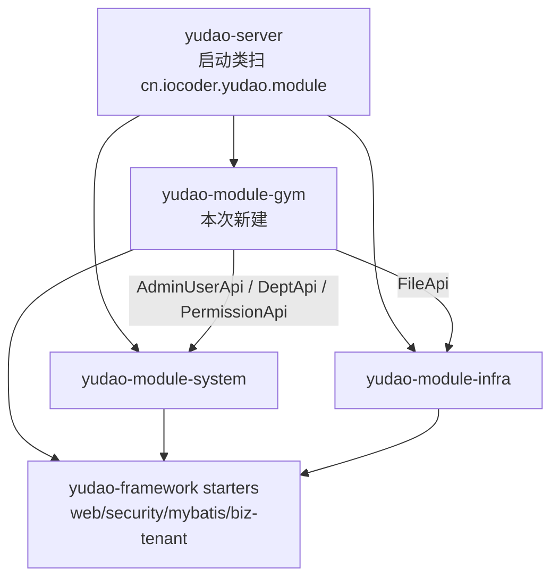

# 变更记录（时间升序）

> 规范见 [`README.md`](README.md)：**每次改动后追加一条**，含 意图 / 改了什么 / 结构关系 / 验证证据 / 影响面 / 未做后续。
> 本文件只追加，不修改历史条目。

| # | 时间 | 主题 | 一句话 |
| --- | --- | --- | --- |
| 1 | 2026-10-13 20:24 ~ 20:36 | [认证切片](#1-2026-10-13-2024-2036-认证切片41-前-5-个接口打通-gym-权限数据落地) | §4.1 前 5 个接口在 yudao 上跑通，落 51 个 gym 权限码与演示账号 |
| 2 | 2026-10-13 20:39 ~ 20:53 | [文件切片](#2-2026-10-13-2039-2053-文件切片41-后-3-个接口新建-yudao-module-gym) | 新建 `yudao-module-gym`，用 Java 实现上传/元数据/内容流 + 越权校验 |
| 3 | 2026-10-13 20:55 ~ 20:57 | [建立 doc 记录体系](#3-2026-10-13-2055-2057-建立-doc-记录体系) | 新增 `doc/`：变更流水 + 结构关系 + 验证清单，并确立「每次改动必记录」规范 |
| 4 | 2026-10-13 21:30 ~ 21:32 | [新增数据排查 SQL 清单](#4-2026-10-13-2130-2132-新增数据排查-sql-清单) | `script/gym/inspect.sql`：8 段只读查询，含同名覆盖缺陷的复现语句 |

---

## 1. [2026-10-13 20:24 ~ 20:36] 认证切片：§4.1 前 5 个接口打通 + gym 权限数据落地

### 意图

规划 `10-backend-mock-api-inventory.md` §4.1 的前 5 行（login / logout / refresh / codes / user info）要迁移到 yudao。
`08-gym-api-contract.md` §4 已明确目标路径是 yudao 原生接口，因此本条的意图**不是再写一套登录接口**，而是：

1. 消除「服务起得来但查不了库」的真实阻塞（原 `application-local.yaml` 写的 `root/12345678` 与本机 MySQL 不符）；
2. 把 51 个 `gym:*` 权限码、总部/门店角色、演示账号落成**数据**（yudao 的权限是数据驱动：`system_menu.permission` + `system_role`），
   否则第 4 个接口 `get-permission-info` 只能返回 yudao 演示数据，前端 `canGym(...)` 一个码都拿不到；
3. 建立可复现的验证手段（脚本 + IDEA 请求集），作为后续所有切片的验收模板。

### 改了什么

| 文件 | 类型 | 说明 |
| --- | --- | --- |
| `yudao-server/src/main/resources/application-local.yaml` | 修改 | L71-72 / L84-85：DB 账号改为 `${GYM_DB_USERNAME:yudao}` / `${GYM_DB_PASSWORD:123456}`，可用环境变量覆盖 |
| `script/gym/sql/01-gym-permission-seed.sql` | 新增 | 幂等种子：1 个「健身管理」根目录 + **51 个 `gym:*` 权限码**（按钮型，不产生路由）+ 2 角色 + 2 部门 + 2 演示账号 |
| `script/gym/seed.sh` | 新增 | 按文件名顺序执行 `script/gym/sql/*.sql`（幂等） |
| `script/gym/verify-auth-api.sh` | 新增 | 5 个认证接口端到端验证，26 条断言（含错误密码、登出失效、门店角色权限收窄的**反向断言**） |
| `script/gym/gym-auth.http` | 新增 | IDEA HTTP Client：登录自动写 `gymToken`/`gymRefresh`，一键跑完 5 个接口 |
| `script/gym/README.md` | 新增 | 认证切片说明（后被文件切片扩充为总说明） |

### 结构关系

本切片**没有新增 Java 类**，改的是「配置 + 数据 + 验证」，与既有代码的关系：

```
前端（GitHub/admin，本次不动）
  └─ POST /admin-api/system/auth/login ─────────┐
  └─ GET  /admin-api/system/auth/get-permission-info
  └─ GET  /admin-api/system/user/profile/get     │  这些路径本来就存在
                                                 ▼
yudao-module-system（既有 Java，未改一行）
  ├─ AuthController.java:66/73/85/93   login / logout / refresh-token / get-permission-info
  ├─ UserProfileController.java:50     profile/get
  └─ AdminAuthServiceImpl.java:100/230/236  登录、刷新、登出的服务实现
        │
        ▼ 读权限（数据驱动）
MySQL：system_menu.permission（51 个 gym:*，由 01-gym-permission-seed.sql 写入）
       system_role / system_role_menu / system_user_role / system_users / system_dept
```

关键结构点：**yudao 的权限码不是 Java 常量，而是 `system_menu.permission` 里的行**。
后续任何 gym 控制器写 `@PreAuthorize("@ss.hasPermission('gym:xxx:yyy')")`，能否通过完全取决于这张表，
这就是本切片必须先落数据的原因。

### 验证证据

```
$ bash script/gym/verify-auth-api.sh
 结果：通过 26 / 失败 0

$ curl -X POST .../system/auth/login -H 'tenant-id: 1' -d '{"username":"gymadmin","password":"Gym@123456"}'
{"code":0,"data":{"userId":252,"accessToken":"...","refreshToken":"...","expiresTime":...},"msg":""}

$ curl .../system/auth/get-permission-info -H "Authorization: Bearer <token>"
{"code":0,"data":{"roles":["gym_hq_admin"],"permissions":[51 个 gym:*],"user":{...}}}
```

幂等性：删净种子行后重跑 `seed.sh` → 再次 26/26 通过；连续跑两次结果一致（51 / 52 / 36 / 2）。

### 影响面 / 风险

- **影响前端联调（重要）**：yudao 多租户开启，**不带 `tenant-id` 请求头会直接 `code=400 请求的租户标识未传递`**。单租户部署可关 `yudao.tenant.enable`，否则前端适配层需补该请求头（前端不在本次范围）。
- 数据库账号从 `root` 改为 `yudao`：仅 `application-local.yaml`（本地 profile），不影响生产配置模板。
- 未见语义回归：yudao 原生认证接口未被改动。

### 未做 / 后续

- 未改任何 Java 代码（这 5 个接口 yudao 基座已实现）；未改前端。
- `homePath` / `authorizedStores`（旧 `/api/user/info` 有、yudao 原生没有）未补，留待前端适配层或后续 gym 专属 profile 接口。
- refresh token 未做「旧 token 立即轮换」（yudao 语义：有效期内不变、可复用），如需一次性轮换要改造 `OAuth2RefreshTokenService`。

---

## 2. [2026-10-13 20:39 ~ 20:53] 文件切片：§4.1 后 3 个接口，新建 yudao-module-gym

### 意图

§4.1 第 6~8 行（上传 / 元数据 / 内容流）在 yudao 基座里**没有**对应实现，且旧 Mock 的语义（魔数嗅探、按类别限制大小、门店/类别越权、私有下载不暴露静态地址）
是 infra 通用文件服务（`@PermitAll` 公开下载 + 全局类型白名单）覆盖不了的。
因此在后端新建自研模块 `yudao-module-gym`，实现这 3 个接口，并**顺带立起 gym 业务模块的骨架**，供后续 185 个业务端点沿用。

### 改了什么

| 文件 | 类型 | 说明 |
| --- | --- | --- |
| `pom.xml` / `yudao-server/pom.xml` | 修改 | 注册并依赖 `yudao-module-gym` |
| `yudao-server/src/main/resources/application.yaml` | 修改 | multipart 上限 16MB → 200MB（video 类别需要，否则 Spring 先拒） |
| `yudao-module-gym/pom.xml` | 新增 | 依赖 system（账号/权限/部门）+ infra（文件存储）+ tenant/web/security/mybatis/test starter |
| `.../controller/admin/file/GymFileController.java` | 新增 | 3 个端点；上传同时映射 `/gym/files` 与 `/gym/files/upload` |
| `.../controller/admin/file/vo/GymFileUploadReqVO.java` | 新增 | multipart 入参：`file` + `category` + `storeId?` |
| `.../controller/admin/file/vo/GymFileRespVO.java` | 新增 | 出参；**刻意不含 infra 存储 url** |
| `.../service/file/GymFileService.java` / `GymFileServiceImpl.java` | 新增 | 上传校验链 + 门店数据范围越权 + 落库（203 行，核心） |
| `.../service/file/dto/GymFileContentDTO.java` | 新增 | 内容流返回（name + mimeType + content），避免 Controller 重复查询 |
| `.../dal/dataobject/file/GymFileDO.java` | 新增 | 继承 `TenantBaseDO`（自动租户隔离 + 逻辑删除） |
| `.../dal/mysql/file/GymFileMapper.java` | 新增 | `BaseMapperX`，注释里给分页写法模板 |
| `.../enums/ErrorCodeConstants.java` | 新增 | 错误码区间 `1_070_000_xxx`（避开其他模块已占用区间） |
| `.../enums/file/GymFileCategoryEnum.java` | 新增 | 5 类别 × 大小上限 × 类型白名单（加枚举即扩展） |
| `.../enums/file/GymFileMimeTypeEnum.java` | 新增 | 7 种支持的 MIME 与扩展名 |
| `.../framework/file/core/utils/GymFileTypeUtils.java` | 新增 | 魔数嗅探 + `writeAttachment`（中文文件名 RFC 5987） |
| `.../test/.../GymFileTypeUtilsTest.java`（5 例）、`GymFileServiceImplTest.java`（10 例） | 新增 | 单测覆盖嗅探、类别、大小、越权、不存在 |
| `yudao-module-infra/.../api/file/FileApi.java` + `FileApiImpl.java` | 修改 | 新增 `getFileContentByUrl(url)`：跨模块读文件内容 |
| `yudao-module-infra/.../service/file/FileService.java` + `FileServiceImpl.java` | 修改 | 新增 `getFileByUrl(url)` |
| `yudao-module-infra/.../dal/mysql/file/FileMapper.java` | 修改 | 新增 `selectByUrl(url)` |
| `script/gym/sql/02-gym-file.sql` | 新增 | `gym_file` 建表（幂等 `CREATE TABLE IF NOT EXISTS`） |
| `script/gym/seed.sh` | 修改 | 改为执行 `sql/` 下全部脚本（不再只跑 01） |
| `script/gym/verify-file-api.sh` | 新增 | 29 条断言，含 5 类反例 |
| `script/gym/gym-files.http` | 新增 | IDEA：文件 3 接口 + 反例 |
| `script/gym/README.md` | 修改 | 扩充为「认证 5 + 文件 3」总说明，新增 §6 扩展清单 |

### 结构关系

**模块依赖（新增的 gym 模块处在 system/infra 之上）**



**上传链路（含校验顺序，早期失败即短路，避免读入超大内容）**

```
POST /admin-api/gym/files  (multipart, @PreAuthorize gym:files:upload)
  └─ GymFileController#uploadFile
       └─ GymFileServiceImpl#uploadFile
            1 GymFileCategoryEnum.find(category)          → 1070000002 非法类别
            2 file.getSize() vs category.maxSize          → 1070000004 超限（先看元信息，不读内容）
            3 file.getBytes() + GymFileTypeUtils.detect() → 1070000003 无法识别/与后缀或 Content-Type 不一致
            4 category.isMimeTypeAllowed(detected)        → 1070000003 类别白名单
            5 resolveAndValidateStoreId(storeId)          → AdminUserApi 取默认门店 / DeptApi 查存在 / PermissionApi 数据范围
                                                          → 1070000005 无门店、1070000006 门店不存在、1070000007 越权
            6 FileApi.createFile(content, name, "gym/"+category, mime)   → 内容交 infra 存储（本地磁盘/DB/S3）
            7 GymFileMapper.insert(GymFileDO)             → 业务归属落 gym_file（租户自动隔离）
```

**下载链路（鉴权 + 越权 + 不暴露 infra 地址）**

```
GET /admin-api/gym/files/{id}/content  (@PreAuthorize gym:files:read)
  └─ GymFileServiceImpl#getFileContent(id)
       ├─ getFile(id)：GymFileMapper.selectById → 1070000001 不存在
       │                validateStorePermission(userId, storeId) → 1070000007 越权
       ├─ FileApi.getFileContentByUrl(file.url)
       │    └─ infra：FileMapper.selectByUrl → FileServiceImpl.getFileContent(configId, path) → 存储客户端读取
       └─ GymFileController 用 GymFileTypeUtils.writeAttachment 输出（Content-Type 用嗅探结果，中文名 RFC 5987）
```

**数据关系**

```
gym_file（本模块新表，TenantBaseDO）
  id / store_id ──────────────► system_dept.id（门店 = 部门；总部角色 all=true，门店角色限本部门及以下）
  uploader_id ────────────────► system_users.id
  url ────────────────────────► infra_file.url（存储凭证，**不出现在任何响应里**）
  category / mime_type / size   业务与安全元数据
```

**权限链（两次校验，互相独立）**

```
① 功能权限：@PreAuthorize("@ss.hasPermission('gym:files:upload'|'gym:files:read')")
              → 取自 system_menu.permission（01 号种子写入的 51 个码）
② 数据权限：PermissionApi.getDeptDataPermission(userId)
              → all=true 放行；否则 storeId 必须 ∈ deptIds（角色 data_scope=1/4）
```

### 验证证据

```
$ mvn -T 1C -pl yudao-module-gym -am test -Dtest='GymFile*Test' -Dsurefire.failIfNoSpecifiedTests=false
 Tests run: 15, Failures: 0, Errors: 0, Skipped: 0        # GymFileTypeUtilsTest 5 + GymFileServiceImplTest 10

$ bash script/gym/verify-file-api.sh
 结果：通过 29 / 失败 0

$ bash script/gym/verify-auth-api.sh      # 回归
 结果：通过 26 / 失败 0
```

29 条断言中的关键反例（真跑出来的，不是静态结论）：

| 场景 | 期望 | 实际 |
| --- | --- | --- |
| PDF 内容改名 `.png` 传 image 类别 | 类型不匹配 | `code=1070000003`，msg 指出实际 `application/pdf` |
| 合同 PDF 传成 `image` 类别 | 类别白名单拦截 | `code=1070000003` |
| 11MB PNG 传 `image`（上限 10MB） | 超限 | `code=1070000004` |
| 未知类别 `coupon` | 非法类别 | `code=1070000002` |
| `gymstore` 读总部门店文件的元数据/内容 | 越权拒绝 | 两次均 `code=1070000007` |
| `gymstore` 读本店文件 / `gymadmin` 跨店读 | 正例放行 | `code=0` |
| 下载内容与上传文件 | 逐字节一致 | `cmp` 通过，`Content-Type: image/png` |
| 响应体是否含 infra 存储地址 | 不含 | `url`/`path` 字段均不存在 |

### 影响面 / 风险

- **infra 模块被扩展**（新增 3 个方法，未改既有签名）：对其他模块无破坏性影响；`FileApi` 是跨模块契约，新增方法属向后兼容。
- **multipart 上限放宽到 200MB**（全局配置）：所有上传接口都受益/受影响；业务侧仍有分类别上限兜底（10/20/200MB）。
- **新表 `gym_file`**：需要在所有环境执行 `script/gym/sql/02-gym-file.sql`（`seed.sh` 已包含）。
- 文件内容落在 infra 配置的存储上（本机默认存储配置），**进程重启不再丢文件**——与旧 Mock「内存存储、重启即失效」不同。
- 越权语义从旧 Mock 的 HTTP 404 变为业务码 `1070000007`（403 语义），前端提示文案需按 code 分支。

### 未做 / 后续

- 未做文件列表/分页接口（前端暂无该页面），`GymFileMapper` 注释里给了写法模板。
- 未做文件删除/清理（旧 Mock 也没有 DELETE；GC 策略待定）。
- 未做「按业务单据绑定」（`businessType`/`businessId`），等合同/审批模块落地后再加外键式关联。
- 未改前端：`admin` 仓库里 `yudaoAdapter.uploadFile` 目前仍指向 `/admin-api/infra/file/upload`，联调时需改为 `/admin-api/gym/files/upload`（属前端范围）。

---

## 3. [2026-10-13 20:55 ~ 20:57] 建立 doc 记录体系

### 意图

代码已经跨了两个切片（认证、文件），但「改了什么 / 为什么改 / 结构关系」只散落在对话与脚本注释里，评审时需要重新拼。
因此建立 **`doc/` 记录体系**，并把「每次改动后按时间顺序追加一条」定为流程的一部分，
让后续每个切片都能被独立审查，而不是依赖记忆。

### 改了什么

| 文件 | 类型 | 说明 |
| --- | --- | --- |
| `doc/README.md` | 新增 | 目录定位、阅读顺序、**记录规范**（条目格式 + 6 个必写段落 + 模板）、验证入口速查 |
| `doc/CHANGELOG.md` | 新增 | 变更流水账（时间升序）：本条 + 追溯补齐认证切片、文件切片两条历史记录 |
| `doc/architecture.md` | 新增 | 结构关系：模块依赖图、两条请求链路、数据模型与拆表理由、双道权限校验、代码地图、扩展点、与规划文档的对应 |
| `doc/testing.md` | 新增 | 三层验证策略、环境依赖、命令清单与当前结论数字、**已知测试盲区**、失败排查顺序 |

### 结构关系

本目录**不参与构建**（不被 Maven 打包、不影响运行时），只做记录；它与代码/脚本/规划文档的对应关系：

```
GitHub/admin/target/plan/            （规划：合同范围、08 接口契约、09 权限码、10 旧 Mock 盘点）
        │  需求与契约来源
        ▼
doc/CHANGELOG.md    ── 时间线：每次改动改了什么 / 意图 / 结构关系 / 证据
doc/architecture.md ── 结构：模块依赖、请求链路、数据模型、权限链、扩展点
doc/testing.md      ── 验证：三层策略 + 命令 + 当前结论 + 盲区
        │  指向实现与证据
        ▼
yudao-module-gym/（Java 实现）  script/gym/（种子 SQL、验证脚本、IDEA 请求、运维说明）
```

### 验证证据

- 文件存在性：`ls doc/` → `README.md` / `CHANGELOG.md` / `architecture.md` / `testing.md`
- 文内引用可解析：`script/gym/README.md`、`doc/CHANGELOG.md`、`doc/architecture.md`、`doc/testing.md` 均存在
- 无代码/配置改动 → 未重跑构建与测试；上一轮结论仍然有效（单测 15/15、认证 26/26、文件 29/29）
- 记录中的数字与代码现状核对一致：`GymFileServiceImpl.java` 203 行、gym 模块 Java 合计 1249 行（`wc -l`）

### 影响面 / 风险

- 对构建、运行时、接口行为**零影响**（纯文档）。
- 唯一约束是流程约束：后续改动如果不追加条目，`CHANGELOG.md` 会出现时间断层，评审时需注意。

### 未做 / 后续

- 未把 `admin/target/plan/` 的规划文档复制进本仓库（避免两份真相冲突，仅在文中引用）。
- 未加自动化校验（例如 CI 检查「有代码改动但 CHANGELOG 无新条目」），后续可按需加一个 `script/ci/check-changelog.sh`。
- 历史记录（#1、#2）是**追溯补齐**的，时间取自文件 mtime 与构建日志，误差在分钟级。

---

## 4. [2026-10-13 21:30 ~ 21:32] 新增数据排查 SQL 清单

### 意图

需要用 GUI 客户端（Sequel Ace / PyCharm Database / DBeaver）直接查库来审查成果，
但排查 SQL 之前只散落在对话里，每次都要重新拼。把已验证的查询固化成文件，客户端点开即跑，
同时把「文件同名覆盖」这个已知缺陷做成一条可复现的检查语句。

### 改了什么

| 文件 | 类型 | 说明 |
| --- | --- | --- |
| `script/gym/inspect.sql` | 新增 | 8 段只读查询：① 权限码 ② 角色与授权规模 ③ 门店/账号 ④ 模拟 get-permission-info ⑤ 文件列表与汇总 ⑥ 文件真实存储位置 ⑦ 同名覆盖缺陷排查 ⑧ 种子数据总览 |
| `doc/CHANGELOG.md` | 修改 | 本条记录 |

### 结构关系

```
script/gym/
├── seed.sh            写：建表 + 权限码 + 演示账号（幂等）
├── verify-*.sh        验：断言接口行为（通过/失败，退出码非 0 表示失败）
├── inspect.sql        查：只读看数据全貌与缺陷复现（本文件，不参与构建）
├── gym-*.http         IDEA 里逐个点接口
└── sql/*.sql          被 seed.sh 顺序执行
```

与 `verify-*.sh` 的分工：验证脚本回答「接口行为对不对」，`inspect.sql` 回答「库里到底是什么」。
两者都用同一套演示数据（`gymadmin` / `gymstore` / 51 权限码）。

### 验证证据

用项目账号整文件执行（只读，未改任何数据）：

```bash
$ mysql -uyudao -p123456 ruoyi-vue-pro < script/gym/inspect.sql
```

关键输出：

| 查询 | 结果 |
| --- | --- |
| ① gym 权限码 | 51 |
| ② 角色 / ⑤ 角色授权行 | 2 / 88 |
| ③ 演示账号 / ④ 门店部门 | 2 / 2 |
| ④ gymadmin / gymstore 权限码数 | 51 / 35（与接口返回一致） |
| ⑥ gym_file 行 | 12（验证脚本留下的记录） |
| ⑦ 同名覆盖排查 | `gym/contract/20261013/contract.pdf` 命中 **6 行** infra_file（缺陷复现成功） |

### 影响面 / 风险

- 全部是 `SELECT`，对数据零写入；可随时重复执行。
- ⑦ 的输出说明「同名同天上传互相覆盖」的缺陷**仍然存在**（尚未修复），修复前上传同名文件需注意。

### 未做 / 后续

- 未修 ⑦ 的覆盖缺陷（方案 A：打开 infra 的 `PATH_SUFFIX_TIMESTAMP_ENABLE`；方案 B：gym 侧目录加唯一片段，待决策）。
- 未加 CI 校验（如自动跑 `inspect.sql` 比对期望行数）。

## [2026-10-13 22:44 ~ 22:57] 对齐当前 JSS 前端，交付门店与员工首批 API

### 意图

先查阅 dashboard 当前 `targets/handoff/backend-priorities.md` P0/P1、`targets/plan/08-gym-api-contract.md`、`09-permissions.md`、`apps/web-jss/integration/backend-contract.md`/`menus.json` 和实际 stores/employees 页面及通用编辑器。结论：首批应解除菜单/门店/员工/数据隔离阻塞，当前 REST 与历史 `/page` 草案不同。按用户要求仅修改后端，前端只读。

### 改了什么

以下为本次新增或在既有未提交切片上修改的文件，不把此前 pom/infra/配置改动计作本次工作。

| 路径（相对 server） | 类型 | 说明 |
| --- | --- | --- |
| `yudao-module-gym/src/main/java/cn/iocoder/yudao/module/gym/controller/admin/common/GymPageReqVO.java` | 新增 | 页码/大小、关键词、状态和门店筛选 |
| `…/controller/admin/store/GymStoreController.java`、`…/store/vo/GymStore{SaveReq,Resp,MediaReq}VO.java` | 新增 | 门店四个基础接口及媒体替换；字符串 ID、营业时间/媒体嵌套响应 |
| `…/controller/admin/employee/GymEmployeeController.java`、`…/employee/vo/GymEmployee{SaveReq,Resp}VO.java` | 新增 | 员工四个基础接口；多店任职和账号关系 |
| `…/service/store/GymStoreService.java` | 新增 | 行 35 分页范围、58 新增部门/档案事务、82 PATCH 行锁、98 媒体校验替换 |
| `…/service/employee/GymEmployeeService.java` | 新增 | 行 34 授权 EXISTS 分页、75 PATCH 全任职范围校验、113 账号权限/主部门校验 |
| `…/service/common/GymDataScope.java`、`GymPatchUtils.java` | 新增 | 共用门店范围和部分更新合并 |
| `…/dal/dataobject/{store,employee}/Gym{Store,StoreMedia,Employee,EmployeeStore}DO.java` | 新增 | 四个 TenantBaseDO 业务模型 |
| `…/dal/mysql/{store,employee}/Gym{Store,StoreMedia,Employee,EmployeeStore}Mapper.java` | 新增 | CRUD、主记录锁定、整体替换关系 |
| `…/enums/ErrorCodeConstants.java` | 修改 | 门店/员工 12 个错误码 |
| `…/controller/admin/file/vo/GymFileRespVO.java` | 修改 | 补原文件名/字节数别名，业务 ID 改字符串，保留 name/size |
| `yudao-module-gym/pom.xml` | 修改 | 更新实现范围说明，无依赖改动 |
| `script/gym/sql/03-gym-store-employee.sql` | 新增 | 四业务表、租户/逻辑删除、唯一索引 |
| `script/gym/sql/04-gym-first-batch-menus.sql` | 新增 | 增量注册两个已交付页面，保留原权限 ID/授权 |
| `script/gym/verify-migrations.py`、`gym-organization.http` | 新增 | 隔离 MySQL 幂等验证及手工 API 请求 |
| `script/gym/verify-file-api.sh`、`README.md` | 修改 | 适配字符串文件 ID 的断言，链接本批交接 |
| `yudao-module-gym/src/test/java/…/service/GymOrganizationServiceTest.java` | 新增 | 17 个实际 DB/事务/方法权限测试 |
| `yudao-module-gym/src/test/resources/application-unit-test.yaml`、`sql/create_tables.sql`、`sql/clean.sql` | 新增 | 隔离 H2、租户拦截器、数据库约束与清理 |
| `docs/gym-first-batch-api.md` | 新增 | 完整更改/契约交接：字段、权限、错误码、部署、回退及未实现项 |
| `docs/README.md`、`architecture.md`、`testing.md`、`backend-contract.md`、`CHANGELOG.md` | 修改 | 当前入口、结构与可复现证据；旧快照标注新交接位置 |

### 结构关系

Controller 操作权限 → Service → GymDataScope/PermissionApi 的 system 部门范围 → MyBatis 租户过滤 → gym 表。门店 ID 等于 system_dept.id，新建部门与门店同事务；员工关联已有 system_users，不新建登录/RBAC。员工任职参与授权分页，读关联关系裁剪到授权门店，修改共享档案要求原/新全门店范围。主记录行锁保护 PATCH/关系替换；任职/媒体关系仅整体替换时删除关系行，业务档案不删除。详见 architecture.md 与新交接文档。

### 验证证据

- `mvn -q -pl yudao-module-gym -am test -Dtest='Gym*Test' -Dsurefire.failIfNoSpecifiedTests=false -DargLine='-javaagent:/Users/hh/.m2/repository/org/mockito/mockito-core/5.23.0/mockito-core-5.23.0.jar'`：退出 0；组织 17 + 文件 Service 12 + 类型工具 5 = **34 tests，0 failures，0 errors，0 skipped**。报告位于 gym/target/surefire-reports。首次默认 JVM 动态附加失败，改用启动 agent 后通过，不改项目测试/生产 JVM 配置。
- `mvn -q -DskipTests -pl yudao-server -am package`：退出 0，生成 yudao-server/target/yudao-server.jar。
- `python3 script/gym/verify-migrations.py`：退出 0；实际本机 MySQL 独立随机库验证四业务表、两个页面、四条页面授权，全部 SQL 两次执行记录数一致；测试库随后删除。
- `git -C /Users/hh/Documents/GitHub/dashboard status --short`：输出为空，前端文件未修改。
- `curl --max-time 5 http://127.0.0.1:48080/v3/api-docs` 未取得响应，本次无运行服务/OpenAPI HTTP/前端验收证据。

### 影响面 / 风险

- 当前前端基础路径/字段无需改动即可对接门店/员工首批。文件元数据 ID 由数字改为字符串，其他已有客户端若依赖数字需适配；原 name/size 保留。
- 只读权限/门店范围/租户负例已覆盖；system 外部依赖使用 mock，未覆盖完整 HTTP 中间件链或真实前端浏览器。不得把测试通过当成业务端到端验收。
- 历史演示角色带 payroll:read，会触发尚缺少的员工工资历史接口，员工编辑仍可能被该请求阻断；联调使用仅本批权限的角色或等待工资切片。未伪造历史数据、未擅自撤销既有角色权限。
- 自动页面授权仅租户 1 的两个既有 gym 角色；其他角色和租户需 system 后台授权。业务库未执行迁移，部署需按交接文档执行 SQL、重启及重新登录。
- SQL 保留档案自然键，未来删除/恢复和 ALTER 迁移需要独立设计。媒体/任职事务锁已落地，生产 MySQL 并发压测未执行。

### 未做 / 后续

未改前端，未提交/发布/启动服务，未清库或迁移业务库。未实现工资历史/模板、会员/卡、私教预约签课、删除/导出/批量接口、创建幂等、账号解绑或第三方接入。下一批优先补工资历史与模板以解除员工编辑条件阻塞，再推进会员/权益/预约签课；所有范围依现行交接文档。

## [2026-10-14 20:30 ~ 20:34] 修复文件二进制下载失败被当作成功 Blob

### 意图

修复本次代码审查指出的问题：文件记录或存储内容缺失时，ServiceException 被全局处理器包装成 HTTP 200 错误 JSON，前端 Blob 客户端将它误当作正常文件。依据文件契约的内容下载真实状态约定；用户授权修复，继续仅修改后端。

### 改了什么

| 路径 | 类型 | 说明 |
| --- | --- | --- |
| `yudao-module-gym/src/main/java/cn/iocoder/yudao/module/gym/controller/admin/file/GymFileController.java:94` | 修改 | 局部异常处理复用全局错误转换及日志；按匹配路由仅对内容下载映射 HTTP 404/403/400/500 |
| `yudao-module-gym/src/test/java/cn/iocoder/yudao/module/gym/controller/admin/file/GymFileControllerTest.java` | 新增 | 9 个真实 MVC/方法权限回归测试，覆盖成功、缺失、越权、非法 ID、存储异常及元数据兼容 |
| `script/gym/verify-file-api.sh` | 修改 | 增加内容下载 HTTP 状态及业务码断言 |
| `script/gym/README.md` | 修改 | 更新内容下载错误状态契约 |
| `docs/testing.md`、`docs/CHANGELOG.md` | 修改 | 记录测试证据及本次报告 |

### 结构关系

文件 Controller 的局部异常处理调用既有 GlobalExceptionHandler.allExceptionHandler，保留 CommonResult 错误码/错误日志。根据 MVC 实际匹配路由辨别内容下载，记录/内容缺失映射 404，跨店和操作权限失败映射 403，参数错误映射 400，未知存储异常映射 500。成功下载继续走原文件输出链；上传/元数据保持 HTTP 200 + body code。纯错误处理修复，不改变模块/数据库结构。

### 验证证据

- `mvn -q -pl yudao-module-gym -am test -Dtest='Gym*Test' -Dsurefire.failIfNoSpecifiedTests=false -DargLine='-javaagent:/Users/hh/.m2/repository/org/mockito/mockito-core/5.23.0/mockito-core-5.23.0.jar'`：退出 0，**43 tests，0 failures，0 errors，0 skipped**。其中新增控制器回归 9 个，验证真实 MVC 错误 JSON/HTTP 状态和 @PreAuthorize 拒绝；Service 为 mock。
- `bash -n script/gym/verify-file-api.sh`：退出 0；本次未对运行服务执行该脚本。
- `mvn -q -DskipTests -pl yudao-server -am package`：退出 0。
- `git diff --check`：退出 0；dashboard 的 `git status --short` 为空，前端文件未修改。

### 影响面 / 风险

二进制下载失败现在返回非成功 HTTP 状态，Blob 请求可进入错误分支；业务 code 保留，支持已有错误提示。元数据/上传响应约定不变。未修改共享全局异常处理器，对其他模块不改变 HTTP 约定。本次 MVC 测试不覆盖安全 Filter 层、真实存储渠道或前端浏览器；已提交/暂存的其他改动均保留原状态，未重新暂存。

### 未做 / 后续

未改前端、未改数据库、未部署/启动服务。真实服务下载回归可在部署后执行 `script/gym/verify-file-api.sh`；未新增其他业务接口。

## [2026-10-14 20:44 ~ 20:46] 修复门店服务误注入 infra 文件 Mapper 导致启动失败

### 意图

修复用户启动反馈的 `fileMapper` Bean 类型不匹配。问题来自 `@Resource` 优先按字段名查找：门店服务期望 GymFileMapper，却因字段名 fileMapper 命中 infra 的同名 Bean。Mapper 已正常注册，JDK 代理不是问题原因。

### 改了什么

| 路径 | 类型 | 说明 |
| --- | --- | --- |
| `yudao-module-gym/src/main/java/cn/iocoder/yudao/module/gym/service/store/GymStoreService.java:30` | 修改 | 注入字段改为 gymFileMapper，并更新两个调用点，匹配实际 Mapper Bean 名称 |
| `yudao-module-gym/src/test/java/cn/iocoder/yudao/module/gym/service/GymOrganizationServiceTest.java` | 修改 | 增加 infra 文件包真实 Mapper 扫描，验证两种文件 Mapper 同时存在及门店媒体读写 |
| `docs/testing.md`、`docs/CHANGELOG.md` | 修改 | 补充修复前复现、修复后回归和验证边界 |

### 结构关系

GymStoreService 继续依赖 gym 文件 Mapper，只修正字段名与 Bean 名称匹配。infra FileMapper 和 GymFileMapper 保持各自 MyBatis JDK 代理，不改全局代理或扫描机制。纯注入修复，不改变架构和数据库。

### 验证证据

- 修复前新增双模块 Mapper 注册后执行 `mvn -q -pl yudao-module-gym -am test -Dtest='GymOrganizationServiceTest#bothFileMappersCoexistAndStoreMediaUsesGymMapper' -Dsurefire.failIfNoSpecifiedTests=false -DargLine='-javaagent:/Users/hh/.m2/repository/org/mockito/mockito-core/5.23.0/mockito-core-5.23.0.jar'`：退出 1，复现用户同款 BeanNotOfRequiredTypeException。
- 修复后执行相同 Maven 命令，测试选择改为 `-Dtest='Gym*Test'`：退出 0，**44 tests，0 failures，0 errors，0 skipped**，其中组织 18、文件服务 12、类型工具 5、文件控制器 9。实际双 Mapper Spring 上下文初始化和媒体持久化通过。
- `mvn -q -DskipTests -pl yudao-server -am package`：退出 0。
- `git diff --check`：退出 0；dashboard 的 `git status --short` 为空。

### 影响面 / 风险

修复后门店服务在 infra/gym 同时加载时注入正确的文件 Mapper。此前组织测试只扫描 gym，未发现名称冲突；本次已将跨模块共存加入回归环境。未更改前端、共享扫描配置、代理类型或数据库，HTTP 契约不变。

### 未做 / 后续

未启动连接业务数据库/Redis 的完整服务，未修改部署环境。用户可重新运行 IDE 应用验证完整启动；本次已生成新版 jar，未自动提交或推送此修复。

## [2026-10-14 21:09 ~ 21:25] 将旧 PostgreSQL 首批种子转换并导入 MySQL 开发库

### 意图

用户提供 `/Users/hh/Documents/GitHub/database/` 种子，要求放入项目开发数据库；确认选择“先导入已实现模块，其他列入待导入清单”。先阅读源模型及种子，再对齐当前 MySQL/system/gym 模型，未把旧 README 的 PostgreSQL/Go 执行流程当成当前项目指令。

### 改了什么

| 路径/目标 | 类型 | 说明 |
| --- | --- | --- |
| `script/gym/development/01-legacy-organization.sql` | 新增 | 首批 MySQL 转换种子，事务/自然键幂等/人工同名冲突守卫；不自动挂入常规 seed.sh |
| `script/gym/verify-legacy-seeds.py` | 新增 | 临时库验证二次导入、实际字段关联及同名冲突回滚 |
| `docs/development-seed-import.md` | 新增 | 实际 ID 映射、账号/权限、待导入模块与数量、备份及操作证据 |
| `docs/README.md`、`script/gym/README.md`、`docs/CHANGELOG.md` | 修改 | 导入入口与记录 |
| `127.0.0.1:3306/ruoyi-vue-pro`，租户 1 | 数据库变更 | 执行既有 03/04 增量迁移与新转换种子；新增 28 行、补建四业务表、转换两个已有业务页面 |

### 结构关系

旧 stores UUID 通过 code 映射为 system_dept / gym_store 的 Long ID；employee_no 映射员工，任职关联转换为 gym_employee_store；旧 admin_accounts 映射 system_users，旧角色按已实现权限子集映射 system_role/menu。账号主部门与员工主门店一致，权限保持 source 授权。源 scrypt 校验后改用 BCrypt，不引入旧登录/RBAC 表。未建立新架构或旧模型影子表。

### 验证证据

- `python3 script/gym/verify-legacy-seeds.py`：退出 0；独立随机 MySQL 库验证 2 门店、2 员工、2 任职、3 账号、2 角色、两轮幂等及同名冲突拒绝/回滚；测试库已删除。
- 正式导入前 `mysqldump --single-transaction --no-tablespaces --set-gtid-purged=OFF` 备份此次涉及的已有表到 `/tmp/gym-development-before-seeds-1dtpy3up.sql`（600 权限）。执行 03/04 及转换 SQL，退出 0；转换种子连续执行两次，第二次记录数不变。
- 新增：system_dept 2、system_users 3、system_role 2、system_role_menu 12、system_user_role 3、gym_store 2、gym_employee 2、gym_employee_store 2，共 28 行。
- SQL 查询核对 SH001/SH002 → 126/127；E001/E002 → 1/2；hq/store1/store2 → 254/255/256；gym_dev_hq/gym_dev_store → 173/174。两员工主门店与对应账号部门一致。
- 实际入库的 3 个账号密码使用 Spring Security BCryptPasswordEncoder 验证通过，仅输出匹配数量，不输出哈希。
- `curl --max-time 5 http://127.0.0.1:48080/v3/api-docs` 未取得运行服务响应，无 HTTP/前端验收证据。

### 影响面 / 风险

数据仅进入本机开发库租户 1，源目录和前端文件未修改。现有用户/密码/业务数据未覆盖。门店角色保持旧种子只读资料权限，总部角色允许首批写入；不授予未实现的工资/会员/支付等权限。开发账号沿用源种子默认密码，属于开发示例。SQL 前置要求已存在总部/根目录/首批权限，不适用于生产初始化或任意租户。

### 未做 / 后续

按用户确认范围未导入会员、课程、合同/审批、设备、工资、营销、支付/分账等未实现模块，详见专门待导入清单。Mock 文件无真实内容，HQ001 缺任职门店，未补造文件/关系。未启动服务、未执行真实登录/浏览器回归，未提交或推送新增导入文件。

## [2026-10-14 21:43 ~ 22:09] 全量 API 任务首轮：薪资闭环及会员基础

### 意图

用户要求实现全部文档 API，仅负责后端，调试后运行前端验证和 review。按现行dashboard 35业务页面的真实请求推进，先解除员工薪资配置编辑阻塞；全量目标仍在进行，详见 gym-full-api-progress.md。

### 改了什么

| 路径 | 类型 | 说明 |
| --- | --- | --- |
| `yudao-module-gym/.../controller/admin/salary/`、`service/salary/`、`dal/*/salary/` | 新增 | 薪资模板、规则、版本、薪资关联/历史真实持久化与权限 |
| `GymEmployeeSaveReqVO` / `GymEmployeeService` / `ErrorCodeConstants` | 修改 | 薪资配置结构化并接入员工事务，新增业务错误码 |
| `yudao-module-gym/.../controller/admin/member/`、`service/member/`、`dal/*/member/` | 新增 | 会员档案基础 CRUD、手机号唯一、会员编号、门店/租户隔离 |
| `GymBusinessPageReqVO` / `GymDateRange` | 新增 | 业务筛选与上海时区左闭右开日期范围 |
| `script/gym/sql/05..08` | 新增 | 薪资/会员表与已实现批次菜单增量迁移 |
| `script/gym/verify-salary-api.py` / `verify-member-api.py` | 新增 | 开发服务HTTP回归；联调资料保留供浏览器复查 |
| `GymOrganizationServiceTest` / 测试DDL与清理SQL / `verify-migrations.py` | 修改 | 持久化、授权、原子回滚和迁移回归 |
| `docs/gym-full-api-progress.md` / `architecture.md` / `testing.md` / 本文 | 新增/修改 | 范围、实现状态、结构与验证证据 |

### 结构关系

员工保存事务调用薪资服务，薪资服务只依赖员工/任职Mapper。模板以家族及版本持久化，发布不可变；家族根锁保证版本串行。员工锁及当前锁定读取防止并发重复关联/重叠，跨店自动结束旧配置须额外范围校验。会员基础通过GymDataScope与TenantBaseDO隔离；权益等后续继续扩展。

### 验证证据

- 薪资阶段53单元/集成测试通过；会员基础加3测试后56通过，0 failures/errors。
- 主服务 Maven 打包退出0；MySQL隔离库二次迁移通过：7业务表、5页面、9条示范角色页面授权，临时库已清理。
- 运行真实后端，使用用户指定admin验证薪资HTTP37断言；含8请求并发关联与4请求并发模板版本。测试 employeeId=3/templateId=2，资料带联调前缀保留。
- 前端5666启动；浏览器新增模板、切换admin、发布及刷新持久化通过，截图 `/tmp/gym-salary-admin-verified.png`。前端git status为空。
- Review发现并修复：规则String→List的通用转换报错、PATCH省略/null混淆、跨店结束旧配置未授权风险、MySQL快照下历史读取重复风险；新增回归及真实并发验证。

### 影响面 / 风险

仅修改后端仓库及本机开发库增量表/菜单，未清库或覆盖旧种子/前端代码。联调测试资料保留可复查；未自动提交/推送。薪资模板是配置，不代表工资计算完成；会员基础HTTP17断言通过；会员基础未接权益筛选/私教/跨店权益，也不能视为会员页完整验收。

### 未做 / 后续

全量目标保持active。继续体测、黑名单、卡权益、私教预约/签课、审批合同、工资报表以及剩余页面/第三方。用户随后明确授权：厂商设备/电子签/支付分账/核销真实接入先跳过并留记号，后续跟进补齐。本轮继续接口及真实未接入状态，不把厂商真实联调作为完成条件。后续继续记录真实HTTP/浏览器证据。

## [2026-10-14 22:10 ~ 22:17] 全量 API 任务继续：体测与黑名单

### 意图

推进会员资料相关的两个业务页面，按现行页面字段实现持久化、授权和体测报告关联。用户已明确授权厂商真实接入先跳过留记号，待后续补齐；其余全量接口目标仍进行。

### 改了什么

| 路径 | 类型 | 说明 |
| --- | --- | --- |
| `controller/admin/member/GymBlacklistController` / `GymMeasurementController`及VO | 新增 | 黑名单与体测REST CRUD、权限码与类型校验 |
| `service/member/GymMemberRecordsService` / `dal/*/member/GymBlacklist*` / `GymMeasurement*` | 新增 | 实际持久化、全店阻断时间判断、撤销留痕、体测附件归属校验 |
| `script/gym/sql/09..10` / `verify-migrations.py` | 新增/修改 | 表、菜单和两轮隔离迁移验证 |
| `GymOrganizationServiceTest` / 测试SQL | 修改 | 新增6个持久化/授权/状态/附件负例测试 |
| `verify-member-api.py` | 修改 | 扩展真实HTTP体测与黑名单验证，并修复脚本文件名含连字符时的动态模块加载 |
| `docs/architecture.md` / `testing.md` / `gym-full-api-progress.md` / 本文 | 修改 | 结构、证据与第三方暂缓标记 |

### 结构关系

体测与黑名单Controller使用会员记录Service，复用会员/门店范围以及GymFileMapper验证报告类别与归属。黑名单保留撤销时间及限制标志，提供checkEntry/checkPurchase供后续真实入场/购卡调用；尚未连接这些业务流程，不把CRUD当成已实现实际门禁阻断。

### 验证证据

- 完整Gym回归：62 tests，0 failures/errors/skipped；新增6例实际H2/MyBatis、租户与方法权限测试。
- 主服务打包退出0，启动正常。会员/体测/黑名单真实HTTP28断言通过，测试memberId=3，测试资料保留。
- 独立MySQL迁移验证：9表、7页面、13条示范角色页面授权，全部脚本两轮幂等，临时库删除。
- admin浏览器体测列表与详情展示真实会员、门店、70.5kg及UTC时间；截图 `/tmp/gym-measurement-admin-verified.png`。
- 本批review：核对范围、租户子查询、字段不可变、结束时间省略/null、撤销幂等、文件类别/门店校验和权限拒绝路径；前端git status为空，git diff --check通过。

### 影响面 / 风险

仅后端及开发库增量表/菜单；未改变前端。测试资料带HTTP前缀并保留，不清库。真实文件上传后关联体测的浏览器路径尚未回归；文件身份和类别已有真实数据库负例覆盖。

### 未做 / 后续

继续卡模板、会员权益、多门店、私教、审批、合同、工资报表及剩余页面。第三方实接按用户授权暂缓，TODO标记在进度文档。全量目标保持active，未声明所有API完成。

## [2026-10-14] 全量API继续：卡权益、私教与审批模板

### 意图

实现现行会员卡与私教页面的业务接口，推进审批开卡真实闭环，只修改后端。

### 改了什么

新增card/course/approval模板DO、Mapper、VO、Service与Controller；成员多门店归属和权益筛选；SQL11–17与菜单；HTTP卡课程/审批模板验证脚本及既有脚本活跃门店选择；真实数据库与并发业务测试；进度、架构、测试记录。

### 结构关系

卡发放受可信业务来源约束；GymBusinessMutex协调新店与全部门店权益。预约预占、取消释放、签到前置与课消通过锁和唯一约束保证事务一致性。审批模板固化有序员工步骤，发布校验有效账号，后续审批状态机将据此执行真实业务。

### 验证证据

完整Gym84测试通过，主服务打包成功；新版真实HTTP卡课程46、会员28、薪资37、审批模板22断言通过。隔离迁移21表/14页面/26页面授权两轮幂等。浏览器admin完成卡创建发布及课程列表加载，截图/tmp/gym-card-admin-verified.png。源码review修正新店锁顺序、版本冻结、产品时间筛选和停用教练绑定校验。前端git status保持为空。

### 影响面 / 风险

开发库增量表菜单及带联调前缀测试数据，不清库、不修改前端。业务菜单数不能证明所有页面已完整验收；审批开卡来源、SELF负责会员范围及实际权益全链路HTTP/浏览器仍待补齐。

### 未做 / 后续

继续审批发起/审核实际开卡与改价、合同、工资报表及剩余配置。设备/电子签/支付分账/核销真实厂商接入按用户授权暂缓并保留TODO。全量目标active，尚未全量交付。

审批模板前端证据：admin在现有页面修改V5草稿名称为“浏览器联调开卡审批-20261014”，保存、发布并刷新后仍显示已发布；截图 `/tmp/gym-approval-template-admin-verified.png`。审批员工为现有店长2账号，未修改账号角色或权限。

## [2026-10-15] 审批记录及开卡/改价真实事务闭环

### 意图

将模板配置推进为真实业务审批，避免只有已通过状态却没有发卡/改价效果。

### 改了什么

新增GymApprovalDO/TaskDO及Mapper、请求/响应VO、Service/Controller；SQL18/19申请/步骤表和审批菜单。模板发布增加审批权限校验。新增5个业务测试及verify-approval-flow-api.py；模板HTTP脚本选择具备既有权限的示范员工，隔离迁移扩展。更新架构/进度/测试说明。

### 结构关系

申请固化模板、业务及账户步骤快照；租户+申请人+提交键唯一防重。最终审核与GymCardService.issue/GymCourseService.applyApprovedPrice同一事务；数据/权限失败回滚步骤。改价不覆盖已经变化的原价；拒绝不发卡。业务来源approval可追溯实际发卡记录。

### 验证证据

89项Gym回归全部通过、构建启动成功；真实HTTP52断言、模板22断言通过，迁移23表/15菜单/28授权两轮幂等。浏览器admin提交开卡、指定gymstore审批，切回admin确认真实期限卡/次数余额，并使用期限卡预约。前端git status与diff --check为空。

### 影响面 / 风险

仅后端和本机开发库业务/菜单增量；保留联调资料，没有修改账号角色。已有store2无审批权限被正确拒绝；新联调员工仅关联已有gymstore权限。租户事务锁目前串行所有申请和审核，后续性能测试可缩小粒度但不能破坏锁顺序。历史错误联调产生的未开卡会员/未使用卡/测试排期保留供复查，不伪造清理成功。

### 未做 / 后续

合同及订单审批来源明确尚未接入；其他人工审核只标记审核完成。继续合同、工资/报表和剩余页面；SELF负责会员及通知仍待补。厂商真实接入按授权暂缓并保留TODO，全量目标active。

## [2026-10-15] 合同模板版本及受控PDF预览

### 意图

推进现行合同模板页面，保持已发布合同原文不可变，并验证真实文件上传/下载。

### 改了什么

新增合同模板DO/Mapper/VO/Service/Controller、SQL20/21；GymFileServiceImpl支持已发布合同模板的受控跨店预览，保留其他文件原范围。增加3个数据库模板测试与1个文件权限测试、verify-contract-template-api.py及隔离迁移计数。01种子增加gym:contracts:templates总部操作排除项。

### 结构关系

总部模板版本绑定受控PDF，发布后不能替换内容或回草稿；版本家族根及源当前锁分配版本。文件读取检查同租户发布引用、合同权限及非空范围，未公开存储URL，也不扩大上传范围。

### 验证证据

Gym93测试通过，构建启动正常；合同模板真实HTTP26断言，包含真实PDF上传下载、4并发版本及共享撤回。隔离两轮迁移24表/16页面/29授权通过。迁移review发现并修复旧种子重跑会给示范门店增加合同模板菜单的问题。

### 影响面 / 风险

仅后端及开发库增量；已发布模板是共享的合同模板原件，实例合同不应复用该共享引用承载会员签署个人资料。前端真实上传发现JSON化FormData导致只传uid，没有文件字节，后端拒绝且没有伪造文件。遵守不改前端要求，保留UPLOAD-JSON-001记录供前端团队修复。

### 未做 / 后续

合同记录、实例文件、签约审批和提醒继续实现。前端上传需请求层改为multipart，不能仅后端恢复丢失字节。厂商电子签继续按用户授权暂缓并留TODO；全量目标active。

## [2026-10-15] 合同实例、签约审批授权与提醒记录

### 意图

将模板连接至真实权益与合同记录，完成现行页面查询、签约审批与提醒接口，保留服务商未接入的真实状态。

### 改了什么

新增合同/事件/提醒DO、Mapper、请求响应VO、GymContractService/Controller、SQL22/23；卡/私教发放hook与签约审批分支。独立实例PDF、快照、授权及failed提醒持久化；verify-contract-flow-api.py与5个真实数据库业务测试。修复长门店编码导致会员号/卡号越界，并防止截断Unicode代理对。返回渠道提示使用人类可读原因，TODO标记留代码和文档。

### 结构关系

发放权益时使用相应类型最新发布模板，独立复制原件，合同来源唯一；FileApi文件创建与业务记录在同一调用链，业务表事务原子。最终签约审批授权与事件同一事务，不生成电子签回执或签署字段。提醒按合同/key幂等，不更改旧失败记录。

### 验证证据

98 Gym测试通过、构建启动成功；合同真实HTTP36断言，包含8并发开卡、8签约、8提醒与实际独立PDF下载。隔离两轮迁移27表/17页面/31授权通过。review核对门店/租户范围、快照屏蔽、文件不可替换、重放与失败事务、编号长度和UTF8合法性。前端仍无源码修改。

### 影响面 / 风险

实例原件是模板PDF副本，业务身份与权益另存快照；没有自动表单填充、签章或外部通知。已配置模板但原件不存在会回滚发卡和审核，防止生成空合同。文件存储的物理对象若在后续数据库写入失败时已创建，仍可能留下未引用对象，清理须按infra存储策略执行；业务表和授权不提交。当前提醒仅保存未配置失败，自动调度和真实渠道仍待接入。

### 未做 / 后续

继续工资/报表、经营与设备/内容/支付配置等剩余页面；SELF负责会员、通知与厂商真实接入按明确进度处理。电子签真实接入用户已授权暂缓，保持未配置状态。UPLOAD-JSON-001及IAB PDF渲染限制记录在进度文档，全量目标active。


## [2026-10-15 09:30 ~ 09:54] 门店工资计算、确认冻结与跨店来源

### 意图

实现现有门店工资表页面，按用户确认的“本人全部任职门店业绩汇总至唯一发薪门店”规则计算，并保证失败不覆盖、确认后不重算。

### 改了什么

| 路径 | 类型 | 说明 |
| --- | --- | --- |
| yudao-module-gym/.../payroll/ | 新增 | Controller、请求响应、服务、工资及员工明细表映射 |
| yudao-module-gym/.../finance/ | 新增 | 不可伪造公开流水的内部支付/退款来源事件映射 |
| yudao-module-gym/.../salary/GymSalaryService.java | 修改 | 已确认工资所用薪资配置不能缩短覆盖期间 |
| yudao-module-gym/.../employee/GymEmployeeService.java | 修改 | 配置并发采用READ_COMMITTED配合员工锁 |
| script/gym/sql/24、25 | 新增 | 三表及现有工资页示范菜单，已应用本地运行库 |
| script/gym/verify-payroll-api.py | 新增 | HTTP并发、回滚、来源、冻结验证 |
| GymOrganizationServiceTest、测试SQL、verify-migrations.py | 修改 | 真实事务与跨店权限、SQL幂等验证 |

### 结构关系

GymPayrollController→GymPayrollService→Store/Employee/Salary锁及FinancialEvent/LessonRecord来源→Payroll/PayrollItem快照。固定底薪和加扣按整月，销售按实际支付退款净额，消课仅confirmed实际单位；所有员工先算成功再替换原草稿。确认锁员工/配置并重新核对期间，SalaryService配置修改同步保护已确认覆盖期间。

### 验证证据

完整105 Gym测试通过（78组织业务+13文件服务+5文件类型+9文件控制器）。mvn -q -DskipTests -pl yudao-server -am package成功，新jar运行48080。verify-migrations.py隔离库连续两次30表/18页面/33授权通过。verify-payroll-api.py真实HTTP24断言，浏览器admin重算、来源查看、确认后--verify-confirmed补充HTTP10断言通过。fixture storeId131/payrollId1，员工各5050合计10100，已确认。截图/tmp/gym-payroll-source-admin.png及/tmp/gym-payroll-confirmed-admin.png。

### 影响面 / 风险

跨店计算需覆盖全部实际来源店权限；发薪店查看保留汇总并屏蔽无权限跨店来源，本人SELF只见本人项。当前内部finance来源尚无真实业务写入器，待订单/支付接入；发卡标价不计收入。月份内中途入职或配置切换按现有页面整月约束拒绝，不自行按天摊算。没有支付工资转账动作。测试门店停用，防止触发全店卡自动扩店；测试薪资配置至2026-07-01。

### 未做 / 后续

销售/支付实际来源写入、其余报表与配置页面、全项目最终review仍未完成。合同脚本新42断言复验在S3上传处被403阻塞，不能当通过；旧36通过记录仍有效，当前上传不可用已记录。前端代码保持未修改。


## [2026-10-15 09:55 ~ 10:05] 业绩、会员汇总与经营看板

### 意图

接入现有home、reports/performance、reports/members三页，按真实支付退款事件、成功签到及授权会员关系统计，避免用权益发放价伪造收入。

### 改了什么

| 路径 | 类型 | 说明 |
| --- | --- | --- |
| yudao-module-gym/.../controller/admin/report/ | 新增 | 三个GET接口、分页/日期/分组请求、类型化汇总与看板响应 |
| yudao-module-gym/.../service/report/GymReportService.java | 新增 | 门店范围、净额/订单去重、会员关系去重、到期提醒、连续日趋势、本人当前待办 |
| script/gym/sql/26-gym-report-menus.sql | 新增 | 现有三页路由；会员卡报表待订单明细，不提前发布 |
| script/gym/verify-report-api.py | 新增 | 真实HTTP只读交叉核对与跨店拒绝 |
| GymOrganizationServiceTest、verify-migrations.py | 修改 | 边界、分组、租户、待办账号绑定、迁移验证 |

### 结构关系

GymReportController→GymReportService→FinancialEvent/Checkin/MemberStore/MemberCardStore/CoursePack及审批表。查询使用只读REPEATABLE_READ保持各指标一致；所有来源在授权门店内过滤，不把SELF升级为门店统计权限。业绩汇总在分页前计算；支付订单按业务订单ID去重，退款只扣净额不增加收款订单数。默认报表查询全部历史，显式起止采用左闭右开北京时间范围，单次有界范围上限366天；看板默认近7天，支持30天，补零日趋势。

### 验证证据

110完整Gym测试通过，包含实际数据库事务、月份边界、部分付款订单去重、单独退款负净额、跨店会员去重、卡和课程到期按人去重、成功/失败入场区分、逐级审批当前本人及账号重绑定。构建成功；隔离迁移30表/21页面/39示范页面授权两次幂等通过，SQL26已应用本地运行库。真实HTTP51断言通过，核对看板/业绩/会员API以及gymstore跨店拒绝。前端admin验证员工汇总、会员表、7/30天切换与图表，截图/tmp/gym-report-performance-admin.png、/tmp/gym-report-members-admin.png、/tmp/gym-dashboard-admin.png。前端源码未改。

### 影响面 / 风险

在册/新增会员跨店看板去重，单店报表每店各计自己的关系；到期人数以当前时点后30天且active权益计算，课程还要求剩余课时。待办只显示本人当前可处理步骤前10项，须同时具有审批读/决定权限及有效员工绑定。当前财务事件尚无实际订单支付写入器，运行库收入为0，不能认定真实收款链路完成；数据库测试中的支付事件仅作测试夹具。当前服务在授权范围加载来源后汇总，极大历史数据量仍需SQL聚合或离线汇总优化。

### 未做 / 后续

会员卡报表需要真实订单项、卡种版本和支付/退款归属，目前不以发卡数量替代售出数量；订单/包月/核销、支付分账、内容设备配置等继续。SELF负责会员访问、第三方厂商未接入和上传阻塞记录保持。全量目标和最终整体review尚未完成。


## [2026-10-15 10:06 ~ 10:13] 门店在线售卡、包月及核销条件

### 意图

实现现有settings页面三类GET/PUT接口，落地R32的业务条件配置，为后续订单、自动扣款及核销执行提供真实持久化来源。

### 改了什么

| 路径 | 类型 | 说明 |
| --- | --- | --- |
| yudao-module-gym/.../controller/admin/sales/ | 新增 | 三类设置控制器与严格请求VO，使用gym:sales:settings |
| yudao-module-gym/.../service/sales/GymSalesSettingsService.java | 新增 | 完整替换、店与卡模板校验、串行保存、幂等版本、默认值和字符串关联ID |
| yudao-module-gym/.../dal/.../sales/ | 新增 | gym_sales_setting单行JSON业务设置映射 |
| script/gym/sql/27、28 | 新增 | 设置表及已实现settings菜单，已应用本地库 |
| script/gym/verify-sales-settings-api.py | 新增 | 真实HTTP并发、保留原设置、时间清除及跨店拒绝 |
| GymOrganizationServiceTest、测试SQL、verify-migrations.py | 修改 | 六项设置真实数据库测试与迁移统计 |

### 结构关系

GymSalesSettingsController→GymSalesSettingsService→门店锁→按ID排序的卡模板锁→gym_sales_setting。tenant/store/kind唯一，每次PUT完整替换该类设置，验证失败不触碰旧内容；相同内容重复保存不增加revision。读取无记录返回明确关闭/空方案默认值而不插入伪配置。在线价和包月价只属设置，不改已发布卡模板快照。

### 验证证据

完整Gym测试116项通过（89组织业务、13文件服务、5类型、9控制器）。构建成功，新jar运行48080；隔离库31表/22页面/41示范页面授权两次迁移幂等通过。真实HTTP38断言，含6并发相同保存、字符串卡ID、重复方案拒绝、依赖/时段/扣款日错误拒绝、旧时段清除、权限边界。fixture store132/template27，停用开发门店保留。admin现有页面将在线售价88.88改89.88，保存成功且刷新保持；包月页显示59.99及授权日规则，自助核销页显示停用、须签到、全天。截图/tmp/gym-sales-settings-admin.png。前端源码未修改。

### 影响面 / 风险

启用方案须适用本店且卡已发布；包月限定28至31天期限卡，固定扣款日1至28，通知/宽限0至30天；停用已失效卡的方案允许保存以便撤下，不可再次启用。审批须依赖签约，核销渠道去重/白名单且启用时非空，每日限定时段不跨午夜。不同管理员的完整PUT按店串行，最后成功保存覆盖前次；当前前端不发送revision条件，尚无浏览器过期编辑冲突检测。业务enabled不等于厂商已配置，未发卡、扣款或核销。

### 未做 / 后续

订单支付/退款回调及财务事件写入、包月授权周期/自动扣款、真实核销执行尚未完成；第三方资料按用户授权留记号。收款分账、内容设备、活动加盟等剩余接口与全量最终review继续。前端上传字节缺失和S3 403仍按原记录跟进。


## [2026-10-15 10:14 ~ 10:28] 收款账户、分账规则及结算记录查询

### 意图

实现现有payment-accounts、settlement-rules、settlements页面接口，对齐R35的脱敏账户、渠道绑定前置条件、规则版本与到账记录查询；第三方接入按用户授权保留TODO，不能假造绑定或到账。

### 改了什么

| 路径 | 类型 | 说明 |
| --- | --- | --- |
| yudao-module-gym/.../controller/admin/settlement/ | 新增 | 账户CRUD/绑定、规则版本及记录查询控制器和请求/响应VO |
| yudao-module-gym/.../service/settlement/GymSettlementService.java | 新增 | 账户脱敏/引用管理、未配置绑定、精确比例、版本串行与冻结、范围校验 |
| yudao-module-gym/.../dal/.../settlement/ | 新增 | 三个真实持久化模型与Mapper |
| script/gym/sql/29、30 | 新增 | 账户、规则、结算快照表和仅总部示范角色三页菜单 |
| script/gym/verify-settlement-api.py | 新增 | 真实HTTP46断言，测试资料不产生绑定或划款 |
| GymOrganizationServiceTest、测试SQL、verify-migrations.py | 修改 | 七项业务数据库测试，迁移幂等和范围验证 |

### 结构关系

账户与规则/记录由GymSettlementService连接。账户归属/商户/渠道/末四位冻结，只保存4位及vault://、secret://、kms://引用；绑定当前返回并保存unconfigured，不直接设bound。门店锁串行分配规则版本，账户ID顺序锁保护启用，READ_COMMITTED避免等待后读旧状态。新版本非回溯生效时关闭旧适用区间，不改比例/周期快照。当前有效规则引用的账户不能直接换凭据；已有结算记录独立读取不可变快照。

### 验证证据

123完整Gym测试通过（96组织业务+13文件服务+5文件类型+9文件控制器）。覆盖精确比例、重复/混合渠道接收者、未绑定拒绝启用、快照冻结、历史重叠拒绝、并发版本与激活、有效凭据引用保护、末四位/引用校验、租户/门店及读写权限。隔离迁移34表/25页面/44示范页面授权两次幂等通过。构建启动成功，SQL29/30已应用；真实HTTP46断言通过，store133及account1/2、rule1-7开发资料保留。

浏览器admin把账户B改名“浏览器联调收款账户-20261015”，保存刷新后保留****1234及unconfigured；规则V7间隔改3保存，刷新后仍3且draft，未绑定启用被拒绝。结算记录页真实空列表，无假到账。截图/tmp/gym-payment-accounts-admin.png、/tmp/gym-settlement-rules-admin.png、/tmp/gym-settlements-admin.png。前端代码未改。

### 影响面 / 风险

仅原总部示范角色增加三页菜单，不给门店旧角色扩权；有自定义管理权限的门店账号仍按门店范围限制，不能读取总部账户。凭据更换使绑定失效，有效规则引用时要求新增账户/版本替代。真实厂商绑定及分账/到账回执生产者未接入，当前不能启用任何未真实绑定的账户，也没有公开创建成功结算接口。规则生效与到期边界按北京时间日期，结束日不含；记录日期过滤dueAt。暂无真实平台到账周期或划付承诺。

### 未做 / 后续

TODO-INTEGRATION-PAYMENT与TODO-INTEGRATION-PROFIT-SHARING保留代码及文档；未来生产者须从可信订单/支付/厂商回执写记录及settledAt，当前未接，不算全交易链路完成。前端交接项 FRONTEND-SETTLEMENT-ERROR-001：点击启用未绑定规则，后端返回1070014007，页面没有观察到业务错误提示，控制台出现事件处理未捕获错误；刷新证明draft保留。依“不改前端”仅记录。订单/包月/核销、设备内容、活动加盟、卡报表与SELF负责会员，以及整体最终review继续。


## [2026-10-15 10:29 ~ 10:46] 多店活动、报名和加盟意向

### 意图

落实R16/R34现有活动与加盟管理页面，以及R11意向提交。活动人数从真实报名持久化归集，匿名意向不暴露联系方式，操作按店和总部范围校验。

### 改了什么

| 路径 | 类型 | 说明 |
| --- | --- | --- |
| yudao-module-gym/.../controller/admin/marketing/ | 新增 | 活动列表/详情/创建/编辑/状态、报名列表/代报名/取消、总部意向管理 |
| yudao-module-gym/.../controller/app/marketing/AppGymFranchiseController.java | 新增 | 匿名意向提交，强制幂等键，公开响应只含收件编号和received |
| yudao-module-gym/.../service/marketing/ | 新增 | 状态/名额/范围/封面校验、咨询幂等与处理审计、按传输来源和租户限流 |
| yudao-module-gym/.../dal/.../marketing/ | 新增 | 活动、门店关系、报名和咨询四个模型/Mapper |
| yudao-module-gym/pom.xml | 修改 | 显式依赖protection starter提供公开提交限流 |
| script/gym/sql/31、32 | 新增 | 四表及仅总部示范角色两页菜单 |
| script/gym/verify-marketing-api.py | 新增 | HTTP48断言、变更转发IP头的限流复核 |
| GymOrganizationServiceTest、GymInquiryRateLimiterKeyResolverTest、测试SQL及迁移验证器 | 修改/新增 | 7项业务数据库测试与2项反绕过限流测试 |

### 结构关系

GymMarketingController→GymMarketingService→活动/门店/报名表。活动行锁串行登记、取消、容量及终态变更，同活动同会员唯一，取消不删除记录；二次报名复用原记录并只占一次名额。共享活动编辑须覆盖全部原/新门店，局部门店仅见自身关系和报名计数；报名姓名/门店快照不随会员后续改名而变化。封面只接受活动门店所属受控图片，响应不放宽私有文件权限。

AppGymFranchiseController→租户+TCP来源IP限流→submitInquiry→唯一提交键/内容摘要。每60秒5次，键不包含正文或幂等键，忽略客户端伪造的X-Forwarded-For；代理后的相同传输来源共享该配额。公开只返回id/received，无公开联系方式查询。总部管理端读取和new→contacted→closed处理，记录处理人/时间。

### 验证证据

完整Gym测试132通过（103组织业务+13文件服务+5类型+9控制器+2限流键）。覆盖名额并发、幂等、取消/二次报名、已有报名日程冻结、封面归属、租户/门店/权限，以及匿名回执无PII、并发咨询仅一条、处理审计。隔离迁移38表/27页面/46示范页面授权两轮幂等通过。构建成功，SQL31/32应用本地库。真实HTTP48断言，含6并发相同报名、超额拒绝、活动取消历史保留、匿名提交/重复/冲突及变化正文不能绕过限流。活动2（后更名浏览器活动验证-20261015）保留2条确认报名，咨询4供浏览器复查。

前端admin修改活动名称及名额3→4，保存刷新后详情2/4并显示两条真实报名；加盟咨询4测试状态改已联系，保存成功，未实际联系或通知任何人。截图/tmp/gym-activity-admin.png与/tmp/gym-franchise-admin.png。前端源码未改。

### 影响面 / 风险

活动终态不可重开；已有报名不允许改门店/日程，但可增加容量、修改名称介绍和封面。发布要求门店启用且活动未结束，结束报名不伪造到场；取消保留报名历史并取消确认名额。活动封面仍受已记录的前端上传与S3 403问题影响，本轮不伪造上传成功。匿名入口需要tenant-id和8至128位Idempotency-Key，改变内容复用键拒绝；不发短信、推送或加盟通知。

### 未做 / 后续

活动会员身份直连的客户端页面及通知分发不属于本轮现有后台页面操作，报名核心和有权限代报名接口已具备；未来会员端须绑定登录身份而非信任memberId。真实通知厂商接入按用户授权留记号。剩余设备/器械、客户端展示/二维码、订单/包月/核销记录和会员卡报表、SELF负责会员，以及整体最终review继续。


## [2026-10-15 10:47 ~ 11:02] 设备柜格、指令审计及器械教学接口

### 意图

实现现有devices、equipment页面，完成R27/R37的软件配置、权限及失败日志；厂商对接按用户授权留TODO，避免把未发送指令当成开门/开柜成功。

### 改了什么

| 路径 | 类型 | 说明 |
| --- | --- | --- |
| yudao-module-gym/.../controller/admin/device/ | 新增 | 设备登记/编辑/查询、柜格PUT、命令POST/GET、器械与教学接口和VO |
| yudao-module-gym/.../service/device/GymDeviceService.java | 新增 | 设备身份冻结、后台不可改遥测、柜格历史保留、幂等失败指令、媒体归属和权限 |
| yudao-module-gym/.../dal/.../device/ | 新增 | 五张业务/审计表模型与Mapper |
| script/gym/sql/33、34 | 新增 | 五表和总部/示范店长的两页菜单，已应用本地运行库 |
| script/gym/verify-device-api.py | 新增 | 真实HTTP、门店账号正向操作与越权、教学验证范围单列 |
| GymOrganizationServiceTest、测试SQL、verify-migrations.py | 修改 | 七项数据库测试与幂等迁移计数 |

### 结构关系

GymDeviceController→GymDeviceService→按租户/门店的设备、柜格、命令、器械及教学表。设备行锁串行柜格替换和指令，命令tenant/device/requester/key唯一且摘要必须相同。柜号规范化、移除只取消configured，恢复同号复用原ID；不清除可信占用/预留状态。配置active与真实online分开，后台不能提交online/lastSeenAt，当前没有可信心跳即false/null。教程只引用同店受控image或MP4 video，不放宽私有文件读取。

### 验证证据

139完整Gym测试通过（110组织业务+13文件服务+5类型+9控制器+2限流键）。包含重复UID、遥测伪造拒绝、柜格移除恢复及忙碌保护、6并发同键一条指令、不同内容拒绝、错误目标、停用失败日志、mock也不成功、教学同店/父实体/状态校验及权限分离。隔离迁移43表/29页面/50示范页面授权，两轮幂等通过。构建成功、SQL33/34应用。

真实HTTP最终38断言通过，device4/5、equipment1，fixture /tmp/gym-device-fixture.json。前端admin柜格新增A3保存后在操作选择器可见，连续两次同一指令只保留同一条失败日志，显示“设备厂商接口未配置，未发送远程指令”；器械改名/型号保存刷新保留。截图/tmp/gym-device-command-admin.png、/tmp/gym-equipment-admin.png。前端源码未改。

### 影响面 / 风险

厂商未配置的全部指令仅记录failed，不执行物理动作；provider=mock也不产生成功回执。停用门店/设备/柜格有各自未发送原因。柜格available仅管理配置可用，occupancyState初始unknown，不伪造空闲或占用。设备读/写/远程指令与器械读/写为独立权限，示范门店账号只能操作本店。

真实教学正向上传/引用/预览本轮没有通过：现有媒体全部属于124总部部门，124没有gym_store业务行，不能作为125器械的同店文件；服务正确拒绝。未为测试伪造总部为业务门店，也未改原文件归属。既有文件内容读取仍出现S3Exception/403，新文件上传又受UPLOAD-JSON-001限制。H2中已有同店媒体关联及启停的正向业务测试，不能代替真实上传和预览。

### 未做 / 后续

TODO-INTEGRATION-DEVICE保留，厂商心跳、身份核验、真实开门开柜与回执还未接入。柜格占用来源预留但无公开伪造入口。教学真实上传/预览需有效存储和正确前端上传请求，不能算已完成。展示/二维码、订单/包月/核销记录和会员卡报表、SELF负责会员与全项目最终review继续，整体目标active。


## [2026-10-15 11:03 ~ 11:12] gym独立开发存储与真实媒体链路补验

### 意图

解除S3示例账户403对新文件联调的阻塞，补齐合同及器械教学真实文件验证，保持全局默认存储和前端源码不变。展示配置/二维码接口仍是下一步，并未在本条认定完成。

### 改了什么

| 路径 | 类型 | 说明 |
| --- | --- | --- |
| infra/api/file/FileApi、FileApiImpl | 修改 | 新增显式存储ID重载，原四参数行为保留 |
| infra/service/file/FileService、FileServiceImpl | 修改 | 完整复用原内容/名称/类型/路径校验，显式选择FileClient；无效目标不回退 |
| gym/service/file/GymFileServiceImpl、gym/service/contract/GymContractService | 修改 | 可选gym.file.storage-config-id用于上传及独立合同原件，不允许由请求体选择 |
| script/gym/run-local.sh | 新增 | 本地仅gym默认选现有数据库存储4，环境变量可覆盖；全局master不动 |
| script/gym/verify-gym-storage-api.py | 新增 | 有效PNG上传、字节读取、权限、教学关联/启停真实验证 |
| FileServiceImplTest、GymFileServiceImplTest | 修改 | 显式目标/默认隔离、缺失目标不回退及gym私有文件验证保留 |

### 结构关系

Gym上传及合同复制→FileApi可选配置重载→FileService相同校验管线→明确FileClient→infra_file/infra_file_content与gym_file。无配置时仍走既有master逻辑，其他调用方不变。本地启动脚本显式传gym.file.storage-config-id=4，不调用updateFileConfigMaster、不修改配置22，也不自动重试至其他存储。受控文件仍按租户/门店读取，响应无infra URL。

### 验证证据

`mvn -q -pl yudao-module-gym -am test -Dtest='Gym*Test,FileServiceImplTest' -Dsurefire.failIfNoSpecifiedTests=false -DargLine='-javaagent:/Users/hh/.m2/repository/org/mockito/mockito-core/5.23.0/mockito-core-5.23.0.jar'`：140项Gym测试、37项infra文件服务测试全部通过。构建成功，并用run-local.sh启动当前后端。

verify-gym-storage-api.py真实HTTP18断言通过：32x32有效PNG真实multipart上传，file19/store125，134字节下载完全一致；总部及门店受控读取，创建tutorial1并启停成功。只读SQL确认全局master仍22/storage20，新文件config4且blob长度134一致。verify-contract-flow-api.py此前未通过的42断言本次全部通过，contract3/member17，独立原件、签约授权不假签、提醒幂等及日期/ID类型核对均完成。

admin现有器械页看到真实教学记录，经预览按钮进入/gym/file-preview/19，蓝白测试PNG实际渲染。截图/tmp/gym-real-tutorial-preview.png。前端源码无修改。

### 影响面 / 风险

仅显式选择该配置的gym新文件使用数据库内容存储。原S3对象不迁移、不改归属，旧对象403仍存在；生产不配置gym.file.storage-config-id时行为不变，须自行配置真实可用存储。数据库存储是本地联调选择，不作为已修复S3账号的声明。原文件名随机前缀、类型/大小校验、门店/租户权限继续生效，缺失显式存储不静默回退。

### 未做 / 后续

UPLOAD-JSON-001仍未修复：前端上传按钮未携带文件字节，遵守用户不改前端要求留交接。当前真实媒体通过HTTP上传后前端预览，不能当作浏览器上传成功。IAB嵌入PDF渲染仍未确认，不以HTTP原件读取替代渲染证明。展示配置、二维码、交易记录/卡报表、SELF范围以及全量最终review继续，目标active。


## [2026-10-15 11:10 ~ 11:35] 展示配置与场景二维码后端及现有前端验证

### 意图

继续R33客户端展示设置、R37小程序/App场景码，保持用户“仅后端、不改前端”的范围。

### 改了什么

| 路径 | 类型 | 说明 |
| --- | --- | --- |
| yudao-module-gym/.../controller/admin/content/ | 新增 | 设置GET/PUT与场景码列表/详情/创建、参数校验 |
| yudao-module-gym/.../service/content/GymContentService.java | 新增 | 独立配置、HTML清洗、同店私有引用、版本/场景幂等 |
| yudao-module-gym/.../dal/{dataobject,mysql}/content/ | 新增 | 两表模型与mapper |
| script/gym/sql/35-gym-client-content.sql、36-gym-client-content-menus.sql | 新增 | 两表、两菜单及限定示范角色授权 |
| yudao-module-gym/.../GymOrganizationServiceTest.java、sql/create_tables.sql、clean.sql | 修改 | 10项业务测试及隔离表 |
| script/gym/verify-migrations.py、verify-content-api.py | 修改/新增 | 两轮迁移与真实内容/二维码HTTP检查 |
| docs/architecture.md、testing.md、gym-full-api-progress.md、script/gym/README.md | 修改 | 结构、当前验证边界、剩余范围 |

### 结构关系

GymContentController调用GymContentService，通过独立mapper保存客户端配置与二维码结果，复用GymDataScope/GymStoreService/GymFileMapper/GymCourseSessionMapper。HTML校验所有图片及文件预览引用，清洗后保存JSON；门店配置不隐式读取总部草稿。二维码按真实排课和门店验证后持久化结果，未接入外部渠道。

### 验证证据

完整Gym测试150项通过；mvn package构建成功。verify-migrations.py连续两轮45表/31菜单/53授权一致。verify-content-api.py首次43断言通过，含真实排课引用、私有媒体、权限、失败回滚和六并发码记录；另独立MySQL配置六并发补验6断言通过。完整脚本增加配置并发项后44版本尚未重跑。SQL35/36应用，新jar经run-local.sh运行。

浏览器admin保存展示名称/纯文本正文，刷新后仍在；封面file19真实加载。二维码重复提交仍4条failed且创建时间未改，无假图片。截图/tmp/gym-client-settings-admin.png、/tmp/gym-qr-codes-admin.png；前端git status干净。

### 影响面 / 风险

未修改前端，新增业务菜单累计31。配置PUT为完整替换，版本是后端计数而非乐观锁令牌。HTML仅受控私有图片，不接受外部图片URL。FRONTEND-CONTENT-IMAGE-001：私有图片正文回填为空并dirty，纯文本正常；当前未确定具体根因。窄面板封面覆盖表单和二维码未展示failureReason均如实留记录。

### 未做 / 后续

真实小程序码/App跳转配置及厂商生成未接入，保持failed/未配置。继续订单、包月、核销、会员卡报表、真实交易事件写入、SELF范围和最终全量review；全量目标仍active。

补充验证：增加配置并发断言后的verify-content-api.py完整重跑44断言通过，真实排课引用=True；替代上条“44版本尚未重跑”的当时状态。复跑保留HTTP联调配置，浏览器保存刷新证据为复跑前的截图。


## [2026-10-15 11:25 ~ 11:40] 自主办卡、包月与核销的持久化记录查询

### 意图

补齐现有三个交易记录页面所需GET接口及真实来源模型，为后续可信交易、协议和验券写入提供结构；不以空态查询代替闭环。

### 改了什么

| 路径 | 类型 | 说明 |
| --- | --- | --- |
| yudao-module-gym/.../controller/admin/sales/GymSalesRecordsController.java、vo/Gym*RespVO.java | 新增 | 六个GET接口及脱敏类型响应 |
| yudao-module-gym/.../service/sales/GymSalesRecordsService.java | 新增 | 来源限制、分页范围、父子校验、时间边界与详情快照 |
| yudao-module-gym/.../dal/{dataobject,mysql}/sales/Gym{BusinessOrder,OrderItem,OrderPayment,OrderRefund,Subscription,SubscriptionCycle,Verification}* | 新增 | 七表类型和mapper |
| script/gym/sql/37-gym-sales-records.sql、38-gym-sales-records-menus.sql | 新增 | 七表及三个业务菜单 |
| yudao-module-gym/.../GymOrganizationServiceTest.java、sql/create_tables.sql、clean.sql、enums/ErrorCodeConstants.java | 修改 | 七项数据库测试、清理与领域错误 |
| script/gym/verify-migrations.py、verify-sales-records-api.py | 修改/新增 | 两轮迁移及真实只读HTTP验证 |
| docs/architecture.md、testing.md、gym-full-api-progress.md、script/gym/README.md | 修改 | 查询结构、验证范围和未完成链路 |

### 结构关系

Controller统一gym:sales:read，Service复用GymDataScope与门店资料，REPEATABLE_READ聚合订单项/支付/退款。包月周期先鉴权父协议；不暴露渠道身份/券引用/请求键。自主办卡只miniapp/app且card_sale，非目标订单不可通过详情读取。没有成功状态写入API，支付模块当前未启用，不强行启用整个框架。

### 验证证据

157项完整Gym测试通过；mvn package构建通过。verify-migrations.py两轮52表/34菜单/59授权一致；SQL37/38已应用，新jar经run-local.sh运行。verify-sales-records-api.py真实38断言通过；三个资源运行库记录数均0。H2覆盖有数据明细和金额/租户/范围/周期边界，未把H2夹具写进运行库。

现有前端三页均显示暂无记录，截图/tmp/gym-sales-orders-admin.png、/tmp/gym-subscriptions-admin.png、/tmp/gym-verifications-admin.png。前端git status干净。调试修正未扣款周期chargedAt错误NOT NULL约束，以及周期非零点Instant筛选边界。

### 影响面 / 风险

新增三菜单，累计34业务页面入口；仅查询API不代表真实支付/代扣/核销已可用。有数据详情HTTP及前端抽屉尚未验证，审批来源分支亦待实现；不允许空库结果支持更广泛的验收声明。

### 未做 / 后续

交易写入、支付退款验证与权益/财务事件、协议授权和周期执行、验券/核销执行均未完成。继续补齐这些业务、会员卡报表、SELF范围和最终全量review；第三方真实资料仍按用户授权跳过并留TODO-INTEGRATION-COMMERCE。


## [2026-10-15 11:35 ~ 11:45] 内部下单和支付退款的财务原子写入

### 意图

补上此前仅有记录读模型、没有可信财务写入器的缺口，为后续订单审批和履约建立来源；真实厂商仍按用户授权留待补齐。

### 改了什么

| 路径 | 类型 | 说明 |
| --- | --- | --- |
| yudao-module-gym/.../service/sales/GymCommerceService.java | 新增 | 服务端报价下单、核验后支付/退款、分笔额度与财务事务 |
| yudao-module-gym/.../service/sales/payment/ | 新增 | 独立核验端口、未配置失败实现及条件注册配置 |
| yudao-module-gym/.../dal/{dataobject,mysql}/sales/GymOrderPolicy* | 新增 | 订单报价与合同审批规则快照 |
| script/gym/sql/39-gym-order-policy.sql | 新增 | 幂等策略表 |
| yudao-module-gym/.../GymOrganizationServiceTest.java、service/sales/payment/GymPaymentConfigurationTest.java | 修改/新增 | 十项数据库和两项真实配置测试 |
| yudao-module-gym/.../sql/create_tables.sql、clean.sql、enums/ErrorCodeConstants.java | 修改 | 表、清理与交易领域错误 |
| script/gym/verify-migrations.py、docs/architecture.md、testing.md、gym-full-api-progress.md、script/gym/README.md | 修改 | 迁移和实际边界证据 |

### 结构关系

内部购买流程调用CommerceService，复用门店/会员/黑名单/卡/报价规则；未增加公开下单或匿名回调。独立Verifier端口从商户凭据核验终态，默认实现失败，适配器存在时配置退让。核验后租户互斥及订单行锁，交易来源唯一；支付退款记录、订单汇总与财务事件同事务。报表/工资继续消费原财务模型，来源sourceType为gym_order_payment/gym_order_refund。

### 验证证据

169项完整Gym测试通过，包含十项新数据库测试和两项配置装配测试。六并发回执仅一条支付及财务事件，错误财务约束使支付/退款记录与汇总全部回滚。付款99.99/退款20净79.99，分笔全退净0，只在H2夹具。MySQL两轮53表/34菜单/59授权一致，SQL39应用，mvn package成功并run-local.sh启动；交易记录HTTP38断言回归通过。运行库五项交易/策略/财务计数均0。

### 影响面 / 风险

没有新增菜单或管理端写权限，前端未改。默认厂商核验器明确未配置；生产真实支付/退款未联调。付款状态与履约状态尚待衔接，不把paid自动解释为已开卡。零元单为pending_fulfillment，不写零值假支付或收入。

### 未做 / 后续

公开认证购买及可信商户回调入口、厂商适配、订单审批与权益/合同履约、退款后的权益处理尚未完成；包月、核销、卡报表、SELF范围、通知调度与最终全量debug/review继续。整体目标active。


## [2026-10-15 11:45 ~ 12:00] 订单来源开卡审批与冻结购买快照履约

### 意图

补齐自主办卡页面已有“申请开卡审批”的orders来源；在可信付款事实基础上发放权益，防止重复或退款后发卡。

### 改了什么

| 路径 | 类型 | 说明 |
| --- | --- | --- |
| yudao-module-gym/.../service/approval/GymApprovalService.java | 修改 | orders来源服务器解析及最后一步原子履约 |
| yudao-module-gym/.../service/sales/GymCommerceService.java | 修改 | 批准/非审批内部履约、冻结策略、按单位幂等和关联卡 |
| yudao-module-gym/.../service/card/GymCardService.java | 修改 | 复用发卡逻辑，内部购买快照不受模板后续停用影响 |
| yudao-module-gym/.../service/contract/GymContractService.java | 修改 | 必需合同实例的严格生成入口 |
| yudao-module-gym/.../service/sales/GymSalesRecordsService.java、controller/admin/sales/vo/GymSalesOrderRespVO.java | 修改 | 详情补充冻结规则、履约时间与关联卡ID |
| yudao-module-gym/.../enums/ErrorCodeConstants.java、GymOrganizationServiceTest.java | 修改 | 开卡条件错误及7项事务测试 |
| script/gym/verify-sales-records-api.py、docs/architecture.md、testing.md、gym-full-api-progress.md、script/gym/README.md | 修改 | 新HTTP拒绝边界、结构与实际验证范围 |

### 结构关系

ApprovalService→CommerceService→CardService/ContractService，按原租户业务互斥串行。订单策略和付款状态再次检查；按itemId:unit生成来源，关联卡与fulfilledAt/订单状态在同一事务落地。合同必需却失败使权益/审批一起回滚，先前付款事务独立保留。普通发卡逻辑仍要求已发布模板，购买入口从持久化服务端快照发放。

### 验证证据

176完整Gym测试通过；新增7数据库测试含并发、三单位、退款竞态、合同缺失回滚和模板停用。mvn package通过并run-local.sh启动。交易记录及orders来源拒绝HTTP42断言通过；原合同业务HTTP42断言回归，contract4/member18/file23，资料保留。没有新迁移/菜单，当前53表/34业务菜单/59授权，前端git干净。

### 影响面 / 风险

新订单来源禁止客户端指定会员/卡/价格，普通手动开卡保持原语义。合同要求在本阶段表示必须生成独立unsigned实例，签署渠道仍unconfigured。新订单正向仅H2凭证mock，未生成真实paid订单作UI证据；不能宣称新来源浏览器或真实支付已经通过。

### 未做 / 后续

退款权益规则已向用户异步询问待答；内部非审批履约方法尚无支付后自动任务/重试触发。继续订单自动履约、退款权益、包月审批/授权/周期、核销、卡报表、SELF和自动通知，随后全量debug和最终review。目标active。


## [2026-10-15 11:50 ~ 12:05] 按用户确认规则全额停卡与部分退款人工处理

### 意图

落实用户明确答复“全额退款停卡；部分退款人工处理”，不自行猜测比例扣权益规则。原自动履约队列计划保留，先完成新确认规则。

### 改了什么

| 路径 | 类型 | 说明 |
| --- | --- | --- |
| yudao-module-gym/.../service/sales/GymRefundReviewService.java | 新增 | 来源限定停卡、部分退款任务、人工决定与审计 |
| yudao-module-gym/.../dal/{dataobject,mysql}/sales/GymOrderRefundReview* | 新增 | 按退款笔数保存人工处理任务 |
| yudao-module-gym/.../controller/admin/sales/vo/GymRefundReview* | 新增 | 人工决定参数及脱敏结果 |
| yudao-module-gym/.../service/sales/{GymCommerceService,GymSalesRecordsService}.java、GymSalesRecordsController.java、GymSalesOrderRespVO.java | 修改 | 退款同事务停卡/任务、详情与双权限接口 |
| script/gym/sql/40-gym-refund-reviews.sql | 新增 | 幂等审核任务表 |
| yudao-module-gym/.../GymOrganizationServiceTest.java、sql/create_tables.sql、clean.sql、ErrorCodeConstants.java | 修改 | 五项数据库测试、表与领域错误 |
| script/gym/verify-migrations.py、verify-sales-records-api.py、docs/architecture.md、testing.md、gym-full-api-progress.md、script/gym/README.md | 修改 | 迁移、HTTP拒绝边界与实现记录 |

### 结构关系

CommerceService.acceptRefund经Verifier校验，退款/财务写入后在同事务调用RefundReviewService。全额停订单关联卡，部分退款创建pending任务。人工决定复用租户互斥与订单行锁，源卡逐个校验member/store/item-unit身份；GET受sales:read，决定还要求approvals:decide。无渠道退款发起或金额修改。

### 验证证据

181完整Gym测试通过，新增5项含部分保留/人工选择、原决定不可覆盖、全额只停本单卡、次数保留、六并发回执与停卡失败全事务回滚。MySQL迁移两轮54表/34页面/59授权一致，SQL40应用，mvn package与run-local.sh启动通过。verify-sales-records-api.py真实45断言通过，仍无交易数据；正向退款权益只在H2夹具。前端git干净。

### 影响面 / 风险

全额退款立即使卡inactive，不删除合同/历史使用，不改其他来源卡。既有预约未自动跨店取消，停卡阻止继续用卡，门店仍通过原取消流程释放预留。人工部分退款可retain或停选中卡，有说明和操作者；现有前端无该按钮，未修改前端，也未宣称浏览器处理通过。

### 未做 / 后续

真实厂商退款仍未配置，正向HTTP/浏览器暂无可信交易可验。继续自动履约队列、包月/核销、卡报表、SELF、通知及最终debug/review。整体目标active。


## [2026-10-15 12:00 ~ 12:30] 持久自动履约、租约重试及独立调度线程

### 意图

补齐支付后自动开卡的持久触发和失败恢复，保证合同/权限等后续故障不抹掉已提交付款，重启后仍可追踪处理；避免发卡阻塞原有调度线程。

### 改了什么

| 路径 | 类型 | 说明 |
| --- | --- | --- |
| yudao-module-gym/.../dal/{dataobject,mysql}/sales/GymFulfillmentTask* | 新增 | 单订单任务、次数、执行身份、到期租约及安全失败状态 |
| yudao-module-gym/.../service/sales/GymFulfillment{QueueService,Worker,Scheduler,Timer}.java | 新增 | 原子任务、租约领取/重试、当前权限验证、租户扫描、私有定时驱动 |
| yudao-module-gym/.../service/sales/{GymCommerceService,GymSalesRecordsService}.java | 修改 | 下单登记/足额激活/退款取消/履约完成及详情状态，人工审批事务暂停 |
| yudao-module-gym/.../controller/admin/sales/GymSalesRecordsController.java、vo/GymFulfillmentTaskRespVO.java、GymSalesOrderRespVO.java | 修改/新增 | 任务查询、双权限重试、受控状态字段 |
| script/gym/sql/41-gym-fulfillment-tasks.sql | 新增 | 持久任务及到期/租约索引 |
| yudao-module-gym/.../GymOrganizationServiceTest.java、service/sales/payment/GymFulfillmentTimerTest.java、sql/create_tables.sql、clean.sql | 修改/新增 | 14业务与2定时器测试、隔离表 |
| script/gym/verify-migrations.py、verify-sales-records-api.py、docs/architecture.md、testing.md、gym-full-api-progress.md、script/gym/README.md | 修改 | 迁移、HTTP、配置和实测边界 |

### 结构关系

CommerceService→QueueService在同事务持久登记/激活/取消/完成；Timer私有调度器→租户扫描→Worker→CommerceService独立履约事务。Worker验证原发起后台账号的当前租户、状态、sales:read和门店范围，恢复执行前后安全上下文。新事务领取120秒租约，claimToken阻止旧执行器覆盖，原业务锁及单位来源继续防重复发卡。人工审批暂停任务、清租约，旧领取者无法越过审批。

### 验证证据

197完整Gym测试通过，163数据库业务及34其他测试。覆盖六执行器一次领取、双租户、账户撤销、失败修复、八次耗尽/有权重试、付款任务同事务、零元无收入、退款取消、审批暂停/失败回滚和旧租约拒绝。私有定时器组件实际触发且不影响已有TaskScheduler；enabled=false无后台工作。MySQL两轮55表/34菜单/59授权，SQL41应用，构建启动成功，真实交易API48断言回归通过。

日志2026-10-15 12:29:51证明gym-fulfillment-1扫描3租户、候选0，121/122过期正常跳过；未修改租户有效期，运行库无成功交易任务。第一次真实扫描发现默认线程共用与过期WARN，已修正独立线程及状态跳过后重跑。前端git干净。

### 影响面 / 风险

没有新菜单或前端改动，仍34业务菜单。默认每30秒、每租户50候选，8次预算、退避上限1小时；可通过gym.commerce.fulfillment.enabled=false停定时驱动。私有线程不替换/占用默认调度器。正向数据仅H2/组件测试，不宣称真实厂商付款、HTTP正向开卡或新重试按钮浏览器通过。

### 未做 / 后续

真实支付适配器和会员购买认证/回调仍按资料缺失留TODO；当前内部下单使用后台账号身份。人工审批拒绝后仍待人工重新决定，不自动绕过。继续包月、核销、卡报表、SELF、通知及最终全量debug/review，目标active。


## [2026-10-15 12:30 ~ 13:05] 会员卡报表及订单项财务分摊

### 意图

接通最后一个业务页面会员卡报表，使销量、实际净收、当前持卡人数、历史课消各按真实来源统计；支付与退款按订单项精确分摊，避免报表把标价或人工开卡当实际收入。

### 改了什么

| 路径 | 类型 | 说明 |
| --- | --- | --- |
| yudao-module-gym/.../service/sales/GymMoneyAllocation.java、GymCommerceService.java | 新增/修改 | 整数分最高平均数累计分摊，支付退款原子记录差额 |
| yudao-module-gym/.../dal/{dataobject,mysql}/finance/GymOrderItemFinancialEvent* | 新增 | 订单项资金事实及唯一约束 |
| yudao-module-gym/.../dal/mysql/report/GymCardReport*、service/report/GymReportService.java | 新增/修改 | SQL聚合、历史版本和未归属资金分组 |
| yudao-module-gym/.../controller/admin/report/GymReportController.java、vo/GymReportRespVO.java | 修改 | GET会员卡报表与字段 |
| script/gym/sql/{42-gym-item-financial-events,43-gym-card-report-menu}.sql | 新增 | 分摊表、页面与示范角色菜单 |
| yudao-module-gym/.../GymOrganizationServiceTest.java、service/sales/GymMoneyAllocationTest.java、sql/create_tables.sql、clean.sql | 修改/新增 | 8项业务及4项精确分摊测试 |
| script/gym/verify-card-report-api.py、verify-migrations.py、docs/{architecture,testing,gym-full-api-progress}.md、script/gym/README.md | 新增/修改 | 真实HTTP验证、迁移及证据记录 |

### 结构关系

CommerceService每笔可信财务事件在同事务生成订单项分摊，累计分配前后差保证分笔收退可完全冲回。ReportService经门店权限限定SQL聚合；支付完成时间统计毛销量，实际付款减退款统计净收，当前有效权益统计持卡人数，确认课消统计历史次数。历史已退役模板用订单/卡快照；缺少历史分摊的真实资金单列未归属卡种，避免丢失现金。

### 验证证据

完整Gym测试209项通过，8项新业务测试含真实服务支付/履约/消课/退款链、分笔及零价、隔离、历史快照、事务回滚和分页汇总。4项分摊测试包含100组固定随机权重与独立逐分算法逐点比较。mvn package成功；verify-migrations.py两轮56表/35业务菜单/61示范授权，SQL42/43已应用。verify-card-report-api.py真实51断言、verify-sales-records-api.py回归48断言通过。后者最初两次因缺少脚本环境变量退出，补齐既有测试账号变量后通过，不是接口失败。

浏览器会员卡报表加载14分组，筛选125门店后13分组；持卡与课消数据可见，截图/tmp/gym-card-report-admin.png。当前运行库无真实交易，净收0；持卡分组人数合计8、课消单位2，不代表全局去重8人。前端git保持干净。

### 影响面 / 风险

累计35业务菜单加2系统页面约37，但菜单数不代表全目标完成。销量为足额支付商品数量，退款不抹毛销量；零价只在履约后计销量，不产生付款。人数是报表查询时当前状态，日期仅约束交易/课消。正向支付退款仅H2独立核验端口mock，未宣称真实支付联调通过。

### 未做 / 后续

真实厂商仍按用户授权TODO。SELF负责会员、包月审批/周期、核销执行、自动提醒、全量契约复核与最终review继续；目标active，未改前端。


## [2026-10-15 13:05 ~ 13:15] 连续包月来源签约审批

### 意图

接通现有包月页“申请签约审批”向后端发送的sourceType=subscriptions，修复只有普通contracts来源可审批的缺口；本地签约审核不等于平台代扣授权。

### 改了什么

| 路径 | 类型 | 说明 |
| --- | --- | --- |
| yudao-module-gym/.../service/approval/GymApprovalService.java | 修改 | 服务端解析协议、生成合同并补入原件附件，审批关联固定合同 |
| yudao-module-gym/.../service/contract/GymContractService.java | 修改 | 包月合同来源、白名单条款快照、最终原协议状态及条款复核 |
| yudao-module-gym/.../service/sales/GymSalesRecordsService.java | 修改 | 更新第三方TODO范围，准确指向已实现的付款写入服务 |
| yudao-module-gym/.../GymOrganizationServiceTest.java | 修改 | 六项来源、并发、回滚与权限业务测试 |
| script/gym/verify-sales-records-api.py | 修改 | 包月来源缺失、会员及价格替换HTTP拒绝检查 |
| docs/{architecture,testing,gym-full-api-progress}.md、script/gym/README.md | 修改 | 流程、验证及未接入边界记录 |

### 结构关系

ApprovalService的contract分支→ContractService.subscriptionSigningSource→锁定租户协议及会员门店→从发布的card合同模板复制独立原件。最终审批→approveSubscriptionSigning→统一approveSigning，复核源协议未授权未解约、合同绑定及条款未变；普通contracts来源也执行该校验，不能绕过。协议金额等白名单写入快照，渠道协议ID不暴露。合同、附件元数据和审批共事务。

### 验证证据

完整215项Gym测试通过，新增6项覆盖真实服务生成/审批、不发卡/不扣款/不伪造授权、六并发同键单合同单审批、条款变化/解约/已授权拒绝、跨店租户和失败回滚。构建成功，run-local.sh新后端PID30689运行。交易脚本53项HTTP、原合同完整链42项回归通过；contract5/member19资料保留。包月浏览器页面加载仍真实空态，截图/tmp/gym-subscription-signing-page.png；没有为演示伪造协议记录。前端git干净。

### 影响面 / 风险

无需迁移，仍56表/35业务菜单；现有前端不变。包月申请由后端自动加入生成的原件，客户端仍不能替换会员/价格。审批通过只使合同approvalStatus=approved、status=unsigned、signingStatus=unconfigured，协议授权/扣款/权益不变。公开合同创建接口的来源范围未扩大；该来源由审批内部服务处理。

### 未做 / 后续

真实代扣授权、周期和解约厂商适配仍未接入；包月来源正向只在H2，运行库无协议，不能宣称真实有数据按钮已验证。继续SELF、周期/核销内部逻辑、自动通知、全量审计/debug/review，目标active。


## [2026-10-15 15:15 ~ 16:00] 合同未签自动提醒与真实线程调试

### 意图

使合同模板“提前提醒天数”实际触发未签提醒，补齐R14/R33的自动计划；缺少通知厂商资料时仍如实记录未发送。

### 改了什么

| 路径 | 类型 | 说明 |
| --- | --- | --- |
| yudao-module-gym/.../service/contract/GymContractReminder{Worker,Scheduler,Timer}.java | 新增 | 冻结提前窗口、按天持久去重、分租户扫描及私有定时线程 |
| yudao-module-gym/.../service/contract/GymContractService.java | 修改 | 保留auto:键空间，签署/取消时间拦截最终批准 |
| yudao-module-gym/.../GymOrganizationServiceTest.java、service/contract/GymContractReminderTimerTest.java | 修改/新增 | 6项业务和2项调度装配测试 |
| script/gym/verify-automatic-reminders-api.py、verify-contract-flow-api.py | 新增/修改 | 真实自动扫描记录与原人工提醒兼容回归 |
| docs/{architecture,testing,gym-full-api-progress}.md、script/gym/README.md | 修改 | 规则、配置、证据及未接入边界 |

### 结构关系

私有Timer→Scheduler验证租户→游标分页→Worker逐合同独立事务。读取合同冻结templateSnapshot.reminderDays，按北京时间dueAt日期提前N天00:00开始，每天同渠道最多一次，逾期未签继续提醒。合同锁+现有唯一键auto:日期:channel+事务事件防并发/重启重复；人工接口禁止auto:前缀。系统任务不创建登录上下文，requestedBy/actorUserId/creator/updater明确为0，已签/取消时间、停用会员门店拦截。

### 验证证据

223完整Gym测试通过（185数据库业务及38其他测试），新增8项覆盖北京时间临界/冻结模板、次日、六并发、审计失败回滚重试、无登录系统审计、租户/停用/签署/取消、超过100条首批未到期仍扫描后续、私有定时器及停用。构建通过，run-local.sh新版本运行。

真实初次运行暴露无登录线程creator=NULL导致MySQL拒绝，已显式写系统审计0并补无登录测试，重建后真实扫描成功。2026-10-15 15:57:15日志首次尝试5份，后续每5秒均0；新合同6生成后也仅新增1次。只读MySQL确认自动记录共6、6条审计全0、6条failed。verify-automatic-reminders-api.py真实15断言通过，含下一次扫描无新增；verify-contract-flow-api.py原流程42断言回归通过，contract6/member20保留。

前端合同5详情可见automatic_reminder_failed及App未配置未发送原因，截图/tmp/gym-automatic-reminder-admin.png，前端源码git干净。

### 影响面 / 风险

沿用SQL22，无新迁移/菜单，仍56表/35业务页面。默认每5分钟扫描，当前本地QA覆盖为每5秒/初始1秒并开定向DEBUG；无需默认任务池/Quartz。渠道app/miniapp/sms可配置，当前没有真实消息传输，均failed，不冒充送达或签署。人工提醒仍独立幂等，HTTP回归不再误把自动记录计作人工重复。

### 未做 / 后续

真实通知授权、会员设备绑定、渠道适配及送达回执仍TODO，用户已允许资料缺失的厂商后续补齐。继续SELF负责会员、包月周期/核销内部流程、全量契约审计、debug及最终review；目标active。

测试分类勘误：本条上文的185数据库业务/38其他项应为183数据库业务/40其他项，以本次Surefire XML为准；完整总计223项不变。其他项为文件服务14、文件controller9、类型5、限流2、支付配置2、履约定时器2、金额分摊4、合同提醒定时器2。


## [2026-10-15 16:00 ~ 16:26] 按门店维护负责会员及SELF业务范围

### 意图

补齐R18/R20的负责会员关系，避免SELF长期退化为全拒绝，又不把某个负责会员的访问权扩成整店数据权限；列表、详情和业务动作统一复核。

### 改了什么

| 路径 | 类型 | 说明 |
| --- | --- | --- |
| script/gym/sql/44-gym-member-coaches.sql | 新增 | 会员/门店/员工唯一负责关系，可撤销保留审计 |
| yudao-module-gym/.../dal/{dataobject,mysql}/member/GymMemberCoach* | 新增 | 关系模型及租户、任职、会员门店、员工状态联查 |
| yudao-module-gym/.../service/member/GymMemberCoachService.java | 新增 | 有权维护、当前SELF身份、统一会员/门店谓词与撤销复核 |
| yudao-module-gym/.../controller/admin/member/GymMemberController.java、vo/GymMemberCoachesReqVO.java、GymMemberCoachRespVO.java | 修改/新增 | 指定会员门店的负责员工查询与整体替换 |
| yudao-module-gym/.../service/member/{GymMemberService,GymMemberRecordsService}.java | 修改 | 会员及体测列表/详情范围、负责会员体测写入、报告上传者约束 |
| yudao-module-gym/.../service/{card/GymCardService,course/GymCourseService,contract/GymContractService}.java | 修改 | 卡包、合同、预约/取消/签到/签课及相关列表汇总的会员范围 |
| yudao-module-gym/.../GymOrganizationServiceTest.java、sql/{create_tables,clean}.sql、ErrorCodeConstants.java | 修改 | 10项业务测试、表、领域错误 |
| script/gym/{verify-member-coach-api.py,verify-migrations.py}、docs/{architecture,testing,gym-full-api-progress}.md、script/gym/README.md | 新增/修改 | 专用SELF账号联调、迁移与边界证据 |

### 结构关系

MemberCoachService以会员+门店+员工建立显式关系，员工必须同店在职且关联有效后台账号；替换由members:write和原有门店范围双重限制，SELF不可自行维护。关系撤销保留active=false与审计。读取按现有部门范围OR当前SELF负责关系构造SQL；SELF需后台类型2身份、有效账号/同租户、员工active、任职仍在、会员仍属该店且门店active。MemberService供卡包、合同、体测、预约/课消统一调用；通用门店/排期管理的权限不扩大。

### 验证证据

233完整Gym测试通过（193数据库业务+40其他），本轮10项覆盖同店他人、共享会员另一店、合同/体测/卡包过滤、上传者校验、撤销/账号/任职/员工状态、后台与会员账号类型区分、同租户与跨租户、并发整体替换、SELF不能自赋负责关系，以及本人负责会员的预约取消、签到、计次卡和私教包课消。MySQL全迁移两轮57表/35业务页/61示范授权一致，SQL44已应用，构建及新进程运行。

用户明确允许创建gymselfqa与专用SELF角色后，verify-member-coach-api.py真实47断言通过：user257、role175(dataScope=5)、employee9、负责member20/store125、contract6、measurement4。撤销同一token立即失去会员/合同/体测读取，恢复后可读；未修改既有账号/角色。既有管理员会员/体测/黑名单HTTP28、卡/私教HTTP46回归通过（最后一轮template38/product8/session8）。前端SELF列表共1条、会员卡2次权益和体测70.5可见，截图/tmp/gym-self-member-list.png、gym-self-member-detail.png、gym-self-measurement.png；浏览器已恢复admin，前端git干净。

### 影响面 / 风险

无新菜单，示范角色权限未扩；独立QA角色及账号由用户明确授权，仅测试范围，资料按用户授权保留。原部门/总部范围与SELF组合按并集处理，负责关系本身不赋予操作权限或整店访问。SQL谓词仅拼服务端Long标识及内部固定列名，不使用客户端SQL。SELF修改体测报告仅可引用同店且本人上传的文件，避免猜他人附件ID。

首次测试编译的scope变量引用已修正。联调期间重新打包覆盖运行Jar引起旧进程核心类加载异常，切换到新构建进程后登录/页面恢复；后续应停止旧进程再打包或使用独立运行包。当前自动提醒已恢复默认5分钟扫描。

### 未做 / 后续

SELF附属文件上传/下载仍未放行，通用课程/排期管理不开放整店；负责会员的通用课程选择及黑名单列表一致性仍需审计。负责关系现由新增后端接口维护，前端未加维护按钮。SELF预约正向在H2验证，真实QA角色仅按用户授权的读取/体测/会员写权限联调，未额外授予预约写入权限。继续文件边界、包月/核销第三方TODO、全量契约debug与最终review，目标active。


## [2026-10-15 16:27 ~ 16:48] 负责会员附件读取及黑名单范围一致性

### 意图

补齐R20负责会员合同/体测原件读取，防止只放业务详情而无法下载，也防止通用文件ID或上传者身份绕过会员范围；保持黑名单列表与详情一致。

### 改了什么

| 路径 | 类型 | 说明 |
| --- | --- | --- |
| yudao-module-gym/.../service/file/GymMemberFileAccess.java | 新增 | 实际合同/体测关联、业务权限和当前会员范围双向校验 |
| yudao-module-gym/.../service/file/GymFileServiceImpl.java | 修改 | 文件读委托、缺失权限和纯SELF无门店历史文件拒绝 |
| yudao-module-gym/.../service/member/GymMemberRecordsService.java | 修改 | 体测报告保留/重绑规则和黑名单列表会员范围 |
| yudao-module-gym/.../GymOrganizationServiceTest.java、service/file/GymFileServiceImplTest.java | 修改 | 7项附件/体测/黑名单及权限回归测试 |
| script/gym/verify-member-coach-api.py、verify-member-file-access-api.py | 修改/新增 | 用户授权的专用角色文件读取及真实下载验证 |
| docs/{architecture,testing,gym-full-api-progress}.md、script/gym/README.md | 修改 | 授权规则、实际证据及剩余边界 |

### 结构关系

FileService.getFile→MemberFileAccess→MemberCoachService实时predicate与合同/体测mapper，元数据/内容共用。仅实际绑定可见且没有不可见会员绑定的附件准许SELF；controller仍需files:read，业务策略额外要求对应read。纯SELF不能借无门店文件或上传者身份放行。体测编辑可保留同会员同店已关联管理员报告，其他会员报告不可重绑；黑名单列表接入统一会员/门店范围，修改仍总部权限。

### 验证证据

完整Gym测试240通过（197数据库业务+43其他），mvn package成功，停旧进程后run-local.sh启动新包。新增7项覆盖当前关联、业务权限撤销、负责人撤销、共享文件、跨租户、报告编辑/重绑、黑名单范围、缺失权限和无门店历史文件。真实存储HTTP18项通过，file28/tutorial2，134字节PNG。

自动审核最初拒绝增加测试角色files:read，用户另行明确答复“允许增加并验证下载”后执行：verify-member-coach-api.py47项通过；verify-member-file-access-api.py24项通过。member20合同6及measurement4报告与管理员原件字节一致；同店其他会员、撤销后原token元数据/内容拒绝；恢复完整原负责员工集合后可读。管理员上传真实测试PDF，QA仅获读取权，未增上传权，资料保留。

### 影响面 / 风险

无迁移或菜单变化，仍57表/35业务页加2系统页。既有总部/门店范围兼容，QA仅修改用户授权的专用角色，文件响应不泄露存储URL。共享到不可见会员的附件对SELF整体拒绝，宁可要求重新分文件。NULL门店历史文件仍保留原宽范围兼容，纯SELF不开放。附件本轮是HTTP字节验证，未宣称浏览器PDF渲染成功；前端源码未改。

### 未做 / 后续

SELF上传、训练计划、课程选择及全量文档契约仍需审计；第三方通知/支付/核销/设备/签署资料缺失按用户授权保留TODO。最终debug/review尚未完成，目标active。


## [2026-10-15 16:48 ~ 16:54] 负责会员体测上传例外与前端路由审计

### 意图

补齐R20中已能写体测却无法上传报告的缺口，保留原multipart契约；检查全量现行页面调用是否有真实后端路由。

### 改了什么

| 路径 | 类型 | 说明 |
| --- | --- | --- |
| yudao-module-gym/.../service/file/{GymMemberFileAccess,GymFileServiceImpl}.java | 修改 | 限体测报告的SELF上传策略，真实存储及旧范围兼容 |
| yudao-module-gym/.../GymOrganizationServiceTest.java、service/file/GymFileServiceImplTest.java | 修改 | 2项上传策略及真实字节/未绑定读取测试 |
| script/gym/verify-api-coverage.py | 新增 | 只读核对前端调用、关联source和通用编辑器与OpenAPI |
| docs/{architecture,testing,gym-full-api-progress}.md、script/gym/README.md | 修改 | 最新状态、证据和审计边界 |

### 结构关系

FileService.uploadFile解析/验证门店后调用MemberFileAccess.canUploadReport；仅body_report、体测写权限和当前负责店有效时使用SELF例外。controller仍要求files:upload，其他角色仍走原部门/总部权限。上传成功只保存文件，不自动关联或放行读取；体测动作后续按具体会员授权绑定。路由脚本只读相邻前端源码及本地OpenAPI，人工资源表解析动态编辑器，无凭证/业务写入。

### 验证证据

完整Gym测试242项通过（198数据库+44其他，0失败/错误/跳过），构建成功，先停旧Java再package、run-local.sh运行。新增测试覆盖无写权限、其他类别/店、撤销后拒绝、存储原字节、只插入一次及未绑定不可读。新进程上verify-member-file-access-api.py24项再次通过。

verify-api-coverage.py输出147管理端操作、127项方法路径要求、missing=[]。动态root GET/PATCH在报告提示，并由显式通用资源表展开；这是路由覆盖证据，不是业务语义验收。浏览器admin体测4“查看报告”打开file29的http-self-report.pdf、0.6KB、Blob下载链接，截图/tmp/gym-member-report-preview-admin.png，嵌入PDF仍空白。前端git状态干净，git diff --check通过。

### 影响面 / 风险

无SQL/菜单/前端修改，仍57表/35业务页加2系统页。未扩大QA角色files:upload；SELF上传正向仅H2/Mockito，真实QA只验证已授权下载。未关联文件不能预览，须先有业务绑定；现有浏览器上传JSON问题保留，不伪造字节成功。动态路由审计资源表需随前端通用编辑器变化维护。

### 未做 / 后续

训练计划、SELF通用课程选择、字段/语义审计和最终全量review继续；实际厂商接入按用户授权留TODO。顶端进度表已消除早期过时状态，历史记录不覆盖，整体目标active。


## [2026-10-15 16:55 ~ 17:12] 训练档案、任职生效与SELF本人授课排期

### 意图

补齐R15/R20/R26中训练档案没有模型和接口的缺口，以及负责会员可以预约却无法使用现有前端选择授课排期的问题。用户明确确认SELF仅选本人授课，门店管理范围独立保留；review同时发现未来任职提前获权边界。

### 改了什么

| 路径 | 类型 | 说明 |
| --- | --- | --- |
| script/gym/sql/45-gym-training-plans.sql、verify-migrations.py | 新增/修改 | 训练档案表及58表迁移验证 |
| yudao-module-gym/.../dal/{dataobject,mysql}/member/GymTrainingPlan* | 新增 | 租户审计模型及锁行Mapper |
| yudao-module-gym/.../controller/admin/member/GymTrainingPlanController.java、vo/GymTrainingPlan{SaveReq,Resp}VO.java | 新增 | 四个REST操作和字段校验/返回 |
| yudao-module-gym/.../service/member/GymTrainingPlanService.java | 新增 | 会员范围、分页、归档、附件及锁行修改 |
| yudao-module-gym/.../enums/{file/GymFileCategoryEnum,ErrorCodeConstants}.java、controller/admin/file/vo/GymFileUploadReqVO.java | 修改 | training_plan类别、类型大小及错误码 |
| yudao-module-gym/.../service/file/GymMemberFileAccess.java | 修改 | 训练附件上传及真实绑定读取授权 |
| yudao-module-gym/.../service/member/GymMemberCoachService.java、dal/mysql/member/GymMemberCoachMapper.java | 修改 | 本人授课谓词及北京时间入职/任职生效检查 |
| yudao-module-gym/.../service/course/GymCourseService.java | 修改 | 选项/产品/排期读范围、名称及预约创建再次校验，管理写范围不扩大 |
| yudao-module-gym/.../GymOrganizationServiceTest.java、service/file/GymFileServiceImplTest.java、sql/{create_tables,clean}.sql | 修改 | 6项新业务回归、类别预期及训练表 |
| script/gym/verify-training-plan-api.py、verify-self-course-selection-api.py | 新增 | 真实档案附件/门店隔离及SELF选课撤销验证 |
| docs/{architecture,testing,gym-full-api-progress}.md、script/gym/README.md | 修改 | 实际API、结构、证据和剩余验收 |

### 结构关系

训练档案Controller复用档案measurements:read/write；Service→MemberService/MemberCoachService统一范围→训练Mapper，更新锁行，成员/门店不可更换。文本和附件至少一项，显式fileId:null移除、省略保留；active/archived保留审计，无硬删除。training_plan上传为真实PDF/PNG/JPEG，FileAccess按实际计划绑定及read权限、当前负责关系授权，未绑定及含不可见会员共享绑定的文件拒绝。SELF不得重绑其他会员资料。

选课读取使用部门范围OR本人employee+有效负责store；列表/详情/教练选项同一谓词，创建预约再次检查授课员工，猜其他教练ID不能绕过。产品创建和排期修改仍原门店管理范围。负责关系联查额外检查hired_on和joined_on按北京时间已到；关系可提前登记，但生效前不授会员范围。

### 验证证据

完整Gym248项通过（204数据库+44其他，0失败/错误/跳过），新增6项覆盖训练CRUD/归档/清除/身份固定/空内容/附件/租户/SELF/共享/权限，未来任职生效及本人选课/预约不能绕过/管理写拒绝。新增类别导致的旧错误提示断言及controller mock预期已修正，最终完整通过。MySQL全部迁移隔离两轮58表/35业务页/61示范授权通过且临时库已删，SQL45已应用运行库；停旧Java后构建成功，run-local.sh新版本运行。

真实verify-training-plan-api.py30断言通过：plan1/归档2/file30/跨店plan3，管理员PDF真实字节、持久化、门店可读、归档/清除、空计划和合同冒充拒绝、跨店读写拒绝。verify-self-course-selection-api.py首次29断言、修复重复创建排期冲突风险后的复用分支31断言通过；员工9的product9/session9可读，同店product10/session10拒绝，撤销原token立即无权，原集合精确恢复。未改QA角色或增加上传/预约写权限。浏览器SELF课程安排仅1条本人排期，截图/tmp/gym-self-course-selection.png，之后admin登录工作台已确认恢复；前端git干净。

运行OpenAPI151管理端操作，既有前端127项方法路径路由审计missing=[]；新增训练四操作没有现有前端页面，不作为训练页面验收。git diff --check通过。

### 影响面 / 风险

无新菜单或角色授权；训练文件复用档案读写权限及files独立权限，前端不改。SELF读取本人的课程不授整店读写；部门角色仍有其原范围。训练归档不删除附件或审计；数据库新增表无自动破坏性回退。SELF上传及创建预约正向仅H2/Mockito，真实QA未额外授权，不能将读取联调当作写入验证。既有上传JSON问题及嵌入PDF空白限制仍记录，原件HTTP字节正常。

### 未做 / 后续

训练档案及SELF选课原待办已补齐，继续全部现行页面字段/业务语义和完整源码review，包含未跟踪源文件、迁移和定时器；本条不是最终全量review结论。厂商支付/包月/核销/设备/电子签/通知按用户授权留TODO，目标active。


## [2026-10-15 17:13 ~ 17:32] review修复私有附件原始存储URL绕过

### 意图

按当前后端交接文档P1第5项核对“直接ID/URL访问也拒绝”。实际匿名请求训练file30的原始infra URL返回200/614字节，业务鉴权可被绕过，不能仅靠隐藏URL防护。

### 改了什么

| 路径 | 类型 | 说明 |
| --- | --- | --- |
| yudao-module-infra/.../service/file/FilePrivatePathPolicy.java | 新增 | 可配置私有目录及受控DB存储策略 |
| yudao-module-infra/.../controller/admin/file/FileController.java | 修改 | 解码后校验路径，私有URL直接403且不读存储 |
| yudao-module-infra/.../service/file/FileServiceImpl.java、enums/ErrorCodeConstants.java | 修改 | 私有上传DB限制、直传/外部URL登记拒绝及领域错误 |
| yudao-server/src/main/resources/application.yaml | 修改 | gym/私有命名空间，其他infra部署默认兼容 |
| yudao-module-infra/.../service/file/{FileServiceImplTest,FilePrivatePathPolicyTest}.java、controller/admin/file/FileControllerPrivatePathTest.java | 修改/新增 | 7项存储/公开入口/编码/穿越及公开目录兼容验证 |
| script/gym/verify-private-file-url-api.py | 新增 | 已知原始URL匿名/管理员403与合法PDF正向，只读DB且不输出URL |
| docs/{architecture,testing,gym-full-api-progress}.md、script/gym/README.md | 修改 | 复现、修复、配置、存量边界及验证记录 |

### 结构关系

公共FileController→FilePrivatePathPolicy按配置直接拒绝私有目录，不看令牌角色，业务文件服务授权后仍经内部FileApi取字节。FileService上传前验证private路径只能DB，防止新数据落入直接公开的S3/静态文件目录；私有前缀禁止前端预签名和外部URL登记。路径先解码再验证安全相对路径。其他公开目录沿用原行为，不修改全局master。

### 验证证据

修复前匿名存储URL200/614字节。修复后Gym248+infra文件44=292相关测试通过，0失败/错误/跳过；infra细分39+2+3，本轮新增7项。构建通过，停旧Java后run-local.sh启动新包。verify-private-file-url-api.py18项通过：合同27/体测29/训练30原始URL匿名及管理员均403，编码路径拒绝，授权业务下载真实PDF及长度正常，私有直传/登记拒绝。无真实支付/通知等外部动作。

verify-member-file-access-api.py24项回归通过，原token撤销后拒绝并恢复原负责集合；verify-gym-storage-api.py18项回归通过，file31/tutorial3，真实134字节PNG。浏览器admin file31图片正常显示及Blob下载，截图/tmp/gym-private-storage-frontend.png；前端git干净。git diff --check通过。

### 影响面 / 风险

无表或菜单变化，仍58表/35业务页加2系统页。配置yudao.file.private-path-prefixes=gym/须保留；私有上传需DB存储，否则明确1001003005，直传/URL登记1001003006。run-local仍显式配置4，master22未改。登录管理员也不能通过公开存储入口下载gym，需正常业务权限。

只读按最新infra记录去重盘点，原12条DB/18条S3，新增测试file31后DB13。历史外部S3地址的权限无法由本地HTTP入口撤销，需要原存储侧处理或原件重新导入；本轮没有迁移或修改桶权限，不宣称存量外部地址已修复。

### 未做 / 后续

继续35页面逐字段/业务语义及全量源码review，包含未跟踪文件。初步字段差异正在逐项核对prepare/嵌套明细/筛选器，不能直接将静态扫描误报判为接口缺失。交易、履约队列和提醒worker本轮审阅未发现新增必须修复的问题，完整review尚未结束；整体目标active。第三方按用户授权保留TODO。


## [2026-10-15 17:32 ~ 17:36] 私有目录通用上传入口补充封堵

### 意图

继续审查发现，即使私有存储仅允许DB，未来全局master切DB后通用infra上传仍可能绕过业务上传流程写入gym/。需在admin/app通用入口直接拒绝私有目录，不仅依赖存储类型。

### 改了什么

| 路径 | 类型 | 说明 |
| --- | --- | --- |
| yudao-module-infra/.../service/file/FilePrivatePathPolicy.java | 修改 | 公共上传目录校验，包含目录恰为gym的情况 |
| yudao-module-infra/.../controller/{admin/file/FileController,app/file/AppFileController}.java | 修改 | 读取文件和调用存储前拒绝私有目录 |
| yudao-module-infra/.../controller/admin/file/FileControllerPrivatePathTest.java | 修改 | 新增admin/app通用上传拒绝及公开目录兼容测试 |
| script/gym/verify-private-file-url-api.py | 修改 | 新增通用上传HTTP负例，不产生记录 |
| docs/{architecture,testing,gym-full-api-progress}.md、script/gym/README.md | 修改 | 最新边界和验证数字 |

### 结构关系

两个通用上传Controller→同一FilePrivatePathPolicy.validatePublicUploadDirectory，先校验安全目录并补文件段匹配私有前缀，再拒绝。业务GymFileController→FileService的受控DB上传不经过通用Controller，保留合法上传能力；私有预签名/URL登记与原始公开下载已有防护不变。

### 验证证据

同一完整回归命令通过293项（Gym248+infra文件45，0失败/错误/跳过），infra细分39/2/4，本补充新增1项同时覆盖admin/app。构建成功并停旧Java再启动新包。真实verify-private-file-url-api.py最新19断言通过：原有合同/体测/训练原始URL403、业务PDF正向、直传预签名和登记拒绝，加通用admin multipart上传到gym/contract明确1001003006；App通用入口负例为单测证据，未创建APP会员测试账号。

### 影响面 / 风险

通用接口不能写入保留私有目录，非私有公开目录兼容；业务受控上传仍有此前真实PNG18项证据。无SQL/菜单/前端或角色授权变化。历史18条外部S3地址的权限边界仍按上一条记录处理，不能以此声称撤销外部访问。

### 未做 / 后续

继续其余业务服务及全部页面字段的完整review；本条仅为本轮文件安全修复收尾，目标active。


## [2026-10-15 17:37 ~ 18:04] SELF 本人课程改价申请、审批校验及 OpenAPI 模型修复

### 意图

对照 R09 教练申请改价、管理员审核，以及现行审批页面继续 review：纯 SELF 先前不能提交本人课程改价申请；实机发现审批人账号校验又被申请人的部门数据权限过滤。字段审计发现嵌套 Item 模型重名污染 OpenAPI。仅修改后端，保留整店权限边界。

### 改了什么

| 路径 | 类型 | 说明 |
| --- | --- | --- |
| yudao-module-gym/.../service/approval/{GymApprovalService,GymApprovalTemplateService}.java | 修改 | 本人改价例外、本人申请可读、仅发布改价模板、内部审批人有效性不依赖申请人可浏览账号 |
| yudao-module-gym/.../service/course/GymCourseService.java | 修改 | 改价申请读取/锁定当前本人课程产品，原管理写权限保留 |
| yudao-module-gym/.../dal/dataobject/approval/GymApprovalDO.java | 修改 | 服务端冻结 sourceCoachId，不接收客户端身份元数据 |
| script/gym/sql/46-gym-approval-source-coach.sql | 新增 | 幂等字段/索引及同租户同店历史快照回填 |
| yudao-module-gym/.../controller/admin/**/vo/*VO.java | 修改 | 23个含嵌套类的VO设置父类限定的Schema名称，避免Item/Step/StoreAssignment覆盖 |
| yudao-module-gym/src/test/**/GymOrganizationServiceTest.java、resources/sql/create_tables.sql | 修改 | 5个本人审批范围/权限/撤销/审批效果/账号过滤及租户回归，H2字段 |
| script/gym/{authorize-self-price-qa,verify-self-price-approval-api,verify-frontend-fields}.py | 新增 | 明确授权后仅补测试角色read/create；指定QA产品闭环；只读前端字段审计 |
| script/gym/{verify-migrations,verify-member-coach-api}.py | 修改 | 六类历史回填验证；保留已获用户明确授权的审批读取/发起权限 |
| docs/{README,architecture,testing,gym-full-api-progress}.md、script/gym/README.md | 修改 | 本轮证据、复现与前端待接标记 |

### 结构关系

纯SELF申请→当前负责关系/本人授课产品→发布的price_change模板→服务端固化sourceCoachId及申请人。列表/详情/同键重放只允许本人且当前负责有效，撤销即拒绝；其他申请人、其他教练、其他审批类型不开放。最终决定仍需原门店范围和指定审批人，不给SELF决定权；审核通过前价格不变。SELF不允许附加文件ID，防止借用整店私有文件。

内部模板指定审批人的账号校验仅在单次getUser调用忽略部门数据过滤，租户过滤保留并显式核对tenantId；随后仍检查账号启用、员工在职、决定权限及审批人门店范围。没有对整个业务方法关闭数据权限。OpenAPI名称元数据修改不改变JSON字段。

### 验证证据

最新完整回归298项：Gym253（209数据库业务+44其他）与infra文件45，0失败/错误/跳过，日志/tmp/gym-review-tests.log；新增测试模拟部门过滤并验证调用后上下文恢复/跨租户拒绝。构建通过，停PID37404后新包run-local.sh运行。SQL46已应用；隔离迁移双轮58表/35业务菜单/61示范页面授权通过，六类回填为91/NULL/NULL/NULL/NULL/999，额外执行SQL46不变。旧审批闭环52项通过。

用户明确授权gym_self_qa增加并保留approvals:read/create；授权脚本只合并两权限及目录祖先，原集合、角色绑定和dataScope不变。SELF改价实机39断言通过：8并发同键一个申请，其他申请人/教练拒绝，直接改价/决定403，原token撤销即时拒绝、精确恢复集合，既有gymstore审核后product9价格149.99。仅标记HTTP-SELF-SELECTION测试产品，资料保留。第一次失败发生在账号过滤校验，未创建SELF申请/未改价，保留其测试模板和管理员负例申请；不把失败轮次记为通过。

浏览器SELF审批列表共1条本人已通过申请，详情真实显示原价200/申请149.99、原因及HTTP审批示范店长；截图/tmp/gym-self-price-approval-frontend.png。发起改价表单模板可读，但门店下拉“暂无数据”，截图/tmp/gym-self-price-store-options-empty.png。已恢复admin登录，前端git无改动。

只读verify-frontend-fields.py当前35菜单：31静态页面309字段名，加4自定义页7组显式契约67嵌套路径，总376项无缺失。工资明细Item曾被订阅Item覆盖，修复后实时OpenAPI验证通过。这是字段名称/路径证据，不代表所有业务语义或浏览器交互通过。git diff --check通过。

### 影响面 / 风险

新增SQL46须部署，历史回填只接受同租户同店有效产品且不覆盖已有sourceCoachId，坏JSON/错店/错租户保持NULL并拒绝SELF。58表/35业务页加2系统页不变。QA无approvals:decide/files:upload新增授权。私有文件旧外部S3对象风险沿用前条记录。

### 未做 / 后续

FRONTEND-SELF-APPROVAL-STORE-001：现行create.vue强制listAll('stores')作为门店选项；纯SELF没有整店资料范围，无法用该表单发起。后端提交/查询/审批闭环已通过，不以放开整店权限规避，按用户要求不修改前端；需前端后续接专用范围选项。SELF附件不开放。完整源码和业务语义review仍进行中；第三方厂商真实联调按用户授权保留TODO，整体目标active。


## [2026-10-15 18:04 ~ 18:20] 最终review：教练任职生命周期、黑名单权限及浏览器闭环

### 意图

继续对照现行管理端backend-contract、backend-priorities和35菜单审查实际业务：旧排期在教练停用/调离后仍可被预约，而取消又被在职检查挡住；现行黑名单单数权限码未登记。完成本轮后端API/debug/前端验证/review交付审计，第三方真实接入沿用用户授权暂缓。

### 改了什么

| 路径 | 类型 | 说明 |
| --- | --- | --- |
| yudao-module-gym/.../service/course/GymCourseService.java | 修改 | 预约先授权再锁教练并检查当前任职；取消仍按教练→排期加锁，允许已离职/调离后释放权益 |
| yudao-module-gym/src/test/.../GymOrganizationServiceTest.java | 修改 | 新增3项：停用/未来任职/移除关系拒绝新预约，取消分别释放私教包/次数卡且不扣余额 |
| script/gym/sql/47-gym-blacklist-write-permission.sql | 新增 | 单数现行编辑权限；只给原已持旧编辑码且全范围的示范总部角色补映射 |
| script/gym/verify-migrations.py | 修改 | 当前全部Controller权限码存在、总部正向/门店负向、旧权撤销后不补发别名 |
| script/gym/verify-coach-lifecycle-api.py | 新增 | 专用资料HTTP任职/并发取消与预占释放；无角色变更/厂商付款模拟 |
| script/gym/verify-controller-permissions.py | 新增 | 只读核对方法/类守卫及启用菜单权限；不授角色 |
| docs/{README,architecture,testing,gym-full-api-progress,backend-contract}.md、script/gym/README.md | 修改 | 本轮审查结论、35页证据映射、复现、授权及待接边界 |

### 结构关系

预约先做会员/排期及授课员工范围授权，再按教练→会员→排期→权益加锁；当前员工在职、入职和该店任职生效均复核，防止旧排期绕过。排期取消只取得教练锁串行化，不要求教练仍可执教；原排期/门店写权限及已签课不可取消规则保留，释放预占与取消预约同事务。

SQL47在现行黑名单页面下登记gym:blacklist:write，保留全部旧菜单。补发只匹配tenant1、gym_hq_admin、data_scope1、启用且已有gym:blacklists:write的角色。店长、SELF、其他角色及撤销旧权的总部角色不自动获得新码。不修改账号绑定或数据范围；新增菜单后重启同一包刷新缓存。

### 验证证据

修复前新增3测试实跑为1失败+2错误：停用教练旧排期仍成功预约；两个取消场景均抛COURSE_COACH_INVALID。修复后完整301项通过：Gym256（212数据库业务+44其他）+infra文件45，0失败/错误/跳过；构建通过，运行包已更新。HTTP生命周期27项通过，employee11/member24/session12/booking5/card12，六并发取消只有一次业务效果，无数据库锁异常，预占归零且余额不扣。资料保留。

SQL47随全部迁移在隔离库双轮幂等通过：58表/35业务页/61页面授权，另验证撤旧权不补别名；临时库清理。第一次应用真实库被自动审批审查拒绝，原因是缺具体持久角色变更授权；用户随后明确“允许修正并保留（推荐）”，才再次应用成功。只读实库结果：gym_hq_admin=1、gym_store_manager=0、gym_self_qa=0条单数编辑授权。

最新运行包审批发卡→预约/取消/重约→并发签课→改价HTTP52通过（approval26/member25/booking6）。前端路由审计151管理端操作、127项方法路径无缺失；2个通用编辑器动态表达式已按14个资源展开核查。字段376项无缺失。权限审计22控制器/150映射方法（文件上传含额外别名，OpenAPI共151）/45权限码，方法或类级守卫及启用菜单均齐；只是声明/登记检查，不替代HTTP数据权限证据。58个映射DO全部继承TenantBaseDO，聚合/关联SQL显式核对租户条件；其余权限/共享档案/合同冻结/薪资/退款及worker事务审查未发现本轮需新增修复的确定问题。

浏览器SELF从本人课程产品“申请改价”入口提交BROWSER-SELF-PRICE-product9-20261015，店长gymstore审核通过，product9从149.99变150。截图/tmp/gym-self-price-browser-submitted.png、/tmp/gym-self-price-browser-approved.png、/tmp/gym-self-price-browser-price.png。勘误：上一条的门店选项限制只影响审批列表通用发起；课程产品入口自动带入storeId且已实证可用，不能泛称SELF所有UI发起均未打通。

浏览器admin权限刷新后黑名单新增按钮出现，对本轮member24创建未来生效记录、修改原因、撤销并刷新重读全部成功，未限制真实会员；截图/tmp/gym-blacklist-permission-browser.png。仍admin登录，前端git无改动。git diff --check及变更Python脚本语法解析通过。

### 影响面 / 风险

课程取消权限未扩大，SELF仍不能管理排期；已离职员工不能再通过旧排期接新预约。SQL47新增权限定义和明确获授权的单角色映射，无表/页面或数据范围变化，保留旧码兼容；正式环境可先登记菜单，再按本环境授权流程分配。脚本在识别当前Java注解布局下进行静态审查，不能声称形式化授权证明。

### 未做 / 后续

本轮现行管理端所需后端API实现、debug、运行前端验证及review已完成；不是R01–R43所有客户端/厂商的合同验收。设备/支付代扣分账/电子签/验券/通知/小程序码真实集成按用户原授权暂缓，必须保留未配置/失败语义。前端UPLOAD-JSON-001、FRONTEND-CONTENT-IMAGE-001、FRONTEND-SETTLEMENT-ERROR-001、通用SELF申请store选择及IAB嵌入PDF限制不改前端，业务HTTP证据与UI限制分别列出。历史18个外部S3对象须原存储处理或重新导入，当前本地403不能撤销外部地址。未清库、未删除测试资料、未提交/重置Git；staged/unstaged/untracked现状保留供用户检视。


## [2026-10-16 19:28 ~ 19:28] 接入 Spotless 并执行全后端 Java 格式化

### 意图

用户要求安装常用格式化依赖并实际执行。项目原无统一Maven格式化配置，采用常见构建插件固定工具版本，使本地和后续检查可复现；延续不修改前端约束。

### 改了什么

| 路径 | 类型 | 说明 |
| --- | --- | --- |
| pom.xml | 修改 | Spotless3.10.4/google-java-format1.36.1；根项目执行、AOSP四空格及verify检查 |
| **/src/main/java/**/*.java、**/src/test/java/**/*.java | 格式化 | 检查7,723文件，最终7,504修改/219未变，含禁用模块及sql/dm源码补丁，排除target |
| script/gym/verify-controller-permissions.py | 修改 | 权限注解字符串参数跨行后仍可提取，守卫业务语义不变 |
| docs/README.md、docs/testing.md、docs/CHANGELOG.md | 修改 | 命令、范围、验证证据和限制 |

### 结构关系

根pom声明构建插件，不增加运行时依赖。inherited=false防止每个模块重复遍历，通过根目录递归Java源/测试glob覆盖启用和禁用模块。AOSP四空格、UTF-8/LF；不重写长字符串/Javadoc，import按引擎整理并清理未用项。check绑定verify，不在compile/test阶段强制改变源代码；apply由明确命令执行。

### 验证证据

mvn -N spotless:apply实际完成依赖下载及格式化。最终mvn -B -ntp -N spotless:apply spotless:check通过，7,723文件无待修正，日志/tmp/server-spotless-final.log。现有相关回归301项（Gym256+infra文件45）0失败/错误/跳过，日志/tmp/server-format-tests.log；最终import排序后再次服务端依赖链test-compile通过，日志/tmp/server-format-final-compile.log。

JDK词法扫描对比Git基线：忽略注释/空白/import后，只有一个CRM文件的三处final static→static final修饰符等价规范化，其余声明/语句token及字面量值不变。未使用import清理由引擎执行；不能把全部diff宣称为纯空白。权限提取脚本已兼容换行，150个方法的表达式离线前后比对一致。git diff --check通过，前端Git干净，原有未跟踪pycache保留。

### 影响面 / 风险

首次统一格式产生7,504个Java文件的较大diff，影响源码/测试排版和import。关闭长字符串重写，未改业务规则。未启用模块未进入当前Maven编译/功能测试，仅有格式解析及源码差异证据；当前启用服务端依赖链编译和相关业务回归通过。全部修改留工作区，未自动提交/暂存或重置。

### 未做 / 后续

不处理前端或将Python/SQL/文档当作本轮格式化输入。HTTP权限审查重跑时48080连接拒绝，仅记录未执行成功；未为格式化启动服务或变更数据库。后续根目录执行mvn -N spotless:apply/check，含根项目的mvn verify自动检查；单独选择子模块的构建如未含根项目，应另跑根检查。

## [2026-10-16 20:01 ~ 20:10] 按 gym.ts 由后端下发业务菜单分类并格式化

### 意图

落实用户提供的 `gym.ts` 菜单分类，只修改后端，页面由现有数据库授权过滤后组织分类，并在完成后运行代码格式化。

### 改了什么

| 文件 | 类型 | 说明 |
| --- | --- | --- |
| `yudao-module-system/src/main/java/cn/iocoder/yudao/module/system/service/auth/AuthMenuTreeCustomizer.java` | 新增 | 可选的认证菜单展示扩展，只处理菜单树 |
| `yudao-module-system/src/main/java/cn/iocoder/yudao/module/system/controller/admin/auth/AuthController.java` | 修改 | 原授权/禁用过滤完成后调用可选分类扩展 |
| `yudao-module-system/src/main/java/cn/iocoder/yudao/module/system/controller/admin/auth/vo/AuthPermissionInfoRespVO.java` | 修改 | 返回已有菜单排序字段sort，供客户端正确排列 |
| `yudao-module-gym/src/main/java/cn/iocoder/yudao/module/gym/framework/menu/GymAuthMenuTreeCustomizer.java` | 新增 | 15分类定义、只组织已授权页、原地址兼容、排序/隐藏状态、目录ID避碰 |
| `yudao-module-gym/src/test/java/cn/iocoder/yudao/module/gym/framework/menu/GymAuthMenuTreeCustomizerTest.java` | 新增 | 7项分类、权限输入边界及地址兼容测试 |
| `docs/architecture.md`、`docs/testing.md`、`docs/CHANGELOG.md` | 修改 | 记录调用链、部署验证及前端适配限制 |

### 结构关系

`AuthController → 原角色授权/禁用过滤 → AuthConvert → AuthMenuTreeCustomizer`；gym实现扩展，system无需依赖gym。当前35页组织为首页+12个非空分类；另外3类没有已交付页面，不制造空菜单或无效业务页。数据库菜单与角色授权不变，分类及31个隐藏旧地址兼容入口仅用于响应展示。分类目录与未知系统菜单互不替换。审批记录优先，报表子路径去除已有reports前缀，避免重复注册相同地址。

### 验证证据

- `mvn -B -ntp -N spotless:apply spotless:check`：7,726个Java文件格式检查通过。
- `mvn -B -ntp -q -pl yudao-server -am package -Dtest='GymAuthMenuTreeCustomizerTest,MenuServiceImplTest,AdminAuthServiceImplTest' -Dsurefire.failIfNoSpecifiedTests=false`（本机Mockito agent参数见testing）：构建及42项测试通过，0失败/错误/跳过。
- 四账号真实HTTP前后比较：admin/gymadmin/gymstore/gymselfqa 权限码仍为1980/57/39/12，授权组件仍为546/35/26/9，旧gym地址35/35/26/9全部保留，分类分别12/12/9/6。
- 48080新JAR运行，5666浏览器已验证分类展开、课程产品分类地址及旧地址列表；截图 `/tmp/gym-backend-menu-categories.png`。前端Git状态为空。未更改数据库菜单/角色/授权，不需要迁移。

### 影响面 / 风险

菜单展示由认证接口的后端适配器负责，系统菜单管理仍显示数据库授权树。新增排序字段兼容现有前端；目录ID是响应展示ID，不可用于数据库授权。由于现有前端拼接父子路径，分类页面使用新嵌套地址，旧地址以隐藏入口保留。实际发现首页固定旧地址匹配可见菜单的快捷卡片会减少，旧/新地址会形成不同页签，旧地址不会自动展开新分类；这些是本次分类适配的已知前端限制，不能宣称完整保留所有前端交互。

### 未做 / 后续

严格未改前端源码、前端依赖或前端格式。未新增优惠券/积分/消息等未交付功能，未改变API权限码、角色绑定、数据范围或第三方集成。首页快捷入口、同页双页签与原地址自动映射如需完全一致，须由前端后续支持绝对子路由或别名及基于路由权限判断入口；本次不越过“仅后端”的边界。review已检查授权前后顺序、只处理已授权输入、隐藏状态、不变输入及路由/虚拟ID去重，已将客户端实际限制明确记录。

## 2026-10-16 启动后缺表修复

意图：修复本机服务显示启动成功后，自动履约任务和薪资列表持续报 SQL 错误的问题。日志明确缺少 `gym_fulfillment_task`、`gym_salary_template`；实际开发库仅有最早的 5 张 gym 表，后续 54 张表尚未迁移。

改动及结构：`script/gym/seed.sh` 新增 `--schema-only`，按编号执行业务建表/升级及必要回填，跳过权限、菜单和演示账号脚本。SQL 错误不再丢弃，失败时显示错误和文件名并停止。`script/gym/README.md` 将数据库初始化移到服务启动之前，`docs/README.md` 增加已有库升级命令。

实际修复：先完整备份 `127.0.0.1:3306/ruoyi-vue-pro` 至 `/tmp/jss-before-schema-repair-BA2bPx.sql`（权限 600），再执行 `bash script/gym/seed.sh --schema-only`，26 个业务脚本成功；重复执行成功。迁移后核对 59 张 gym 表、872 个必需字段，无缺失；启动服务前比对原有 64 张表的 INSERT 数据与备份完全一致。

验证：`mvn -T 1C -DskipTests -pl yudao-server -am package` 构建成功，日志 `/tmp/jss-startup-build.log`。`bash script/gym/run-local.sh --logging.file.name=/tmp/jss-runtime-verified.log` 启动成功并监听 48080。真实 admin 登录、37 个无路径 ID 的管理端业务 GET 接口及未登录拒绝均通过，结果 `/tmp/jss-startup-http-result.json`；启动后观察超过两分钟，自动履约未再出现缺表或租户批次失败。脚本验证覆盖 26 个业务迁移、无 system 写入及第 3 个 SQL 失败立即停止且保留错误详情。

影响面与限制：数据库变更只涉及项目既有业务迁移；没有执行账号/菜单/权限种子。真实登录验证会正常产生登录日志和令牌记录。此次验证覆盖构建、数据库结构、查询入口和空队列扫描，未执行全量业务写入回归或第三方集成验收。用户原有 `GymFileController.java` 修改保持原样；未提交代码。后续已有库升级先运行 `bash script/gym/seed.sh --schema-only`，新环境需要演示账号/菜单时运行完整 `seed.sh`。

## 2026-10-16 dashboard 侧边栏缺少业务菜单修复

意图及根因：用户反馈 dashboard 侧边栏仍不全，“芋道源码”显示名对应 admin。开发库仅登记门店资料和员工资料 2 个 gym 页面，真实 `get-permission-info` 也仅返回这 2 种组件；前端清单已有 35 页。上一轮 `--schema-only` 只补业务表，未执行页面菜单登记；菜单分类适配器只组织已存在菜单，无法补出缺少的 33 页。

改动及结构：`seed.sh` 新增 `--menus-only`，选择现有 19 个 `*-menu.sql` / `*-menus.sql`，只执行末尾 `INSERT INTO system_role_menu` 之前的页面登记部分。全量初始化与 `--schema-only` 行为保持原范围，后续菜单脚本仍需遵守先登记、后授权的结构。README 增加独立补菜单命令和普通角色仍需单独授权的说明；不修改前端或认证分类规则。

实际修复及证据：先备份菜单/角色/授权/账号至 `/tmp/jss-before-menu-repair-G33VJt.sql`（权限600），再运行 `bash script/gym/seed.sh --menus-only`，19脚本成功。角色、角色菜单、账号、用户角色4表与执行前备份逐条一致（真实登录验证之前比较）；第二次运行后菜单 INSERT 数据逐字节一致。真实 admin 登录后取得35种 gym 组件，和 dashboard/integration/menus.json 完全一致；全部组件文件存在，按前端 filterAppMenus 同样逻辑过滤后仍保留35页。结果 `/tmp/jss-menu-verification.json`，验证脚本 `/tmp/jss-verify-dashboard-menus.py`。

验证与限制：`python3 /tmp/jss-verify-seed-modes.py` 验证 menus-only=19、schema-only=26、完整初始化=47个脚本，范围正确；模拟第3个SQL失败后立即停止且保留错误和文件名；bash语法与git差异检查通过。未执行额外Java构建，本次不涉及Java修改；未声称浏览器实际截图验收。现有适配器返回12个业务分类，其中11个可见，加盟分类隐藏；二维码、员工薪资关联、门店工资表页隐藏；优惠券、积分、消息无已交付页面。前端已生成的动态路由不会由数据库更新自动重建，需要退出重新登录。普通账号既有授权不扩展。

## [2026-10-16 20:24 ~ 20:28] 审计SQL初始化阶段、规划seed管理并清理脚本缓存

### 意图

回应用户希望更优雅管理SQL/seed的请求：先确认现有建表与数据写入阶段，形成可执行的接入方案，并清理script中的临时工作产物。

### 改了什么

| 文件 | 类型 | 说明 |
| --- | --- | --- |
| `.gitignore` | 修改 | 忽略Python缓存目录及pyc/pyo/pyd产物，避免验证工具污染工作区 |
| `script/gym/verify-migrations.py` | 修改 | 从CREATE TABLE定义提取完整表名集合，与隔离库实际表名比较，取代漏算gym_file的58表名单 |
| `script/gym/README.md` | 修改 | 在首节明确执行阶段、59表勘误、Flyway/seed分离方案、已有库接管步骤和清理边界；修正历史使用步骤中初始化与启动的顺序，停止建议改写已部署01 |
| `docs/README.md` | 修改 | 将seed.sh标为开发库混合入口并指向当前管理方案 |
| `docs/architecture.md`、`docs/testing.md`、`docs/CHANGELOG.md` | 修改 | 记录现有执行链、待接入方案、审计及验证证据 |
| `script/gym/__pycache__/*.pyc` | 清理未跟踪产物 | 删除9个缓存文件、97,880字节，保留全部脚本源代码 |

### 结构关系

现有结构不变：框架基座导入后，显式seed.sh调用01～47，Java应用随后使用这些表；数据库单元测试另经SqlInitializationTestConfiguration加载H2建表资源。当前system/infra/gym依赖未启用BPM，Flowable的schema配置不负责gym。目标方案为发布准备阶段Flyway版本迁移、运行必需基础数据与开发演示seed/测试fixture分离；新空库执行baseline脚本，已有库在列/索引/回填/基础数据核对后显式建立基线，再从后续版本升级。仅记录方案，尚未接入。

### 验证证据

- 只读检查当前MySQL：47个SQL定义59张gym表，实际表名集合一致；缺少/额外均0，没有迁移历史表。
- 随机隔离库 `verify-migrations.py` 两轮通过：59表、35页面、61条示范页面授权，自动清理测试库；`verify-legacy-seeds.py` 两轮及冲突回滚通过：2门店/2员工/2任职/3账号/2角色，自动清理测试库。
- 31个Python文件AST语法检查、两个运行/初始化shell的bash -n通过；未执行HTTP/授权脚本。
- 清理后script目录pyc数量0，git check-ignore匹配新增规则，历史SQL和开发seed无diff，git diff --check通过。日志见testing本轮条目。

### 影响面 / 风险

没有执行现有业务库的seed、修改表结构/角色授权或重启48080；只对业务库做信息_schema/初始化标记只读检查。验证器今后会把gym_file等所有SQL定义表纳入核对。当前seed.sh仍是无版本账本的混合全量入口且含开发演示授权，不能等同生产迁移。旧文件直接改名迁入自动运行可能重复执行回填/角色绑定，因此方案要求先拆分和核对已有基线。表名一致不代表完整schema或数据状态一致。

### 未做 / 后续

未安装Flyway、创建迁移历史表、替换seed.sh或移动47个历史SQL；方案明确下一阶段应拆出schema/必要基础数据/开发seed、固定版本与校验和，再验证新库及既有库接管。31个可复用验证源脚本、专用需授权操作脚本、HTTP请求和部署工具保留；没有因“清理script”删除业务库QA数据。此前58表统计遗漏gym_file，本条追加勘误，不修改历史证据。


## [2026-10-16 20:39 ~ 20:42] 拉取origin/main并合并本地SQL管理文档

### 意图

按用户要求拉取更新并解决冲突，保留此前未提交的SQL审计、seed方案和临时缓存清理改动。

### 改了什么

| 文件 | 类型 | 说明 |
| --- | --- | --- |
| `docs/CHANGELOG.md`、`docs/testing.md` | 合并冲突 | 完整保留远端缺表/菜单修复记录与本地SQL审计记录，追加本轮验证 |
| `docs/README.md`、`script/gym/README.md` | 合并冲突 | 保留两种新seed模式、启动前初始化及run-local入口，同步本地待接入方案 |
| `docs/architecture.md` | 修改 | 补充新局部模式与当前仍无版本账本的关系 |

### 结构关系

main从c56544282a快进至origin/main的15cf33b3c8（fix(db): update seed.sh）。远端seed.sh与GymFileController实现原样保留，本地.gitignore、完整表清单验证和审计方案恢复；只对相互重叠的文档做合并，不另造数据库执行入口。

### 验证证据

- `git ls-files -u`为空，HEAD与origin/main均为15cf33b3c8；原7个本地修改文件均保持未暂存、未提交。
- 离线fake-mysql检查：完整47、schema-only26、menus-only19选择正确，三种模式第3文件失败即停并保留错误，局部模式写入范围与互斥参数检查通过；无实际数据库访问。脚本`/tmp/verify-server-pull-seed-modes.py`。
- `GymFileControllerTest` 9测试通过，0失败/错误/跳过；Maven命令及日志见testing本轮条目。
- `mvn -B -ntp -N spotless:check`通过7,726文件；31个Python语法检查、bash -n及git diff --check通过。逐文件确认本地.gitignore/验证器内容与临时保存一致，两边新增历史记录均完整保留。

### 影响面 / 风险

冲突仅发生在4个文档。拉取前临时保存并另备份补丁，恢复后保持原有未暂存状态；未运行业务库seed、未重启后端、未改前端。远端局部seed仍不是版本化迁移，Flyway方案保持待接入状态。

### 未做 / 后续

本轮只更新server仓库并解决冲突；未提交/推送本地改动，没有执行全量业务或第三方联调。临时stash在完整恢复核对后清理，拉取前补丁保存在`/tmp/server-before-pull-20261016-sql-management.patch`。


## [2026-10-16 20:44 ~ 21:05] 落地Flyway版本迁移、独立开发seed并接管现有开发库

### 意图

按用户明确选定的方案实施数据库管理：版本化正式迁移、单独执行开发seed、冻结旧脚本，验证新库与已有库接管，同时保留前端和应用启动边界。

### 改了什么

| 文件 | 类型 | 说明 |
| --- | --- | --- |
| `sql/gym/pom.xml` | 新增 | 独立Flyway13.10.3/MySQL工具，固定历史表并禁用clean/自动baseline/乱序 |
| `sql/gym/migration/mysql/V001__gym_schema.sql` | 新增 | 59表完整结构，固定原引擎/字符集，不含业务数据 |
| `sql/gym/migration/mysql/V002__gym_reference_data.sql` | 新增 | 必要菜单/权限定义，仅写system_menu，不创建账号或授权 |
| `sql/gym/migration/mysql/V003__gym_legacy_backfills.sql` | 新增 | 必要历史回填，不恢复已删除的会员门店关系 |
| `sql/gym/legacy-schema.json` | 新增 | V001校验和与59表结构指纹，区分默认NULL/字符串NULL及索引可见性 |
| `sql/gym/seed/development/demo.sql` | 新增 | 独立事务化开发seed、显式租户和来源冲突检查；只初始化新建演示身份的授权/绑定 |
| `script/gym/database.py`、`script/gym/db.sh` | 新增 | 显式init、adopt-legacy、migrate、validate、info及seed入口，接管前核对与完整备份 |
| `script/gym/seed.sh` | 修改 | 只执行development seed，停用历史全量/schema-only/menus-only重放 |
| `sql/gym/legacy/*.sql`、`legacy/development/01-legacy-organization.sql` | 原样移动 | 冻结旧47SQL与旧开发导入，sha256.json及README说明来源 |
| `script/gym/verify-migrations.py` | 修改 | 真实Flyway/隔离MySQL的31项验证 |
| `script/gym/verify-legacy-migrations.py`、`verify-legacy-seeds.py` | 保留/调整 | 原验证器迁移至历史专用入口，修正归档路径；保留此前完整59表核对 |
| `.github/workflows/gym-database.yml` | 新增 | 数据库迁移CI配置，隔离MySQL9.7执行当前验证入口 |
| `script/gym/README.md`、`docs/README.md`、`docs/architecture.md`、`docs/testing.md`、`docs/CHANGELOG.md` | 修改 | 当前运行命令、结构关系与证据 |
| `docs/gym-first-batch-api.md`、`docs/development-seed-import.md` | 修改 | 为历史交接文档加现行入口与旧路径归档提示 |

### 结构关系

`db.sh → database.py → 独立Maven Flyway → migration/mysql`；历史表为flyway_gym_schema_history。框架表先存在，新gym库显式baseline0后执行001～003；已有完整旧库先结构校验、完整备份，baseline1后只执行002/003。开发seed位于扫描目录之外，需显式开发环境/目标库/租户且迁移完整；首次身份初始化与后续人工授权维护分离。Java应用不新增Flyway运行依赖或启动hook，H2测试流程不变，前端无改动。旧脚本仅历史隔离验证，不能继续作为发布入口。

### 验证证据

- 真实Flyway隔离回归31项通过；5个随机测试库清理，覆盖初始化/接管/校验和与结构漂移/重复执行/权限不恢复/开发seed冲突与事务等。日志及复现命令见testing本轮条目。
- 两个历史验证通过：47脚本两轮59表/35页/61授权、旧开发数据幂等和冲突回滚；47SQL校验和及旧开发SQL字节不变。
- 本地ruoyi-vue-pro接管成功至003；接管前完整备份1,577,567字节、权限600，位置`/tmp/gym-db-backups/ruoyi-vue-pro-before-flyway-20261016-205827-111751.sql`。三类待回填均0，接管前后6张系统表行哈希完全相同；重复migrate不改历史、validate通过。
- Spotless apply/check 7,726文件通过且0修改；33个Python/3个shell/POM XML/workflow YAML语法检查、git diff --check通过。CI工作流已配置，本机运行通过不冒充远端CI已运行。

### 影响面 / 风险

正式发布改用显式db.sh命令；旧seed入口模式已停止，避免无历史全量重放。现有开发库新增Flyway历史表，未修改既有账号/密码/数据范围/授权/菜单数据，未导入开发演示数据或重启服务。备份默认在/tmp，长期保存可配置GYM_DB_BACKUP_DIR。MySQL DDL可能隐式提交，失败不得假设全批回滚或自动repair。Flyway提示本机9.7高于其官方验证上限9.4，本轮证据限定实际本机回归。结构指纹只用于旧V001接管，未来版本追加，不能改已应用文件或更新旧指纹来掩盖漂移。

### 未做 / 后续

没有接管全部框架历史SQL、给应用增加自动建表、执行生产开发seed、变更前端或第三方联调。未提交/推送代码，未触发远端CI；后续新增DDL/必要基础数据用V004及之后版本，演示样例只改独立开发seed，生产角色权限仍显式维护。已有部分旧库必须先审查并补齐结构再接管，不能跳过校验强制baseline。

## [2026-10-16 21:14 ~ 21:15] 补充数据库操作手册与后端贡献指南

### 意图

按用户要求将“以后如何通过 shell 入口迁移”的说明整理到脚本目录，并新增根目录 CONTRIBUTING.md，方便日常操作与后续贡献。

### 改了什么

| 文件 | 类型 | 说明 |
| --- | --- | --- |
| `script/gym/DATABASE.md` | 新增 | 日常升级、首次初始化/旧库接管、版本文件约定、开发 seed、验证及失败处理 |
| `CONTRIBUTING.md` | 新增 | 后端范围、开发环境、分层/权限、数据库约定、格式化、测试和评审流程 |
| `script/gym/README.md`、`docs/README.md` | 修改 | 添加新手册与贡献指南入口 |
| `docs/testing.md`、`docs/CHANGELOG.md` | 追加 | 记录本轮文档验证及范围 |

### 结构关系

数据库操作细节集中在 script/gym/DATABASE.md；贡献指南通过链接引用。脚本实现、应用依赖和数据库结构均无变化，因此未调整 architecture.md。

### 验证证据

两份新文档的9个相对文件链接均存在，代码围栏与文件换行检查通过；数据库子命令与实现核对，db.sh --help、seed.sh --help 均退出0；git diff --check通过。可复现说明见testing本轮条目。

### 影响面 / 风险

仅增加维护文档，明确日常migrate不自动备份、已应用迁移不可修改、开发seed显式执行；未运行业务数据库操作或改变前端。

### 未做 / 后续

未修改可执行代码、重启服务或重新执行数据库回归；本轮无Java变更，未重复格式化。未提交或推送，后续数据库变更按手册追加新版本并运行对应验证。


## [2026-10-19 20:08 ~ 20:20] 搭建美团验券历史 POST 与团购业务文档

### 意图

按用户给定美团 queryListByDate 文档先搭好后端 POST，不要求真实跑通、前端不动；整理 docs 并新增团购验券业务说明。该接口是按日历史查询，不承担实际核销。

### 改了什么

| 文件 | 类型 | 说明 |
| --- | --- | --- |
| `yudao-module-gym/.../controller/admin/groupbuy/GymGroupBuyController.java` 及 `vo/` | 新增 | JSON POST 入口、本地参数校验、类型化平台响应与 OpenAPI |
| `yudao-module-gym/.../service/groupbuy/GymGroupBuyService.java` | 新增 | 校验当前租户的门店和数据范围，转换平台业务 DTO |
| `yudao-module-gym/.../framework/groupbuy/meituan/` 及 `dto/` | 新增 | 凭据配置、独立业务请求类型、SHA1 签名、表单 POST、超时和错误转换 |
| `yudao-module-gym/.../enums/ErrorCodeConstants.java` | 修改 | 1070022001–1070022004 集成错误码 |
| `yudao-server/src/main/resources/application.yaml` | 修改 | 默认关闭的配置项，无真实凭据 |
| `yudao-module-gym/src/test/java/.../groupbuy/` 相关四个测试类 | 新增 | 15 项本地模拟测试 |
| `docs/group-buy-verification.md` | 新增 | 业务范围、接口、类型设计、签名、配置、权限与待接入清单 |
| `docs/README.md`、`docs/archive/backend-contract.md` | 整理 | 分类索引、历史契约归档、修正文档入口与失效链接 |
| `docs/architecture.md`、`docs/testing.md`、`docs/gym-full-api-progress.md` | 追加 | 请求结构、验证证据与平台接入进度边界 |

### 结构关系

Controller（gym:sales:read）→ Service → GymStoreService.requireStore → Meituan Client → 固定官方地址。业务参数用 MeituanCouponHistoryRequest getter/setter，公共参数仅在签名与传输边界用 Map；biz 序列化一次后参与签名和发送。配置按 tenantId/storeId 取授权，默认关闭、缺配置直接拒绝，不跨租户借用凭据。无 Mapper、DDL、核销结果或权益写入。

### 验证证据

`mvn -o -B -ntp -N spotless:apply spotless:check` 通过；`mvn -o -B -ntp -pl yudao-module-gym -am test -Dtest='GymMeituan*Test,GymGroupBuy*Test' -Dsurefire.failIfNoSpecifiedTests=false -DargLine=-javaagent:/Users/hh/.m2/repository/org/mockito/mockito-core/5.23.0/mockito-core-5.23.0.jar`：15 测试、0 失败/错误/跳过。`mvn -o -B -ntp -pl yudao-server -am -DskipTests package` 成功（跳过测试）；文档 18 个本地链接存在、围栏成对，`git diff --check` 通过。具体覆盖和 JDK25 agent 说明见 testing 当日条目。

### 影响面 / 风险

仅新增后端入口，复用既有读取权限，不新增菜单/角色授权或迁移。现有本地核销记录 GET 契约不变，前端未修改。接口默认关闭，凭据须由外部配置提供；券码响应不记录访问日志，平台错误不冒充成功空记录。文档属于到店餐饮方案，健身/到综行业正式使用前必须确认对应业务权限。历史契约文件改放 archive，现行索引已更新。

### 未做 / 后续

未提供真实凭据、调用美团生产接口、启动/重启服务、迁移数据库、接入其他平台或执行核销。商户授权流程与令牌刷新、实际核销/撤销/未知结果补查、历史同步落库、权益发放与对账均待后续。未提交/推送；创建主题分支因工作区 .git 只读未成功，变更保留在原分支工作区供检查。


## [2026-10-19 20:37 ~ 20:40] 公共请求参数 DTO 与团购接入代码审查

### 意图

处理用户在美团 Client 公共参数位置的审阅意见，将该参数集合也封装为 DTO，并审查这一轮团购接口、配置、测试及文档变更。

### 改了什么

| 文件 | 类型 | 说明 |
| --- | --- | --- |
| `yudao-module-gym/.../framework/groupbuy/meituan/dto/MeituanCommonRequest.java` | 新增 | 公共字段、getter/setter、固定默认值，以及签名和表单边界的 toParameters 转换 |
| `yudao-module-gym/.../framework/groupbuy/meituan/GymMeituanCouponClient.java` | 修改 | 用公共 DTO 构建请求、写入签名并生成表单，保留同一份 biz 原文 |
| `yudao-module-gym/.../GymMeituanCouponClientTest.java`、`GymGroupBuyControllerTest.java` | 修改 | 多业务授权字段签名、网络超时、表单字段白名单和 MVC 实际响应结构回归 |
| `docs/group-buy-verification.md`、`docs/architecture.md` | 修改 | 同步公共参数 DTO 的职责及转换边界 |
| `docs/testing.md`、`docs/CHANGELOG.md` | 追加 | 本轮审查范围、结论和可复现验证结果 |

### 结构关系

MeituanCouponHistoryRequest 承载业务参数；Client 将其一次序列化后写入 MeituanCommonRequest.biz。公共字段通过 setter 赋值，签名前 toParameters 得到排序后的键值，再把签名写回 DTO；表单发送再次转换但不重新序列化 biz。DTO 不保存 signKey，不生成包含授权令牌的 toString。HTTP 入口和既有响应结构不变。

### 验证证据

审查了本轮全部 Controller/VO、Service、Client/DTO、配置、错误码、四个测试类及文档差异，重点检查鉴权、租户门店隔离、凭据归属、签名编码、异常处理和业务范围；未发现阻塞当前请求骨架交付的问题。`mvn -o -B -ntp -N spotless:apply spotless:check` 通过；`mvn -o -B -ntp -pl yudao-module-gym -am test -Dtest='GymMeituan*Test,GymGroupBuy*Test' -Dsurefire.failIfNoSpecifiedTests=false -DargLine=-javaagent:/Users/hh/.m2/repository/org/mockito/mockito-core/5.23.0/mockito-core-5.23.0.jar`：17 测试、0 失败/错误/跳过。`mvn -o -B -ntp -pl yudao-server -am -DskipTests package` 成功（跳过测试）。6 份相关文档共 24 个相对链接存在，围栏成对；git diff HEAD --check 通过。

### 影响面 / 风险

只调整后端请求组装类型并补充回归，公共参数由显式字段转换，不受全局 JSON 命名策略影响；签名及发送字段经本地 HTTP 模拟验证。无前端、数据库或角色授权变更，保留已有暂存内容，未额外暂存或提交。

### 未做 / 后续

未访问真实美团接口、提供凭据、启动/重启服务或执行实际核销。真实平台授权、行业权限、联通和数据差异仍按业务说明待接入；本次代码审查和模拟测试不能替代平台联调。
