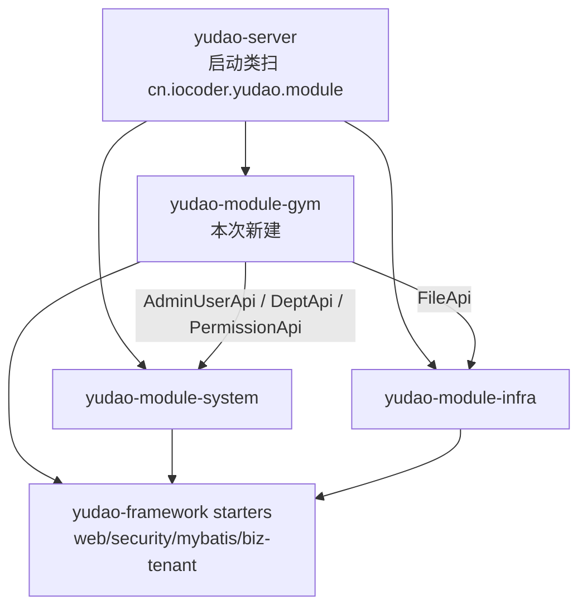

# 变更记录（时间升序）

> 规范见 [`README.md`](README.md)：**每次改动后追加一条**，含 意图 / 改了什么 / 结构关系 / 验证证据 / 影响面 / 未做后续。
> 本文件只追加，不修改历史条目。

| # | 时间 | 主题 | 一句话 |
| --- | --- | --- | --- |
| 1 | 2026-10-13 20:24 ~ 20:36 | [认证切片](#1-2026-10-13-2024-2036-认证切片41-前-5-个接口打通-gym-权限数据落地) | §4.1 前 5 个接口在 yudao 上跑通，落 51 个 gym 权限码与演示账号 |
| 2 | 2026-10-13 20:39 ~ 20:53 | [文件切片](#2-2026-10-13-2039-2053-文件切片41-后-3-个接口新建-yudao-module-gym) | 新建 `yudao-module-gym`，用 Java 实现上传/元数据/内容流 + 越权校验 |
| 3 | 2026-10-13 20:55 ~ 20:57 | [建立 doc 记录体系](#3-2026-10-13-2055-2057-建立-doc-记录体系) | 新增 `doc/`：变更流水 + 结构关系 + 验证清单，并确立「每次改动必记录」规范 |
| 4 | 2026-10-13 21:30 ~ 21:32 | [新增数据排查 SQL 清单](#4-2026-10-13-2130-2132-新增数据排查-sql-清单) | `script/gym/inspect.sql`：8 段只读查询，含同名覆盖缺陷的复现语句 |

---

## 1. [2026-10-13 20:24 ~ 20:36] 认证切片：§4.1 前 5 个接口打通 + gym 权限数据落地

### 意图

规划 `10-backend-mock-api-inventory.md` §4.1 的前 5 行（login / logout / refresh / codes / user info）要迁移到 yudao。
`08-gym-api-contract.md` §4 已明确目标路径是 yudao 原生接口，因此本条的意图**不是再写一套登录接口**，而是：

1. 消除「服务起得来但查不了库」的真实阻塞（原 `application-local.yaml` 写的 `root/12345678` 与本机 MySQL 不符）；
2. 把 51 个 `gym:*` 权限码、总部/门店角色、演示账号落成**数据**（yudao 的权限是数据驱动：`system_menu.permission` + `system_role`），
   否则第 4 个接口 `get-permission-info` 只能返回 yudao 演示数据，前端 `canGym(...)` 一个码都拿不到；
3. 建立可复现的验证手段（脚本 + IDEA 请求集），作为后续所有切片的验收模板。

### 改了什么

| 文件 | 类型 | 说明 |
| --- | --- | --- |
| `yudao-server/src/main/resources/application-local.yaml` | 修改 | L71-72 / L84-85：DB 账号改为 `${GYM_DB_USERNAME:yudao}` / `${GYM_DB_PASSWORD:123456}`，可用环境变量覆盖 |
| `script/gym/sql/01-gym-permission-seed.sql` | 新增 | 幂等种子：1 个「健身管理」根目录 + **51 个 `gym:*` 权限码**（按钮型，不产生路由）+ 2 角色 + 2 部门 + 2 演示账号 |
| `script/gym/seed.sh` | 新增 | 按文件名顺序执行 `script/gym/sql/*.sql`（幂等） |
| `script/gym/verify-auth-api.sh` | 新增 | 5 个认证接口端到端验证，26 条断言（含错误密码、登出失效、门店角色权限收窄的**反向断言**） |
| `script/gym/gym-auth.http` | 新增 | IDEA HTTP Client：登录自动写 `gymToken`/`gymRefresh`，一键跑完 5 个接口 |
| `script/gym/README.md` | 新增 | 认证切片说明（后被文件切片扩充为总说明） |

### 结构关系

本切片**没有新增 Java 类**，改的是「配置 + 数据 + 验证」，与既有代码的关系：

```
前端（GitHub/admin，本次不动）
  └─ POST /admin-api/system/auth/login ─────────┐
  └─ GET  /admin-api/system/auth/get-permission-info
  └─ GET  /admin-api/system/user/profile/get     │  这些路径本来就存在
                                                 ▼
yudao-module-system（既有 Java，未改一行）
  ├─ AuthController.java:66/73/85/93   login / logout / refresh-token / get-permission-info
  ├─ UserProfileController.java:50     profile/get
  └─ AdminAuthServiceImpl.java:100/230/236  登录、刷新、登出的服务实现
        │
        ▼ 读权限（数据驱动）
MySQL：system_menu.permission（51 个 gym:*，由 01-gym-permission-seed.sql 写入）
       system_role / system_role_menu / system_user_role / system_users / system_dept
```

关键结构点：**yudao 的权限码不是 Java 常量，而是 `system_menu.permission` 里的行**。
后续任何 gym 控制器写 `@PreAuthorize("@ss.hasPermission('gym:xxx:yyy')")`，能否通过完全取决于这张表，
这就是本切片必须先落数据的原因。

### 验证证据

```
$ bash script/gym/verify-auth-api.sh
 结果：通过 26 / 失败 0

$ curl -X POST .../system/auth/login -H 'tenant-id: 1' -d '{"username":"gymadmin","password":"Gym@123456"}'
{"code":0,"data":{"userId":252,"accessToken":"...","refreshToken":"...","expiresTime":...},"msg":""}

$ curl .../system/auth/get-permission-info -H "Authorization: Bearer <token>"
{"code":0,"data":{"roles":["gym_hq_admin"],"permissions":[51 个 gym:*],"user":{...}}}
```

幂等性：删净种子行后重跑 `seed.sh` → 再次 26/26 通过；连续跑两次结果一致（51 / 52 / 36 / 2）。

### 影响面 / 风险

- **影响前端联调（重要）**：yudao 多租户开启，**不带 `tenant-id` 请求头会直接 `code=400 请求的租户标识未传递`**。单租户部署可关 `yudao.tenant.enable`，否则前端适配层需补该请求头（前端不在本次范围）。
- 数据库账号从 `root` 改为 `yudao`：仅 `application-local.yaml`（本地 profile），不影响生产配置模板。
- 未见语义回归：yudao 原生认证接口未被改动。

### 未做 / 后续

- 未改任何 Java 代码（这 5 个接口 yudao 基座已实现）；未改前端。
- `homePath` / `authorizedStores`（旧 `/api/user/info` 有、yudao 原生没有）未补，留待前端适配层或后续 gym 专属 profile 接口。
- refresh token 未做「旧 token 立即轮换」（yudao 语义：有效期内不变、可复用），如需一次性轮换要改造 `OAuth2RefreshTokenService`。

---

## 2. [2026-10-13 20:39 ~ 20:53] 文件切片：§4.1 后 3 个接口，新建 yudao-module-gym

### 意图

§4.1 第 6~8 行（上传 / 元数据 / 内容流）在 yudao 基座里**没有**对应实现，且旧 Mock 的语义（魔数嗅探、按类别限制大小、门店/类别越权、私有下载不暴露静态地址）
是 infra 通用文件服务（`@PermitAll` 公开下载 + 全局类型白名单）覆盖不了的。
因此在后端新建自研模块 `yudao-module-gym`，实现这 3 个接口，并**顺带立起 gym 业务模块的骨架**，供后续 185 个业务端点沿用。

### 改了什么

| 文件 | 类型 | 说明 |
| --- | --- | --- |
| `pom.xml` / `yudao-server/pom.xml` | 修改 | 注册并依赖 `yudao-module-gym` |
| `yudao-server/src/main/resources/application.yaml` | 修改 | multipart 上限 16MB → 200MB（video 类别需要，否则 Spring 先拒） |
| `yudao-module-gym/pom.xml` | 新增 | 依赖 system（账号/权限/部门）+ infra（文件存储）+ tenant/web/security/mybatis/test starter |
| `.../controller/admin/file/GymFileController.java` | 新增 | 3 个端点；上传同时映射 `/gym/files` 与 `/gym/files/upload` |
| `.../controller/admin/file/vo/GymFileUploadReqVO.java` | 新增 | multipart 入参：`file` + `category` + `storeId?` |
| `.../controller/admin/file/vo/GymFileRespVO.java` | 新增 | 出参；**刻意不含 infra 存储 url** |
| `.../service/file/GymFileService.java` / `GymFileServiceImpl.java` | 新增 | 上传校验链 + 门店数据范围越权 + 落库（203 行，核心） |
| `.../service/file/dto/GymFileContentDTO.java` | 新增 | 内容流返回（name + mimeType + content），避免 Controller 重复查询 |
| `.../dal/dataobject/file/GymFileDO.java` | 新增 | 继承 `TenantBaseDO`（自动租户隔离 + 逻辑删除） |
| `.../dal/mysql/file/GymFileMapper.java` | 新增 | `BaseMapperX`，注释里给分页写法模板 |
| `.../enums/ErrorCodeConstants.java` | 新增 | 错误码区间 `1_070_000_xxx`（避开其他模块已占用区间） |
| `.../enums/file/GymFileCategoryEnum.java` | 新增 | 5 类别 × 大小上限 × 类型白名单（加枚举即扩展） |
| `.../enums/file/GymFileMimeTypeEnum.java` | 新增 | 7 种支持的 MIME 与扩展名 |
| `.../framework/file/core/utils/GymFileTypeUtils.java` | 新增 | 魔数嗅探 + `writeAttachment`（中文文件名 RFC 5987） |
| `.../test/.../GymFileTypeUtilsTest.java`（5 例）、`GymFileServiceImplTest.java`（10 例） | 新增 | 单测覆盖嗅探、类别、大小、越权、不存在 |
| `yudao-module-infra/.../api/file/FileApi.java` + `FileApiImpl.java` | 修改 | 新增 `getFileContentByUrl(url)`：跨模块读文件内容 |
| `yudao-module-infra/.../service/file/FileService.java` + `FileServiceImpl.java` | 修改 | 新增 `getFileByUrl(url)` |
| `yudao-module-infra/.../dal/mysql/file/FileMapper.java` | 修改 | 新增 `selectByUrl(url)` |
| `script/gym/sql/02-gym-file.sql` | 新增 | `gym_file` 建表（幂等 `CREATE TABLE IF NOT EXISTS`） |
| `script/gym/seed.sh` | 修改 | 改为执行 `sql/` 下全部脚本（不再只跑 01） |
| `script/gym/verify-file-api.sh` | 新增 | 29 条断言，含 5 类反例 |
| `script/gym/gym-files.http` | 新增 | IDEA：文件 3 接口 + 反例 |
| `script/gym/README.md` | 修改 | 扩充为「认证 5 + 文件 3」总说明，新增 §6 扩展清单 |

### 结构关系

**模块依赖（新增的 gym 模块处在 system/infra 之上）**



**上传链路（含校验顺序，早期失败即短路，避免读入超大内容）**

```
POST /admin-api/gym/files  (multipart, @PreAuthorize gym:files:upload)
  └─ GymFileController#uploadFile
       └─ GymFileServiceImpl#uploadFile
            1 GymFileCategoryEnum.find(category)          → 1070000002 非法类别
            2 file.getSize() vs category.maxSize          → 1070000004 超限（先看元信息，不读内容）
            3 file.getBytes() + GymFileTypeUtils.detect() → 1070000003 无法识别/与后缀或 Content-Type 不一致
            4 category.isMimeTypeAllowed(detected)        → 1070000003 类别白名单
            5 resolveAndValidateStoreId(storeId)          → AdminUserApi 取默认门店 / DeptApi 查存在 / PermissionApi 数据范围
                                                          → 1070000005 无门店、1070000006 门店不存在、1070000007 越权
            6 FileApi.createFile(content, name, "gym/"+category, mime)   → 内容交 infra 存储（本地磁盘/DB/S3）
            7 GymFileMapper.insert(GymFileDO)             → 业务归属落 gym_file（租户自动隔离）
```

**下载链路（鉴权 + 越权 + 不暴露 infra 地址）**

```
GET /admin-api/gym/files/{id}/content  (@PreAuthorize gym:files:read)
  └─ GymFileServiceImpl#getFileContent(id)
       ├─ getFile(id)：GymFileMapper.selectById → 1070000001 不存在
       │                validateStorePermission(userId, storeId) → 1070000007 越权
       ├─ FileApi.getFileContentByUrl(file.url)
       │    └─ infra：FileMapper.selectByUrl → FileServiceImpl.getFileContent(configId, path) → 存储客户端读取
       └─ GymFileController 用 GymFileTypeUtils.writeAttachment 输出（Content-Type 用嗅探结果，中文名 RFC 5987）
```

**数据关系**

```
gym_file（本模块新表，TenantBaseDO）
  id / store_id ──────────────► system_dept.id（门店 = 部门；总部角色 all=true，门店角色限本部门及以下）
  uploader_id ────────────────► system_users.id
  url ────────────────────────► infra_file.url（存储凭证，**不出现在任何响应里**）
  category / mime_type / size   业务与安全元数据
```

**权限链（两次校验，互相独立）**

```
① 功能权限：@PreAuthorize("@ss.hasPermission('gym:files:upload'|'gym:files:read')")
              → 取自 system_menu.permission（01 号种子写入的 51 个码）
② 数据权限：PermissionApi.getDeptDataPermission(userId)
              → all=true 放行；否则 storeId 必须 ∈ deptIds（角色 data_scope=1/4）
```

### 验证证据

```
$ mvn -T 1C -pl yudao-module-gym -am test -Dtest='GymFile*Test' -Dsurefire.failIfNoSpecifiedTests=false
 Tests run: 15, Failures: 0, Errors: 0, Skipped: 0        # GymFileTypeUtilsTest 5 + GymFileServiceImplTest 10

$ bash script/gym/verify-file-api.sh
 结果：通过 29 / 失败 0

$ bash script/gym/verify-auth-api.sh      # 回归
 结果：通过 26 / 失败 0
```

29 条断言中的关键反例（真跑出来的，不是静态结论）：

| 场景 | 期望 | 实际 |
| --- | --- | --- |
| PDF 内容改名 `.png` 传 image 类别 | 类型不匹配 | `code=1070000003`，msg 指出实际 `application/pdf` |
| 合同 PDF 传成 `image` 类别 | 类别白名单拦截 | `code=1070000003` |
| 11MB PNG 传 `image`（上限 10MB） | 超限 | `code=1070000004` |
| 未知类别 `coupon` | 非法类别 | `code=1070000002` |
| `gymstore` 读总部门店文件的元数据/内容 | 越权拒绝 | 两次均 `code=1070000007` |
| `gymstore` 读本店文件 / `gymadmin` 跨店读 | 正例放行 | `code=0` |
| 下载内容与上传文件 | 逐字节一致 | `cmp` 通过，`Content-Type: image/png` |
| 响应体是否含 infra 存储地址 | 不含 | `url`/`path` 字段均不存在 |

### 影响面 / 风险

- **infra 模块被扩展**（新增 3 个方法，未改既有签名）：对其他模块无破坏性影响；`FileApi` 是跨模块契约，新增方法属向后兼容。
- **multipart 上限放宽到 200MB**（全局配置）：所有上传接口都受益/受影响；业务侧仍有分类别上限兜底（10/20/200MB）。
- **新表 `gym_file`**：需要在所有环境执行 `script/gym/sql/02-gym-file.sql`（`seed.sh` 已包含）。
- 文件内容落在 infra 配置的存储上（本机默认存储配置），**进程重启不再丢文件**——与旧 Mock「内存存储、重启即失效」不同。
- 越权语义从旧 Mock 的 HTTP 404 变为业务码 `1070000007`（403 语义），前端提示文案需按 code 分支。

### 未做 / 后续

- 未做文件列表/分页接口（前端暂无该页面），`GymFileMapper` 注释里给了写法模板。
- 未做文件删除/清理（旧 Mock 也没有 DELETE；GC 策略待定）。
- 未做「按业务单据绑定」（`businessType`/`businessId`），等合同/审批模块落地后再加外键式关联。
- 未改前端：`admin` 仓库里 `yudaoAdapter.uploadFile` 目前仍指向 `/admin-api/infra/file/upload`，联调时需改为 `/admin-api/gym/files/upload`（属前端范围）。

---

## 3. [2026-10-13 20:55 ~ 20:57] 建立 doc 记录体系

### 意图

代码已经跨了两个切片（认证、文件），但「改了什么 / 为什么改 / 结构关系」只散落在对话与脚本注释里，评审时需要重新拼。
因此建立 **`doc/` 记录体系**，并把「每次改动后按时间顺序追加一条」定为流程的一部分，
让后续每个切片都能被独立审查，而不是依赖记忆。

### 改了什么

| 文件 | 类型 | 说明 |
| --- | --- | --- |
| `doc/README.md` | 新增 | 目录定位、阅读顺序、**记录规范**（条目格式 + 6 个必写段落 + 模板）、验证入口速查 |
| `doc/CHANGELOG.md` | 新增 | 变更流水账（时间升序）：本条 + 追溯补齐认证切片、文件切片两条历史记录 |
| `doc/architecture.md` | 新增 | 结构关系：模块依赖图、两条请求链路、数据模型与拆表理由、双道权限校验、代码地图、扩展点、与规划文档的对应 |
| `doc/testing.md` | 新增 | 三层验证策略、环境依赖、命令清单与当前结论数字、**已知测试盲区**、失败排查顺序 |

### 结构关系

本目录**不参与构建**（不被 Maven 打包、不影响运行时），只做记录；它与代码/脚本/规划文档的对应关系：

```
GitHub/admin/target/plan/            （规划：合同范围、08 接口契约、09 权限码、10 旧 Mock 盘点）
        │  需求与契约来源
        ▼
doc/CHANGELOG.md    ── 时间线：每次改动改了什么 / 意图 / 结构关系 / 证据
doc/architecture.md ── 结构：模块依赖、请求链路、数据模型、权限链、扩展点
doc/testing.md      ── 验证：三层策略 + 命令 + 当前结论 + 盲区
        │  指向实现与证据
        ▼
yudao-module-gym/（Java 实现）  script/gym/（种子 SQL、验证脚本、IDEA 请求、运维说明）
```

### 验证证据

- 文件存在性：`ls doc/` → `README.md` / `CHANGELOG.md` / `architecture.md` / `testing.md`
- 文内引用可解析：`script/gym/README.md`、`doc/CHANGELOG.md`、`doc/architecture.md`、`doc/testing.md` 均存在
- 无代码/配置改动 → 未重跑构建与测试；上一轮结论仍然有效（单测 15/15、认证 26/26、文件 29/29）
- 记录中的数字与代码现状核对一致：`GymFileServiceImpl.java` 203 行、gym 模块 Java 合计 1249 行（`wc -l`）

### 影响面 / 风险

- 对构建、运行时、接口行为**零影响**（纯文档）。
- 唯一约束是流程约束：后续改动如果不追加条目，`CHANGELOG.md` 会出现时间断层，评审时需注意。

### 未做 / 后续

- 未把 `admin/target/plan/` 的规划文档复制进本仓库（避免两份真相冲突，仅在文中引用）。
- 未加自动化校验（例如 CI 检查「有代码改动但 CHANGELOG 无新条目」），后续可按需加一个 `script/ci/check-changelog.sh`。
- 历史记录（#1、#2）是**追溯补齐**的，时间取自文件 mtime 与构建日志，误差在分钟级。

---

## 4. [2026-10-13 21:30 ~ 21:32] 新增数据排查 SQL 清单

### 意图

需要用 GUI 客户端（Sequel Ace / PyCharm Database / DBeaver）直接查库来审查成果，
但排查 SQL 之前只散落在对话里，每次都要重新拼。把已验证的查询固化成文件，客户端点开即跑，
同时把「文件同名覆盖」这个已知缺陷做成一条可复现的检查语句。

### 改了什么

| 文件 | 类型 | 说明 |
| --- | --- | --- |
| `script/gym/inspect.sql` | 新增 | 8 段只读查询：① 权限码 ② 角色与授权规模 ③ 门店/账号 ④ 模拟 get-permission-info ⑤ 文件列表与汇总 ⑥ 文件真实存储位置 ⑦ 同名覆盖缺陷排查 ⑧ 种子数据总览 |
| `doc/CHANGELOG.md` | 修改 | 本条记录 |

### 结构关系

```
script/gym/
├── seed.sh            写：建表 + 权限码 + 演示账号（幂等）
├── verify-*.sh        验：断言接口行为（通过/失败，退出码非 0 表示失败）
├── inspect.sql        查：只读看数据全貌与缺陷复现（本文件，不参与构建）
├── gym-*.http         IDEA 里逐个点接口
└── sql/*.sql          被 seed.sh 顺序执行
```

与 `verify-*.sh` 的分工：验证脚本回答「接口行为对不对」，`inspect.sql` 回答「库里到底是什么」。
两者都用同一套演示数据（`gymadmin` / `gymstore` / 51 权限码）。

### 验证证据

用项目账号整文件执行（只读，未改任何数据）：

```bash
$ mysql -uyudao -p123456 ruoyi-vue-pro < script/gym/inspect.sql
```

关键输出：

| 查询 | 结果 |
| --- | --- |
| ① gym 权限码 | 51 |
| ② 角色 / ⑤ 角色授权行 | 2 / 88 |
| ③ 演示账号 / ④ 门店部门 | 2 / 2 |
| ④ gymadmin / gymstore 权限码数 | 51 / 35（与接口返回一致） |
| ⑥ gym_file 行 | 12（验证脚本留下的记录） |
| ⑦ 同名覆盖排查 | `gym/contract/20261013/contract.pdf` 命中 **6 行** infra_file（缺陷复现成功） |

### 影响面 / 风险

- 全部是 `SELECT`，对数据零写入；可随时重复执行。
- ⑦ 的输出说明「同名同天上传互相覆盖」的缺陷**仍然存在**（尚未修复），修复前上传同名文件需注意。

### 未做 / 后续

- 未修 ⑦ 的覆盖缺陷（方案 A：打开 infra 的 `PATH_SUFFIX_TIMESTAMP_ENABLE`；方案 B：gym 侧目录加唯一片段，待决策）。
- 未加 CI 校验（如自动跑 `inspect.sql` 比对期望行数）。

## [2026-10-13 22:44 ~ 22:57] 对齐当前 JSS 前端，交付门店与员工首批 API

### 意图

先查阅 dashboard 当前 `targets/handoff/backend-priorities.md` P0/P1、`targets/plan/08-gym-api-contract.md`、`09-permissions.md`、`apps/web-jss/integration/backend-contract.md`/`menus.json` 和实际 stores/employees 页面及通用编辑器。结论：首批应解除菜单/门店/员工/数据隔离阻塞，当前 REST 与历史 `/page` 草案不同。按用户要求仅修改后端，前端只读。

### 改了什么

以下为本次新增或在既有未提交切片上修改的文件，不把此前 pom/infra/配置改动计作本次工作。

| 路径（相对 server） | 类型 | 说明 |
| --- | --- | --- |
| `yudao-module-gym/src/main/java/cn/iocoder/yudao/module/gym/controller/admin/common/GymPageReqVO.java` | 新增 | 页码/大小、关键词、状态和门店筛选 |
| `…/controller/admin/store/GymStoreController.java`、`…/store/vo/GymStore{SaveReq,Resp,MediaReq}VO.java` | 新增 | 门店四个基础接口及媒体替换；字符串 ID、营业时间/媒体嵌套响应 |
| `…/controller/admin/employee/GymEmployeeController.java`、`…/employee/vo/GymEmployee{SaveReq,Resp}VO.java` | 新增 | 员工四个基础接口；多店任职和账号关系 |
| `…/service/store/GymStoreService.java` | 新增 | 行 35 分页范围、58 新增部门/档案事务、82 PATCH 行锁、98 媒体校验替换 |
| `…/service/employee/GymEmployeeService.java` | 新增 | 行 34 授权 EXISTS 分页、75 PATCH 全任职范围校验、113 账号权限/主部门校验 |
| `…/service/common/GymDataScope.java`、`GymPatchUtils.java` | 新增 | 共用门店范围和部分更新合并 |
| `…/dal/dataobject/{store,employee}/Gym{Store,StoreMedia,Employee,EmployeeStore}DO.java` | 新增 | 四个 TenantBaseDO 业务模型 |
| `…/dal/mysql/{store,employee}/Gym{Store,StoreMedia,Employee,EmployeeStore}Mapper.java` | 新增 | CRUD、主记录锁定、整体替换关系 |
| `…/enums/ErrorCodeConstants.java` | 修改 | 门店/员工 12 个错误码 |
| `…/controller/admin/file/vo/GymFileRespVO.java` | 修改 | 补原文件名/字节数别名，业务 ID 改字符串，保留 name/size |
| `yudao-module-gym/pom.xml` | 修改 | 更新实现范围说明，无依赖改动 |
| `script/gym/sql/03-gym-store-employee.sql` | 新增 | 四业务表、租户/逻辑删除、唯一索引 |
| `script/gym/sql/04-gym-first-batch-menus.sql` | 新增 | 增量注册两个已交付页面，保留原权限 ID/授权 |
| `script/gym/verify-migrations.py`、`gym-organization.http` | 新增 | 隔离 MySQL 幂等验证及手工 API 请求 |
| `script/gym/verify-file-api.sh`、`README.md` | 修改 | 适配字符串文件 ID 的断言，链接本批交接 |
| `yudao-module-gym/src/test/java/…/service/GymOrganizationServiceTest.java` | 新增 | 17 个实际 DB/事务/方法权限测试 |
| `yudao-module-gym/src/test/resources/application-unit-test.yaml`、`sql/create_tables.sql`、`sql/clean.sql` | 新增 | 隔离 H2、租户拦截器、数据库约束与清理 |
| `docs/gym-first-batch-api.md` | 新增 | 完整更改/契约交接：字段、权限、错误码、部署、回退及未实现项 |
| `docs/README.md`、`architecture.md`、`testing.md`、`backend-contract.md`、`CHANGELOG.md` | 修改 | 当前入口、结构与可复现证据；旧快照标注新交接位置 |

### 结构关系

Controller 操作权限 → Service → GymDataScope/PermissionApi 的 system 部门范围 → MyBatis 租户过滤 → gym 表。门店 ID 等于 system_dept.id，新建部门与门店同事务；员工关联已有 system_users，不新建登录/RBAC。员工任职参与授权分页，读关联关系裁剪到授权门店，修改共享档案要求原/新全门店范围。主记录行锁保护 PATCH/关系替换；任职/媒体关系仅整体替换时删除关系行，业务档案不删除。详见 architecture.md 与新交接文档。

### 验证证据

- `mvn -q -pl yudao-module-gym -am test -Dtest='Gym*Test' -Dsurefire.failIfNoSpecifiedTests=false -DargLine='-javaagent:/Users/hh/.m2/repository/org/mockito/mockito-core/5.23.0/mockito-core-5.23.0.jar'`：退出 0；组织 17 + 文件 Service 12 + 类型工具 5 = **34 tests，0 failures，0 errors，0 skipped**。报告位于 gym/target/surefire-reports。首次默认 JVM 动态附加失败，改用启动 agent 后通过，不改项目测试/生产 JVM 配置。
- `mvn -q -DskipTests -pl yudao-server -am package`：退出 0，生成 yudao-server/target/yudao-server.jar。
- `python3 script/gym/verify-migrations.py`：退出 0；实际本机 MySQL 独立随机库验证四业务表、两个页面、四条页面授权，全部 SQL 两次执行记录数一致；测试库随后删除。
- `git -C /Users/hh/Documents/GitHub/dashboard status --short`：输出为空，前端文件未修改。
- `curl --max-time 5 http://127.0.0.1:48080/v3/api-docs` 未取得响应，本次无运行服务/OpenAPI HTTP/前端验收证据。

### 影响面 / 风险

- 当前前端基础路径/字段无需改动即可对接门店/员工首批。文件元数据 ID 由数字改为字符串，其他已有客户端若依赖数字需适配；原 name/size 保留。
- 只读权限/门店范围/租户负例已覆盖；system 外部依赖使用 mock，未覆盖完整 HTTP 中间件链或真实前端浏览器。不得把测试通过当成业务端到端验收。
- 历史演示角色带 payroll:read，会触发尚缺少的员工工资历史接口，员工编辑仍可能被该请求阻断；联调使用仅本批权限的角色或等待工资切片。未伪造历史数据、未擅自撤销既有角色权限。
- 自动页面授权仅租户 1 的两个既有 gym 角色；其他角色和租户需 system 后台授权。业务库未执行迁移，部署需按交接文档执行 SQL、重启及重新登录。
- SQL 保留档案自然键，未来删除/恢复和 ALTER 迁移需要独立设计。媒体/任职事务锁已落地，生产 MySQL 并发压测未执行。

### 未做 / 后续

未改前端，未提交/发布/启动服务，未清库或迁移业务库。未实现工资历史/模板、会员/卡、私教预约签课、删除/导出/批量接口、创建幂等、账号解绑或第三方接入。下一批优先补工资历史与模板以解除员工编辑条件阻塞，再推进会员/权益/预约签课；所有范围依现行交接文档。

## [2026-10-14 20:30 ~ 20:34] 修复文件二进制下载失败被当作成功 Blob

### 意图

修复本次代码审查指出的问题：文件记录或存储内容缺失时，ServiceException 被全局处理器包装成 HTTP 200 错误 JSON，前端 Blob 客户端将它误当作正常文件。依据文件契约的内容下载真实状态约定；用户授权修复，继续仅修改后端。

### 改了什么

| 路径 | 类型 | 说明 |
| --- | --- | --- |
| `yudao-module-gym/src/main/java/cn/iocoder/yudao/module/gym/controller/admin/file/GymFileController.java:94` | 修改 | 局部异常处理复用全局错误转换及日志；按匹配路由仅对内容下载映射 HTTP 404/403/400/500 |
| `yudao-module-gym/src/test/java/cn/iocoder/yudao/module/gym/controller/admin/file/GymFileControllerTest.java` | 新增 | 9 个真实 MVC/方法权限回归测试，覆盖成功、缺失、越权、非法 ID、存储异常及元数据兼容 |
| `script/gym/verify-file-api.sh` | 修改 | 增加内容下载 HTTP 状态及业务码断言 |
| `script/gym/README.md` | 修改 | 更新内容下载错误状态契约 |
| `docs/testing.md`、`docs/CHANGELOG.md` | 修改 | 记录测试证据及本次报告 |

### 结构关系

文件 Controller 的局部异常处理调用既有 GlobalExceptionHandler.allExceptionHandler，保留 CommonResult 错误码/错误日志。根据 MVC 实际匹配路由辨别内容下载，记录/内容缺失映射 404，跨店和操作权限失败映射 403，参数错误映射 400，未知存储异常映射 500。成功下载继续走原文件输出链；上传/元数据保持 HTTP 200 + body code。纯错误处理修复，不改变模块/数据库结构。

### 验证证据

- `mvn -q -pl yudao-module-gym -am test -Dtest='Gym*Test' -Dsurefire.failIfNoSpecifiedTests=false -DargLine='-javaagent:/Users/hh/.m2/repository/org/mockito/mockito-core/5.23.0/mockito-core-5.23.0.jar'`：退出 0，**43 tests，0 failures，0 errors，0 skipped**。其中新增控制器回归 9 个，验证真实 MVC 错误 JSON/HTTP 状态和 @PreAuthorize 拒绝；Service 为 mock。
- `bash -n script/gym/verify-file-api.sh`：退出 0；本次未对运行服务执行该脚本。
- `mvn -q -DskipTests -pl yudao-server -am package`：退出 0。
- `git diff --check`：退出 0；dashboard 的 `git status --short` 为空，前端文件未修改。

### 影响面 / 风险

二进制下载失败现在返回非成功 HTTP 状态，Blob 请求可进入错误分支；业务 code 保留，支持已有错误提示。元数据/上传响应约定不变。未修改共享全局异常处理器，对其他模块不改变 HTTP 约定。本次 MVC 测试不覆盖安全 Filter 层、真实存储渠道或前端浏览器；已提交/暂存的其他改动均保留原状态，未重新暂存。

### 未做 / 后续

未改前端、未改数据库、未部署/启动服务。真实服务下载回归可在部署后执行 `script/gym/verify-file-api.sh`；未新增其他业务接口。

## [2026-10-14 20:44 ~ 20:46] 修复门店服务误注入 infra 文件 Mapper 导致启动失败

### 意图

修复用户启动反馈的 `fileMapper` Bean 类型不匹配。问题来自 `@Resource` 优先按字段名查找：门店服务期望 GymFileMapper，却因字段名 fileMapper 命中 infra 的同名 Bean。Mapper 已正常注册，JDK 代理不是问题原因。

### 改了什么

| 路径 | 类型 | 说明 |
| --- | --- | --- |
| `yudao-module-gym/src/main/java/cn/iocoder/yudao/module/gym/service/store/GymStoreService.java:30` | 修改 | 注入字段改为 gymFileMapper，并更新两个调用点，匹配实际 Mapper Bean 名称 |
| `yudao-module-gym/src/test/java/cn/iocoder/yudao/module/gym/service/GymOrganizationServiceTest.java` | 修改 | 增加 infra 文件包真实 Mapper 扫描，验证两种文件 Mapper 同时存在及门店媒体读写 |
| `docs/testing.md`、`docs/CHANGELOG.md` | 修改 | 补充修复前复现、修复后回归和验证边界 |

### 结构关系

GymStoreService 继续依赖 gym 文件 Mapper，只修正字段名与 Bean 名称匹配。infra FileMapper 和 GymFileMapper 保持各自 MyBatis JDK 代理，不改全局代理或扫描机制。纯注入修复，不改变架构和数据库。

### 验证证据

- 修复前新增双模块 Mapper 注册后执行 `mvn -q -pl yudao-module-gym -am test -Dtest='GymOrganizationServiceTest#bothFileMappersCoexistAndStoreMediaUsesGymMapper' -Dsurefire.failIfNoSpecifiedTests=false -DargLine='-javaagent:/Users/hh/.m2/repository/org/mockito/mockito-core/5.23.0/mockito-core-5.23.0.jar'`：退出 1，复现用户同款 BeanNotOfRequiredTypeException。
- 修复后执行相同 Maven 命令，测试选择改为 `-Dtest='Gym*Test'`：退出 0，**44 tests，0 failures，0 errors，0 skipped**，其中组织 18、文件服务 12、类型工具 5、文件控制器 9。实际双 Mapper Spring 上下文初始化和媒体持久化通过。
- `mvn -q -DskipTests -pl yudao-server -am package`：退出 0。
- `git diff --check`：退出 0；dashboard 的 `git status --short` 为空。

### 影响面 / 风险

修复后门店服务在 infra/gym 同时加载时注入正确的文件 Mapper。此前组织测试只扫描 gym，未发现名称冲突；本次已将跨模块共存加入回归环境。未更改前端、共享扫描配置、代理类型或数据库，HTTP 契约不变。

### 未做 / 后续

未启动连接业务数据库/Redis 的完整服务，未修改部署环境。用户可重新运行 IDE 应用验证完整启动；本次已生成新版 jar，未自动提交或推送此修复。

## [2026-10-14 21:09 ~ 21:25] 将旧 PostgreSQL 首批种子转换并导入 MySQL 开发库

### 意图

用户提供 `/Users/hh/Documents/GitHub/database/` 种子，要求放入项目开发数据库；确认选择“先导入已实现模块，其他列入待导入清单”。先阅读源模型及种子，再对齐当前 MySQL/system/gym 模型，未把旧 README 的 PostgreSQL/Go 执行流程当成当前项目指令。

### 改了什么

| 路径/目标 | 类型 | 说明 |
| --- | --- | --- |
| `script/gym/development/01-legacy-organization.sql` | 新增 | 首批 MySQL 转换种子，事务/自然键幂等/人工同名冲突守卫；不自动挂入常规 seed.sh |
| `script/gym/verify-legacy-seeds.py` | 新增 | 临时库验证二次导入、实际字段关联及同名冲突回滚 |
| `docs/development-seed-import.md` | 新增 | 实际 ID 映射、账号/权限、待导入模块与数量、备份及操作证据 |
| `docs/README.md`、`script/gym/README.md`、`docs/CHANGELOG.md` | 修改 | 导入入口与记录 |
| `127.0.0.1:3306/ruoyi-vue-pro`，租户 1 | 数据库变更 | 执行既有 03/04 增量迁移与新转换种子；新增 28 行、补建四业务表、转换两个已有业务页面 |

### 结构关系

旧 stores UUID 通过 code 映射为 system_dept / gym_store 的 Long ID；employee_no 映射员工，任职关联转换为 gym_employee_store；旧 admin_accounts 映射 system_users，旧角色按已实现权限子集映射 system_role/menu。账号主部门与员工主门店一致，权限保持 source 授权。源 scrypt 校验后改用 BCrypt，不引入旧登录/RBAC 表。未建立新架构或旧模型影子表。

### 验证证据

- `python3 script/gym/verify-legacy-seeds.py`：退出 0；独立随机 MySQL 库验证 2 门店、2 员工、2 任职、3 账号、2 角色、两轮幂等及同名冲突拒绝/回滚；测试库已删除。
- 正式导入前 `mysqldump --single-transaction --no-tablespaces --set-gtid-purged=OFF` 备份此次涉及的已有表到 `/tmp/gym-development-before-seeds-1dtpy3up.sql`（600 权限）。执行 03/04 及转换 SQL，退出 0；转换种子连续执行两次，第二次记录数不变。
- 新增：system_dept 2、system_users 3、system_role 2、system_role_menu 12、system_user_role 3、gym_store 2、gym_employee 2、gym_employee_store 2，共 28 行。
- SQL 查询核对 SH001/SH002 → 126/127；E001/E002 → 1/2；hq/store1/store2 → 254/255/256；gym_dev_hq/gym_dev_store → 173/174。两员工主门店与对应账号部门一致。
- 实际入库的 3 个账号密码使用 Spring Security BCryptPasswordEncoder 验证通过，仅输出匹配数量，不输出哈希。
- `curl --max-time 5 http://127.0.0.1:48080/v3/api-docs` 未取得运行服务响应，无 HTTP/前端验收证据。

### 影响面 / 风险

数据仅进入本机开发库租户 1，源目录和前端文件未修改。现有用户/密码/业务数据未覆盖。门店角色保持旧种子只读资料权限，总部角色允许首批写入；不授予未实现的工资/会员/支付等权限。开发账号沿用源种子默认密码，属于开发示例。SQL 前置要求已存在总部/根目录/首批权限，不适用于生产初始化或任意租户。

### 未做 / 后续

按用户确认范围未导入会员、课程、合同/审批、设备、工资、营销、支付/分账等未实现模块，详见专门待导入清单。Mock 文件无真实内容，HQ001 缺任职门店，未补造文件/关系。未启动服务、未执行真实登录/浏览器回归，未提交或推送新增导入文件。

## [2026-10-14 21:43 ~ 22:09] 全量 API 任务首轮：薪资闭环及会员基础

### 意图

用户要求实现全部文档 API，仅负责后端，调试后运行前端验证和 review。按现行dashboard 35业务页面的真实请求推进，先解除员工薪资配置编辑阻塞；全量目标仍在进行，详见 gym-full-api-progress.md。

### 改了什么

| 路径 | 类型 | 说明 |
| --- | --- | --- |
| `yudao-module-gym/.../controller/admin/salary/`、`service/salary/`、`dal/*/salary/` | 新增 | 薪资模板、规则、版本、薪资关联/历史真实持久化与权限 |
| `GymEmployeeSaveReqVO` / `GymEmployeeService` / `ErrorCodeConstants` | 修改 | 薪资配置结构化并接入员工事务，新增业务错误码 |
| `yudao-module-gym/.../controller/admin/member/`、`service/member/`、`dal/*/member/` | 新增 | 会员档案基础 CRUD、手机号唯一、会员编号、门店/租户隔离 |
| `GymBusinessPageReqVO` / `GymDateRange` | 新增 | 业务筛选与上海时区左闭右开日期范围 |
| `script/gym/sql/05..08` | 新增 | 薪资/会员表与已实现批次菜单增量迁移 |
| `script/gym/verify-salary-api.py` / `verify-member-api.py` | 新增 | 开发服务HTTP回归；联调资料保留供浏览器复查 |
| `GymOrganizationServiceTest` / 测试DDL与清理SQL / `verify-migrations.py` | 修改 | 持久化、授权、原子回滚和迁移回归 |
| `docs/gym-full-api-progress.md` / `architecture.md` / `testing.md` / 本文 | 新增/修改 | 范围、实现状态、结构与验证证据 |

### 结构关系

员工保存事务调用薪资服务，薪资服务只依赖员工/任职Mapper。模板以家族及版本持久化，发布不可变；家族根锁保证版本串行。员工锁及当前锁定读取防止并发重复关联/重叠，跨店自动结束旧配置须额外范围校验。会员基础通过GymDataScope与TenantBaseDO隔离；权益等后续继续扩展。

### 验证证据

- 薪资阶段53单元/集成测试通过；会员基础加3测试后56通过，0 failures/errors。
- 主服务 Maven 打包退出0；MySQL隔离库二次迁移通过：7业务表、5页面、9条示范角色页面授权，临时库已清理。
- 运行真实后端，使用用户指定admin验证薪资HTTP37断言；含8请求并发关联与4请求并发模板版本。测试 employeeId=3/templateId=2，资料带联调前缀保留。
- 前端5666启动；浏览器新增模板、切换admin、发布及刷新持久化通过，截图 `/tmp/gym-salary-admin-verified.png`。前端git status为空。
- Review发现并修复：规则String→List的通用转换报错、PATCH省略/null混淆、跨店结束旧配置未授权风险、MySQL快照下历史读取重复风险；新增回归及真实并发验证。

### 影响面 / 风险

仅修改后端仓库及本机开发库增量表/菜单，未清库或覆盖旧种子/前端代码。联调测试资料保留可复查；未自动提交/推送。薪资模板是配置，不代表工资计算完成；会员基础HTTP17断言通过；会员基础未接权益筛选/私教/跨店权益，也不能视为会员页完整验收。

### 未做 / 后续

全量目标保持active。继续体测、黑名单、卡权益、私教预约/签课、审批合同、工资报表以及剩余页面/第三方。用户随后明确授权：厂商设备/电子签/支付分账/核销真实接入先跳过并留记号，后续跟进补齐。本轮继续接口及真实未接入状态，不把厂商真实联调作为完成条件。后续继续记录真实HTTP/浏览器证据。

## [2026-10-14 22:10 ~ 22:17] 全量 API 任务继续：体测与黑名单

### 意图

推进会员资料相关的两个业务页面，按现行页面字段实现持久化、授权和体测报告关联。用户已明确授权厂商真实接入先跳过留记号，待后续补齐；其余全量接口目标仍进行。

### 改了什么

| 路径 | 类型 | 说明 |
| --- | --- | --- |
| `controller/admin/member/GymBlacklistController` / `GymMeasurementController`及VO | 新增 | 黑名单与体测REST CRUD、权限码与类型校验 |
| `service/member/GymMemberRecordsService` / `dal/*/member/GymBlacklist*` / `GymMeasurement*` | 新增 | 实际持久化、全店阻断时间判断、撤销留痕、体测附件归属校验 |
| `script/gym/sql/09..10` / `verify-migrations.py` | 新增/修改 | 表、菜单和两轮隔离迁移验证 |
| `GymOrganizationServiceTest` / 测试SQL | 修改 | 新增6个持久化/授权/状态/附件负例测试 |
| `verify-member-api.py` | 修改 | 扩展真实HTTP体测与黑名单验证，并修复脚本文件名含连字符时的动态模块加载 |
| `docs/architecture.md` / `testing.md` / `gym-full-api-progress.md` / 本文 | 修改 | 结构、证据与第三方暂缓标记 |

### 结构关系

体测与黑名单Controller使用会员记录Service，复用会员/门店范围以及GymFileMapper验证报告类别与归属。黑名单保留撤销时间及限制标志，提供checkEntry/checkPurchase供后续真实入场/购卡调用；尚未连接这些业务流程，不把CRUD当成已实现实际门禁阻断。

### 验证证据

- 完整Gym回归：62 tests，0 failures/errors/skipped；新增6例实际H2/MyBatis、租户与方法权限测试。
- 主服务打包退出0，启动正常。会员/体测/黑名单真实HTTP28断言通过，测试memberId=3，测试资料保留。
- 独立MySQL迁移验证：9表、7页面、13条示范角色页面授权，全部脚本两轮幂等，临时库删除。
- admin浏览器体测列表与详情展示真实会员、门店、70.5kg及UTC时间；截图 `/tmp/gym-measurement-admin-verified.png`。
- 本批review：核对范围、租户子查询、字段不可变、结束时间省略/null、撤销幂等、文件类别/门店校验和权限拒绝路径；前端git status为空，git diff --check通过。

### 影响面 / 风险

仅后端及开发库增量表/菜单；未改变前端。测试资料带HTTP前缀并保留，不清库。真实文件上传后关联体测的浏览器路径尚未回归；文件身份和类别已有真实数据库负例覆盖。

### 未做 / 后续

继续卡模板、会员权益、多门店、私教、审批、合同、工资报表及剩余页面。第三方实接按用户授权暂缓，TODO标记在进度文档。全量目标保持active，未声明所有API完成。

## [2026-10-14] 全量API继续：卡权益、私教与审批模板

### 意图

实现现行会员卡与私教页面的业务接口，推进审批开卡真实闭环，只修改后端。

### 改了什么

新增card/course/approval模板DO、Mapper、VO、Service与Controller；成员多门店归属和权益筛选；SQL11–17与菜单；HTTP卡课程/审批模板验证脚本及既有脚本活跃门店选择；真实数据库与并发业务测试；进度、架构、测试记录。

### 结构关系

卡发放受可信业务来源约束；GymBusinessMutex协调新店与全部门店权益。预约预占、取消释放、签到前置与课消通过锁和唯一约束保证事务一致性。审批模板固化有序员工步骤，发布校验有效账号，后续审批状态机将据此执行真实业务。

### 验证证据

完整Gym84测试通过，主服务打包成功；新版真实HTTP卡课程46、会员28、薪资37、审批模板22断言通过。隔离迁移21表/14页面/26页面授权两轮幂等。浏览器admin完成卡创建发布及课程列表加载，截图/tmp/gym-card-admin-verified.png。源码review修正新店锁顺序、版本冻结、产品时间筛选和停用教练绑定校验。前端git status保持为空。

### 影响面 / 风险

开发库增量表菜单及带联调前缀测试数据，不清库、不修改前端。业务菜单数不能证明所有页面已完整验收；审批开卡来源、SELF负责会员范围及实际权益全链路HTTP/浏览器仍待补齐。

### 未做 / 后续

继续审批发起/审核实际开卡与改价、合同、工资报表及剩余配置。设备/电子签/支付分账/核销真实厂商接入按用户授权暂缓并保留TODO。全量目标active，尚未全量交付。

审批模板前端证据：admin在现有页面修改V5草稿名称为“浏览器联调开卡审批-20261014”，保存、发布并刷新后仍显示已发布；截图 `/tmp/gym-approval-template-admin-verified.png`。审批员工为现有店长2账号，未修改账号角色或权限。

## [2026-10-15] 审批记录及开卡/改价真实事务闭环

### 意图

将模板配置推进为真实业务审批，避免只有已通过状态却没有发卡/改价效果。

### 改了什么

新增GymApprovalDO/TaskDO及Mapper、请求/响应VO、Service/Controller；SQL18/19申请/步骤表和审批菜单。模板发布增加审批权限校验。新增5个业务测试及verify-approval-flow-api.py；模板HTTP脚本选择具备既有权限的示范员工，隔离迁移扩展。更新架构/进度/测试说明。

### 结构关系

申请固化模板、业务及账户步骤快照；租户+申请人+提交键唯一防重。最终审核与GymCardService.issue/GymCourseService.applyApprovedPrice同一事务；数据/权限失败回滚步骤。改价不覆盖已经变化的原价；拒绝不发卡。业务来源approval可追溯实际发卡记录。

### 验证证据

89项Gym回归全部通过、构建启动成功；真实HTTP52断言、模板22断言通过，迁移23表/15菜单/28授权两轮幂等。浏览器admin提交开卡、指定gymstore审批，切回admin确认真实期限卡/次数余额，并使用期限卡预约。前端git status与diff --check为空。

### 影响面 / 风险

仅后端和本机开发库业务/菜单增量；保留联调资料，没有修改账号角色。已有store2无审批权限被正确拒绝；新联调员工仅关联已有gymstore权限。租户事务锁目前串行所有申请和审核，后续性能测试可缩小粒度但不能破坏锁顺序。历史错误联调产生的未开卡会员/未使用卡/测试排期保留供复查，不伪造清理成功。

### 未做 / 后续

合同及订单审批来源明确尚未接入；其他人工审核只标记审核完成。继续合同、工资/报表和剩余页面；SELF负责会员及通知仍待补。厂商真实接入按授权暂缓并保留TODO，全量目标active。

## [2026-10-15] 合同模板版本及受控PDF预览

### 意图

推进现行合同模板页面，保持已发布合同原文不可变，并验证真实文件上传/下载。

### 改了什么

新增合同模板DO/Mapper/VO/Service/Controller、SQL20/21；GymFileServiceImpl支持已发布合同模板的受控跨店预览，保留其他文件原范围。增加3个数据库模板测试与1个文件权限测试、verify-contract-template-api.py及隔离迁移计数。01种子增加gym:contracts:templates总部操作排除项。

### 结构关系

总部模板版本绑定受控PDF，发布后不能替换内容或回草稿；版本家族根及源当前锁分配版本。文件读取检查同租户发布引用、合同权限及非空范围，未公开存储URL，也不扩大上传范围。

### 验证证据

Gym93测试通过，构建启动正常；合同模板真实HTTP26断言，包含真实PDF上传下载、4并发版本及共享撤回。隔离两轮迁移24表/16页面/29授权通过。迁移review发现并修复旧种子重跑会给示范门店增加合同模板菜单的问题。

### 影响面 / 风险

仅后端及开发库增量；已发布模板是共享的合同模板原件，实例合同不应复用该共享引用承载会员签署个人资料。前端真实上传发现JSON化FormData导致只传uid，没有文件字节，后端拒绝且没有伪造文件。遵守不改前端要求，保留UPLOAD-JSON-001记录供前端团队修复。

### 未做 / 后续

合同记录、实例文件、签约审批和提醒继续实现。前端上传需请求层改为multipart，不能仅后端恢复丢失字节。厂商电子签继续按用户授权暂缓并留TODO；全量目标active。

## [2026-10-15] 合同实例、签约审批授权与提醒记录

### 意图

将模板连接至真实权益与合同记录，完成现行页面查询、签约审批与提醒接口，保留服务商未接入的真实状态。

### 改了什么

新增合同/事件/提醒DO、Mapper、请求响应VO、GymContractService/Controller、SQL22/23；卡/私教发放hook与签约审批分支。独立实例PDF、快照、授权及failed提醒持久化；verify-contract-flow-api.py与5个真实数据库业务测试。修复长门店编码导致会员号/卡号越界，并防止截断Unicode代理对。返回渠道提示使用人类可读原因，TODO标记留代码和文档。

### 结构关系

发放权益时使用相应类型最新发布模板，独立复制原件，合同来源唯一；FileApi文件创建与业务记录在同一调用链，业务表事务原子。最终签约审批授权与事件同一事务，不生成电子签回执或签署字段。提醒按合同/key幂等，不更改旧失败记录。

### 验证证据

98 Gym测试通过、构建启动成功；合同真实HTTP36断言，包含8并发开卡、8签约、8提醒与实际独立PDF下载。隔离两轮迁移27表/17页面/31授权通过。review核对门店/租户范围、快照屏蔽、文件不可替换、重放与失败事务、编号长度和UTF8合法性。前端仍无源码修改。

### 影响面 / 风险

实例原件是模板PDF副本，业务身份与权益另存快照；没有自动表单填充、签章或外部通知。已配置模板但原件不存在会回滚发卡和审核，防止生成空合同。文件存储的物理对象若在后续数据库写入失败时已创建，仍可能留下未引用对象，清理须按infra存储策略执行；业务表和授权不提交。当前提醒仅保存未配置失败，自动调度和真实渠道仍待接入。

### 未做 / 后续

继续工资/报表、经营与设备/内容/支付配置等剩余页面；SELF负责会员、通知与厂商真实接入按明确进度处理。电子签真实接入用户已授权暂缓，保持未配置状态。UPLOAD-JSON-001及IAB PDF渲染限制记录在进度文档，全量目标active。


## [2026-10-15 09:30 ~ 09:54] 门店工资计算、确认冻结与跨店来源

### 意图

实现现有门店工资表页面，按用户确认的“本人全部任职门店业绩汇总至唯一发薪门店”规则计算，并保证失败不覆盖、确认后不重算。

### 改了什么

| 路径 | 类型 | 说明 |
| --- | --- | --- |
| yudao-module-gym/.../payroll/ | 新增 | Controller、请求响应、服务、工资及员工明细表映射 |
| yudao-module-gym/.../finance/ | 新增 | 不可伪造公开流水的内部支付/退款来源事件映射 |
| yudao-module-gym/.../salary/GymSalaryService.java | 修改 | 已确认工资所用薪资配置不能缩短覆盖期间 |
| yudao-module-gym/.../employee/GymEmployeeService.java | 修改 | 配置并发采用READ_COMMITTED配合员工锁 |
| script/gym/sql/24、25 | 新增 | 三表及现有工资页示范菜单，已应用本地运行库 |
| script/gym/verify-payroll-api.py | 新增 | HTTP并发、回滚、来源、冻结验证 |
| GymOrganizationServiceTest、测试SQL、verify-migrations.py | 修改 | 真实事务与跨店权限、SQL幂等验证 |

### 结构关系

GymPayrollController→GymPayrollService→Store/Employee/Salary锁及FinancialEvent/LessonRecord来源→Payroll/PayrollItem快照。固定底薪和加扣按整月，销售按实际支付退款净额，消课仅confirmed实际单位；所有员工先算成功再替换原草稿。确认锁员工/配置并重新核对期间，SalaryService配置修改同步保护已确认覆盖期间。

### 验证证据

完整105 Gym测试通过（78组织业务+13文件服务+5文件类型+9文件控制器）。mvn -q -DskipTests -pl yudao-server -am package成功，新jar运行48080。verify-migrations.py隔离库连续两次30表/18页面/33授权通过。verify-payroll-api.py真实HTTP24断言，浏览器admin重算、来源查看、确认后--verify-confirmed补充HTTP10断言通过。fixture storeId131/payrollId1，员工各5050合计10100，已确认。截图/tmp/gym-payroll-source-admin.png及/tmp/gym-payroll-confirmed-admin.png。

### 影响面 / 风险

跨店计算需覆盖全部实际来源店权限；发薪店查看保留汇总并屏蔽无权限跨店来源，本人SELF只见本人项。当前内部finance来源尚无真实业务写入器，待订单/支付接入；发卡标价不计收入。月份内中途入职或配置切换按现有页面整月约束拒绝，不自行按天摊算。没有支付工资转账动作。测试门店停用，防止触发全店卡自动扩店；测试薪资配置至2026-07-01。

### 未做 / 后续

销售/支付实际来源写入、其余报表与配置页面、全项目最终review仍未完成。合同脚本新42断言复验在S3上传处被403阻塞，不能当通过；旧36通过记录仍有效，当前上传不可用已记录。前端代码保持未修改。


## [2026-10-15 09:55 ~ 10:05] 业绩、会员汇总与经营看板

### 意图

接入现有home、reports/performance、reports/members三页，按真实支付退款事件、成功签到及授权会员关系统计，避免用权益发放价伪造收入。

### 改了什么

| 路径 | 类型 | 说明 |
| --- | --- | --- |
| yudao-module-gym/.../controller/admin/report/ | 新增 | 三个GET接口、分页/日期/分组请求、类型化汇总与看板响应 |
| yudao-module-gym/.../service/report/GymReportService.java | 新增 | 门店范围、净额/订单去重、会员关系去重、到期提醒、连续日趋势、本人当前待办 |
| script/gym/sql/26-gym-report-menus.sql | 新增 | 现有三页路由；会员卡报表待订单明细，不提前发布 |
| script/gym/verify-report-api.py | 新增 | 真实HTTP只读交叉核对与跨店拒绝 |
| GymOrganizationServiceTest、verify-migrations.py | 修改 | 边界、分组、租户、待办账号绑定、迁移验证 |

### 结构关系

GymReportController→GymReportService→FinancialEvent/Checkin/MemberStore/MemberCardStore/CoursePack及审批表。查询使用只读REPEATABLE_READ保持各指标一致；所有来源在授权门店内过滤，不把SELF升级为门店统计权限。业绩汇总在分页前计算；支付订单按业务订单ID去重，退款只扣净额不增加收款订单数。默认报表查询全部历史，显式起止采用左闭右开北京时间范围，单次有界范围上限366天；看板默认近7天，支持30天，补零日趋势。

### 验证证据

110完整Gym测试通过，包含实际数据库事务、月份边界、部分付款订单去重、单独退款负净额、跨店会员去重、卡和课程到期按人去重、成功/失败入场区分、逐级审批当前本人及账号重绑定。构建成功；隔离迁移30表/21页面/39示范页面授权两次幂等通过，SQL26已应用本地运行库。真实HTTP51断言通过，核对看板/业绩/会员API以及gymstore跨店拒绝。前端admin验证员工汇总、会员表、7/30天切换与图表，截图/tmp/gym-report-performance-admin.png、/tmp/gym-report-members-admin.png、/tmp/gym-dashboard-admin.png。前端源码未改。

### 影响面 / 风险

在册/新增会员跨店看板去重，单店报表每店各计自己的关系；到期人数以当前时点后30天且active权益计算，课程还要求剩余课时。待办只显示本人当前可处理步骤前10项，须同时具有审批读/决定权限及有效员工绑定。当前财务事件尚无实际订单支付写入器，运行库收入为0，不能认定真实收款链路完成；数据库测试中的支付事件仅作测试夹具。当前服务在授权范围加载来源后汇总，极大历史数据量仍需SQL聚合或离线汇总优化。

### 未做 / 后续

会员卡报表需要真实订单项、卡种版本和支付/退款归属，目前不以发卡数量替代售出数量；订单/包月/核销、支付分账、内容设备配置等继续。SELF负责会员访问、第三方厂商未接入和上传阻塞记录保持。全量目标和最终整体review尚未完成。


## [2026-10-15 10:06 ~ 10:13] 门店在线售卡、包月及核销条件

### 意图

实现现有settings页面三类GET/PUT接口，落地R32的业务条件配置，为后续订单、自动扣款及核销执行提供真实持久化来源。

### 改了什么

| 路径 | 类型 | 说明 |
| --- | --- | --- |
| yudao-module-gym/.../controller/admin/sales/ | 新增 | 三类设置控制器与严格请求VO，使用gym:sales:settings |
| yudao-module-gym/.../service/sales/GymSalesSettingsService.java | 新增 | 完整替换、店与卡模板校验、串行保存、幂等版本、默认值和字符串关联ID |
| yudao-module-gym/.../dal/.../sales/ | 新增 | gym_sales_setting单行JSON业务设置映射 |
| script/gym/sql/27、28 | 新增 | 设置表及已实现settings菜单，已应用本地库 |
| script/gym/verify-sales-settings-api.py | 新增 | 真实HTTP并发、保留原设置、时间清除及跨店拒绝 |
| GymOrganizationServiceTest、测试SQL、verify-migrations.py | 修改 | 六项设置真实数据库测试与迁移统计 |

### 结构关系

GymSalesSettingsController→GymSalesSettingsService→门店锁→按ID排序的卡模板锁→gym_sales_setting。tenant/store/kind唯一，每次PUT完整替换该类设置，验证失败不触碰旧内容；相同内容重复保存不增加revision。读取无记录返回明确关闭/空方案默认值而不插入伪配置。在线价和包月价只属设置，不改已发布卡模板快照。

### 验证证据

完整Gym测试116项通过（89组织业务、13文件服务、5类型、9控制器）。构建成功，新jar运行48080；隔离库31表/22页面/41示范页面授权两次迁移幂等通过。真实HTTP38断言，含6并发相同保存、字符串卡ID、重复方案拒绝、依赖/时段/扣款日错误拒绝、旧时段清除、权限边界。fixture store132/template27，停用开发门店保留。admin现有页面将在线售价88.88改89.88，保存成功且刷新保持；包月页显示59.99及授权日规则，自助核销页显示停用、须签到、全天。截图/tmp/gym-sales-settings-admin.png。前端源码未修改。

### 影响面 / 风险

启用方案须适用本店且卡已发布；包月限定28至31天期限卡，固定扣款日1至28，通知/宽限0至30天；停用已失效卡的方案允许保存以便撤下，不可再次启用。审批须依赖签约，核销渠道去重/白名单且启用时非空，每日限定时段不跨午夜。不同管理员的完整PUT按店串行，最后成功保存覆盖前次；当前前端不发送revision条件，尚无浏览器过期编辑冲突检测。业务enabled不等于厂商已配置，未发卡、扣款或核销。

### 未做 / 后续

订单支付/退款回调及财务事件写入、包月授权周期/自动扣款、真实核销执行尚未完成；第三方资料按用户授权留记号。收款分账、内容设备、活动加盟等剩余接口与全量最终review继续。前端上传字节缺失和S3 403仍按原记录跟进。


## [2026-10-15 10:14 ~ 10:28] 收款账户、分账规则及结算记录查询

### 意图

实现现有payment-accounts、settlement-rules、settlements页面接口，对齐R35的脱敏账户、渠道绑定前置条件、规则版本与到账记录查询；第三方接入按用户授权保留TODO，不能假造绑定或到账。

### 改了什么

| 路径 | 类型 | 说明 |
| --- | --- | --- |
| yudao-module-gym/.../controller/admin/settlement/ | 新增 | 账户CRUD/绑定、规则版本及记录查询控制器和请求/响应VO |
| yudao-module-gym/.../service/settlement/GymSettlementService.java | 新增 | 账户脱敏/引用管理、未配置绑定、精确比例、版本串行与冻结、范围校验 |
| yudao-module-gym/.../dal/.../settlement/ | 新增 | 三个真实持久化模型与Mapper |
| script/gym/sql/29、30 | 新增 | 账户、规则、结算快照表和仅总部示范角色三页菜单 |
| script/gym/verify-settlement-api.py | 新增 | 真实HTTP46断言，测试资料不产生绑定或划款 |
| GymOrganizationServiceTest、测试SQL、verify-migrations.py | 修改 | 七项业务数据库测试，迁移幂等和范围验证 |

### 结构关系

账户与规则/记录由GymSettlementService连接。账户归属/商户/渠道/末四位冻结，只保存4位及vault://、secret://、kms://引用；绑定当前返回并保存unconfigured，不直接设bound。门店锁串行分配规则版本，账户ID顺序锁保护启用，READ_COMMITTED避免等待后读旧状态。新版本非回溯生效时关闭旧适用区间，不改比例/周期快照。当前有效规则引用的账户不能直接换凭据；已有结算记录独立读取不可变快照。

### 验证证据

123完整Gym测试通过（96组织业务+13文件服务+5文件类型+9文件控制器）。覆盖精确比例、重复/混合渠道接收者、未绑定拒绝启用、快照冻结、历史重叠拒绝、并发版本与激活、有效凭据引用保护、末四位/引用校验、租户/门店及读写权限。隔离迁移34表/25页面/44示范页面授权两次幂等通过。构建启动成功，SQL29/30已应用；真实HTTP46断言通过，store133及account1/2、rule1-7开发资料保留。

浏览器admin把账户B改名“浏览器联调收款账户-20261015”，保存刷新后保留****1234及unconfigured；规则V7间隔改3保存，刷新后仍3且draft，未绑定启用被拒绝。结算记录页真实空列表，无假到账。截图/tmp/gym-payment-accounts-admin.png、/tmp/gym-settlement-rules-admin.png、/tmp/gym-settlements-admin.png。前端代码未改。

### 影响面 / 风险

仅原总部示范角色增加三页菜单，不给门店旧角色扩权；有自定义管理权限的门店账号仍按门店范围限制，不能读取总部账户。凭据更换使绑定失效，有效规则引用时要求新增账户/版本替代。真实厂商绑定及分账/到账回执生产者未接入，当前不能启用任何未真实绑定的账户，也没有公开创建成功结算接口。规则生效与到期边界按北京时间日期，结束日不含；记录日期过滤dueAt。暂无真实平台到账周期或划付承诺。

### 未做 / 后续

TODO-INTEGRATION-PAYMENT与TODO-INTEGRATION-PROFIT-SHARING保留代码及文档；未来生产者须从可信订单/支付/厂商回执写记录及settledAt，当前未接，不算全交易链路完成。前端交接项 FRONTEND-SETTLEMENT-ERROR-001：点击启用未绑定规则，后端返回1070014007，页面没有观察到业务错误提示，控制台出现事件处理未捕获错误；刷新证明draft保留。依“不改前端”仅记录。订单/包月/核销、设备内容、活动加盟、卡报表与SELF负责会员，以及整体最终review继续。


## [2026-10-15 10:29 ~ 10:46] 多店活动、报名和加盟意向

### 意图

落实R16/R34现有活动与加盟管理页面，以及R11意向提交。活动人数从真实报名持久化归集，匿名意向不暴露联系方式，操作按店和总部范围校验。

### 改了什么

| 路径 | 类型 | 说明 |
| --- | --- | --- |
| yudao-module-gym/.../controller/admin/marketing/ | 新增 | 活动列表/详情/创建/编辑/状态、报名列表/代报名/取消、总部意向管理 |
| yudao-module-gym/.../controller/app/marketing/AppGymFranchiseController.java | 新增 | 匿名意向提交，强制幂等键，公开响应只含收件编号和received |
| yudao-module-gym/.../service/marketing/ | 新增 | 状态/名额/范围/封面校验、咨询幂等与处理审计、按传输来源和租户限流 |
| yudao-module-gym/.../dal/.../marketing/ | 新增 | 活动、门店关系、报名和咨询四个模型/Mapper |
| yudao-module-gym/pom.xml | 修改 | 显式依赖protection starter提供公开提交限流 |
| script/gym/sql/31、32 | 新增 | 四表及仅总部示范角色两页菜单 |
| script/gym/verify-marketing-api.py | 新增 | HTTP48断言、变更转发IP头的限流复核 |
| GymOrganizationServiceTest、GymInquiryRateLimiterKeyResolverTest、测试SQL及迁移验证器 | 修改/新增 | 7项业务数据库测试与2项反绕过限流测试 |

### 结构关系

GymMarketingController→GymMarketingService→活动/门店/报名表。活动行锁串行登记、取消、容量及终态变更，同活动同会员唯一，取消不删除记录；二次报名复用原记录并只占一次名额。共享活动编辑须覆盖全部原/新门店，局部门店仅见自身关系和报名计数；报名姓名/门店快照不随会员后续改名而变化。封面只接受活动门店所属受控图片，响应不放宽私有文件权限。

AppGymFranchiseController→租户+TCP来源IP限流→submitInquiry→唯一提交键/内容摘要。每60秒5次，键不包含正文或幂等键，忽略客户端伪造的X-Forwarded-For；代理后的相同传输来源共享该配额。公开只返回id/received，无公开联系方式查询。总部管理端读取和new→contacted→closed处理，记录处理人/时间。

### 验证证据

完整Gym测试132通过（103组织业务+13文件服务+5类型+9控制器+2限流键）。覆盖名额并发、幂等、取消/二次报名、已有报名日程冻结、封面归属、租户/门店/权限，以及匿名回执无PII、并发咨询仅一条、处理审计。隔离迁移38表/27页面/46示范页面授权两轮幂等通过。构建成功，SQL31/32应用本地库。真实HTTP48断言，含6并发相同报名、超额拒绝、活动取消历史保留、匿名提交/重复/冲突及变化正文不能绕过限流。活动2（后更名浏览器活动验证-20261015）保留2条确认报名，咨询4供浏览器复查。

前端admin修改活动名称及名额3→4，保存刷新后详情2/4并显示两条真实报名；加盟咨询4测试状态改已联系，保存成功，未实际联系或通知任何人。截图/tmp/gym-activity-admin.png与/tmp/gym-franchise-admin.png。前端源码未改。

### 影响面 / 风险

活动终态不可重开；已有报名不允许改门店/日程，但可增加容量、修改名称介绍和封面。发布要求门店启用且活动未结束，结束报名不伪造到场；取消保留报名历史并取消确认名额。活动封面仍受已记录的前端上传与S3 403问题影响，本轮不伪造上传成功。匿名入口需要tenant-id和8至128位Idempotency-Key，改变内容复用键拒绝；不发短信、推送或加盟通知。

### 未做 / 后续

活动会员身份直连的客户端页面及通知分发不属于本轮现有后台页面操作，报名核心和有权限代报名接口已具备；未来会员端须绑定登录身份而非信任memberId。真实通知厂商接入按用户授权留记号。剩余设备/器械、客户端展示/二维码、订单/包月/核销记录和会员卡报表、SELF负责会员，以及整体最终review继续。


## [2026-10-15 10:47 ~ 11:02] 设备柜格、指令审计及器械教学接口

### 意图

实现现有devices、equipment页面，完成R27/R37的软件配置、权限及失败日志；厂商对接按用户授权留TODO，避免把未发送指令当成开门/开柜成功。

### 改了什么

| 路径 | 类型 | 说明 |
| --- | --- | --- |
| yudao-module-gym/.../controller/admin/device/ | 新增 | 设备登记/编辑/查询、柜格PUT、命令POST/GET、器械与教学接口和VO |
| yudao-module-gym/.../service/device/GymDeviceService.java | 新增 | 设备身份冻结、后台不可改遥测、柜格历史保留、幂等失败指令、媒体归属和权限 |
| yudao-module-gym/.../dal/.../device/ | 新增 | 五张业务/审计表模型与Mapper |
| script/gym/sql/33、34 | 新增 | 五表和总部/示范店长的两页菜单，已应用本地运行库 |
| script/gym/verify-device-api.py | 新增 | 真实HTTP、门店账号正向操作与越权、教学验证范围单列 |
| GymOrganizationServiceTest、测试SQL、verify-migrations.py | 修改 | 七项数据库测试与幂等迁移计数 |

### 结构关系

GymDeviceController→GymDeviceService→按租户/门店的设备、柜格、命令、器械及教学表。设备行锁串行柜格替换和指令，命令tenant/device/requester/key唯一且摘要必须相同。柜号规范化、移除只取消configured，恢复同号复用原ID；不清除可信占用/预留状态。配置active与真实online分开，后台不能提交online/lastSeenAt，当前没有可信心跳即false/null。教程只引用同店受控image或MP4 video，不放宽私有文件读取。

### 验证证据

139完整Gym测试通过（110组织业务+13文件服务+5类型+9控制器+2限流键）。包含重复UID、遥测伪造拒绝、柜格移除恢复及忙碌保护、6并发同键一条指令、不同内容拒绝、错误目标、停用失败日志、mock也不成功、教学同店/父实体/状态校验及权限分离。隔离迁移43表/29页面/50示范页面授权，两轮幂等通过。构建成功、SQL33/34应用。

真实HTTP最终38断言通过，device4/5、equipment1，fixture /tmp/gym-device-fixture.json。前端admin柜格新增A3保存后在操作选择器可见，连续两次同一指令只保留同一条失败日志，显示“设备厂商接口未配置，未发送远程指令”；器械改名/型号保存刷新保留。截图/tmp/gym-device-command-admin.png、/tmp/gym-equipment-admin.png。前端源码未改。

### 影响面 / 风险

厂商未配置的全部指令仅记录failed，不执行物理动作；provider=mock也不产生成功回执。停用门店/设备/柜格有各自未发送原因。柜格available仅管理配置可用，occupancyState初始unknown，不伪造空闲或占用。设备读/写/远程指令与器械读/写为独立权限，示范门店账号只能操作本店。

真实教学正向上传/引用/预览本轮没有通过：现有媒体全部属于124总部部门，124没有gym_store业务行，不能作为125器械的同店文件；服务正确拒绝。未为测试伪造总部为业务门店，也未改原文件归属。既有文件内容读取仍出现S3Exception/403，新文件上传又受UPLOAD-JSON-001限制。H2中已有同店媒体关联及启停的正向业务测试，不能代替真实上传和预览。

### 未做 / 后续

TODO-INTEGRATION-DEVICE保留，厂商心跳、身份核验、真实开门开柜与回执还未接入。柜格占用来源预留但无公开伪造入口。教学真实上传/预览需有效存储和正确前端上传请求，不能算已完成。展示/二维码、订单/包月/核销记录和会员卡报表、SELF负责会员与全项目最终review继续，整体目标active。


## [2026-10-15 11:03 ~ 11:12] gym独立开发存储与真实媒体链路补验

### 意图

解除S3示例账户403对新文件联调的阻塞，补齐合同及器械教学真实文件验证，保持全局默认存储和前端源码不变。展示配置/二维码接口仍是下一步，并未在本条认定完成。

### 改了什么

| 路径 | 类型 | 说明 |
| --- | --- | --- |
| infra/api/file/FileApi、FileApiImpl | 修改 | 新增显式存储ID重载，原四参数行为保留 |
| infra/service/file/FileService、FileServiceImpl | 修改 | 完整复用原内容/名称/类型/路径校验，显式选择FileClient；无效目标不回退 |
| gym/service/file/GymFileServiceImpl、gym/service/contract/GymContractService | 修改 | 可选gym.file.storage-config-id用于上传及独立合同原件，不允许由请求体选择 |
| script/gym/run-local.sh | 新增 | 本地仅gym默认选现有数据库存储4，环境变量可覆盖；全局master不动 |
| script/gym/verify-gym-storage-api.py | 新增 | 有效PNG上传、字节读取、权限、教学关联/启停真实验证 |
| FileServiceImplTest、GymFileServiceImplTest | 修改 | 显式目标/默认隔离、缺失目标不回退及gym私有文件验证保留 |

### 结构关系

Gym上传及合同复制→FileApi可选配置重载→FileService相同校验管线→明确FileClient→infra_file/infra_file_content与gym_file。无配置时仍走既有master逻辑，其他调用方不变。本地启动脚本显式传gym.file.storage-config-id=4，不调用updateFileConfigMaster、不修改配置22，也不自动重试至其他存储。受控文件仍按租户/门店读取，响应无infra URL。

### 验证证据

`mvn -q -pl yudao-module-gym -am test -Dtest='Gym*Test,FileServiceImplTest' -Dsurefire.failIfNoSpecifiedTests=false -DargLine='-javaagent:/Users/hh/.m2/repository/org/mockito/mockito-core/5.23.0/mockito-core-5.23.0.jar'`：140项Gym测试、37项infra文件服务测试全部通过。构建成功，并用run-local.sh启动当前后端。

verify-gym-storage-api.py真实HTTP18断言通过：32x32有效PNG真实multipart上传，file19/store125，134字节下载完全一致；总部及门店受控读取，创建tutorial1并启停成功。只读SQL确认全局master仍22/storage20，新文件config4且blob长度134一致。verify-contract-flow-api.py此前未通过的42断言本次全部通过，contract3/member17，独立原件、签约授权不假签、提醒幂等及日期/ID类型核对均完成。

admin现有器械页看到真实教学记录，经预览按钮进入/gym/file-preview/19，蓝白测试PNG实际渲染。截图/tmp/gym-real-tutorial-preview.png。前端源码无修改。

### 影响面 / 风险

仅显式选择该配置的gym新文件使用数据库内容存储。原S3对象不迁移、不改归属，旧对象403仍存在；生产不配置gym.file.storage-config-id时行为不变，须自行配置真实可用存储。数据库存储是本地联调选择，不作为已修复S3账号的声明。原文件名随机前缀、类型/大小校验、门店/租户权限继续生效，缺失显式存储不静默回退。

### 未做 / 后续

UPLOAD-JSON-001仍未修复：前端上传按钮未携带文件字节，遵守用户不改前端要求留交接。当前真实媒体通过HTTP上传后前端预览，不能当作浏览器上传成功。IAB嵌入PDF渲染仍未确认，不以HTTP原件读取替代渲染证明。展示配置、二维码、交易记录/卡报表、SELF范围以及全量最终review继续，目标active。


## [2026-10-15 11:10 ~ 11:35] 展示配置与场景二维码后端及现有前端验证

### 意图

继续R33客户端展示设置、R37小程序/App场景码，保持用户“仅后端、不改前端”的范围。

### 改了什么

| 路径 | 类型 | 说明 |
| --- | --- | --- |
| yudao-module-gym/.../controller/admin/content/ | 新增 | 设置GET/PUT与场景码列表/详情/创建、参数校验 |
| yudao-module-gym/.../service/content/GymContentService.java | 新增 | 独立配置、HTML清洗、同店私有引用、版本/场景幂等 |
| yudao-module-gym/.../dal/{dataobject,mysql}/content/ | 新增 | 两表模型与mapper |
| script/gym/sql/35-gym-client-content.sql、36-gym-client-content-menus.sql | 新增 | 两表、两菜单及限定示范角色授权 |
| yudao-module-gym/.../GymOrganizationServiceTest.java、sql/create_tables.sql、clean.sql | 修改 | 10项业务测试及隔离表 |
| script/gym/verify-migrations.py、verify-content-api.py | 修改/新增 | 两轮迁移与真实内容/二维码HTTP检查 |
| docs/architecture.md、testing.md、gym-full-api-progress.md、script/gym/README.md | 修改 | 结构、当前验证边界、剩余范围 |

### 结构关系

GymContentController调用GymContentService，通过独立mapper保存客户端配置与二维码结果，复用GymDataScope/GymStoreService/GymFileMapper/GymCourseSessionMapper。HTML校验所有图片及文件预览引用，清洗后保存JSON；门店配置不隐式读取总部草稿。二维码按真实排课和门店验证后持久化结果，未接入外部渠道。

### 验证证据

完整Gym测试150项通过；mvn package构建成功。verify-migrations.py连续两轮45表/31菜单/53授权一致。verify-content-api.py首次43断言通过，含真实排课引用、私有媒体、权限、失败回滚和六并发码记录；另独立MySQL配置六并发补验6断言通过。完整脚本增加配置并发项后44版本尚未重跑。SQL35/36应用，新jar经run-local.sh运行。

浏览器admin保存展示名称/纯文本正文，刷新后仍在；封面file19真实加载。二维码重复提交仍4条failed且创建时间未改，无假图片。截图/tmp/gym-client-settings-admin.png、/tmp/gym-qr-codes-admin.png；前端git status干净。

### 影响面 / 风险

未修改前端，新增业务菜单累计31。配置PUT为完整替换，版本是后端计数而非乐观锁令牌。HTML仅受控私有图片，不接受外部图片URL。FRONTEND-CONTENT-IMAGE-001：私有图片正文回填为空并dirty，纯文本正常；当前未确定具体根因。窄面板封面覆盖表单和二维码未展示failureReason均如实留记录。

### 未做 / 后续

真实小程序码/App跳转配置及厂商生成未接入，保持failed/未配置。继续订单、包月、核销、会员卡报表、真实交易事件写入、SELF范围和最终全量review；全量目标仍active。

补充验证：增加配置并发断言后的verify-content-api.py完整重跑44断言通过，真实排课引用=True；替代上条“44版本尚未重跑”的当时状态。复跑保留HTTP联调配置，浏览器保存刷新证据为复跑前的截图。


## [2026-10-15 11:25 ~ 11:40] 自主办卡、包月与核销的持久化记录查询

### 意图

补齐现有三个交易记录页面所需GET接口及真实来源模型，为后续可信交易、协议和验券写入提供结构；不以空态查询代替闭环。

### 改了什么

| 路径 | 类型 | 说明 |
| --- | --- | --- |
| yudao-module-gym/.../controller/admin/sales/GymSalesRecordsController.java、vo/Gym*RespVO.java | 新增 | 六个GET接口及脱敏类型响应 |
| yudao-module-gym/.../service/sales/GymSalesRecordsService.java | 新增 | 来源限制、分页范围、父子校验、时间边界与详情快照 |
| yudao-module-gym/.../dal/{dataobject,mysql}/sales/Gym{BusinessOrder,OrderItem,OrderPayment,OrderRefund,Subscription,SubscriptionCycle,Verification}* | 新增 | 七表类型和mapper |
| script/gym/sql/37-gym-sales-records.sql、38-gym-sales-records-menus.sql | 新增 | 七表及三个业务菜单 |
| yudao-module-gym/.../GymOrganizationServiceTest.java、sql/create_tables.sql、clean.sql、enums/ErrorCodeConstants.java | 修改 | 七项数据库测试、清理与领域错误 |
| script/gym/verify-migrations.py、verify-sales-records-api.py | 修改/新增 | 两轮迁移及真实只读HTTP验证 |
| docs/architecture.md、testing.md、gym-full-api-progress.md、script/gym/README.md | 修改 | 查询结构、验证范围和未完成链路 |

### 结构关系

Controller统一gym:sales:read，Service复用GymDataScope与门店资料，REPEATABLE_READ聚合订单项/支付/退款。包月周期先鉴权父协议；不暴露渠道身份/券引用/请求键。自主办卡只miniapp/app且card_sale，非目标订单不可通过详情读取。没有成功状态写入API，支付模块当前未启用，不强行启用整个框架。

### 验证证据

157项完整Gym测试通过；mvn package构建通过。verify-migrations.py两轮52表/34菜单/59授权一致；SQL37/38已应用，新jar经run-local.sh运行。verify-sales-records-api.py真实38断言通过；三个资源运行库记录数均0。H2覆盖有数据明细和金额/租户/范围/周期边界，未把H2夹具写进运行库。

现有前端三页均显示暂无记录，截图/tmp/gym-sales-orders-admin.png、/tmp/gym-subscriptions-admin.png、/tmp/gym-verifications-admin.png。前端git status干净。调试修正未扣款周期chargedAt错误NOT NULL约束，以及周期非零点Instant筛选边界。

### 影响面 / 风险

新增三菜单，累计34业务页面入口；仅查询API不代表真实支付/代扣/核销已可用。有数据详情HTTP及前端抽屉尚未验证，审批来源分支亦待实现；不允许空库结果支持更广泛的验收声明。

### 未做 / 后续

交易写入、支付退款验证与权益/财务事件、协议授权和周期执行、验券/核销执行均未完成。继续补齐这些业务、会员卡报表、SELF范围和最终全量review；第三方真实资料仍按用户授权跳过并留TODO-INTEGRATION-COMMERCE。


## [2026-10-15 11:35 ~ 11:45] 内部下单和支付退款的财务原子写入

### 意图

补上此前仅有记录读模型、没有可信财务写入器的缺口，为后续订单审批和履约建立来源；真实厂商仍按用户授权留待补齐。

### 改了什么

| 路径 | 类型 | 说明 |
| --- | --- | --- |
| yudao-module-gym/.../service/sales/GymCommerceService.java | 新增 | 服务端报价下单、核验后支付/退款、分笔额度与财务事务 |
| yudao-module-gym/.../service/sales/payment/ | 新增 | 独立核验端口、未配置失败实现及条件注册配置 |
| yudao-module-gym/.../dal/{dataobject,mysql}/sales/GymOrderPolicy* | 新增 | 订单报价与合同审批规则快照 |
| script/gym/sql/39-gym-order-policy.sql | 新增 | 幂等策略表 |
| yudao-module-gym/.../GymOrganizationServiceTest.java、service/sales/payment/GymPaymentConfigurationTest.java | 修改/新增 | 十项数据库和两项真实配置测试 |
| yudao-module-gym/.../sql/create_tables.sql、clean.sql、enums/ErrorCodeConstants.java | 修改 | 表、清理与交易领域错误 |
| script/gym/verify-migrations.py、docs/architecture.md、testing.md、gym-full-api-progress.md、script/gym/README.md | 修改 | 迁移和实际边界证据 |

### 结构关系

内部购买流程调用CommerceService，复用门店/会员/黑名单/卡/报价规则；未增加公开下单或匿名回调。独立Verifier端口从商户凭据核验终态，默认实现失败，适配器存在时配置退让。核验后租户互斥及订单行锁，交易来源唯一；支付退款记录、订单汇总与财务事件同事务。报表/工资继续消费原财务模型，来源sourceType为gym_order_payment/gym_order_refund。

### 验证证据

169项完整Gym测试通过，包含十项新数据库测试和两项配置装配测试。六并发回执仅一条支付及财务事件，错误财务约束使支付/退款记录与汇总全部回滚。付款99.99/退款20净79.99，分笔全退净0，只在H2夹具。MySQL两轮53表/34菜单/59授权一致，SQL39应用，mvn package成功并run-local.sh启动；交易记录HTTP38断言回归通过。运行库五项交易/策略/财务计数均0。

### 影响面 / 风险

没有新增菜单或管理端写权限，前端未改。默认厂商核验器明确未配置；生产真实支付/退款未联调。付款状态与履约状态尚待衔接，不把paid自动解释为已开卡。零元单为pending_fulfillment，不写零值假支付或收入。

### 未做 / 后续

公开认证购买及可信商户回调入口、厂商适配、订单审批与权益/合同履约、退款后的权益处理尚未完成；包月、核销、卡报表、SELF范围、通知调度与最终全量debug/review继续。整体目标active。


## [2026-10-15 11:45 ~ 12:00] 订单来源开卡审批与冻结购买快照履约

### 意图

补齐自主办卡页面已有“申请开卡审批”的orders来源；在可信付款事实基础上发放权益，防止重复或退款后发卡。

### 改了什么

| 路径 | 类型 | 说明 |
| --- | --- | --- |
| yudao-module-gym/.../service/approval/GymApprovalService.java | 修改 | orders来源服务器解析及最后一步原子履约 |
| yudao-module-gym/.../service/sales/GymCommerceService.java | 修改 | 批准/非审批内部履约、冻结策略、按单位幂等和关联卡 |
| yudao-module-gym/.../service/card/GymCardService.java | 修改 | 复用发卡逻辑，内部购买快照不受模板后续停用影响 |
| yudao-module-gym/.../service/contract/GymContractService.java | 修改 | 必需合同实例的严格生成入口 |
| yudao-module-gym/.../service/sales/GymSalesRecordsService.java、controller/admin/sales/vo/GymSalesOrderRespVO.java | 修改 | 详情补充冻结规则、履约时间与关联卡ID |
| yudao-module-gym/.../enums/ErrorCodeConstants.java、GymOrganizationServiceTest.java | 修改 | 开卡条件错误及7项事务测试 |
| script/gym/verify-sales-records-api.py、docs/architecture.md、testing.md、gym-full-api-progress.md、script/gym/README.md | 修改 | 新HTTP拒绝边界、结构与实际验证范围 |

### 结构关系

ApprovalService→CommerceService→CardService/ContractService，按原租户业务互斥串行。订单策略和付款状态再次检查；按itemId:unit生成来源，关联卡与fulfilledAt/订单状态在同一事务落地。合同必需却失败使权益/审批一起回滚，先前付款事务独立保留。普通发卡逻辑仍要求已发布模板，购买入口从持久化服务端快照发放。

### 验证证据

176完整Gym测试通过；新增7数据库测试含并发、三单位、退款竞态、合同缺失回滚和模板停用。mvn package通过并run-local.sh启动。交易记录及orders来源拒绝HTTP42断言通过；原合同业务HTTP42断言回归，contract4/member18/file23，资料保留。没有新迁移/菜单，当前53表/34业务菜单/59授权，前端git干净。

### 影响面 / 风险

新订单来源禁止客户端指定会员/卡/价格，普通手动开卡保持原语义。合同要求在本阶段表示必须生成独立unsigned实例，签署渠道仍unconfigured。新订单正向仅H2凭证mock，未生成真实paid订单作UI证据；不能宣称新来源浏览器或真实支付已经通过。

### 未做 / 后续

退款权益规则已向用户异步询问待答；内部非审批履约方法尚无支付后自动任务/重试触发。继续订单自动履约、退款权益、包月审批/授权/周期、核销、卡报表、SELF和自动通知，随后全量debug和最终review。目标active。


## [2026-10-15 11:50 ~ 12:05] 按用户确认规则全额停卡与部分退款人工处理

### 意图

落实用户明确答复“全额退款停卡；部分退款人工处理”，不自行猜测比例扣权益规则。原自动履约队列计划保留，先完成新确认规则。

### 改了什么

| 路径 | 类型 | 说明 |
| --- | --- | --- |
| yudao-module-gym/.../service/sales/GymRefundReviewService.java | 新增 | 来源限定停卡、部分退款任务、人工决定与审计 |
| yudao-module-gym/.../dal/{dataobject,mysql}/sales/GymOrderRefundReview* | 新增 | 按退款笔数保存人工处理任务 |
| yudao-module-gym/.../controller/admin/sales/vo/GymRefundReview* | 新增 | 人工决定参数及脱敏结果 |
| yudao-module-gym/.../service/sales/{GymCommerceService,GymSalesRecordsService}.java、GymSalesRecordsController.java、GymSalesOrderRespVO.java | 修改 | 退款同事务停卡/任务、详情与双权限接口 |
| script/gym/sql/40-gym-refund-reviews.sql | 新增 | 幂等审核任务表 |
| yudao-module-gym/.../GymOrganizationServiceTest.java、sql/create_tables.sql、clean.sql、ErrorCodeConstants.java | 修改 | 五项数据库测试、表与领域错误 |
| script/gym/verify-migrations.py、verify-sales-records-api.py、docs/architecture.md、testing.md、gym-full-api-progress.md、script/gym/README.md | 修改 | 迁移、HTTP拒绝边界与实现记录 |

### 结构关系

CommerceService.acceptRefund经Verifier校验，退款/财务写入后在同事务调用RefundReviewService。全额停订单关联卡，部分退款创建pending任务。人工决定复用租户互斥与订单行锁，源卡逐个校验member/store/item-unit身份；GET受sales:read，决定还要求approvals:decide。无渠道退款发起或金额修改。

### 验证证据

181完整Gym测试通过，新增5项含部分保留/人工选择、原决定不可覆盖、全额只停本单卡、次数保留、六并发回执与停卡失败全事务回滚。MySQL迁移两轮54表/34页面/59授权一致，SQL40应用，mvn package与run-local.sh启动通过。verify-sales-records-api.py真实45断言通过，仍无交易数据；正向退款权益只在H2夹具。前端git干净。

### 影响面 / 风险

全额退款立即使卡inactive，不删除合同/历史使用，不改其他来源卡。既有预约未自动跨店取消，停卡阻止继续用卡，门店仍通过原取消流程释放预留。人工部分退款可retain或停选中卡，有说明和操作者；现有前端无该按钮，未修改前端，也未宣称浏览器处理通过。

### 未做 / 后续

真实厂商退款仍未配置，正向HTTP/浏览器暂无可信交易可验。继续自动履约队列、包月/核销、卡报表、SELF、通知及最终debug/review。整体目标active。


## [2026-10-15 12:00 ~ 12:30] 持久自动履约、租约重试及独立调度线程

### 意图

补齐支付后自动开卡的持久触发和失败恢复，保证合同/权限等后续故障不抹掉已提交付款，重启后仍可追踪处理；避免发卡阻塞原有调度线程。

### 改了什么

| 路径 | 类型 | 说明 |
| --- | --- | --- |
| yudao-module-gym/.../dal/{dataobject,mysql}/sales/GymFulfillmentTask* | 新增 | 单订单任务、次数、执行身份、到期租约及安全失败状态 |
| yudao-module-gym/.../service/sales/GymFulfillment{QueueService,Worker,Scheduler,Timer}.java | 新增 | 原子任务、租约领取/重试、当前权限验证、租户扫描、私有定时驱动 |
| yudao-module-gym/.../service/sales/{GymCommerceService,GymSalesRecordsService}.java | 修改 | 下单登记/足额激活/退款取消/履约完成及详情状态，人工审批事务暂停 |
| yudao-module-gym/.../controller/admin/sales/GymSalesRecordsController.java、vo/GymFulfillmentTaskRespVO.java、GymSalesOrderRespVO.java | 修改/新增 | 任务查询、双权限重试、受控状态字段 |
| script/gym/sql/41-gym-fulfillment-tasks.sql | 新增 | 持久任务及到期/租约索引 |
| yudao-module-gym/.../GymOrganizationServiceTest.java、service/sales/payment/GymFulfillmentTimerTest.java、sql/create_tables.sql、clean.sql | 修改/新增 | 14业务与2定时器测试、隔离表 |
| script/gym/verify-migrations.py、verify-sales-records-api.py、docs/architecture.md、testing.md、gym-full-api-progress.md、script/gym/README.md | 修改 | 迁移、HTTP、配置和实测边界 |

### 结构关系

CommerceService→QueueService在同事务持久登记/激活/取消/完成；Timer私有调度器→租户扫描→Worker→CommerceService独立履约事务。Worker验证原发起后台账号的当前租户、状态、sales:read和门店范围，恢复执行前后安全上下文。新事务领取120秒租约，claimToken阻止旧执行器覆盖，原业务锁及单位来源继续防重复发卡。人工审批暂停任务、清租约，旧领取者无法越过审批。

### 验证证据

197完整Gym测试通过，163数据库业务及34其他测试。覆盖六执行器一次领取、双租户、账户撤销、失败修复、八次耗尽/有权重试、付款任务同事务、零元无收入、退款取消、审批暂停/失败回滚和旧租约拒绝。私有定时器组件实际触发且不影响已有TaskScheduler；enabled=false无后台工作。MySQL两轮55表/34菜单/59授权，SQL41应用，构建启动成功，真实交易API48断言回归通过。

日志2026-10-15 12:29:51证明gym-fulfillment-1扫描3租户、候选0，121/122过期正常跳过；未修改租户有效期，运行库无成功交易任务。第一次真实扫描发现默认线程共用与过期WARN，已修正独立线程及状态跳过后重跑。前端git干净。

### 影响面 / 风险

没有新菜单或前端改动，仍34业务菜单。默认每30秒、每租户50候选，8次预算、退避上限1小时；可通过gym.commerce.fulfillment.enabled=false停定时驱动。私有线程不替换/占用默认调度器。正向数据仅H2/组件测试，不宣称真实厂商付款、HTTP正向开卡或新重试按钮浏览器通过。

### 未做 / 后续

真实支付适配器和会员购买认证/回调仍按资料缺失留TODO；当前内部下单使用后台账号身份。人工审批拒绝后仍待人工重新决定，不自动绕过。继续包月、核销、卡报表、SELF、通知及最终全量debug/review，目标active。


## [2026-10-15 12:30 ~ 13:05] 会员卡报表及订单项财务分摊

### 意图

接通最后一个业务页面会员卡报表，使销量、实际净收、当前持卡人数、历史课消各按真实来源统计；支付与退款按订单项精确分摊，避免报表把标价或人工开卡当实际收入。

### 改了什么

| 路径 | 类型 | 说明 |
| --- | --- | --- |
| yudao-module-gym/.../service/sales/GymMoneyAllocation.java、GymCommerceService.java | 新增/修改 | 整数分最高平均数累计分摊，支付退款原子记录差额 |
| yudao-module-gym/.../dal/{dataobject,mysql}/finance/GymOrderItemFinancialEvent* | 新增 | 订单项资金事实及唯一约束 |
| yudao-module-gym/.../dal/mysql/report/GymCardReport*、service/report/GymReportService.java | 新增/修改 | SQL聚合、历史版本和未归属资金分组 |
| yudao-module-gym/.../controller/admin/report/GymReportController.java、vo/GymReportRespVO.java | 修改 | GET会员卡报表与字段 |
| script/gym/sql/{42-gym-item-financial-events,43-gym-card-report-menu}.sql | 新增 | 分摊表、页面与示范角色菜单 |
| yudao-module-gym/.../GymOrganizationServiceTest.java、service/sales/GymMoneyAllocationTest.java、sql/create_tables.sql、clean.sql | 修改/新增 | 8项业务及4项精确分摊测试 |
| script/gym/verify-card-report-api.py、verify-migrations.py、docs/{architecture,testing,gym-full-api-progress}.md、script/gym/README.md | 新增/修改 | 真实HTTP验证、迁移及证据记录 |

### 结构关系

CommerceService每笔可信财务事件在同事务生成订单项分摊，累计分配前后差保证分笔收退可完全冲回。ReportService经门店权限限定SQL聚合；支付完成时间统计毛销量，实际付款减退款统计净收，当前有效权益统计持卡人数，确认课消统计历史次数。历史已退役模板用订单/卡快照；缺少历史分摊的真实资金单列未归属卡种，避免丢失现金。

### 验证证据

完整Gym测试209项通过，8项新业务测试含真实服务支付/履约/消课/退款链、分笔及零价、隔离、历史快照、事务回滚和分页汇总。4项分摊测试包含100组固定随机权重与独立逐分算法逐点比较。mvn package成功；verify-migrations.py两轮56表/35业务菜单/61示范授权，SQL42/43已应用。verify-card-report-api.py真实51断言、verify-sales-records-api.py回归48断言通过。后者最初两次因缺少脚本环境变量退出，补齐既有测试账号变量后通过，不是接口失败。

浏览器会员卡报表加载14分组，筛选125门店后13分组；持卡与课消数据可见，截图/tmp/gym-card-report-admin.png。当前运行库无真实交易，净收0；持卡分组人数合计8、课消单位2，不代表全局去重8人。前端git保持干净。

### 影响面 / 风险

累计35业务菜单加2系统页面约37，但菜单数不代表全目标完成。销量为足额支付商品数量，退款不抹毛销量；零价只在履约后计销量，不产生付款。人数是报表查询时当前状态，日期仅约束交易/课消。正向支付退款仅H2独立核验端口mock，未宣称真实支付联调通过。

### 未做 / 后续

真实厂商仍按用户授权TODO。SELF负责会员、包月审批/周期、核销执行、自动提醒、全量契约复核与最终review继续；目标active，未改前端。


## [2026-10-15 13:05 ~ 13:15] 连续包月来源签约审批

### 意图

接通现有包月页“申请签约审批”向后端发送的sourceType=subscriptions，修复只有普通contracts来源可审批的缺口；本地签约审核不等于平台代扣授权。

### 改了什么

| 路径 | 类型 | 说明 |
| --- | --- | --- |
| yudao-module-gym/.../service/approval/GymApprovalService.java | 修改 | 服务端解析协议、生成合同并补入原件附件，审批关联固定合同 |
| yudao-module-gym/.../service/contract/GymContractService.java | 修改 | 包月合同来源、白名单条款快照、最终原协议状态及条款复核 |
| yudao-module-gym/.../service/sales/GymSalesRecordsService.java | 修改 | 更新第三方TODO范围，准确指向已实现的付款写入服务 |
| yudao-module-gym/.../GymOrganizationServiceTest.java | 修改 | 六项来源、并发、回滚与权限业务测试 |
| script/gym/verify-sales-records-api.py | 修改 | 包月来源缺失、会员及价格替换HTTP拒绝检查 |
| docs/{architecture,testing,gym-full-api-progress}.md、script/gym/README.md | 修改 | 流程、验证及未接入边界记录 |

### 结构关系

ApprovalService的contract分支→ContractService.subscriptionSigningSource→锁定租户协议及会员门店→从发布的card合同模板复制独立原件。最终审批→approveSubscriptionSigning→统一approveSigning，复核源协议未授权未解约、合同绑定及条款未变；普通contracts来源也执行该校验，不能绕过。协议金额等白名单写入快照，渠道协议ID不暴露。合同、附件元数据和审批共事务。

### 验证证据

完整215项Gym测试通过，新增6项覆盖真实服务生成/审批、不发卡/不扣款/不伪造授权、六并发同键单合同单审批、条款变化/解约/已授权拒绝、跨店租户和失败回滚。构建成功，run-local.sh新后端PID30689运行。交易脚本53项HTTP、原合同完整链42项回归通过；contract5/member19资料保留。包月浏览器页面加载仍真实空态，截图/tmp/gym-subscription-signing-page.png；没有为演示伪造协议记录。前端git干净。

### 影响面 / 风险

无需迁移，仍56表/35业务菜单；现有前端不变。包月申请由后端自动加入生成的原件，客户端仍不能替换会员/价格。审批通过只使合同approvalStatus=approved、status=unsigned、signingStatus=unconfigured，协议授权/扣款/权益不变。公开合同创建接口的来源范围未扩大；该来源由审批内部服务处理。

### 未做 / 后续

真实代扣授权、周期和解约厂商适配仍未接入；包月来源正向只在H2，运行库无协议，不能宣称真实有数据按钮已验证。继续SELF、周期/核销内部逻辑、自动通知、全量审计/debug/review，目标active。


## [2026-10-15 15:15 ~ 16:00] 合同未签自动提醒与真实线程调试

### 意图

使合同模板“提前提醒天数”实际触发未签提醒，补齐R14/R33的自动计划；缺少通知厂商资料时仍如实记录未发送。

### 改了什么

| 路径 | 类型 | 说明 |
| --- | --- | --- |
| yudao-module-gym/.../service/contract/GymContractReminder{Worker,Scheduler,Timer}.java | 新增 | 冻结提前窗口、按天持久去重、分租户扫描及私有定时线程 |
| yudao-module-gym/.../service/contract/GymContractService.java | 修改 | 保留auto:键空间，签署/取消时间拦截最终批准 |
| yudao-module-gym/.../GymOrganizationServiceTest.java、service/contract/GymContractReminderTimerTest.java | 修改/新增 | 6项业务和2项调度装配测试 |
| script/gym/verify-automatic-reminders-api.py、verify-contract-flow-api.py | 新增/修改 | 真实自动扫描记录与原人工提醒兼容回归 |
| docs/{architecture,testing,gym-full-api-progress}.md、script/gym/README.md | 修改 | 规则、配置、证据及未接入边界 |

### 结构关系

私有Timer→Scheduler验证租户→游标分页→Worker逐合同独立事务。读取合同冻结templateSnapshot.reminderDays，按北京时间dueAt日期提前N天00:00开始，每天同渠道最多一次，逾期未签继续提醒。合同锁+现有唯一键auto:日期:channel+事务事件防并发/重启重复；人工接口禁止auto:前缀。系统任务不创建登录上下文，requestedBy/actorUserId/creator/updater明确为0，已签/取消时间、停用会员门店拦截。

### 验证证据

223完整Gym测试通过（185数据库业务及38其他测试），新增8项覆盖北京时间临界/冻结模板、次日、六并发、审计失败回滚重试、无登录系统审计、租户/停用/签署/取消、超过100条首批未到期仍扫描后续、私有定时器及停用。构建通过，run-local.sh新版本运行。

真实初次运行暴露无登录线程creator=NULL导致MySQL拒绝，已显式写系统审计0并补无登录测试，重建后真实扫描成功。2026-10-15 15:57:15日志首次尝试5份，后续每5秒均0；新合同6生成后也仅新增1次。只读MySQL确认自动记录共6、6条审计全0、6条failed。verify-automatic-reminders-api.py真实15断言通过，含下一次扫描无新增；verify-contract-flow-api.py原流程42断言回归通过，contract6/member20保留。

前端合同5详情可见automatic_reminder_failed及App未配置未发送原因，截图/tmp/gym-automatic-reminder-admin.png，前端源码git干净。

### 影响面 / 风险

沿用SQL22，无新迁移/菜单，仍56表/35业务页面。默认每5分钟扫描，当前本地QA覆盖为每5秒/初始1秒并开定向DEBUG；无需默认任务池/Quartz。渠道app/miniapp/sms可配置，当前没有真实消息传输，均failed，不冒充送达或签署。人工提醒仍独立幂等，HTTP回归不再误把自动记录计作人工重复。

### 未做 / 后续

真实通知授权、会员设备绑定、渠道适配及送达回执仍TODO，用户已允许资料缺失的厂商后续补齐。继续SELF负责会员、包月周期/核销内部流程、全量契约审计、debug及最终review；目标active。

测试分类勘误：本条上文的185数据库业务/38其他项应为183数据库业务/40其他项，以本次Surefire XML为准；完整总计223项不变。其他项为文件服务14、文件controller9、类型5、限流2、支付配置2、履约定时器2、金额分摊4、合同提醒定时器2。


## [2026-10-15 16:00 ~ 16:26] 按门店维护负责会员及SELF业务范围

### 意图

补齐R18/R20的负责会员关系，避免SELF长期退化为全拒绝，又不把某个负责会员的访问权扩成整店数据权限；列表、详情和业务动作统一复核。

### 改了什么

| 路径 | 类型 | 说明 |
| --- | --- | --- |
| script/gym/sql/44-gym-member-coaches.sql | 新增 | 会员/门店/员工唯一负责关系，可撤销保留审计 |
| yudao-module-gym/.../dal/{dataobject,mysql}/member/GymMemberCoach* | 新增 | 关系模型及租户、任职、会员门店、员工状态联查 |
| yudao-module-gym/.../service/member/GymMemberCoachService.java | 新增 | 有权维护、当前SELF身份、统一会员/门店谓词与撤销复核 |
| yudao-module-gym/.../controller/admin/member/GymMemberController.java、vo/GymMemberCoachesReqVO.java、GymMemberCoachRespVO.java | 修改/新增 | 指定会员门店的负责员工查询与整体替换 |
| yudao-module-gym/.../service/member/{GymMemberService,GymMemberRecordsService}.java | 修改 | 会员及体测列表/详情范围、负责会员体测写入、报告上传者约束 |
| yudao-module-gym/.../service/{card/GymCardService,course/GymCourseService,contract/GymContractService}.java | 修改 | 卡包、合同、预约/取消/签到/签课及相关列表汇总的会员范围 |
| yudao-module-gym/.../GymOrganizationServiceTest.java、sql/{create_tables,clean}.sql、ErrorCodeConstants.java | 修改 | 10项业务测试、表、领域错误 |
| script/gym/{verify-member-coach-api.py,verify-migrations.py}、docs/{architecture,testing,gym-full-api-progress}.md、script/gym/README.md | 新增/修改 | 专用SELF账号联调、迁移与边界证据 |

### 结构关系

MemberCoachService以会员+门店+员工建立显式关系，员工必须同店在职且关联有效后台账号；替换由members:write和原有门店范围双重限制，SELF不可自行维护。关系撤销保留active=false与审计。读取按现有部门范围OR当前SELF负责关系构造SQL；SELF需后台类型2身份、有效账号/同租户、员工active、任职仍在、会员仍属该店且门店active。MemberService供卡包、合同、体测、预约/课消统一调用；通用门店/排期管理的权限不扩大。

### 验证证据

233完整Gym测试通过（193数据库业务+40其他），本轮10项覆盖同店他人、共享会员另一店、合同/体测/卡包过滤、上传者校验、撤销/账号/任职/员工状态、后台与会员账号类型区分、同租户与跨租户、并发整体替换、SELF不能自赋负责关系，以及本人负责会员的预约取消、签到、计次卡和私教包课消。MySQL全迁移两轮57表/35业务页/61示范授权一致，SQL44已应用，构建及新进程运行。

用户明确允许创建gymselfqa与专用SELF角色后，verify-member-coach-api.py真实47断言通过：user257、role175(dataScope=5)、employee9、负责member20/store125、contract6、measurement4。撤销同一token立即失去会员/合同/体测读取，恢复后可读；未修改既有账号/角色。既有管理员会员/体测/黑名单HTTP28、卡/私教HTTP46回归通过（最后一轮template38/product8/session8）。前端SELF列表共1条、会员卡2次权益和体测70.5可见，截图/tmp/gym-self-member-list.png、gym-self-member-detail.png、gym-self-measurement.png；浏览器已恢复admin，前端git干净。

### 影响面 / 风险

无新菜单，示范角色权限未扩；独立QA角色及账号由用户明确授权，仅测试范围，资料按用户授权保留。原部门/总部范围与SELF组合按并集处理，负责关系本身不赋予操作权限或整店访问。SQL谓词仅拼服务端Long标识及内部固定列名，不使用客户端SQL。SELF修改体测报告仅可引用同店且本人上传的文件，避免猜他人附件ID。

首次测试编译的scope变量引用已修正。联调期间重新打包覆盖运行Jar引起旧进程核心类加载异常，切换到新构建进程后登录/页面恢复；后续应停止旧进程再打包或使用独立运行包。当前自动提醒已恢复默认5分钟扫描。

### 未做 / 后续

SELF附属文件上传/下载仍未放行，通用课程/排期管理不开放整店；负责会员的通用课程选择及黑名单列表一致性仍需审计。负责关系现由新增后端接口维护，前端未加维护按钮。SELF预约正向在H2验证，真实QA角色仅按用户授权的读取/体测/会员写权限联调，未额外授予预约写入权限。继续文件边界、包月/核销第三方TODO、全量契约debug与最终review，目标active。


## [2026-10-15 16:27 ~ 16:48] 负责会员附件读取及黑名单范围一致性

### 意图

补齐R20负责会员合同/体测原件读取，防止只放业务详情而无法下载，也防止通用文件ID或上传者身份绕过会员范围；保持黑名单列表与详情一致。

### 改了什么

| 路径 | 类型 | 说明 |
| --- | --- | --- |
| yudao-module-gym/.../service/file/GymMemberFileAccess.java | 新增 | 实际合同/体测关联、业务权限和当前会员范围双向校验 |
| yudao-module-gym/.../service/file/GymFileServiceImpl.java | 修改 | 文件读委托、缺失权限和纯SELF无门店历史文件拒绝 |
| yudao-module-gym/.../service/member/GymMemberRecordsService.java | 修改 | 体测报告保留/重绑规则和黑名单列表会员范围 |
| yudao-module-gym/.../GymOrganizationServiceTest.java、service/file/GymFileServiceImplTest.java | 修改 | 7项附件/体测/黑名单及权限回归测试 |
| script/gym/verify-member-coach-api.py、verify-member-file-access-api.py | 修改/新增 | 用户授权的专用角色文件读取及真实下载验证 |
| docs/{architecture,testing,gym-full-api-progress}.md、script/gym/README.md | 修改 | 授权规则、实际证据及剩余边界 |

### 结构关系

FileService.getFile→MemberFileAccess→MemberCoachService实时predicate与合同/体测mapper，元数据/内容共用。仅实际绑定可见且没有不可见会员绑定的附件准许SELF；controller仍需files:read，业务策略额外要求对应read。纯SELF不能借无门店文件或上传者身份放行。体测编辑可保留同会员同店已关联管理员报告，其他会员报告不可重绑；黑名单列表接入统一会员/门店范围，修改仍总部权限。

### 验证证据

完整Gym测试240通过（197数据库业务+43其他），mvn package成功，停旧进程后run-local.sh启动新包。新增7项覆盖当前关联、业务权限撤销、负责人撤销、共享文件、跨租户、报告编辑/重绑、黑名单范围、缺失权限和无门店历史文件。真实存储HTTP18项通过，file28/tutorial2，134字节PNG。

自动审核最初拒绝增加测试角色files:read，用户另行明确答复“允许增加并验证下载”后执行：verify-member-coach-api.py47项通过；verify-member-file-access-api.py24项通过。member20合同6及measurement4报告与管理员原件字节一致；同店其他会员、撤销后原token元数据/内容拒绝；恢复完整原负责员工集合后可读。管理员上传真实测试PDF，QA仅获读取权，未增上传权，资料保留。

### 影响面 / 风险

无迁移或菜单变化，仍57表/35业务页加2系统页。既有总部/门店范围兼容，QA仅修改用户授权的专用角色，文件响应不泄露存储URL。共享到不可见会员的附件对SELF整体拒绝，宁可要求重新分文件。NULL门店历史文件仍保留原宽范围兼容，纯SELF不开放。附件本轮是HTTP字节验证，未宣称浏览器PDF渲染成功；前端源码未改。

### 未做 / 后续

SELF上传、训练计划、课程选择及全量文档契约仍需审计；第三方通知/支付/核销/设备/签署资料缺失按用户授权保留TODO。最终debug/review尚未完成，目标active。


## [2026-10-15 16:48 ~ 16:54] 负责会员体测上传例外与前端路由审计

### 意图

补齐R20中已能写体测却无法上传报告的缺口，保留原multipart契约；检查全量现行页面调用是否有真实后端路由。

### 改了什么

| 路径 | 类型 | 说明 |
| --- | --- | --- |
| yudao-module-gym/.../service/file/{GymMemberFileAccess,GymFileServiceImpl}.java | 修改 | 限体测报告的SELF上传策略，真实存储及旧范围兼容 |
| yudao-module-gym/.../GymOrganizationServiceTest.java、service/file/GymFileServiceImplTest.java | 修改 | 2项上传策略及真实字节/未绑定读取测试 |
| script/gym/verify-api-coverage.py | 新增 | 只读核对前端调用、关联source和通用编辑器与OpenAPI |
| docs/{architecture,testing,gym-full-api-progress}.md、script/gym/README.md | 修改 | 最新状态、证据和审计边界 |

### 结构关系

FileService.uploadFile解析/验证门店后调用MemberFileAccess.canUploadReport；仅body_report、体测写权限和当前负责店有效时使用SELF例外。controller仍要求files:upload，其他角色仍走原部门/总部权限。上传成功只保存文件，不自动关联或放行读取；体测动作后续按具体会员授权绑定。路由脚本只读相邻前端源码及本地OpenAPI，人工资源表解析动态编辑器，无凭证/业务写入。

### 验证证据

完整Gym测试242项通过（198数据库+44其他，0失败/错误/跳过），构建成功，先停旧Java再package、run-local.sh运行。新增测试覆盖无写权限、其他类别/店、撤销后拒绝、存储原字节、只插入一次及未绑定不可读。新进程上verify-member-file-access-api.py24项再次通过。

verify-api-coverage.py输出147管理端操作、127项方法路径要求、missing=[]。动态root GET/PATCH在报告提示，并由显式通用资源表展开；这是路由覆盖证据，不是业务语义验收。浏览器admin体测4“查看报告”打开file29的http-self-report.pdf、0.6KB、Blob下载链接，截图/tmp/gym-member-report-preview-admin.png，嵌入PDF仍空白。前端git状态干净，git diff --check通过。

### 影响面 / 风险

无SQL/菜单/前端修改，仍57表/35业务页加2系统页。未扩大QA角色files:upload；SELF上传正向仅H2/Mockito，真实QA只验证已授权下载。未关联文件不能预览，须先有业务绑定；现有浏览器上传JSON问题保留，不伪造字节成功。动态路由审计资源表需随前端通用编辑器变化维护。

### 未做 / 后续

训练计划、SELF通用课程选择、字段/语义审计和最终全量review继续；实际厂商接入按用户授权留TODO。顶端进度表已消除早期过时状态，历史记录不覆盖，整体目标active。


## [2026-10-15 16:55 ~ 17:12] 训练档案、任职生效与SELF本人授课排期

### 意图

补齐R15/R20/R26中训练档案没有模型和接口的缺口，以及负责会员可以预约却无法使用现有前端选择授课排期的问题。用户明确确认SELF仅选本人授课，门店管理范围独立保留；review同时发现未来任职提前获权边界。

### 改了什么

| 路径 | 类型 | 说明 |
| --- | --- | --- |
| script/gym/sql/45-gym-training-plans.sql、verify-migrations.py | 新增/修改 | 训练档案表及58表迁移验证 |
| yudao-module-gym/.../dal/{dataobject,mysql}/member/GymTrainingPlan* | 新增 | 租户审计模型及锁行Mapper |
| yudao-module-gym/.../controller/admin/member/GymTrainingPlanController.java、vo/GymTrainingPlan{SaveReq,Resp}VO.java | 新增 | 四个REST操作和字段校验/返回 |
| yudao-module-gym/.../service/member/GymTrainingPlanService.java | 新增 | 会员范围、分页、归档、附件及锁行修改 |
| yudao-module-gym/.../enums/{file/GymFileCategoryEnum,ErrorCodeConstants}.java、controller/admin/file/vo/GymFileUploadReqVO.java | 修改 | training_plan类别、类型大小及错误码 |
| yudao-module-gym/.../service/file/GymMemberFileAccess.java | 修改 | 训练附件上传及真实绑定读取授权 |
| yudao-module-gym/.../service/member/GymMemberCoachService.java、dal/mysql/member/GymMemberCoachMapper.java | 修改 | 本人授课谓词及北京时间入职/任职生效检查 |
| yudao-module-gym/.../service/course/GymCourseService.java | 修改 | 选项/产品/排期读范围、名称及预约创建再次校验，管理写范围不扩大 |
| yudao-module-gym/.../GymOrganizationServiceTest.java、service/file/GymFileServiceImplTest.java、sql/{create_tables,clean}.sql | 修改 | 6项新业务回归、类别预期及训练表 |
| script/gym/verify-training-plan-api.py、verify-self-course-selection-api.py | 新增 | 真实档案附件/门店隔离及SELF选课撤销验证 |
| docs/{architecture,testing,gym-full-api-progress}.md、script/gym/README.md | 修改 | 实际API、结构、证据和剩余验收 |

### 结构关系

训练档案Controller复用档案measurements:read/write；Service→MemberService/MemberCoachService统一范围→训练Mapper，更新锁行，成员/门店不可更换。文本和附件至少一项，显式fileId:null移除、省略保留；active/archived保留审计，无硬删除。training_plan上传为真实PDF/PNG/JPEG，FileAccess按实际计划绑定及read权限、当前负责关系授权，未绑定及含不可见会员共享绑定的文件拒绝。SELF不得重绑其他会员资料。

选课读取使用部门范围OR本人employee+有效负责store；列表/详情/教练选项同一谓词，创建预约再次检查授课员工，猜其他教练ID不能绕过。产品创建和排期修改仍原门店管理范围。负责关系联查额外检查hired_on和joined_on按北京时间已到；关系可提前登记，但生效前不授会员范围。

### 验证证据

完整Gym248项通过（204数据库+44其他，0失败/错误/跳过），新增6项覆盖训练CRUD/归档/清除/身份固定/空内容/附件/租户/SELF/共享/权限，未来任职生效及本人选课/预约不能绕过/管理写拒绝。新增类别导致的旧错误提示断言及controller mock预期已修正，最终完整通过。MySQL全部迁移隔离两轮58表/35业务页/61示范授权通过且临时库已删，SQL45已应用运行库；停旧Java后构建成功，run-local.sh新版本运行。

真实verify-training-plan-api.py30断言通过：plan1/归档2/file30/跨店plan3，管理员PDF真实字节、持久化、门店可读、归档/清除、空计划和合同冒充拒绝、跨店读写拒绝。verify-self-course-selection-api.py首次29断言、修复重复创建排期冲突风险后的复用分支31断言通过；员工9的product9/session9可读，同店product10/session10拒绝，撤销原token立即无权，原集合精确恢复。未改QA角色或增加上传/预约写权限。浏览器SELF课程安排仅1条本人排期，截图/tmp/gym-self-course-selection.png，之后admin登录工作台已确认恢复；前端git干净。

运行OpenAPI151管理端操作，既有前端127项方法路径路由审计missing=[]；新增训练四操作没有现有前端页面，不作为训练页面验收。git diff --check通过。

### 影响面 / 风险

无新菜单或角色授权；训练文件复用档案读写权限及files独立权限，前端不改。SELF读取本人的课程不授整店读写；部门角色仍有其原范围。训练归档不删除附件或审计；数据库新增表无自动破坏性回退。SELF上传及创建预约正向仅H2/Mockito，真实QA未额外授权，不能将读取联调当作写入验证。既有上传JSON问题及嵌入PDF空白限制仍记录，原件HTTP字节正常。

### 未做 / 后续

训练档案及SELF选课原待办已补齐，继续全部现行页面字段/业务语义和完整源码review，包含未跟踪源文件、迁移和定时器；本条不是最终全量review结论。厂商支付/包月/核销/设备/电子签/通知按用户授权留TODO，目标active。


## [2026-10-15 17:13 ~ 17:32] review修复私有附件原始存储URL绕过

### 意图

按当前后端交接文档P1第5项核对“直接ID/URL访问也拒绝”。实际匿名请求训练file30的原始infra URL返回200/614字节，业务鉴权可被绕过，不能仅靠隐藏URL防护。

### 改了什么

| 路径 | 类型 | 说明 |
| --- | --- | --- |
| yudao-module-infra/.../service/file/FilePrivatePathPolicy.java | 新增 | 可配置私有目录及受控DB存储策略 |
| yudao-module-infra/.../controller/admin/file/FileController.java | 修改 | 解码后校验路径，私有URL直接403且不读存储 |
| yudao-module-infra/.../service/file/FileServiceImpl.java、enums/ErrorCodeConstants.java | 修改 | 私有上传DB限制、直传/外部URL登记拒绝及领域错误 |
| yudao-server/src/main/resources/application.yaml | 修改 | gym/私有命名空间，其他infra部署默认兼容 |
| yudao-module-infra/.../service/file/{FileServiceImplTest,FilePrivatePathPolicyTest}.java、controller/admin/file/FileControllerPrivatePathTest.java | 修改/新增 | 7项存储/公开入口/编码/穿越及公开目录兼容验证 |
| script/gym/verify-private-file-url-api.py | 新增 | 已知原始URL匿名/管理员403与合法PDF正向，只读DB且不输出URL |
| docs/{architecture,testing,gym-full-api-progress}.md、script/gym/README.md | 修改 | 复现、修复、配置、存量边界及验证记录 |

### 结构关系

公共FileController→FilePrivatePathPolicy按配置直接拒绝私有目录，不看令牌角色，业务文件服务授权后仍经内部FileApi取字节。FileService上传前验证private路径只能DB，防止新数据落入直接公开的S3/静态文件目录；私有前缀禁止前端预签名和外部URL登记。路径先解码再验证安全相对路径。其他公开目录沿用原行为，不修改全局master。

### 验证证据

修复前匿名存储URL200/614字节。修复后Gym248+infra文件44=292相关测试通过，0失败/错误/跳过；infra细分39+2+3，本轮新增7项。构建通过，停旧Java后run-local.sh启动新包。verify-private-file-url-api.py18项通过：合同27/体测29/训练30原始URL匿名及管理员均403，编码路径拒绝，授权业务下载真实PDF及长度正常，私有直传/登记拒绝。无真实支付/通知等外部动作。

verify-member-file-access-api.py24项回归通过，原token撤销后拒绝并恢复原负责集合；verify-gym-storage-api.py18项回归通过，file31/tutorial3，真实134字节PNG。浏览器admin file31图片正常显示及Blob下载，截图/tmp/gym-private-storage-frontend.png；前端git干净。git diff --check通过。

### 影响面 / 风险

无表或菜单变化，仍58表/35业务页加2系统页。配置yudao.file.private-path-prefixes=gym/须保留；私有上传需DB存储，否则明确1001003005，直传/URL登记1001003006。run-local仍显式配置4，master22未改。登录管理员也不能通过公开存储入口下载gym，需正常业务权限。

只读按最新infra记录去重盘点，原12条DB/18条S3，新增测试file31后DB13。历史外部S3地址的权限无法由本地HTTP入口撤销，需要原存储侧处理或原件重新导入；本轮没有迁移或修改桶权限，不宣称存量外部地址已修复。

### 未做 / 后续

继续35页面逐字段/业务语义及全量源码review，包含未跟踪文件。初步字段差异正在逐项核对prepare/嵌套明细/筛选器，不能直接将静态扫描误报判为接口缺失。交易、履约队列和提醒worker本轮审阅未发现新增必须修复的问题，完整review尚未结束；整体目标active。第三方按用户授权保留TODO。


## [2026-10-15 17:32 ~ 17:36] 私有目录通用上传入口补充封堵

### 意图

继续审查发现，即使私有存储仅允许DB，未来全局master切DB后通用infra上传仍可能绕过业务上传流程写入gym/。需在admin/app通用入口直接拒绝私有目录，不仅依赖存储类型。

### 改了什么

| 路径 | 类型 | 说明 |
| --- | --- | --- |
| yudao-module-infra/.../service/file/FilePrivatePathPolicy.java | 修改 | 公共上传目录校验，包含目录恰为gym的情况 |
| yudao-module-infra/.../controller/{admin/file/FileController,app/file/AppFileController}.java | 修改 | 读取文件和调用存储前拒绝私有目录 |
| yudao-module-infra/.../controller/admin/file/FileControllerPrivatePathTest.java | 修改 | 新增admin/app通用上传拒绝及公开目录兼容测试 |
| script/gym/verify-private-file-url-api.py | 修改 | 新增通用上传HTTP负例，不产生记录 |
| docs/{architecture,testing,gym-full-api-progress}.md、script/gym/README.md | 修改 | 最新边界和验证数字 |

### 结构关系

两个通用上传Controller→同一FilePrivatePathPolicy.validatePublicUploadDirectory，先校验安全目录并补文件段匹配私有前缀，再拒绝。业务GymFileController→FileService的受控DB上传不经过通用Controller，保留合法上传能力；私有预签名/URL登记与原始公开下载已有防护不变。

### 验证证据

同一完整回归命令通过293项（Gym248+infra文件45，0失败/错误/跳过），infra细分39/2/4，本补充新增1项同时覆盖admin/app。构建成功并停旧Java再启动新包。真实verify-private-file-url-api.py最新19断言通过：原有合同/体测/训练原始URL403、业务PDF正向、直传预签名和登记拒绝，加通用admin multipart上传到gym/contract明确1001003006；App通用入口负例为单测证据，未创建APP会员测试账号。

### 影响面 / 风险

通用接口不能写入保留私有目录，非私有公开目录兼容；业务受控上传仍有此前真实PNG18项证据。无SQL/菜单/前端或角色授权变化。历史18条外部S3地址的权限边界仍按上一条记录处理，不能以此声称撤销外部访问。

### 未做 / 后续

继续其余业务服务及全部页面字段的完整review；本条仅为本轮文件安全修复收尾，目标active。


## [2026-10-15 17:37 ~ 18:04] SELF 本人课程改价申请、审批校验及 OpenAPI 模型修复

### 意图

对照 R09 教练申请改价、管理员审核，以及现行审批页面继续 review：纯 SELF 先前不能提交本人课程改价申请；实机发现审批人账号校验又被申请人的部门数据权限过滤。字段审计发现嵌套 Item 模型重名污染 OpenAPI。仅修改后端，保留整店权限边界。

### 改了什么

| 路径 | 类型 | 说明 |
| --- | --- | --- |
| yudao-module-gym/.../service/approval/{GymApprovalService,GymApprovalTemplateService}.java | 修改 | 本人改价例外、本人申请可读、仅发布改价模板、内部审批人有效性不依赖申请人可浏览账号 |
| yudao-module-gym/.../service/course/GymCourseService.java | 修改 | 改价申请读取/锁定当前本人课程产品，原管理写权限保留 |
| yudao-module-gym/.../dal/dataobject/approval/GymApprovalDO.java | 修改 | 服务端冻结 sourceCoachId，不接收客户端身份元数据 |
| script/gym/sql/46-gym-approval-source-coach.sql | 新增 | 幂等字段/索引及同租户同店历史快照回填 |
| yudao-module-gym/.../controller/admin/**/vo/*VO.java | 修改 | 23个含嵌套类的VO设置父类限定的Schema名称，避免Item/Step/StoreAssignment覆盖 |
| yudao-module-gym/src/test/**/GymOrganizationServiceTest.java、resources/sql/create_tables.sql | 修改 | 5个本人审批范围/权限/撤销/审批效果/账号过滤及租户回归，H2字段 |
| script/gym/{authorize-self-price-qa,verify-self-price-approval-api,verify-frontend-fields}.py | 新增 | 明确授权后仅补测试角色read/create；指定QA产品闭环；只读前端字段审计 |
| script/gym/{verify-migrations,verify-member-coach-api}.py | 修改 | 六类历史回填验证；保留已获用户明确授权的审批读取/发起权限 |
| docs/{README,architecture,testing,gym-full-api-progress}.md、script/gym/README.md | 修改 | 本轮证据、复现与前端待接标记 |

### 结构关系

纯SELF申请→当前负责关系/本人授课产品→发布的price_change模板→服务端固化sourceCoachId及申请人。列表/详情/同键重放只允许本人且当前负责有效，撤销即拒绝；其他申请人、其他教练、其他审批类型不开放。最终决定仍需原门店范围和指定审批人，不给SELF决定权；审核通过前价格不变。SELF不允许附加文件ID，防止借用整店私有文件。

内部模板指定审批人的账号校验仅在单次getUser调用忽略部门数据过滤，租户过滤保留并显式核对tenantId；随后仍检查账号启用、员工在职、决定权限及审批人门店范围。没有对整个业务方法关闭数据权限。OpenAPI名称元数据修改不改变JSON字段。

### 验证证据

最新完整回归298项：Gym253（209数据库业务+44其他）与infra文件45，0失败/错误/跳过，日志/tmp/gym-review-tests.log；新增测试模拟部门过滤并验证调用后上下文恢复/跨租户拒绝。构建通过，停PID37404后新包run-local.sh运行。SQL46已应用；隔离迁移双轮58表/35业务菜单/61示范页面授权通过，六类回填为91/NULL/NULL/NULL/NULL/999，额外执行SQL46不变。旧审批闭环52项通过。

用户明确授权gym_self_qa增加并保留approvals:read/create；授权脚本只合并两权限及目录祖先，原集合、角色绑定和dataScope不变。SELF改价实机39断言通过：8并发同键一个申请，其他申请人/教练拒绝，直接改价/决定403，原token撤销即时拒绝、精确恢复集合，既有gymstore审核后product9价格149.99。仅标记HTTP-SELF-SELECTION测试产品，资料保留。第一次失败发生在账号过滤校验，未创建SELF申请/未改价，保留其测试模板和管理员负例申请；不把失败轮次记为通过。

浏览器SELF审批列表共1条本人已通过申请，详情真实显示原价200/申请149.99、原因及HTTP审批示范店长；截图/tmp/gym-self-price-approval-frontend.png。发起改价表单模板可读，但门店下拉“暂无数据”，截图/tmp/gym-self-price-store-options-empty.png。已恢复admin登录，前端git无改动。

只读verify-frontend-fields.py当前35菜单：31静态页面309字段名，加4自定义页7组显式契约67嵌套路径，总376项无缺失。工资明细Item曾被订阅Item覆盖，修复后实时OpenAPI验证通过。这是字段名称/路径证据，不代表所有业务语义或浏览器交互通过。git diff --check通过。

### 影响面 / 风险

新增SQL46须部署，历史回填只接受同租户同店有效产品且不覆盖已有sourceCoachId，坏JSON/错店/错租户保持NULL并拒绝SELF。58表/35业务页加2系统页不变。QA无approvals:decide/files:upload新增授权。私有文件旧外部S3对象风险沿用前条记录。

### 未做 / 后续

FRONTEND-SELF-APPROVAL-STORE-001：现行create.vue强制listAll('stores')作为门店选项；纯SELF没有整店资料范围，无法用该表单发起。后端提交/查询/审批闭环已通过，不以放开整店权限规避，按用户要求不修改前端；需前端后续接专用范围选项。SELF附件不开放。完整源码和业务语义review仍进行中；第三方厂商真实联调按用户授权保留TODO，整体目标active。


## [2026-10-15 18:04 ~ 18:20] 最终review：教练任职生命周期、黑名单权限及浏览器闭环

### 意图

继续对照现行管理端backend-contract、backend-priorities和35菜单审查实际业务：旧排期在教练停用/调离后仍可被预约，而取消又被在职检查挡住；现行黑名单单数权限码未登记。完成本轮后端API/debug/前端验证/review交付审计，第三方真实接入沿用用户授权暂缓。

### 改了什么

| 路径 | 类型 | 说明 |
| --- | --- | --- |
| yudao-module-gym/.../service/course/GymCourseService.java | 修改 | 预约先授权再锁教练并检查当前任职；取消仍按教练→排期加锁，允许已离职/调离后释放权益 |
| yudao-module-gym/src/test/.../GymOrganizationServiceTest.java | 修改 | 新增3项：停用/未来任职/移除关系拒绝新预约，取消分别释放私教包/次数卡且不扣余额 |
| script/gym/sql/47-gym-blacklist-write-permission.sql | 新增 | 单数现行编辑权限；只给原已持旧编辑码且全范围的示范总部角色补映射 |
| script/gym/verify-migrations.py | 修改 | 当前全部Controller权限码存在、总部正向/门店负向、旧权撤销后不补发别名 |
| script/gym/verify-coach-lifecycle-api.py | 新增 | 专用资料HTTP任职/并发取消与预占释放；无角色变更/厂商付款模拟 |
| script/gym/verify-controller-permissions.py | 新增 | 只读核对方法/类守卫及启用菜单权限；不授角色 |
| docs/{README,architecture,testing,gym-full-api-progress,backend-contract}.md、script/gym/README.md | 修改 | 本轮审查结论、35页证据映射、复现、授权及待接边界 |

### 结构关系

预约先做会员/排期及授课员工范围授权，再按教练→会员→排期→权益加锁；当前员工在职、入职和该店任职生效均复核，防止旧排期绕过。排期取消只取得教练锁串行化，不要求教练仍可执教；原排期/门店写权限及已签课不可取消规则保留，释放预占与取消预约同事务。

SQL47在现行黑名单页面下登记gym:blacklist:write，保留全部旧菜单。补发只匹配tenant1、gym_hq_admin、data_scope1、启用且已有gym:blacklists:write的角色。店长、SELF、其他角色及撤销旧权的总部角色不自动获得新码。不修改账号绑定或数据范围；新增菜单后重启同一包刷新缓存。

### 验证证据

修复前新增3测试实跑为1失败+2错误：停用教练旧排期仍成功预约；两个取消场景均抛COURSE_COACH_INVALID。修复后完整301项通过：Gym256（212数据库业务+44其他）+infra文件45，0失败/错误/跳过；构建通过，运行包已更新。HTTP生命周期27项通过，employee11/member24/session12/booking5/card12，六并发取消只有一次业务效果，无数据库锁异常，预占归零且余额不扣。资料保留。

SQL47随全部迁移在隔离库双轮幂等通过：58表/35业务页/61页面授权，另验证撤旧权不补别名；临时库清理。第一次应用真实库被自动审批审查拒绝，原因是缺具体持久角色变更授权；用户随后明确“允许修正并保留（推荐）”，才再次应用成功。只读实库结果：gym_hq_admin=1、gym_store_manager=0、gym_self_qa=0条单数编辑授权。

最新运行包审批发卡→预约/取消/重约→并发签课→改价HTTP52通过（approval26/member25/booking6）。前端路由审计151管理端操作、127项方法路径无缺失；2个通用编辑器动态表达式已按14个资源展开核查。字段376项无缺失。权限审计22控制器/150映射方法（文件上传含额外别名，OpenAPI共151）/45权限码，方法或类级守卫及启用菜单均齐；只是声明/登记检查，不替代HTTP数据权限证据。58个映射DO全部继承TenantBaseDO，聚合/关联SQL显式核对租户条件；其余权限/共享档案/合同冻结/薪资/退款及worker事务审查未发现本轮需新增修复的确定问题。

浏览器SELF从本人课程产品“申请改价”入口提交BROWSER-SELF-PRICE-product9-20261015，店长gymstore审核通过，product9从149.99变150。截图/tmp/gym-self-price-browser-submitted.png、/tmp/gym-self-price-browser-approved.png、/tmp/gym-self-price-browser-price.png。勘误：上一条的门店选项限制只影响审批列表通用发起；课程产品入口自动带入storeId且已实证可用，不能泛称SELF所有UI发起均未打通。

浏览器admin权限刷新后黑名单新增按钮出现，对本轮member24创建未来生效记录、修改原因、撤销并刷新重读全部成功，未限制真实会员；截图/tmp/gym-blacklist-permission-browser.png。仍admin登录，前端git无改动。git diff --check及变更Python脚本语法解析通过。

### 影响面 / 风险

课程取消权限未扩大，SELF仍不能管理排期；已离职员工不能再通过旧排期接新预约。SQL47新增权限定义和明确获授权的单角色映射，无表/页面或数据范围变化，保留旧码兼容；正式环境可先登记菜单，再按本环境授权流程分配。脚本在识别当前Java注解布局下进行静态审查，不能声称形式化授权证明。

### 未做 / 后续

本轮现行管理端所需后端API实现、debug、运行前端验证及review已完成；不是R01–R43所有客户端/厂商的合同验收。设备/支付代扣分账/电子签/验券/通知/小程序码真实集成按用户原授权暂缓，必须保留未配置/失败语义。前端UPLOAD-JSON-001、FRONTEND-CONTENT-IMAGE-001、FRONTEND-SETTLEMENT-ERROR-001、通用SELF申请store选择及IAB嵌入PDF限制不改前端，业务HTTP证据与UI限制分别列出。历史18个外部S3对象须原存储处理或重新导入，当前本地403不能撤销外部地址。未清库、未删除测试资料、未提交/重置Git；staged/unstaged/untracked现状保留供用户检视。


## [2026-10-16 19:28 ~ 19:28] 接入 Spotless 并执行全后端 Java 格式化

### 意图

用户要求安装常用格式化依赖并实际执行。项目原无统一Maven格式化配置，采用常见构建插件固定工具版本，使本地和后续检查可复现；延续不修改前端约束。

### 改了什么

| 路径 | 类型 | 说明 |
| --- | --- | --- |
| pom.xml | 修改 | Spotless3.10.4/google-java-format1.36.1；根项目执行、AOSP四空格及verify检查 |
| **/src/main/java/**/*.java、**/src/test/java/**/*.java | 格式化 | 检查7,723文件，最终7,504修改/219未变，含禁用模块及sql/dm源码补丁，排除target |
| script/gym/verify-controller-permissions.py | 修改 | 权限注解字符串参数跨行后仍可提取，守卫业务语义不变 |
| docs/README.md、docs/testing.md、docs/CHANGELOG.md | 修改 | 命令、范围、验证证据和限制 |

### 结构关系

根pom声明构建插件，不增加运行时依赖。inherited=false防止每个模块重复遍历，通过根目录递归Java源/测试glob覆盖启用和禁用模块。AOSP四空格、UTF-8/LF；不重写长字符串/Javadoc，import按引擎整理并清理未用项。check绑定verify，不在compile/test阶段强制改变源代码；apply由明确命令执行。

### 验证证据

mvn -N spotless:apply实际完成依赖下载及格式化。最终mvn -B -ntp -N spotless:apply spotless:check通过，7,723文件无待修正，日志/tmp/server-spotless-final.log。现有相关回归301项（Gym256+infra文件45）0失败/错误/跳过，日志/tmp/server-format-tests.log；最终import排序后再次服务端依赖链test-compile通过，日志/tmp/server-format-final-compile.log。

JDK词法扫描对比Git基线：忽略注释/空白/import后，只有一个CRM文件的三处final static→static final修饰符等价规范化，其余声明/语句token及字面量值不变。未使用import清理由引擎执行；不能把全部diff宣称为纯空白。权限提取脚本已兼容换行，150个方法的表达式离线前后比对一致。git diff --check通过，前端Git干净，原有未跟踪pycache保留。

### 影响面 / 风险

首次统一格式产生7,504个Java文件的较大diff，影响源码/测试排版和import。关闭长字符串重写，未改业务规则。未启用模块未进入当前Maven编译/功能测试，仅有格式解析及源码差异证据；当前启用服务端依赖链编译和相关业务回归通过。全部修改留工作区，未自动提交/暂存或重置。

### 未做 / 后续

不处理前端或将Python/SQL/文档当作本轮格式化输入。HTTP权限审查重跑时48080连接拒绝，仅记录未执行成功；未为格式化启动服务或变更数据库。后续根目录执行mvn -N spotless:apply/check，含根项目的mvn verify自动检查；单独选择子模块的构建如未含根项目，应另跑根检查。

## [2026-10-16 20:01 ~ 20:10] 按 gym.ts 由后端下发业务菜单分类并格式化

### 意图

落实用户提供的 `gym.ts` 菜单分类，只修改后端，页面由现有数据库授权过滤后组织分类，并在完成后运行代码格式化。

### 改了什么

| 文件 | 类型 | 说明 |
| --- | --- | --- |
| `yudao-module-system/src/main/java/cn/iocoder/yudao/module/system/service/auth/AuthMenuTreeCustomizer.java` | 新增 | 可选的认证菜单展示扩展，只处理菜单树 |
| `yudao-module-system/src/main/java/cn/iocoder/yudao/module/system/controller/admin/auth/AuthController.java` | 修改 | 原授权/禁用过滤完成后调用可选分类扩展 |
| `yudao-module-system/src/main/java/cn/iocoder/yudao/module/system/controller/admin/auth/vo/AuthPermissionInfoRespVO.java` | 修改 | 返回已有菜单排序字段sort，供客户端正确排列 |
| `yudao-module-gym/src/main/java/cn/iocoder/yudao/module/gym/framework/menu/GymAuthMenuTreeCustomizer.java` | 新增 | 15分类定义、只组织已授权页、原地址兼容、排序/隐藏状态、目录ID避碰 |
| `yudao-module-gym/src/test/java/cn/iocoder/yudao/module/gym/framework/menu/GymAuthMenuTreeCustomizerTest.java` | 新增 | 7项分类、权限输入边界及地址兼容测试 |
| `docs/architecture.md`、`docs/testing.md`、`docs/CHANGELOG.md` | 修改 | 记录调用链、部署验证及前端适配限制 |

### 结构关系

`AuthController → 原角色授权/禁用过滤 → AuthConvert → AuthMenuTreeCustomizer`；gym实现扩展，system无需依赖gym。当前35页组织为首页+12个非空分类；另外3类没有已交付页面，不制造空菜单或无效业务页。数据库菜单与角色授权不变，分类及31个隐藏旧地址兼容入口仅用于响应展示。分类目录与未知系统菜单互不替换。审批记录优先，报表子路径去除已有reports前缀，避免重复注册相同地址。

### 验证证据

- `mvn -B -ntp -N spotless:apply spotless:check`：7,726个Java文件格式检查通过。
- `mvn -B -ntp -q -pl yudao-server -am package -Dtest='GymAuthMenuTreeCustomizerTest,MenuServiceImplTest,AdminAuthServiceImplTest' -Dsurefire.failIfNoSpecifiedTests=false`（本机Mockito agent参数见testing）：构建及42项测试通过，0失败/错误/跳过。
- 四账号真实HTTP前后比较：admin/gymadmin/gymstore/gymselfqa 权限码仍为1980/57/39/12，授权组件仍为546/35/26/9，旧gym地址35/35/26/9全部保留，分类分别12/12/9/6。
- 48080新JAR运行，5666浏览器已验证分类展开、课程产品分类地址及旧地址列表；截图 `/tmp/gym-backend-menu-categories.png`。前端Git状态为空。未更改数据库菜单/角色/授权，不需要迁移。

### 影响面 / 风险

菜单展示由认证接口的后端适配器负责，系统菜单管理仍显示数据库授权树。新增排序字段兼容现有前端；目录ID是响应展示ID，不可用于数据库授权。由于现有前端拼接父子路径，分类页面使用新嵌套地址，旧地址以隐藏入口保留。实际发现首页固定旧地址匹配可见菜单的快捷卡片会减少，旧/新地址会形成不同页签，旧地址不会自动展开新分类；这些是本次分类适配的已知前端限制，不能宣称完整保留所有前端交互。

### 未做 / 后续

严格未改前端源码、前端依赖或前端格式。未新增优惠券/积分/消息等未交付功能，未改变API权限码、角色绑定、数据范围或第三方集成。首页快捷入口、同页双页签与原地址自动映射如需完全一致，须由前端后续支持绝对子路由或别名及基于路由权限判断入口；本次不越过“仅后端”的边界。review已检查授权前后顺序、只处理已授权输入、隐藏状态、不变输入及路由/虚拟ID去重，已将客户端实际限制明确记录。

## 2026-10-16 启动后缺表修复

意图：修复本机服务显示启动成功后，自动履约任务和薪资列表持续报 SQL 错误的问题。日志明确缺少 `gym_fulfillment_task`、`gym_salary_template`；实际开发库仅有最早的 5 张 gym 表，后续 54 张表尚未迁移。

改动及结构：`script/gym/seed.sh` 新增 `--schema-only`，按编号执行业务建表/升级及必要回填，跳过权限、菜单和演示账号脚本。SQL 错误不再丢弃，失败时显示错误和文件名并停止。`script/gym/README.md` 将数据库初始化移到服务启动之前，`docs/README.md` 增加已有库升级命令。

实际修复：先完整备份 `127.0.0.1:3306/ruoyi-vue-pro` 至 `/tmp/jss-before-schema-repair-BA2bPx.sql`（权限 600），再执行 `bash script/gym/seed.sh --schema-only`，26 个业务脚本成功；重复执行成功。迁移后核对 59 张 gym 表、872 个必需字段，无缺失；启动服务前比对原有 64 张表的 INSERT 数据与备份完全一致。

验证：`mvn -T 1C -DskipTests -pl yudao-server -am package` 构建成功，日志 `/tmp/jss-startup-build.log`。`bash script/gym/run-local.sh --logging.file.name=/tmp/jss-runtime-verified.log` 启动成功并监听 48080。真实 admin 登录、37 个无路径 ID 的管理端业务 GET 接口及未登录拒绝均通过，结果 `/tmp/jss-startup-http-result.json`；启动后观察超过两分钟，自动履约未再出现缺表或租户批次失败。脚本验证覆盖 26 个业务迁移、无 system 写入及第 3 个 SQL 失败立即停止且保留错误详情。

影响面与限制：数据库变更只涉及项目既有业务迁移；没有执行账号/菜单/权限种子。真实登录验证会正常产生登录日志和令牌记录。此次验证覆盖构建、数据库结构、查询入口和空队列扫描，未执行全量业务写入回归或第三方集成验收。用户原有 `GymFileController.java` 修改保持原样；未提交代码。后续已有库升级先运行 `bash script/gym/seed.sh --schema-only`，新环境需要演示账号/菜单时运行完整 `seed.sh`。

## 2026-10-16 dashboard 侧边栏缺少业务菜单修复

意图及根因：用户反馈 dashboard 侧边栏仍不全，“芋道源码”显示名对应 admin。开发库仅登记门店资料和员工资料 2 个 gym 页面，真实 `get-permission-info` 也仅返回这 2 种组件；前端清单已有 35 页。上一轮 `--schema-only` 只补业务表，未执行页面菜单登记；菜单分类适配器只组织已存在菜单，无法补出缺少的 33 页。

改动及结构：`seed.sh` 新增 `--menus-only`，选择现有 19 个 `*-menu.sql` / `*-menus.sql`，只执行末尾 `INSERT INTO system_role_menu` 之前的页面登记部分。全量初始化与 `--schema-only` 行为保持原范围，后续菜单脚本仍需遵守先登记、后授权的结构。README 增加独立补菜单命令和普通角色仍需单独授权的说明；不修改前端或认证分类规则。

实际修复及证据：先备份菜单/角色/授权/账号至 `/tmp/jss-before-menu-repair-G33VJt.sql`（权限600），再运行 `bash script/gym/seed.sh --menus-only`，19脚本成功。角色、角色菜单、账号、用户角色4表与执行前备份逐条一致（真实登录验证之前比较）；第二次运行后菜单 INSERT 数据逐字节一致。真实 admin 登录后取得35种 gym 组件，和 dashboard/integration/menus.json 完全一致；全部组件文件存在，按前端 filterAppMenus 同样逻辑过滤后仍保留35页。结果 `/tmp/jss-menu-verification.json`，验证脚本 `/tmp/jss-verify-dashboard-menus.py`。

验证与限制：`python3 /tmp/jss-verify-seed-modes.py` 验证 menus-only=19、schema-only=26、完整初始化=47个脚本，范围正确；模拟第3个SQL失败后立即停止且保留错误和文件名；bash语法与git差异检查通过。未执行额外Java构建，本次不涉及Java修改；未声称浏览器实际截图验收。现有适配器返回12个业务分类，其中11个可见，加盟分类隐藏；二维码、员工薪资关联、门店工资表页隐藏；优惠券、积分、消息无已交付页面。前端已生成的动态路由不会由数据库更新自动重建，需要退出重新登录。普通账号既有授权不扩展。

## [2026-10-16 20:24 ~ 20:28] 审计SQL初始化阶段、规划seed管理并清理脚本缓存

### 意图

回应用户希望更优雅管理SQL/seed的请求：先确认现有建表与数据写入阶段，形成可执行的接入方案，并清理script中的临时工作产物。

### 改了什么

| 文件 | 类型 | 说明 |
| --- | --- | --- |
| `.gitignore` | 修改 | 忽略Python缓存目录及pyc/pyo/pyd产物，避免验证工具污染工作区 |
| `script/gym/verify-migrations.py` | 修改 | 从CREATE TABLE定义提取完整表名集合，与隔离库实际表名比较，取代漏算gym_file的58表名单 |
| `script/gym/README.md` | 修改 | 在首节明确执行阶段、59表勘误、Flyway/seed分离方案、已有库接管步骤和清理边界；修正历史使用步骤中初始化与启动的顺序，停止建议改写已部署01 |
| `docs/README.md` | 修改 | 将seed.sh标为开发库混合入口并指向当前管理方案 |
| `docs/architecture.md`、`docs/testing.md`、`docs/CHANGELOG.md` | 修改 | 记录现有执行链、待接入方案、审计及验证证据 |
| `script/gym/__pycache__/*.pyc` | 清理未跟踪产物 | 删除9个缓存文件、97,880字节，保留全部脚本源代码 |

### 结构关系

现有结构不变：框架基座导入后，显式seed.sh调用01～47，Java应用随后使用这些表；数据库单元测试另经SqlInitializationTestConfiguration加载H2建表资源。当前system/infra/gym依赖未启用BPM，Flowable的schema配置不负责gym。目标方案为发布准备阶段Flyway版本迁移、运行必需基础数据与开发演示seed/测试fixture分离；新空库执行baseline脚本，已有库在列/索引/回填/基础数据核对后显式建立基线，再从后续版本升级。仅记录方案，尚未接入。

### 验证证据

- 只读检查当前MySQL：47个SQL定义59张gym表，实际表名集合一致；缺少/额外均0，没有迁移历史表。
- 随机隔离库 `verify-migrations.py` 两轮通过：59表、35页面、61条示范页面授权，自动清理测试库；`verify-legacy-seeds.py` 两轮及冲突回滚通过：2门店/2员工/2任职/3账号/2角色，自动清理测试库。
- 31个Python文件AST语法检查、两个运行/初始化shell的bash -n通过；未执行HTTP/授权脚本。
- 清理后script目录pyc数量0，git check-ignore匹配新增规则，历史SQL和开发seed无diff，git diff --check通过。日志见testing本轮条目。

### 影响面 / 风险

没有执行现有业务库的seed、修改表结构/角色授权或重启48080；只对业务库做信息_schema/初始化标记只读检查。验证器今后会把gym_file等所有SQL定义表纳入核对。当前seed.sh仍是无版本账本的混合全量入口且含开发演示授权，不能等同生产迁移。旧文件直接改名迁入自动运行可能重复执行回填/角色绑定，因此方案要求先拆分和核对已有基线。表名一致不代表完整schema或数据状态一致。

### 未做 / 后续

未安装Flyway、创建迁移历史表、替换seed.sh或移动47个历史SQL；方案明确下一阶段应拆出schema/必要基础数据/开发seed、固定版本与校验和，再验证新库及既有库接管。31个可复用验证源脚本、专用需授权操作脚本、HTTP请求和部署工具保留；没有因“清理script”删除业务库QA数据。此前58表统计遗漏gym_file，本条追加勘误，不修改历史证据。


## [2026-10-16 20:39 ~ 20:42] 拉取origin/main并合并本地SQL管理文档

### 意图

按用户要求拉取更新并解决冲突，保留此前未提交的SQL审计、seed方案和临时缓存清理改动。

### 改了什么

| 文件 | 类型 | 说明 |
| --- | --- | --- |
| `docs/CHANGELOG.md`、`docs/testing.md` | 合并冲突 | 完整保留远端缺表/菜单修复记录与本地SQL审计记录，追加本轮验证 |
| `docs/README.md`、`script/gym/README.md` | 合并冲突 | 保留两种新seed模式、启动前初始化及run-local入口，同步本地待接入方案 |
| `docs/architecture.md` | 修改 | 补充新局部模式与当前仍无版本账本的关系 |

### 结构关系

main从c56544282a快进至origin/main的15cf33b3c8（fix(db): update seed.sh）。远端seed.sh与GymFileController实现原样保留，本地.gitignore、完整表清单验证和审计方案恢复；只对相互重叠的文档做合并，不另造数据库执行入口。

### 验证证据

- `git ls-files -u`为空，HEAD与origin/main均为15cf33b3c8；原7个本地修改文件均保持未暂存、未提交。
- 离线fake-mysql检查：完整47、schema-only26、menus-only19选择正确，三种模式第3文件失败即停并保留错误，局部模式写入范围与互斥参数检查通过；无实际数据库访问。脚本`/tmp/verify-server-pull-seed-modes.py`。
- `GymFileControllerTest` 9测试通过，0失败/错误/跳过；Maven命令及日志见testing本轮条目。
- `mvn -B -ntp -N spotless:check`通过7,726文件；31个Python语法检查、bash -n及git diff --check通过。逐文件确认本地.gitignore/验证器内容与临时保存一致，两边新增历史记录均完整保留。

### 影响面 / 风险

冲突仅发生在4个文档。拉取前临时保存并另备份补丁，恢复后保持原有未暂存状态；未运行业务库seed、未重启后端、未改前端。远端局部seed仍不是版本化迁移，Flyway方案保持待接入状态。

### 未做 / 后续

本轮只更新server仓库并解决冲突；未提交/推送本地改动，没有执行全量业务或第三方联调。临时stash在完整恢复核对后清理，拉取前补丁保存在`/tmp/server-before-pull-20261016-sql-management.patch`。


## [2026-10-16 20:44 ~ 21:05] 落地Flyway版本迁移、独立开发seed并接管现有开发库

### 意图

按用户明确选定的方案实施数据库管理：版本化正式迁移、单独执行开发seed、冻结旧脚本，验证新库与已有库接管，同时保留前端和应用启动边界。

### 改了什么

| 文件 | 类型 | 说明 |
| --- | --- | --- |
| `sql/gym/pom.xml` | 新增 | 独立Flyway13.10.3/MySQL工具，固定历史表并禁用clean/自动baseline/乱序 |
| `sql/gym/migration/mysql/V001__gym_schema.sql` | 新增 | 59表完整结构，固定原引擎/字符集，不含业务数据 |
| `sql/gym/migration/mysql/V002__gym_reference_data.sql` | 新增 | 必要菜单/权限定义，仅写system_menu，不创建账号或授权 |
| `sql/gym/migration/mysql/V003__gym_legacy_backfills.sql` | 新增 | 必要历史回填，不恢复已删除的会员门店关系 |
| `sql/gym/legacy-schema.json` | 新增 | V001校验和与59表结构指纹，区分默认NULL/字符串NULL及索引可见性 |
| `sql/gym/seed/development/demo.sql` | 新增 | 独立事务化开发seed、显式租户和来源冲突检查；只初始化新建演示身份的授权/绑定 |
| `script/gym/database.py`、`script/gym/db.sh` | 新增 | 显式init、adopt-legacy、migrate、validate、info及seed入口，接管前核对与完整备份 |
| `script/gym/seed.sh` | 修改 | 只执行development seed，停用历史全量/schema-only/menus-only重放 |
| `sql/gym/legacy/*.sql`、`legacy/development/01-legacy-organization.sql` | 原样移动 | 冻结旧47SQL与旧开发导入，sha256.json及README说明来源 |
| `script/gym/verify-migrations.py` | 修改 | 真实Flyway/隔离MySQL的31项验证 |
| `script/gym/verify-legacy-migrations.py`、`verify-legacy-seeds.py` | 保留/调整 | 原验证器迁移至历史专用入口，修正归档路径；保留此前完整59表核对 |
| `.github/workflows/gym-database.yml` | 新增 | 数据库迁移CI配置，隔离MySQL9.7执行当前验证入口 |
| `script/gym/README.md`、`docs/README.md`、`docs/architecture.md`、`docs/testing.md`、`docs/CHANGELOG.md` | 修改 | 当前运行命令、结构关系与证据 |
| `docs/gym-first-batch-api.md`、`docs/development-seed-import.md` | 修改 | 为历史交接文档加现行入口与旧路径归档提示 |

### 结构关系

`db.sh → database.py → 独立Maven Flyway → migration/mysql`；历史表为flyway_gym_schema_history。框架表先存在，新gym库显式baseline0后执行001～003；已有完整旧库先结构校验、完整备份，baseline1后只执行002/003。开发seed位于扫描目录之外，需显式开发环境/目标库/租户且迁移完整；首次身份初始化与后续人工授权维护分离。Java应用不新增Flyway运行依赖或启动hook，H2测试流程不变，前端无改动。旧脚本仅历史隔离验证，不能继续作为发布入口。

### 验证证据

- 真实Flyway隔离回归31项通过；5个随机测试库清理，覆盖初始化/接管/校验和与结构漂移/重复执行/权限不恢复/开发seed冲突与事务等。日志及复现命令见testing本轮条目。
- 两个历史验证通过：47脚本两轮59表/35页/61授权、旧开发数据幂等和冲突回滚；47SQL校验和及旧开发SQL字节不变。
- 本地ruoyi-vue-pro接管成功至003；接管前完整备份1,577,567字节、权限600，位置`/tmp/gym-db-backups/ruoyi-vue-pro-before-flyway-20261016-205827-111751.sql`。三类待回填均0，接管前后6张系统表行哈希完全相同；重复migrate不改历史、validate通过。
- Spotless apply/check 7,726文件通过且0修改；33个Python/3个shell/POM XML/workflow YAML语法检查、git diff --check通过。CI工作流已配置，本机运行通过不冒充远端CI已运行。

### 影响面 / 风险

正式发布改用显式db.sh命令；旧seed入口模式已停止，避免无历史全量重放。现有开发库新增Flyway历史表，未修改既有账号/密码/数据范围/授权/菜单数据，未导入开发演示数据或重启服务。备份默认在/tmp，长期保存可配置GYM_DB_BACKUP_DIR。MySQL DDL可能隐式提交，失败不得假设全批回滚或自动repair。Flyway提示本机9.7高于其官方验证上限9.4，本轮证据限定实际本机回归。结构指纹只用于旧V001接管，未来版本追加，不能改已应用文件或更新旧指纹来掩盖漂移。

### 未做 / 后续

没有接管全部框架历史SQL、给应用增加自动建表、执行生产开发seed、变更前端或第三方联调。未提交/推送代码，未触发远端CI；后续新增DDL/必要基础数据用V004及之后版本，演示样例只改独立开发seed，生产角色权限仍显式维护。已有部分旧库必须先审查并补齐结构再接管，不能跳过校验强制baseline。

## [2026-10-16 21:14 ~ 21:15] 补充数据库操作手册与后端贡献指南

### 意图

按用户要求将“以后如何通过 shell 入口迁移”的说明整理到脚本目录，并新增根目录 CONTRIBUTING.md，方便日常操作与后续贡献。

### 改了什么

| 文件 | 类型 | 说明 |
| --- | --- | --- |
| `script/gym/DATABASE.md` | 新增 | 日常升级、首次初始化/旧库接管、版本文件约定、开发 seed、验证及失败处理 |
| `CONTRIBUTING.md` | 新增 | 后端范围、开发环境、分层/权限、数据库约定、格式化、测试和评审流程 |
| `script/gym/README.md`、`docs/README.md` | 修改 | 添加新手册与贡献指南入口 |
| `docs/testing.md`、`docs/CHANGELOG.md` | 追加 | 记录本轮文档验证及范围 |

### 结构关系

数据库操作细节集中在 script/gym/DATABASE.md；贡献指南通过链接引用。脚本实现、应用依赖和数据库结构均无变化，因此未调整 architecture.md。

### 验证证据

两份新文档的9个相对文件链接均存在，代码围栏与文件换行检查通过；数据库子命令与实现核对，db.sh --help、seed.sh --help 均退出0；git diff --check通过。可复现说明见testing本轮条目。

### 影响面 / 风险

仅增加维护文档，明确日常migrate不自动备份、已应用迁移不可修改、开发seed显式执行；未运行业务数据库操作或改变前端。

### 未做 / 后续

未修改可执行代码、重启服务或重新执行数据库回归；本轮无Java变更，未重复格式化。未提交或推送，后续数据库变更按手册追加新版本并运行对应验证。


## [2026-10-19 20:08 ~ 20:20] 搭建美团验券历史 POST 与团购业务文档

### 意图

按用户给定美团 queryListByDate 文档先搭好后端 POST，不要求真实跑通、前端不动；整理 docs 并新增团购验券业务说明。该接口是按日历史查询，不承担实际核销。

### 改了什么

| 文件 | 类型 | 说明 |
| --- | --- | --- |
| `yudao-module-gym/.../controller/admin/groupbuy/GymGroupBuyController.java` 及 `vo/` | 新增 | JSON POST 入口、本地参数校验、类型化平台响应与 OpenAPI |
| `yudao-module-gym/.../service/groupbuy/GymGroupBuyService.java` | 新增 | 校验当前租户的门店和数据范围，转换平台业务 DTO |
| `yudao-module-gym/.../framework/groupbuy/meituan/` 及 `dto/` | 新增 | 凭据配置、独立业务请求类型、SHA1 签名、表单 POST、超时和错误转换 |
| `yudao-module-gym/.../enums/ErrorCodeConstants.java` | 修改 | 1070022001–1070022004 集成错误码 |
| `yudao-server/src/main/resources/application.yaml` | 修改 | 默认关闭的配置项，无真实凭据 |
| `yudao-module-gym/src/test/java/.../groupbuy/` 相关四个测试类 | 新增 | 15 项本地模拟测试 |
| `docs/group-buy-verification.md` | 新增 | 业务范围、接口、类型设计、签名、配置、权限与待接入清单 |
| `docs/README.md`、`docs/archive/backend-contract.md` | 整理 | 分类索引、历史契约归档、修正文档入口与失效链接 |
| `docs/architecture.md`、`docs/testing.md`、`docs/gym-full-api-progress.md` | 追加 | 请求结构、验证证据与平台接入进度边界 |

### 结构关系

Controller（gym:sales:read）→ Service → GymStoreService.requireStore → Meituan Client → 固定官方地址。业务参数用 MeituanCouponHistoryRequest getter/setter，公共参数仅在签名与传输边界用 Map；biz 序列化一次后参与签名和发送。配置按 tenantId/storeId 取授权，默认关闭、缺配置直接拒绝，不跨租户借用凭据。无 Mapper、DDL、核销结果或权益写入。

### 验证证据

`mvn -o -B -ntp -N spotless:apply spotless:check` 通过；`mvn -o -B -ntp -pl yudao-module-gym -am test -Dtest='GymMeituan*Test,GymGroupBuy*Test' -Dsurefire.failIfNoSpecifiedTests=false -DargLine=-javaagent:/Users/hh/.m2/repository/org/mockito/mockito-core/5.23.0/mockito-core-5.23.0.jar`：15 测试、0 失败/错误/跳过。`mvn -o -B -ntp -pl yudao-server -am -DskipTests package` 成功（跳过测试）；文档 18 个本地链接存在、围栏成对，`git diff --check` 通过。具体覆盖和 JDK25 agent 说明见 testing 当日条目。

### 影响面 / 风险

仅新增后端入口，复用既有读取权限，不新增菜单/角色授权或迁移。现有本地核销记录 GET 契约不变，前端未修改。接口默认关闭，凭据须由外部配置提供；券码响应不记录访问日志，平台错误不冒充成功空记录。文档属于到店餐饮方案，健身/到综行业正式使用前必须确认对应业务权限。历史契约文件改放 archive，现行索引已更新。

### 未做 / 后续

未提供真实凭据、调用美团生产接口、启动/重启服务、迁移数据库、接入其他平台或执行核销。商户授权流程与令牌刷新、实际核销/撤销/未知结果补查、历史同步落库、权益发放与对账均待后续。未提交/推送；创建主题分支因工作区 .git 只读未成功，变更保留在原分支工作区供检查。


## [2026-10-19 20:37 ~ 20:40] 公共请求参数 DTO 与团购接入代码审查

### 意图

处理用户在美团 Client 公共参数位置的审阅意见，将该参数集合也封装为 DTO，并审查这一轮团购接口、配置、测试及文档变更。

### 改了什么

| 文件 | 类型 | 说明 |
| --- | --- | --- |
| `yudao-module-gym/.../framework/groupbuy/meituan/dto/MeituanCommonRequest.java` | 新增 | 公共字段、getter/setter、固定默认值，以及签名和表单边界的 toParameters 转换 |
| `yudao-module-gym/.../framework/groupbuy/meituan/GymMeituanCouponClient.java` | 修改 | 用公共 DTO 构建请求、写入签名并生成表单，保留同一份 biz 原文 |
| `yudao-module-gym/.../GymMeituanCouponClientTest.java`、`GymGroupBuyControllerTest.java` | 修改 | 多业务授权字段签名、网络超时、表单字段白名单和 MVC 实际响应结构回归 |
| `docs/group-buy-verification.md`、`docs/architecture.md` | 修改 | 同步公共参数 DTO 的职责及转换边界 |
| `docs/testing.md`、`docs/CHANGELOG.md` | 追加 | 本轮审查范围、结论和可复现验证结果 |

### 结构关系

MeituanCouponHistoryRequest 承载业务参数；Client 将其一次序列化后写入 MeituanCommonRequest.biz。公共字段通过 setter 赋值，签名前 toParameters 得到排序后的键值，再把签名写回 DTO；表单发送再次转换但不重新序列化 biz。DTO 不保存 signKey，不生成包含授权令牌的 toString。HTTP 入口和既有响应结构不变。

### 验证证据

审查了本轮全部 Controller/VO、Service、Client/DTO、配置、错误码、四个测试类及文档差异，重点检查鉴权、租户门店隔离、凭据归属、签名编码、异常处理和业务范围；未发现阻塞当前请求骨架交付的问题。`mvn -o -B -ntp -N spotless:apply spotless:check` 通过；`mvn -o -B -ntp -pl yudao-module-gym -am test -Dtest='GymMeituan*Test,GymGroupBuy*Test' -Dsurefire.failIfNoSpecifiedTests=false -DargLine=-javaagent:/Users/hh/.m2/repository/org/mockito/mockito-core/5.23.0/mockito-core-5.23.0.jar`：17 测试、0 失败/错误/跳过。`mvn -o -B -ntp -pl yudao-server -am -DskipTests package` 成功（跳过测试）。6 份相关文档共 24 个相对链接存在，围栏成对；git diff HEAD --check 通过。

### 影响面 / 风险

只调整后端请求组装类型并补充回归，公共参数由显式字段转换，不受全局 JSON 命名策略影响；签名及发送字段经本地 HTTP 模拟验证。无前端、数据库或角色授权变更，保留已有暂存内容，未额外暂存或提交。

### 未做 / 后续

未访问真实美团接口、提供凭据、启动/重启服务或执行实际核销。真实平台授权、行业权限、联通和数据差异仍按业务说明待接入；本次代码审查和模拟测试不能替代平台联调。


## [2026-10-19 21:10 ~ 21:38] 健身服务零售团购核销16项POST框架

### 意图

按用户要求切换到美团服务零售文档，把“团购核销API”目录全部16项搭建为后端POST请求框架，包含该目录退款接口；遵循独立DTO和getter/setter规范，前端不动，不要求真实平台跑通。

### 改了什么

| 文件 | 类型 | 说明 |
| --- | --- | --- |
| `yudao-module-gym/.../controller/admin/groupbuy/GymMeituanRetailController.java` 及新请求VO | 新增 | 16个类型化POST入口、本地店ID/嵌套业务参数校验和功能权限 |
| `yudao-module-gym/.../service/groupbuy/GymMeituanRetailService.java` | 新增 | 每项显式业务方法，门店检查、上下文租户和可信操作人填充 |
| `yudao-module-gym/.../framework/groupbuy/meituan/GymMeituanRetailClient.java`、`MeituanApi.java` | 新增 | 16个明确平台方法及固定路径/业务编号/操作类型白名单 |
| `yudao-module-gym/.../framework/groupbuy/meituan/GymMeituanTransport.java` | 新增 | 共享签名表单POST、业务编号隔离、开关、超时和结果未知处理 |
| `yudao-module-gym/.../framework/groupbuy/meituan/dto/retail/`、`dto/MeituanResponse.java` | 新增 | 独立业务请求、嵌套类型及各平台响应模型，公共响应泛型信封 |
| `GymMeituanCouponClient.java`、`GymMeituanProperties.java`、`GymGroupBuyController.java`、`ErrorCodeConstants.java` | 修改 | 旧餐饮复用传输并限制编号1/标记deprecated；新默认58、变更单独关闭、增加错误码 |
| `yudao-server/src/main/resources/application.yaml` | 修改 | 默认关闭接口和状态变更请求，凭据仍从外部配置读取 |
| `sql/gym/migration/mysql/V004__gym_group_buy_refund_permission.sql` | 新增 | 独立退款权限定义，不授予角色，不创建前端页面 |
| `yudao-module-gym/src/test/.../GymMeituanRetailClientTest.java`、`GymMeituanRetailControllerTest.java`、契约辅助类及JSON | 新增 | 16项独立官方契约、实际MVC/Service链路和边界回归 |
| 既有餐饮Client和配置测试 | 修改 | 显式餐饮编号1，默认配置编号58的回归 |
| `docs/meituan-service-retail-api.md` | 新增 | 16项官方来源、远端/本地路径、DTO与字段约束，以及文档差异 |
| `docs/README.md`、`architecture.md`、`group-buy-verification.md`、`gym-full-api-progress.md`、`testing.md` | 修改/追加 | 当前业务边界、配置、分层及可复现证据 |

### 结构关系

Controller → Retail Service → GymStoreService.requireStore → 填充当前登录操作人 → Retail Client → MeituanApi白名单 → Transport → 官方表单POST。业务DTO和公共DTO通过setter构建，biz一次序列化后同时用于签名与发送。新接口固定businessId58，旧餐饮历史只允许显式编号1；同一门店不能借修改请求参数混用业务授权。变更请求需额外开关和权限，退款为独立权限；没有Mapper、核销流水、权益或财务写入器。

### 验证证据

`mvn -o -B -ntp -N spotless:apply spotless:check`通过；`mvn -o -B -ntp -pl yudao-module-gym -am test -Dtest='GymMeituan*Test,GymGroupBuy*Test' -Dsurefire.failIfNoSpecifiedTests=false -DargLine=-javaagent:/Users/hh/.m2/repository/org/mockito/mockito-core/5.23.0/mockito-core-5.23.0.jar`：114测试、0失败/错误/跳过。16项平台契约逐项验证实际POST路径、字段、签名和类型化响应；每个本地入口有功能权限和门店拒绝回归。`mvn -o -B -ntp -pl yudao-server -am -DskipTests package`最终成功（跳过测试，构建完成时间21:37:31）。Python静态审计核对16个路径/路由/方法和16个日志禁用注解，4份当前文档23个相对链接和围栏通过，git diff --check通过，dashboard工作区干净。SQL仅做静态核对，未执行MySQL迁移；完整命令和范围见testing当日条目。

### 影响面 / 风险

范围严格限于服务零售团购核销目录，未扩到商家券、财务、预约或授权管理目录。旧餐饮路径保留响应兼容但不再适用于默认58授权。核销/撤销/退款变更无自动重试，网络/格式异常及可能部分执行的业务错误返回结果待确认；明确公共参数拒绝才按未执行拒绝处理。批量结果保留逐项状态。审查发现并修复部分核销错误被一概当作整次拒绝的问题；当前请求骨架未发现其余阻塞问题。请求/响应体访问日志关闭，平台异常原文不透传。V004仅定义权限，部署需显式迁移和分配职责；没有改前端或角色授权。

### 未做 / 后续

未取得真实平台凭据、发起真实核销/退款、启动/重启应用或运行目标库迁移。授权刷新/回调、未知结果自动补查、核销落库、本地会员权益、退款审批财务和对账仍未接入；请求框架完成不等于平台真实业务上线。变更保留在codex/meituan-retail-group-buy分支工作区，未提交或推送。

## [2026-10-23 22:15 ~ 22:58] 小程序135项契约与首批会员接口

### 意图

按小程序需求建立带描述和总数的接口清单，推进135项后端实现；优先完成可独立验证的会员身份、本人资料、权益、运动档案和文件。遵从用户“不要改前端”及“这个部分先跳过，文档写清楚”：支付/自动续费、电子签约、门禁设备与监控的真实渠道接入和联调暂缓。

### 改了什么

| 文件 | 类型 | 说明 |
| --- | --- | --- |
| `docs/uniapp/uniapp-api.md`、`uniapp-api-summary.md` | 新增 | 设计契约、逐项方法/完整路径/描述与状态，总数135 |
| `docs/uniapp/uniapp-implementation.md`、`api-implementation.json` | 新增 | 当前实施证据、第三方暂缓范围、部署限制与机器清单 |
| `pom.xml`、`yudao-module-gym/pom.xml`、`yudao-server/pom.xml` | 修改 | 启用member模块，由gym通过MemberUserApi取得会员身份 |
| `yudao-module-gym/.../controller/app/mobile/` | 新增 | 身份/资料4项、档案/合同/签到/汇总8项、文件2项、卡与课包3项，共17个入口及显式VO |
| `yudao-module-gym/.../service/mobile/` | 新增 | 身份映射、事务幂等、本人查询、权益状态投影、文件用途和归属验证 |
| `yudao-module-gym/.../dal/dataobject/mobile/`、`dal/mysql/mobile/` | 新增 | 身份、请求幂等、会员文件归属的实体与Mapper |
| `yudao-module-gym/.../framework/mobile/`、`enums/ErrorCodeConstants.java` | 新增/修改 | 通用手机号入口拦截、移动JSON绑定异常处理、新业务错误码 |
| `yudao-module-gym/.../service/file/GymFileServiceImpl.java` | 修改 | 后台通用文件访问拒绝member用途，防止按门店权限读取会员私有文件 |
| `sql/gym/migration/mysql/V005__gym_mobile_identity.sql` | 新增 | member_user及3张gym表，既有迁移保持不变 |
| `yudao-module-gym/src/test/.../GymMobileMemberServiceTest.java`、`GymMobileIdentityControllerTest.java`、`src/test/resources/sql/` | 新增/修改 | 23项数据库服务测试、4项MVC测试及对应H2建表/清理 |
| `script/gym/verify-migrations.py`、`verify-uniapp-api-coverage.py` | 修改/新增 | 新版本结构与真实隔离迁移检查、135项路由和实现证据核对 |
| `docs/README.md`、`architecture.md`、`testing.md` | 修改/追加 | 文档入口、模块及数据关系、实际验证命令与边界 |

### 结构关系

会员令牌 → 账号类型/租户/状态检查 → MemberUserApi → gym_mobile_identity → 本人gym档案；查询在数据库分页前加入member_id。首次关联在事务中使用请求键行锁、摘要及GymBusinessMutex，保持客户阶段/负责关系，相同请求返回原结果。会员文件使用已有FileApi私有存储和新归属表，不把会员账号写入后台uploader_id；人脸不可下载。卡查询按当前权益门店关系及实际时间状态投影，状态过滤与分页总数一致。员工端仍保留system身份和既有权限链。

### 验证证据

Spotless apply/check通过；完整所选gym回归404项通过，member状态回归4项通过、1项既有禁用测试跳过；其中本批新增27项测试全部通过。server package成功（跳过测试）。真实MySQL/Flyway隔离回归34项通过、临时库已清理。契约审计21/135源码路由、114缺失，文件证据和总表一致；文档链接/围栏、git diff --check通过。具体命令及验证边界见testing当日条目。

### 影响面 / 风险

本批新增接口只允许本人数据；通用会员换手机号入口被拦截，后台通用文件服务不再接受member用途文件。member整体装配会带入其他通用入口，本批未迁移其所有业务表，部署前需核查入口开放范围及依赖。V005尚未应用到业务数据库；部署须按既有手册显式迁移。微信账号及实际HTTP过滤链尚未联调，本地mock不替代真实渠道验收。保留用户原始uniapp.md暂存及未暂存变更，未改前端、账号授权或历史迁移，未提交/推送。

### 未做 / 后续

135项尚未全部完成：17个新增实现、4个复用源码路由、114个待开发。继续公共门店/商品、预约写流程、互动、工作台等实现和相应权限/并发测试；来源和邀请码只留存，奖励归因待实现。用户明确暂缓四类第三方实际接入，完整接口编号及所需资料已记入实施边界；不伪造支付、签署、开门、播放成功，不将暂缓条目从总表删除或计作完成。

## [2026-10-23 22:59 ~ 23:20] 会员私教预约主流程与共享课时预占

### 意图

继续135项小程序后端目标，补齐不依赖外部渠道的教练排期、本人预约创建/取消/查询和课消记录，防止后台与会员端同时预约时超占名额或重复释放课时。

### 改了什么

| 文件 | 类型 | 说明 |
| --- | --- | --- |
| `yudao-module-gym/.../controller/app/mobile/AppGymBookingsController.java`、`vo/GymMobileBookingVO.java` | 新增 | 总表37–41、45共6个接口、严格写入字段、分页查询与显式响应 |
| `yudao-module-gym/.../service/mobile/GymMobileBookingsService.java` | 新增 | 本人鉴权、持久幂等、事务预占和取消、批量关联读取、排期可约资格 |
| `yudao-module-gym/.../service/course/GymBookingRules.java`、`GymCourseService.java` | 新增/修改 | 会员与后台共用任职、课包、冲突和预占/释放规则；既有确认课消记录消费时余额 |
| `yudao-module-gym/.../framework/mobile/GymMobileBookingProperties.java`、`yudao-server/src/main/resources/application.yaml` | 新增/修改 | 自助取消提前量配置，默认0分钟，范围0～10080 |
| `yudao-module-gym/.../dal/dataobject/course/GymBookingDO.java`、`GymLessonRecordDO.java`、`enums/ErrorCodeConstants.java` | 修改 | 取消原因、消费后余额及冲突/超时错误码 |
| `sql/gym/migration/mysql/V006__gym_mobile_booking_audit.sql`、测试`create_tables.sql` | 新增/修改 | 两个可空审计列；不猜测回填旧课消余额 |
| `yudao-module-gym/src/test/.../GymMobileBookingsServiceTest.java`、`GymMobileBookingsControllerTest.java`、`GymOrganizationServiceTest.java` | 新增/修改 | 新增21项回归及既有签课余额断言 |
| `script/gym/verify-migrations.py`、`README.md`、`DATABASE.md` | 修改 | 新列真实迁移验证、当前版本及接口覆盖审计入口 |
| `docs/uniapp/`中设计/总表/实施说明/JSON清单、`docs/architecture.md`、`testing.md` | 修改/追加 | 27/135真实进度、取消政策、历史余额空值和验证证据 |

### 结构关系

App Controller → 本人身份 → 幂等请求事务 → 教练/会员/排期/预约/权益锁 → GymBookingRules → 预占或释放账本 → 保存原响应。后台也通过相同规则并持有会员锁，跨入口不能产生重叠预约。取消异常会回滚已释放课时、状态和请求结果。列表不依赖后台数据范围，使用本人SQL谓词、真实课程日期和批量关联投影；课消余额读取新增的消费时快照。

### 验证证据

最终gym完整回归425项通过，member所选4项通过/1项既有禁用跳过；本批聚焦260项通过，含15项新服务测试、5项新MVC测试和1项两端混合并发测试。Spotless通过，server及依赖package通过（跳过测试）；真实MySQL/Flyway隔离35检查通过并清理测试库。源码覆盖27/135，108缺失；不是全量完成。具体命令和日志见testing本次条目。

### 影响面 / 风险

后台新增同会员重叠课程拒绝，属于业务一致性修复；已有容量、预占、取消和签课回归保持通过。会员自助取消默认开课前，可配置提前分钟数，过期联系门店；没有自动爽约扣课。旧课消和不限次数卡的历史余额返回NULL，不能当0或当前余额。V006需先迁移再启用新代码；仅隔离库已应用，业务库未动。前端、角色授权及既有迁移未修改；没有真实微信、签课二维码或设备集成验收。

### 未做 / 后续

当前23个新增接口实现通过本地测试，4个已有源码接口复用，仍有108个目标接口待实现。接续公共展示、商品、会员签到排名及扫码签课、工作台等；支付/自动续费、电子签约、门禁设备、监控外部接入继续按用户确认暂缓。代码保留在原工作分支，未提交或推送。

## [2026-10-23 23:21 ~ 23:45] 移动工作台档案、会员跟进及分配

### 意图

继续135项小程序接口目标，新增工作台的体测、计划、合同读写以及会员跟进和分配，复用现有后台业务校验、功能权限、门店及SELF负责关系；不修改前端。

### 改了什么

| 文件 | 类型 | 说明 |
| --- | --- | --- |
| `yudao-module-gym/.../controller/admin/mobile/` | 新增 | 两个Controller及专用VO，9个工作台入口；5个写请求必填幂等头并拒绝未定义身份/内部字段 |
| `yudao-module-gym/.../service/mobile/GymMobileWorkAccess.java`、`GymMobileWorkRecordsService.java`、`GymMobileWorkMembersService.java` | 新增 | 后台身份与当前范围验证、公开响应适配、复用已有创建服务、跟进与带版本分配 |
| `yudao-module-gym/.../dal/dataobject/mobile/GymMemberFollowupDO.java`、`dal/mysql/mobile/GymMemberFollowupMapper.java` | 新增 | 租户隔离的跟进记录与员工审计 |
| `yudao-module-gym/.../dal/dataobject/card/GymMemberStoreDO.java`、`service/member/GymMemberCoachService.java` | 修改 | 门店负责关系版本、实际变更递增及到岗日期校验；旧后台同步维护版本 |
| `yudao-module-gym/.../enums/ErrorCodeConstants.java` | 修改 | 版本冲突及缺少有效员工关联错误 |
| `sql/gym/migration/mysql/V007__gym_mobile_member_followups.sql`、测试SQL | 新增/修改 | 跟进表和默认0的负责关系版本，gym表总数63 |
| `yudao-module-gym/src/test/.../GymOrganizationServiceTest.java`、`controller/admin/mobile/GymMobileWorkControllerTest.java` | 修改/新增 | 12项业务/权限/并发测试及5项HTTP绑定测试 |
| `script/gym/verify-migrations.py`、`README.md`、`DATABASE.md` | 修改 | 63表和默认版本真实验证、当前迁移版本说明 |
| `docs/uniapp/`的设计/总表/实施说明/清单、`architecture.md`、`testing.md` | 修改/追加 | 36/135进度、权限与版本边界、证据及待开发读取入口 |

### 结构关系

后台令牌 → Controller功能权限 → GymMobileWorkAccess账号及租户检查 → 原会员负责关系/门店校验 → 业务服务或Mapper。写入先检查当前权限，再读取幂等结果，防止撤权后重放历史资料。体测/计划/合同复用原创建服务，响应裁剪内部证据。跟进作者从员工关联取得；分配在租户锁及会员关系行锁内核对expectedVersion，调用原替换服务后返回实际版本。

### 验证证据

最终gym442项通过，member4项通过/1项既有禁用跳过；新增17项覆盖真实权限、服务、数据库、并发及MVC，全部通过。Spotless及server依赖打包成功（跳过测试）。真实隔离MySQL/Flyway36检查通过，所有临时库清理；V007未应用至业务库。接口审计36映射/99缺失，证据文件、文档链接/围栏及diff检查通过。详见testing本次条目。

### 影响面 / 风险

原分配服务现在仅接受已经到入职和门店任职日期的有效员工，实际增删负责关系时更新共享版本。旧后台接口仍不要求expectedVersion，保持原整体替换语义；新增移动接口可检测旧后台先发生的变更，不能宣称旧后台操作也都受版本冲突保护。V007必须先迁移后运行新代码。跟进要求当前账号关联唯一在职员工；总部账号未关联员工时不可冒名录入。数据与功能权限分开验证，无角色自动授权、外部渠道接入或前端变更。

### 未做 / 后续

已新增实现32项、复用源码4项，仍有99项目标接口待开发；会员列表/详情的assignmentVersion读取、工作台上下文/文件、公共展示、商品及其余流程继续推进。真实支付/自动续费、电子签约、门禁、监控继续按用户要求暂缓。没有提交、推送或部署，本轮不代表135项全部完成。

## [2026-10-23 23:45 ~ 2026-10-24 00:01] 工作台会员列表、详情与分配版本读取

### 意图

补齐135项目标的87–88两项，使工作台可按权限筛选会员、读取本门店权益摘要，并取得已实现分配接口所需的expectedVersion来源。

### 改了什么

| 文件 | 类型 | 说明 |
| --- | --- | --- |
| `yudao-module-gym/.../service/mobile/GymMobileWorkMemberQueryService.java` | 新增 | 授权关联和权益筛选先于分页、每会员去重、确定响应门店、批量摘要与只读事务 |
| `yudao-module-gym/.../controller/admin/mobile/GymMobileWorkMembersController.java` | 修改 | 新增列表及详情GET，统一会员读取权限 |
| `yudao-module-gym/.../controller/admin/mobile/vo/GymMobileWorkMembersVO.java` | 修改 | 有界查询参数、脱敏WorkMember及卡/课包摘要响应 |
| `yudao-module-gym/src/test/.../GymOrganizationServiceTest.java`、`GymMobileWorkControllerTest.java` | 修改 | 9项数据库/权限/业务回归、1项MVC绑定回归，并扩充实际方法权限验证 |
| `docs/uniapp/uniapp-api.md`、`uniapp-api-summary.md`、`uniapp-implementation.md`、`api-implementation.json` | 修改 | 明确多门店选择、摘要字段及筛选语义；进度38/135、余97 |
| `docs/architecture.md`、`docs/testing.md` | 修改/追加 | 更新版本读取状态及查询链路，记录测试与打包证据 |

### 结构关系

移动会员Controller → 方法权限 → 查询服务后台身份 → 既有GymMemberCoachService授权谓词 → 会员SQL相关子查询 → 分页 → 满足筛选的最小可见门店 → 批量负责关系与权益投影。详情要求指定门店。只读REPEATABLE_READ事务使coachIds与assignmentVersion保持同一快照；写分配仍重新检查当前权限和版本。

### 验证证据

新增10项测试通过，最终gym完整回归452项通过，member4项通过/1项既有禁用跳过；Spotless及server依赖打包成功。命令沿用testing中记录的reactor和显式Mockito agent。源码路由审计38映射/97缺失，证据文件、文档链接/围栏和diff检查通过。无SQL结构修改，因此本批不重复运行迁移测试，也不将以前的迁移结果算作新增验证。

### 影响面 / 风险

没有改动旧后台会员查询口径。移动列表省略门店时每会员选满足全部筛选的最小可见门店，调用方需要其他门店资料应明确传storeId；不会把不同门店负责关系版本合并。卡适用范围取真实关系表，摘要仅合计当前有效权益；潜客取真实客户阶段，预占不代表已消费。返回脱敏手机号，不带内部实体。部署HTTP、真实账号登录及外部渠道尚未验收。

### 未做 / 后续

34项新增实现、4项复用源码、97项目标待开发。继续公共门店/商品/教练展示、工作台上下文及其余业务接口；支付/自动续费、电子签约、门禁、监控真实接入按用户要求暂缓。前端、角色授权及业务数据库未修改，没有提交、推送或部署。

## [2026-10-24 00:02 ~ 00:27] 公开门店、首页与展示配置及媒体访问

### 意图

补齐135项目标7–11，让游客读取当前租户营业门店、首页、已登记入场次数和展示资料；为真实图片/视频提供可撤销的公开引用读取，保留第三方设备等暂缓边界。

### 改了什么

| 文件 | 类型 | 说明 |
| --- | --- | --- |
| `yudao-module-gym/.../controller/app/mobile/AppGymPublicController.java`、`vo/GymMobilePublicVO.java` | 新增 | 五个目标GET与显式响应、有界位置查询参数 |
| `yudao-module-gym/.../controller/app/mobile/AppGymPublicMediaController.java` | 新增 | 公开媒体辅助GET，实际Range读取、404及禁缓存；不增加135条目 |
| `yudao-module-gym/.../service/mobile/GymMobilePublicService.java` | 新增 | 租户内营业门店、距离分页、真实签到计数、配置回退、公开引用及内容校验 |
| `yudao-module-gym/.../framework/mobile/GymPublicMediaTenantFilter.java`、`GymMobileWebConfiguration.java` | 新增/修改 | 仅公开媒体GET的query租户转header，保留原租户过滤器及校验 |
| `yudao-module-gym/.../controller/admin/content/vo/GymClientSettingsReqVO.java`、`service/content/GymContentService.java` | 修改 | 原配置新增可选福利、三模型及公告，检查归属/URL/唯一ID/有效期，保持原权限和全量替换 |
| `yudao-module-gym/src/test/.../GymOrganizationServiceTest.java`、`controller/app/mobile/GymMobilePublicControllerTest.java`、`GymPublicMediaTenantFilterTest.java` | 修改/新增 | 11项业务测试、4项MVC、4项真实租户过滤器组合测试 |
| `docs/uniapp/`中的设计/总表/实施说明/清单、`docs/architecture.md`、`docs/testing.md` | 修改/追加 | 43/135进度、配置方法、公开素材辅助路径及统计/联调边界 |

### 结构关系

公开Controller → 租户内数据服务 → 门店/素材/配置/签到Mapper → 显式响应。门店状态active即公开营业口径，位置排序先于数据库分页；首页不加载个人资料。配置沿用原JSON，门店存在则整份覆盖，否则回退总部。公开图片URL → gym媒体租户选择器 → 原租户Context/Security校验 → 当前公开引用及文件类型检查 → FileApi → Resource范围响应；共享框架未修改。

### 验证证据

最终gym471项通过、member4通过/1既有禁用跳过，本批新增19项。Spotless和server依赖package成功。覆盖43/135、余92；相对链接/围栏、机器清单、总表和diff检查通过。测试与日志见testing当日条目。没有DDL变更，不重复记账旧MySQL迁移测试；完整部署过滤链和存储服务没有联调。

### 影响面 / 风险

原后台配置DTO新增可选字段，仍是全量替换，调用者保存时须保留所需公告/加盟/福利字段；无前端修改。营业门店绑定的环境素材及启用配置的封面/模型明确成为匿名可读，未发布或业务私有类别不开放，撤销全部公开引用才撤销访问。媒体query租户只在精确GET路径生效，原header优先，仍拒绝过期租户与登录租户不符。当前入场数据不是完整设备覆盖，实时人数null/unavailable；不以查询时刻冒充设备更新时间。加盟缺少完整三模型时返回未配置，不补虚构素材。

### 未做 / 后续

39项新增实现、4项复用源码、92项待开发。继续商品、教练展示、购买内部流程、互动及工作台能力；支付/自动续费、电子签约、门禁、监控实际接入仍按用户要求暂缓。未修改前端或角色授权、未迁移业务库、未提交推送部署。

## [2026-10-24 00:27 ~ 18:53] 公开商品目录、实际售价和商品版本

### 意图

实现总表14–16、27四项，游客可读取真实销售商品，明确未交付购买和自动续费边界。期间任务中断后续跑验证。

### 改了什么

| 文件 | 类型 | 说明 |
| --- | --- | --- |
| `yudao-module-gym/.../controller/app/mobile/AppGymCatalogController.java`、`vo/GymMobileCatalogVO.java`、`service/mobile/GymMobileCatalogService.java` | 新增 | 四个商品GET、真实配置与分页、购买限制 |
| `yudao-module-gym/.../GymCourseProductDO.java`、`GymCourseProductRespVO.java`、`GymCourseService.java` | 修改 | 商品真实版本，实际资料或审批变价才递增 |
| `yudao-module-gym/.../GymSubscriptionSettingsReqVO.java`、`GymSalesSettingsService.java`、`ErrorCodeConstants.java` | 修改 | 成对续费条款和协议版本、明确不可用错误 |
| `sql/gym/migration/mysql/V008__gym_course_product_version.sql`、`script/gym/verify-migrations.py`、脚本手册 | 新增/修改 | 默认版本1、旧值保留验证、下一版本V009 |
| `yudao-module-gym/src/test/.../GymOrganizationServiceTest.java`、`GymMobileCatalogControllerTest.java`、H2 schema | 修改/新增 | 七项业务和两项MVC测试 |
| `docs/uniapp/`设计/总表/清单/实施说明、`architecture.md`、`testing.md` | 修改 | 47/135、88待开发、版本与售卖边界 |

### 结构关系

公开Controller → 只读商品服务 → 真实销售配置/模板/商品/有效任职。卡和包月返回门店配置revision，私教依赖V008商品版本；原后台变更服务在锁内维护版本。包月公开前检查条款成对发布，复用原JSON和权限。

### 验证证据

gym480项通过，member4项通过/1既有禁用跳过；新增9项。Spotless与server打包成功。真实隔离MySQL/Flyway38检查通过并清理临时库，未迁移业务库。日志、命令和时间见testing当日条目。源码映射47/135，余88。

### 影响面 / 风险

V008须先于新代码部署。包月后台保存仍全量替换，须保留需发布的条款；旧配置缺少条款不公开。销售状态不代表已支持付款，卡/私教返回checkout_unavailable，包月返回auto_renewal_integration_deferred。实际第三方接入仍暂缓；前端不改。

### 未做 / 后续

43项新增实现、4项复用源码、88项待开发；继续教练公开资料及其余内部流程。没有部署或真实渠道联调。按用户最新“小步提交”要求，将此前累计后端工作按依赖与功能拆分为本地提交，用户原始uniapp.md改动保持原暂存及工作区状态，不推送。

## [2026-10-24 19:03 ~ 19:12] 教练公开资料发布、列表与详情

### 意图

实现总表35–36，提供真实教练介绍与资质展示，同时避免自动公开全部内部员工档案。

### 改了什么

| 文件 | 类型 | 说明 |
| --- | --- | --- |
| `yudao-module-gym/.../controller/app/mobile/AppGymCoachesController.java`、`vo/GymMobileCoachVO.java`、`service/mobile/GymMobileCoachService.java` | 新增 | 两个公开GET、当前门店过滤与显式响应 |
| `yudao-module-gym/.../controller/admin/employee/vo/GymPublicCoachProfileVO.java`、`service/employee/GymCoachPublicProfiles.java` | 新增 | 公开对象、发布校验、有效任职及图片引用规则 |
| `yudao-module-gym/.../GymEmployeeDO.java`、员工请求/响应VO、`GymEmployeeService.java`、`GymMobilePublicService.java`、`ErrorCodeConstants.java` | 修改 | 原员工写入口显式发布、保留旧设置、媒体引用及不可见错误 |
| `sql/gym/migration/mysql/V009__gym_public_coach_profiles.sql`、H2 schema、`script/gym/verify-migrations.py`及脚本手册 | 新增/修改 | 默认私有列、历史员工保护、40项验证、下一版本V010 |
| `yudao-module-gym/src/test/.../GymOrganizationServiceTest.java`、`GymMobileCoachesControllerTest.java` | 修改/新增 | 七项业务及两项MVC回归 |
| `docs/uniapp/`设计/总表/实施说明/清单、`architecture.md`、`testing.md` | 修改 | 49/135进度、发布流程及公开图片边界 |

### 结构关系

员工既有功能权限和全部任职范围检查 → 发布资料校验及持久化；游客Controller → 当前租户公开条件 → SQL分页 → 裁剪响应。公开媒体沿用原路径和租户过滤，在有效任职与营业门店下确认公开教练引用，复用文件实际内容检查。

### 验证证据

最终gym489项全部通过，member4通过/1既有禁用跳过；新增9项。Spotless和server打包通过，真实隔离MySQL/Flyway40检查通过并清理临时库。源码审计49/135、86缺失；命令与日志见testing。

### 影响面 / 风险

新代码须先迁移到V009；旧员工默认不公开。明确发布后的资料在全部当前营业任职门店共用，图片变为按引用匿名可读；下架时仅撤销本公开引用，其他有效公开引用仍可访问。原员工写权限和共享档案范围保持，前端和角色授权不改。公开资质是管理员录入资料，不表示已外部核验。

### 未做 / 后续

45项新增实现、4项复用源码、86项待开发。本人教练资料编辑及其他工作台入口继续推进；第三方实际接入仍按要求暂缓，未迁移业务库或部署。此功能连同测试、文档单独作一次本地提交，不推送；用户原始uniapp.md改动保留。

## [2026-10-24 19:13 ~ 19:24] 本人教练资料修改与草稿图片预览

### 意图

实现总表83–84，教练能够修改自己的介绍和图片，保持管理员发布控制和内部员工资料边界。

### 改了什么

| 文件 | 类型 | 说明 |
| --- | --- | --- |
| `yudao-module-gym/.../controller/admin/mobile/GymMobileCoachProfileController.java`、`vo/GymMobileCoachProfilePatch.java` | 新增 | GET/PATCH及本人绑定图片辅助读取、部分字段请求、鉴权和媒体响应 |
| `yudao-module-gym/.../service/mobile/GymMobileCoachProfileService.java` | 新增 | 当前教练身份、行锁合并、图片上传人/绑定校验、草稿预览 |
| `yudao-module-gym/src/test/.../GymOrganizationServiceTest.java`、`GymMobileCoachProfileControllerTest.java` | 修改/新增 | 七项数据库/权限/并发业务测试、三项MVC |
| `docs/uniapp/`设计/总表/实施说明/清单、`architecture.md`、`testing.md` | 修改 | 51/135状态、身份/发布/图片边界与验证证据 |

### 结构关系

认证Controller → 工作台有效账号和唯一员工 → 当前营业任职及已有教练资料/私教商品 → 只读资料或员工行锁内合并。更新仅写公开资料JSON和审计字段，管理员发布标志及其他员工字段保持。本人图片辅助路径重新验证绑定和真实内容，通过FileApi读取，不向匿名公开草稿。

### 验证证据

最终gym499项全部通过；member4通过/1既有禁用跳过。新增10项覆盖身份、文件、匿名代理拒绝、并发合并及MVC；Spotless和server打包成功。源码审计51/135，余84项。首轮夹具违反既有唯一绑定约束，修正测试后通过，未改约束。详见testing本次条目。

### 影响面 / 风险

不要求或授予整店员工写权限，服务端只准本人操作；发布仍由管理员控制。新图片须本人上传，管理员既有绑定可继续使用。失效旧图片需在保存时清除。新增鉴权预览为辅助路由，不计入135项；未修改公开图片路由、原上传权限或前端。无需新增迁移，继续依赖V009。

### 未做 / 后续

47项新增本地实现、4项复用源码、84项待开发。继续工作台上传/下载等流程；当前资料编辑不代表SELF通用图片上传已完成。四类第三方真实接入保持暂缓，未部署或迁移业务库。本功能及测试文档作单独本地提交，不推送；原始uniapp.md改动保留。

## [2026-10-24 19:25 ~ 19:49] 工作台文件上传、下载和目标归属

### 意图

补齐总表74、76，打通SELF教练图片上传，并防止上传到指定会员的附件被原后台或移动入口误绑给其他目标。

### 改了什么

| 文件 | 类型 | 说明 |
| --- | --- | --- |
| `yudao-module-gym/.../controller/admin/mobile/GymMobileWorkFilesController.java`、`vo/GymMobileWorkFileUploadReqVO.java`、`service/mobile/GymMobileWorkFilesService.java` | 新增 | 两个目标路由、用途权限、内容校验、下载及字段白名单 |
| `yudao-module-gym/.../dal/dataobject/mobile/GymMobileWorkFileDO.java`、对应Mapper、`service/file/GymWorkFileBindings.java` | 新增 | 租户内不可变上传用途及会员/员工目标 |
| `yudao-module-gym/.../GymMemberRecordsService.java`、`GymTrainingPlanService.java`、`GymContractTemplateService.java`、`GymCoachPublicProfiles.java`、`GymEmployeeService.java`、`GymMobileCoachProfileService.java` | 修改 | 原绑定入口也检查新文件目标，教练图片不随账号重绑转移 |
| `sql/gym/migration/mysql/V010__gym_mobile_work_file_targets.sql`、H2 schema/clean、迁移脚本及手册 | 新增/修改 | 64表、唯一目标和历史文件保留验证，下一版本V011 |
| `yudao-module-gym/src/test/.../GymOrganizationServiceTest.java`、`GymMobileWorkFilesControllerTest.java` | 修改/新增 | 九项业务回归及三项MVC |
| `docs/uniapp/`设计/总表/实施说明/清单、`architecture.md`、`testing.md` | 修改 | 53/135进度、用途权限和存储回滚边界 |

### 结构关系

文件功能权限与有效后台身份 → 用途对应业务/数据范围 → 实际内容检查 → 私有FileApi → gym_file和目标行同事务落库。原会员档案、教练资料和模板服务共享目标检查。下载按当前目标及绑定关系授权，不靠知道ID或曾上传过来绕过撤权。

### 验证证据

完整gym511项通过，member4通过/1既有禁用跳过；新增12项。Spotless、server依赖打包通过；真实隔离MySQL/Flyway42检查通过并清理测试库。源码审计53/135，余82项。MVC发现的header误绑定和缺少nosniff已修复并验证；日志见testing。

### 影响面 / 风险

部署须先执行V010；原附件绑定服务也依赖新表。新上传目标固定，历史文件不变。只有新工作台入口增加按本人教练身份上传图片的能力，不扩大原通用后台上传权限或自动授权角色。数据库回滚不删除外部已写入对象，孤立对象自动清理尚未实现；合同上传不表示签署成功。前端未修改。

### 未做 / 后续

49项新增实现、4项复用源码、82项待开发。继续工作台上下文、预约与其余内部流程；支付/自动续费、电子签约、门禁、监控实际接入继续暂缓。未部署或迁移业务库，本功能连同测试文档单独本地提交，不推送；原始uniapp.md改动保留。

## [2026-10-24 19:50 ~ 20:05] 工作台身份、权限和门店入口上下文

### 意图

补齐总表6，提供可核对实际权限的工作台入口上下文，避免按职位推断角色或把本人任职范围误当整店权限。

### 改了什么

| 文件 | 类型 | 说明 |
| --- | --- | --- |
| `yudao-module-gym/.../controller/admin/mobile/GymMobileWorkContextController.java`、`vo/GymMobileWorkContextVO.java`、`service/mobile/GymMobileWorkContextService.java` | 新增 | 当前账号、可空员工编号、实际角色与gym权限、门店入口集合 |
| `yudao-module-system/.../api/permission/PermissionApi.java`、`PermissionApiImpl.java`、`dto/UserPermissionInfoRespDTO.java` | 修改/新增 | 跨模块读取本人启用角色和菜单权限，复用既有权限/菜单服务 |
| `yudao-module-gym/src/test/.../GymOrganizationServiceTest.java`、`GymMobileWorkContextControllerTest.java`、`yudao-module-system/src/test/.../PermissionApiImplTest.java` | 修改/新增 | 五项业务范围、两项MVC及三项系统API测试 |
| `docs/uniapp/`设计/总表/实施说明/机器清单、`architecture.md`、`testing.md` | 修改 | 54/135状态、菜单展示与业务鉴权边界、验证证据 |

### 结构关系

工作台Controller → 有效后台身份 → system PermissionApi查询启用角色和菜单权限 → gym员工、整店范围、SELF关系与任职查询 → 当前租户营业门店入口。本人任职不改变后续会员范围鉴权，系统API不反向依赖gym，不修改原授权接口。

### 验证证据

gym518项、系统权限27项全部通过；member4通过/1既有禁用跳过。新增10项覆盖停用角色与父菜单、空范围、总部无员工、任职日期、租户和令牌、本人任职不授予会员访问及MVC。Spotless和server依赖打包成功。源码审计54/135、余81项；命令和日志见testing本次条目。首轮Mockito重载匹配器编译错误已修正。

### 影响面 / 风险

无新权限码、自动授权或DDL。上下文只提供入口展示，权限列表不保证目标功能均已实现；超级管理员不补造通配符。`employeeId`允许null；封面及距离本接口为null。停用/撤权后的业务请求继续按原鉴权执行，部署缓存撤权联调未在本批证明。前端未修改。

### 未做 / 后续

50项新增本地实现、4项复用源码、81项待开发；继续工作台预约、排课与其余内部流程。支付/自动续费、电子签约、门禁、监控实际接入保持暂缓。未部署或迁移业务库，本功能及文档测试独立本地提交，不推送；原始uniapp.md内容和暂存状态保留。

## [2026-10-24 20:05 ~ 20:13] 工作台预约、签到与课消查询

### 意图

补齐总表78–81，在原后台真实业务账本上提供移动工作台查询，落实本人授课与会员负责关系共同限定的SELF范围。

### 改了什么

| 文件 | 类型 | 说明 |
| --- | --- | --- |
| `yudao-module-gym/.../controller/admin/mobile/GymMobileWorkCoursesController.java`、`vo/GymMobileWorkCoursesVO.java` | 新增 | 四条读取路由、功能权限、必传日期和有界分页、明确响应字段 |
| `yudao-module-gym/.../service/mobile/GymMobileWorkCoursesService.java` | 新增 | SQL前置范围、租户与关联检查、批量读数据、历史状态和余额 |
| `yudao-module-gym/src/test/.../GymOrganizationServiceTest.java`、`GymMobileWorkCoursesControllerTest.java` | 修改/新增 | 六项实际业务/范围回归、三项MVC |
| `docs/uniapp/`设计/总表/实施说明/机器清单、`architecture.md`、`testing.md` | 修改 | 58/135进度、查询和历史边界、可复现证据 |

### 结构关系

移动Controller检查对应功能权限，服务检查有效后台身份，复用会员和授课范围谓词做SQL分页。预约必须关联同租户同门店排期；签到与课消分别取成功和确认状态；明确VO只输出授权记录字段，余额读取消费时快照。原后台写入和查询服务保持，未新增业务写入或DDL。

### 验证证据

gym527项全部通过；member4通过/1既有禁用跳过。新增9项覆盖从实际预约到签到/扣课再读取的流程，以及SELF两条件交集、管理门店、租户、撤权、分页、日期、错误关联、历史null余额、HTTP绑定与功能权限。Spotless、server依赖打包、diff检查通过；源码映射58/135，余77项。详细命令与日志见testing本次条目。

### 影响面 / 风险

移动工作台预约/课消的SELF范围比仅负责会员更严格，必须本人授课；原后台接口未改。没有自动权限授权，列表中的当前负责关系和任职影响历史访问。异常排期归属不返回预约；缺失历史余额或姓名为null。签到来源保持真实manual，不表示门禁集成已接通。前端未修改。

### 未做 / 后续

54项新增本地实现、4项复用源码、77项待开发。继续工作台排课、代约及其余内部流程，二维码和扫码签课仍待实现；四类第三方接入继续暂缓。未部署或迁移业务库，本功能及测试文档独立本地提交，不推送；原始uniapp.md内容和暂存状态保留。

## [2026-10-24 20:14 ~ 20:24] 工作台排课与代会员预约

### 意图

补齐总表85–86，为有权限的教练和管理者提供排期创建及真实会员权益预约，并使移动入口与旧后台并发时共享冲突和预占规则。

### 改了什么

| 文件 | 类型 | 说明 |
| --- | --- | --- |
| `yudao-module-gym/.../controller/admin/mobile/GymMobileWorkCourseWriteController.java`、`vo/GymMobileWorkCourseWriteVO.java`、`service/mobile/GymMobileWorkCourseWriteService.java` | 新增 | 两个幂等写入口、本人/管理范围、严格字段、排课和真实代约 |
| `yudao-module-gym/.../service/course/GymBookingRules.java`、`GymCourseService.java` | 修改 | 提取同教练排期重叠查询，原后台继续使用相同锁与权限 |
| `yudao-module-gym/src/test/.../GymOrganizationServiceTest.java`、`GymMobileWorkCourseWriteControllerTest.java` | 修改/新增 | 八项业务/事务/混合并发及三项MVC |
| `docs/uniapp/`设计/总表/实施说明/机器清单、`architecture.md`、`testing.md` | 修改 | 60/135状态、本人排课边界、幂等及余额说明 |

### 结构关系

写事务先检查当前身份和数据范围，再锁持久化幂等请求。排课复用教练锁及共享重叠判断，代约委托原预约业务及预占账本，响应与业务同事务保存。查询仅负责构造明确响应，不开放额外读接口权限。

### 验证证据

gym538项、member4项通过；1项member既有禁用跳过。新增11项含H2真实并发与故障注入：同键一次写入、跨旧后台冲突只一方成功、响应保存失败回滚业务和键。Spotless和server依赖打包通过；源码60/135、余75项。命令与日志见testing本批条目。

### 影响面 / 风险

本人排课允许无会员负责关系，但仍须显式排课权限、本人有效员工/任职和真实商品；这不扩大原后台整店权限。代约仍须本人授课和负责会员的交集，或整店授权范围。排课返回member_context_required，不冒充会员可约资格。幂等重放是首次响应快照，当前状态须查询。无新DDL或自动授权，前端未修改。

### 未做 / 后续

56项新增本地实现、4项复用源码、75项待开发。继续其他内部接口，二维码/扫码签课尚待实现，四类第三方接入保持暂缓。未部署、推送或迁移业务库；混合并发尚未在部署MySQL验证。本批独立本地提交，保留用户原始uniapp.md及其暂存状态。

## [2026-10-24 20:25 ~ 20:41] 短时二维码与会员确认签课

### 意图

补齐总表44和82，使会员扫码与人工确认共用真实扣课账本，要求真实签到并防止跨会员/课程、过期、改期或重复扣课。

### 改了什么

| 文件 | 类型 | 说明 |
| --- | --- | --- |
| `yudao-module-gym/.../GymMobileLessonQrController.java`、`AppGymLessonConfirmationController.java`、`GymMobileLessonVO.java` | 新增 | 发码与本人签课、严格请求及访问日志正文禁用 |
| `yudao-module-gym/.../GymMobileLessonService.java`、`GymMobileLessonToken.java`、`GymMobileLessonProperties.java` | 新增 | 短时HMAC、业务绑定、签发人当前授权及幂等事务 |
| `yudao-module-gym/.../GymLessonConfirmationService.java`、`GymCourseService.java`、`ErrorCodeConstants.java` | 新增/修改 | 人工与扫码共享一次扣课事务、同预约签到验证、未配置/无效错误码 |
| `sql/gym/migration/mysql/V011__gym_mobile_lesson_qr.sql`、对应DO/Mapper、H2 schema/clean、迁移回归及脚本手册 | 新增/修改 | 65表、哈希唯一、精确时间绑定及历史不生成凭据 |
| `yudao-server/src/main/resources/application.yaml` | 修改 | 环境密钥占位、60秒TTL、课后120分钟窗口 |
| `GymOrganizationServiceTest.java`、`GymMobileLessonControllerTest.java` | 修改/新增 | 八项事务/授权/并发与三项MVC |
| `docs/uniapp/`设计/总表/实施说明/清单、`architecture.md`、`testing.md` | 修改 | 62/135进度、签名配置、使用及验证边界 |

### 结构关系

发码在排期/预约锁下保存哈希及绑定，会员凭本人预约和有效token进入同一共享签课事务；旧后台也调用共享服务。真实签到、权益预占和唯一课消是扣课依据，二维码使用与幂等结果同事务提交。

### 验证证据

gym549项全部通过，member4通过/1既有禁用跳过；Spotless与server依赖打包成功。真实隔离MySQL/Flyway45检查通过并清理测试库，源码映射62/135。新增11项含真实事务回滚、两种来源并发、过期/撤权/错绑拒绝。时间解析测试问题已修正，详细日志见testing。

### 影响面 / 风险

部署前执行V011并配置至少32字节随机密钥的Base64；未配置时明确不可用，轮换使旧码不能新确认。人工签课新增同预约签到关联验证，其原权限和非扫码时间边界保留。二维码表仅哈希，幂等发码响应仍保存原token；未实施过期记录自动清理。前端未修改，无码可自动制造签到。

### 未做 / 后续

58项新增本地实现、4项复用源码、73项待开发；月度签到汇总等继续推进。四类第三方实际接入仍暂缓，真实扫码页面与部署密钥未配置，业务库未迁移。本功能和测试文档独立本地提交，不推送；原始uniapp.md与暂存状态保留。

## [2026-10-24 20:43 ~ 20:55] 会员月度签到汇总与本人排名

### 意图

补齐总表43，向本人返回指定门店月份的真实成功签到次数、活跃天数、参与人数及排名，明确零签到和同分口径。

### 改了什么

| 文件 | 类型 | 说明 |
| --- | --- | --- |
| `yudao-module-gym/.../AppGymAttendanceController.java`、`GymMobileAttendanceVO.java` | 新增 | 认证月度读取、月份/门店参数与五项聚合响应 |
| `yudao-module-gym/.../GymMobileAttendanceService.java` | 新增 | 本人身份、当前关系或本人历史授权、上海逐日边界和只读快照 |
| `yudao-module-gym/.../GymMobileAttendanceMapper.java`、`GymMobileAttendanceAggregate.java` | 新增 | SQL去重活跃日及同店竞争排名，不返回其他会员身份 |
| `GymOrganizationServiceTest.java`、`GymMobileAttendanceControllerTest.java` | 修改/新增 | 五项真实数据库业务测试及两项MVC |
| `docs/uniapp/uniapp-api.md`、`uniapp-api-summary.md`、`uniapp-implementation.md`、`api-implementation.json` | 修改 | 明确统计口径，进度63/135 |
| `docs/architecture.md`、`docs/testing.md` | 修改 | 查询链路、时间边界、验证命令和实际结果 |

### 结构关系

Controller经会员身份校验进入月度服务；门店关系或本人成功历史提供读取资格。Java按Asia/Shanghai计算各日边界，Mapper在同一只读事务快照中聚合本人签到和门店参与人数；无新表、权限或写入流程。

### 验证证据

gym556项、member4项通过，1项既有禁用跳过；Spotless和server依赖打包通过。新增7项覆盖竞争排名、零值、时间边界、1991夏令时、历史访问、账号/租户隔离及响应字段。源码审计63/135，余72项。具体命令、日志和测试夹具ID类型修正见testing本批记录。

### 影响面 / 风险

查询月份1900–9999年，未来月先鉴权再返回零值。成功签到按记录条数及上海自然日分别计数，停用但未删除会员仍参与历史排名；没有本人签到时rank为空。仅输出本人排名和人数，updatedAt是计算时刻。无DDL；聚合查询性能尚未在部署MySQL大数据量验证，前端未修改。

### 未做 / 后续

59项新增本地实现、4项复用源码、72项待开发，继续其他内部接口。支付/自动续费、电子签约、门禁设备和监控真实接入保持暂缓。没有推送或迁移业务库；本批独立本地提交，保留用户原始uniapp.md及暂存状态。

## [2026-10-24 20:57 ~ 21:09] 移动工资查询与后台明确发布

### 意图

补齐总表108–111，实现员工本人已发布工资和管理者授权门店工资查询；补上原后台缺失的显式发布动作，避免把“确认”自动当成“对员工公开”。

### 改了什么

| 文件 | 类型 | 说明 |
| --- | --- | --- |
| `yudao-module-gym/.../GymMobilePayrollController.java`、`GymMobilePayrollVO.java`、`GymMobilePayrollService.java` | 新增 | 四个移动路由、员工明细资源、本人/整店授权和快照投影 |
| `yudao-module-gym/.../GymPayrollPublicationController.java`、`GymPayrollPublicationService.java` | 新增 | 后台显式发布、同批次可重试和首次发布审计 |
| `GymPayrollDO.java`、`GymPayrollRespVO.java`、`GymPayrollService.java`、`ErrorCodeConstants.java` | 修改 | 发布字段、旧SELF草稿隔离及当前有效员工校验、发布前置状态错误 |
| `sql/gym/migration/mysql/V012__gym_payroll_publication.sql`、测试schema、`script/gym/verify-migrations.py` | 新增/修改 | 可空发布字段、员工索引、历史确认工资不自动发布及48项迁移检查 |
| `GymOrganizationServiceTest.java`、`GymMobilePayrollControllerTest.java` | 修改/新增 | 七项权限/事务/并发业务、三项MVC，更新旧SELF回归 |
| `docs/uniapp/`设计/总表/实施说明/清单、`architecture.md`、`testing.md`、`script/gym/README.md`、`DATABASE.md` | 修改 | 67/135进度、发布操作、ID与金额映射、验证证据和部署要求 |

### 结构关系

移动服务从员工工资明细读取，通过父批次EXISTS先限制查询再分页，批量加载父信息并投影已冻结金额。发布服务复用后台身份和门店范围，按门店→批次锁顺序写发布时间/人，原confirmed状态保留。原后台SELF也要求发布及有效员工，避免旁路读取草稿。

### 验证证据

gym566项、member4项通过，1项既有禁用跳过；Spotless及server依赖打包通过。真实隔离MySQL/Flyway48检查通过并清理全部临时库。新增10项测试含真实快照金额、严格本人、分页权限、离职与跨租户、旧SELF混合范围、故障回滚及并发发布。源码映射67/135；具体命令和日志见testing本批条目。

### 影响面 / 风险

部署前需V012并validate，表数仍65。历史确认工资默认未发布，管理员明确发布后员工才可读取；旧SELF入口同步收紧，管理者草稿审核能力保持。发布使用原gym:payroll:confirm权限，不自动授权。移动详情使用员工明细ID，后台发布使用批次ID；金额从原快照读取且不暴露源交易。确认冻结逻辑未改；前端未修改。

### 未做 / 后续

63项新增本地实现、4项复用源码、68项待开发，继续其他内部业务。暂未提供撤回或批量发布、自动通知、工资打款；四类第三方真实接入仍暂缓。业务库未迁移，不推送；本批独立本地提交，保留用户原始uniapp.md及暂存状态。

## [2026-10-24 21:11 ~ 21:24] 活动公开展示、报名与取消

### 意图

补齐总表66–70、121，提供管理者创建发布、公开活动和会员本人报名/取消/历史，保持原后台跨店活动、总名额和重复报名规则。

### 改了什么

| 文件 | 类型 | 说明 |
| --- | --- | --- |
| `yudao-module-gym/.../AppGymActivitiesController.java`、`GymMobileActivityController.java`、`GymMobileActivityVO.java`、`GymMobileActivityService.java` | 新增 | 六个目标路由、身份/范围、幂等创建报名、取消和历史 |
| `GymActivityParticipationService.java`、`GymMarketingService.java` | 新增/修改 | 两端共用活动锁下的名额、时间和重复报名规则，已有报名后截止不可修改 |
| `GymActivityPublicAssets.java`、`GymMobilePublicService.java` | 新增/修改 | 活动封面公开引用、营业门店归属、工作用途隔离及受控下载 |
| `GymActivityDO.java`、`GymActivitySaveReqVO.java`、`GymActivityRespVO.java`、`V013__gym_activity_cancel_deadline.sql`、测试schema | 新增/修改 | 可空取消截止及旧活动开始前回退，不改变历史状态/名额 |
| `GymOrganizationServiceTest.java`、`GymMobileActivitiesControllerTest.java`、`script/gym/verify-migrations.py` | 修改/新增 | 九项业务、三项MVC、跨端并发、回滚及50项隔离迁移检查 |
| `docs/uniapp/`设计/总表/实施说明/清单、`architecture.md`、`testing.md`、脚本README/DATABASE | 修改 | 73/135进度、跨店选店、旧键重放、封面和部署边界 |

### 结构关系

移动创建在幂等事务中调用原活动创建及发布；两端报名先授权、锁活动与会员后调用公共名额服务。会员取消与旧后台取消同样持活动锁，取消保留记录，重报复用ID。公开素材服务增加活动引用授权，文件内容继续走原实际内容检查。

### 验证证据

gym578项和member4项通过，1项既有禁用跳过；Spotless与server依赖打包成功。真实隔离MySQL/Flyway50检查通过并清理临时库，源码映射73/135。新增12项包含后台/会员竞争名额、同键并发、失败回滚、取消边界、跨店、匿名公开及封面用途隔离；命令和日志见testing本批条目。

### 影响面 / 风险

部署前须V013，表数仍65。移动新活动单店且有限名额，旧多店及NULL不限量保留；无body报名按有效默认店优先，否则最小有效关联店，已有记录不转店。会员取消截止可早于报名截止，后台管理取消仍按开始前。已有报名后截止不可变；旧已绑定工作用途图片不可作为公开封面。列表投影有逐项关联读取，大数据量性能未专项验证。前端未修改。

### 未做 / 后续

69项新增本地实现、4项复用源码、62项待开发，继续内部业务。没有活动专用移动封面上传用途、自动消息推送或前端页面改动；四类第三方实际接入保持暂缓。业务库未迁移，不推送；本批独立本地提交，原始uniapp.md及暂存状态保留。

## [2026-10-24 21:24 ~ 2026-10-25 16:49] 匿名反馈与门店一次回复

### 意图

补齐总表64–65、119–120，支持会员本人反馈/历史及门店授权读取/回复，同时保护附件元信息与会员身份，继续按小步独立提交。

### 改了什么

| 文件 | 类型 | 说明 |
| --- | --- | --- |
| `yudao-module-gym/.../AppGymFeedbackController.java`、`GymMobileFeedbackController.java`、`GymMobileFeedbackVO.java`、`GymMobileFeedbackService.java` | 新增 | 四目标路由及专用图片辅助读取、本人/整店隔离、幂等一次回复及可选卡数量快照 |
| `GymFeedbackImages.java`、`GymFeedbackDO.java`、`GymFeedbackAttachmentDO.java`及对应Mapper | 新增 | 图片解码重编码、受限归属及一图一反馈 |
| `ErrorCodeConstants.java`、`V014__gym_anonymous_feedback.sql`、测试create_tables/clean | 修改/新增 | 四个错误码、两表、两权限定义，不自动授权 |
| `GymOrganizationServiceTest.java`、`GymMobileFeedbackControllerTest.java`、`GymFeedbackImagesTest.java`、`script/gym/verify-migrations.py` | 修改/新增 | 十四项新测试及54项隔离迁移检查 |
| `docs/uniapp/`设计/总表/实施说明/清单、`architecture.md`、`testing.md`、脚本README/DATABASE | 修改 | 77/135进度、匿名与同意边界、部署要求及验证证据 |

### 结构关系

Controller鉴权后调用服务，SQL先限制本人/门店再分页；提交按文件ID顺序锁定并检查真实所有权，反馈/附件/幂等结果同事务。回复锁定反馈保留首次内容。图片服务复制像素重编码，专用下载验证关联及范围；旧通用文件入口仍拒绝会员私有类别。

### 验证证据

gym592项、member4项通过，1项既有禁用跳过；Spotless及server依赖打包成功。真实隔离MySQL/Flyway54检查通过，临时库清理，源码映射77/135。新增测试覆盖跨身份/租户/门店、显式卡摘要、图片元数据、同键与竞争回复/附件并发、故障回滚、历史和MVC；具体命令及日志见testing本批条目。

### 影响面 / 风险

部署前须V014并validate，当前67张gym表。只登记权限，授权由管理员明确处理。默认不附卡摘要，显式同意也只记录有效数量，不包含卡号等身份字段；图片元数据去除不等于图像正文脱敏。ImageIO图片处理需评估生产并发内存，当前测试不证明负载能力。前端未修改，业务数据库未迁移。

### 未做 / 后续

73项新增本地实现、4项复用源码、58项待开发，继续内部接口。没有反馈编辑/撤回、回复覆盖、完全匿名或自动通知；第三方实际接入仍按用户要求暂缓。不同历史接口幂等payload键序的跨进程稳定性需单独审计，本批新反馈用有序外层Map，未修改已有幂等摘要。保留原始uniapp.md及暂存状态，不推送。

## [2026-10-25 16:51 ~ 16:55] 修复活动报名重试摘要顺序

### 意图

核查上一批记录的幂等摘要风险，修复总表68活动报名使用Map.of导致不同JVM迭代顺序变化、相同请求可能误报冲突的问题。

### 改了什么

| 文件 | 类型 | 说明 |
| --- | --- | --- |
| `yudao-module-gym/.../service/mobile/GymMobileActivityService.java` | 修改 | 新请求固定activityId/memberId顺序，并构造逆序历史兼容候选 |
| `yudao-module-gym/.../service/mobile/GymMobileIdempotency.java` | 修改 | 增加服务端显式历史payload兼容入口，原execute行为保持，存量摘要不改写 |
| `yudao-module-gym/.../service/GymOrganizationServiceTest.java` | 修改 | 两种历史摘要重放、取消后不重报、身份/活动差异和非法键拒绝 |
| `docs/testing.md`、`docs/uniapp/uniapp-api.md`、`docs/uniapp/uniapp-implementation.md` | 修改 | 594项回归证据、兼容范围及部署边界 |

### 结构关系

原调用链和事务边界不变。活动服务构造同一可信活动/会员数据的两种编码，幂等服务持原请求锁检查其中一种匹配即可恢复首次响应；不接受客户端hash，不重写存量摘要。其他入口沿用原execute编码。

### 验证证据

活动专项11项、完整gym594项与member4项通过，1项既有禁用跳过；Spotless及server依赖打包通过。H2真实请求行分别写两种旧摘要，取消后重放均不占名额；新请求摘要稳定、活动/会员改变拒绝。源码覆盖77/135；命令及日志见testing对应条目。

### 影响面 / 风险

无需新迁移，不影响已保存响应或其他接口摘要。所有实例须升级才能消除旧实现的误冲突；旧版本回退仍有原顺序风险。没有生产多节点重启证据，不声称任意未来DTO演进自动兼容。前端、业务数据库未修改。

### 未做 / 后续

135个目标仍覆盖77个、待开发58个，本次为已有报名接口可靠性修复，不增加数量。继续内部接口；第三方接入按要求暂缓。小步本地提交，不推送，原始uniapp.md和暂存状态保留。

## [2026-10-25 16:56 ~ 17:16] 器械扫码与公开教学

### 意图

实现总表71–72，复用原后台器械/教程数据提供游客扫码解析和图文、视频教学；在公开读取前增加明确发布与撤销，避免历史内部教程自动公开。

### 改了什么

| 文件 | 类型 | 说明 |
| --- | --- | --- |
| `yudao-module-gym/.../AppGymEquipmentController.java`、`GymMobileEquipmentVO.java`、`GymMobileEquipmentService.java` | 新增 | 两条目标接口，租户内场景解析与受控教学投影 |
| `GymEquipmentPublicationController.java` | 新增 | 后台明确生成场景码/公开教程及撤销，整店权限与有效账号 |
| `GymEquipmentPublicAssets.java`、`GymMobilePublicService.java` | 新增/修改 | 图片/MP4公开引用、文件归属及工作用途隔离，共用素材下载 |
| `GymEquipmentDO.java`、`V015__gym_equipment_public_scene.sql`、测试schema、`ErrorCodeConstants.java` | 新增/修改 | 可空发布场景码、租户唯一索引与明确错误，无历史公开回填 |
| `GymOrganizationServiceTest.java`、`GymMobileEquipmentControllerTest.java`、`script/gym/verify-migrations.py` | 修改/新增 | 七项业务、两项MVC及57项隔离迁移检查 |
| `docs/uniapp/`设计/总表/实施说明/清单、`architecture.md`、`testing.md`、脚本README/DATABASE | 修改 | 79/135进度、image字段、发布/撤销及扫码/播放验证边界 |

### 结构关系

游客Controller进入租户只读事务，按已发布active器械和营业门店查询；素材服务关联有效教程与同店普通文件并检查用途。后台发布/撤销在原器械行锁内生成或清空scene，与旧器械编辑锁一致；下载复用公开媒体Controller，重新校验当前引用及魔数。

### 验证证据

gym603项与member4项通过，1项既有禁用跳过；Spotless、server依赖打包及真实隔离MySQL/Flyway57项检查通过，临时库清理。新增9项验证匿名访问、历史默认不公开、跨租户/权限/用途隔离、撤销与状态、共享文件引用、并发发布及故障回滚。源码映射79/135；命令、日志及初轮测试断言修正见testing本批条目。

### 影响面 / 风险

部署前须V015并validate，仍67张gym表，无新权限/自动授权。历史教程默认不公开，管理员明确发布后该器械当前及后续active教程对游客可见；停用后再启用恢复原码，永久废止需撤销。教程响应补充image字段，使用纯文本instructions及受控Media URL。逐项关联读取和视频全量字节加载未压测；前端未修改，业务库未迁移。

### 未做 / 后续

75项新增本地实现、4项复用源码、56项待开发，继续后续内部业务。生成本地scene不等于生成微信官方小程序码，未完成手机扫码/实际视频播放/真实设备渠道联调，不修改前端。四类第三方仍暂缓。小步本地提交，不推送；原始uniapp.md及暂存状态保留。

## [2026-10-25 17:17 ~ 17:31] 移动销售明细与完整筛选汇总

### 意图

补齐总表105，按实际财务事件提供授权门店销售明细和卡/私教汇总，保持已确认实收、退款发生日及已保存归属份额口径，避免多员工/多商品重复金额或分页汇总失真。

### 改了什么

| 文件 | 类型 | 说明 |
| --- | --- | --- |
| `yudao-module-gym/.../GymMobileSalesReportController.java`、`GymMobileSalesReportVO.java`、`GymMobileSalesReportService.java` | 新增 | 功能和整店范围、日期窗口、金额字符串、显式销售响应 |
| `GymMobileSalesReportMapper.java`、`GymMobileSalesReportAggregate.java` | 新增 | SQL筛选/分组/分页、完整summary、原付款时间及可信订单元信息 |
| `V016__gym_financial_report_indexes.sql`、测试schema、`script/gym/verify-migrations.py` | 新增/修改 | 两条查询索引、60项隔离迁移检查，历史流水不改写 |
| `GymOrganizationServiceTest.java`、`GymMobileSalesReportControllerTest.java` | 修改/新增 | 七项财务/范围测试及两项MVC，真实服务收退款、跨期、归属和多商品防放大 |
| `docs/uniapp/`设计/总表/实施说明/清单、`architecture.md`、`testing.md`、脚本README/DATABASE | 修改 | 80/135进度、列表分组/ID/均价/可空字段口径与部署边界 |

### 结构关系

Controller检查gym:reports:read，服务检查当前后台身份和整店范围并生成Criteria；Mapper共享财务事件筛选，数据库聚合及分页，页后批量投影快照名称。全链路只读REPEATABLE_READ，金额不JOIN多商品行，不改原支付/退款或报表服务。V016增加门店时间和订单付款查找索引。

### 验证证据

gym612项、member4项通过，1项既有禁用跳过；Spotless及server依赖打包成功。真实隔离MySQL/Flyway60检查通过且清理临时库。专项验证99.99实收/20退款/79.99净额，多员工份额不重复订单数，跨期负净额、分页完整汇总、权限及旧流水保留；命令与日志见testing本批条目。源码映射80/135。

### 影响面 / 风险

部署前须V016并validate，仍67张gym表，不修改财务数据或授权。列表一行是订单/门店/员工/商品组，id为当前区间首条流水ID，不能当订单详情ID；summary订单数去重，可能少于total行数。paidAt允许区间外原付款时间，无可信元信息时编号/名称为空；没有伪造历史数据。索引构建及生产查询计划需要按真实规模评估，未压测。前端和业务数据库未修改。

### 未做 / 后续

76项新增本地实现、4项复用源码、55项待开发。106员工/门店业绩、107会员汇总、77首页概览继续后续批次；第三方真实支付/退款等仍按用户要求暂缓。小步本地提交，不推送，原始uniapp.md及暂存状态保留。

## [2026-10-25 17:32 ~ 17:44] 员工与门店业绩、排名和平均值

### 意图

补齐总表106，支持管理者查看授权门店/员工业绩和员工只看本人，分别读取财务与课消数据，避免跨店重复人数、未归属收入冒充员工和分页平均值失真。

### 改了什么

| 文件 | 类型 | 说明 |
| --- | --- | --- |
| `yudao-module-gym/.../GymMobilePerformanceController.java`、`GymMobilePerformanceVO.java`、`GymMobilePerformanceService.java` | 新增 | 整店或SELF范围、当前零业绩对象、历史归属、竞争排名与完整均值 |
| `GymMobilePerformanceMapper.java`、`GymMobilePerformanceAggregate.java` | 新增 | 先限定范围再按员工/门店聚合财务与课消，独立指标 |
| `GymOrganizationServiceTest.java`、`GymMobilePerformanceControllerTest.java` | 修改/新增 | 七项实际业务和两项MVC，混合范围、零业绩、并列排名和负退款 |
| `docs/uniapp/`设计/总表/实施说明/清单、`architecture.md`、`testing.md` | 修改 | 81/135进度、可空storeId/rank、平均口径及历史人事数据限制 |

### 结构关系

服务根据整店数据范围或有效SELF员工当前任职生成查询条件，Mapper只加载按主体聚合的金额和课消。服务合并零业绩对象、计算完整summary与排名后分页；同员工多店合并，未归属行单列；整个请求共享只读事务。既有财务/课消写入和销售报表不变。

### 验证证据

gym621项、member4项通过，1项既有禁用跳过；Spotless和server依赖打包通过。新增9项验证200总净额/180员工归属额/3员工/2店及均值，SELF仅80及本人课消，1/1/3并列排名、历史人员和负退款、分页不改summary，真实收退款与105一致。源码映射81/135；具体命令和日志见testing本批条目。

### 影响面 / 风险

无新迁移、权限定义或自动授权，复用gym:reports:read及V016索引。员工不允许store分组，rank为空；员工跨店合并时storeId为空。员工分母采用当前可核实任职及期间实际归属人员，缺完整任职历史时不能精确还原过去零业绩在职人数，此限制已写入契约，不能作为完整历史编制报表。生产聚合计划和大量主体排序尚未压测；前端未修改。

### 未做 / 后续

77项新增本地实现、4项复用源码、54项待开发。继续107会员汇总和77首页概览；完整历史任职建模及真实外部接入仍未完成。小步本地提交，不推送，业务库未迁移，原始uniapp.md及暂存状态保留。

## [2026-10-25 17:45 ~ 17:59] 当前会员、私教及临期权益人数汇总

### 意图

补齐总表107，按授权门店提供去重人数；明确date仅筛选注册自然日，避免在没有完整历史状态时把当前会员和权益总量包装成历史快照。

### 改了什么

| 文件 | 类型 | 说明 |
| --- | --- | --- |
| `yudao-module-gym/.../GymMobileMemberSummaryController.java`、`GymMobileMemberSummaryVO.java`、`GymMobileMemberSummaryService.java` | 新增 | 后台身份、整店范围、日期校验、实际统计时点与明确响应 |
| `GymMobileMemberSummaryMapper.java`、`GymMobileMemberSummaryAggregate.java` | 新增 | 当前人群及同店权益EXISTS聚合，临期窗口与跨店去重 |
| `GymOrganizationServiceTest.java`、`GymMobileMemberSummaryControllerTest.java` | 修改/新增 | 七项业务、两项MVC，微秒边界、权益状态、当前人群与权限 |
| `docs/uniapp/`设计/总表/实施说明/清单、`architecture.md`、`testing.md` | 修改 | 82/135进度、五项人数字段、date/updatedAt区别及历史数据限制 |

### 结构关系

Controller复用reports:read，Service检查有效后台身份和整店范围后捕获一次业务时钟，Mapper按当前会员档案一人一行，用同租户同门店关系及权益EXISTS避免乘积。全部查询共享只读事务，响应不暴露个人信息；不修改原会员/开卡/发放写流程。

### 验证证据

gym630项、member4项通过，1项既有禁用跳过；新增专项9项先行通过。Spotless和server依赖打包通过，打包跳过测试。验证联合3人/分店各2人、同人多权益仅1人、临期微秒边界、注册日上海边界、跨租户关联及SELF不可查看整店。完整回归后仅补OpenAPI说明，最终打包覆盖注解。源码映射82/135；命令及日志见testing本批条目。

### 影响面 / 风险

无新DDL、权限定义、自动授权或业务库修改。五项均为人数且互有交集；memberCount包含潜客，临期不等于卡/包数量，预占不重复扣减。date只筛选当前可见人群的初次注册日，updatedAt表明当前权益统计时点；缺历史版本时无法精确重建过去总量，也不冻结历史新增。此限制已同步契约及OpenAPI。生产查询规模和部署HTTP未验证；前端未修改。

### 未做 / 后续

78项新增本地实现、4项复用源码、53项待开发。继续后续内部接口；历史快照及真实第三方接入仍未完成。小步本地提交，不推送；原始uniapp.md的内容及暂存状态保留。

## [2026-10-25 18:01 ~ 18:12] 移动工作台首页概览与逐项授权

### 意图

补齐总表77，将业绩、签到、课消、会员及当前待办组合成受控概览；避免员工读取整店指标、缺少功能权限仍返回汇总，或将列表前10条误当全部待办数。

### 改了什么

| 文件 | 类型 | 说明 |
| --- | --- | --- |
| `yudao-module-gym/.../GymMobileDashboardController.java`、`GymMobileDashboardVO.java`、`GymMobileDashboardService.java` | 新增 | 整店/SELF范围、逐项权限、日期与显式null指标 |
| `GymMobileDashboardMapper.java`、`GymMobileDashboardAggregate.java` | 新增 | 五类SQL聚合、同店负责关系、当前步骤计数 |
| `GymOrganizationServiceTest.java`、`GymMobileDashboardControllerTest.java` | 修改/新增 | 九项业务与两项MVC，实际签到签课及12条真实审批 |
| `docs/uniapp/`设计/总表/实施说明/清单、`architecture.md`、`testing.md` | 修改 | 83/135进度、功能权限矩阵、历史日期与当前人口/待办区别 |

### 结构关系

有效后台身份进入服务后解析整店或本人任职范围，分别检查功能权限，仅执行已授权聚合。财务按本人份额，签到按同店当前负责关系，课消同时限定本人授课；成员EXISTS去重，审批按当前账号有效绑定及当前pending步骤计数。源表SQL先限定租户/门店/时间/责任，全部读取共享只读事务，无既有写流程变化。

### 验证证据

gym641项、member4项通过，1项既有禁用跳过；Spotless及server依赖打包通过。整店630/750与本人90/210金额、跨店成员去重、逐项null、12条待审批及流转后11/1、月初/微秒/未来边界、实际签课重复确认仍1条均验证。首轮夹具漏booking_id被约束拒绝，补齐夹具后专项及全量通过；源码映射83/135，命令及日志见testing。

### 影响面 / 风险

无新DDL、权限定义或自动授权，前端和业务库未修改。SELF不返回整店会员总量或审批待办；未授权指标显式null。date决定当天/昨日/截至当天的月累计，但成员总量、负责关系和待办是当前状态，无法重建完整历史快照。生产MySQL聚合计划、规模压测和部署HTTP联调未验证。

### 未做 / 后续

79项新增本地实现、4项复用源码、52项待开发，继续审批及其余内部业务。真实支付、自动续费、电子签约、门禁和监控仍按用户要求暂缓；不伪造成功。小步本地提交，不推送；原始uniapp.md内容及暂存状态保留。

## [2026-10-25 18:14 ~ 18:30] 移动审批查询、可用模板与版本化决策

### 意图

补齐总表112–115，按申请人/指定审批人/授权管理者返回受控审批信息，并让移动决策与既有后台共享真实业务事务；解决重复点击、并发相反决策和过期页面处理风险。

### 改了什么

| 文件 | 类型 | 说明 |
| --- | --- | --- |
| `yudao-module-gym/.../GymMobileApprovalsController.java`、`GymMobileApprovalsVO.java`、`GymMobileApprovalsService.java` | 新增 | 四路由、查询视图、受控摘要、可用模板、版本及持久化幂等 |
| `GymApprovalDO.java`、`GymApprovalService.java`、`ErrorCodeConstants.java` | 修改 | 版本初值、原后台真实处理递增、独立过期版本错误 |
| `V017__gym_approval_version.sql`、测试schema、`script/gym/verify-migrations.py` | 新增/修改 | 新库和历史审批version基线，62项隔离检查 |
| `GymOrganizationServiceTest.java`、`GymMobileApprovalsControllerTest.java` | 修改/新增 | 十二项业务与三项MVC，实际发卡、回滚及移动/旧后台竞争 |
| `docs/uniapp/`设计/总表/实施说明/清单、`architecture.md`、`testing.md`、脚本README/DATABASE | 修改 | 87/135进度、参与者范围、版本和首次响应语义、部署顺序 |

### 结构关系

Controller分别校验read/create/read+decide，服务用SQL在分页前限定申请账号或当前有效步骤绑定，批量投影白名单响应。移动决策先校验处理资格，再进入请求幂等锁、原门店权益互斥和审批行锁，比较expectedVersion并委托原GymApprovalService完成业务；状态、任务、version和请求结果同事务。旧后台也递增同一版本，原请求格式保留。

### 验证证据

gym656项、member4项通过，1项既有禁用跳过；Spotless和server依赖打包通过。15项专项验证待办/已处理、模板有效性、当前参与者权限、实际发卡一次、黑名单失败回滚及同键恢复、相反决策竞争和旧后台混合竞争。真实隔离MySQL/Flyway62检查通过且临时库清理，旧审批pending/步骤2/原因保持，version为1。源码映射87/135，详见testing命令及日志。

### 影响面 / 风险

部署先V017 migrate/validate，统一更新所有审批写入实例后再开放移动决策；旧版不递增version，混跑不能保证版本语义。历史版本1为迁移基线，不表示审批没被处理过。受控响应不含手机号、附件URL或业务结果卡号；原后台摘要和请求契约未改，移动拒绝另要求原因。无权限定义/自动授权，前端及业务库未改，仍67表；未做生产滚动部署和规模压测。

### 未做 / 后续

83项新增本地实现、4项复用源码、48项待开发。104发卡/私教申请、116专属改价和117–118报价继续后续批次，旧price_change仍是商品公开价变更，不能冒充单客户报价。真实第三方接入继续暂缓。小步本地提交，不推送；原始uniapp.md内容和暂存状态保留。

## [2026-10-25 18:31 ~ 18:53] 会员卡及私教课包的真实发放申请

### 意图

补齐总表104，两类产品只在最终审批后生成实际权益；私教产品申请期间发生变化时阻断发放，避免悄悄使用新课时/价格，且不将内部授予权益伪装成已收款。

### 改了什么

| 文件 | 类型 | 说明 |
| --- | --- | --- |
| `yudao-module-gym/.../GymMobileCardIssueController.java`、`GymMobileCardIssueVO.java`、`GymMobileCardIssueService.java` | 新增 | 严格申请参数、双功能权限与整店范围、幂等创建及首次审批响应 |
| `GymApprovalService.java`、`GymCourseService.java`、`GymMobileApprovalsService.java`、`ErrorCodeConstants.java` | 修改 | 私教开通来源、冻结条款与最终重查、实际发课包及摘要白名单 |
| `V018__gym_mobile_card_issue_permission.sql`、`script/gym/verify-migrations.py` | 新增/修改 | 独立权限定义，无角色授权；64项隔离检查 |
| `GymOrganizationServiceTest.java`、`GymMobileCardIssueControllerTest.java` | 修改/新增 | 十一项业务与两项MVC，实际权益/未签合同、并发与回滚 |
| `docs/uniapp/`设计/总表/实施说明/清单、`architecture.md`、`testing.md`、脚本README/DATABASE | 修改 | 88/135进度、无虚假收入、无限期私教、模板/权限及部署边界 |

### 结构关系

移动申请通过cards:issue及approvals:create检查后，在幂等事务内构造真实card_opening请求并调用原审批服务。会员卡使用选中不可变模板；私教快照和最终发放按教练→会员→商品锁序核对版本/教练/名称/数量/时长/价格，之后复用issuePack及可选合同生成。申请、审批决策、权益和合同分别处于相应完整事务，最后业务失败回滚版本/步骤/权益/幂等结果。

### 验证证据

gym669项、member4项通过，1项既有禁用跳过；Spotless及server依赖打包通过，打包跳过测试。专项及全量验证卡/课包最终发放、unsigned合同、财务事件0、产品变化阻断、原模板不被新版本替换、合同失败整体回滚及同键重试、同键并发仅一审批、商品编辑与批准竞争不混用条款。真实隔离MySQL/Flyway64检查通过且临时库清理。源码映射88/135，命令与日志见testing。

### 影响面 / 风险

V018只定义gym:cards:issue，不授予角色、不新增页面或表，仍67表；原后台审批授权策略保留。须V017/V018及全体审批节点更新后再授权启用，旧节点不能处理新私教开通来源。课包明确无固定到期日，配置对应合同模板时才生成内部未签合同，不证明真实付款或签约。前端和业务库未改，未执行生产多节点/规模及第三方联调。

### 未做 / 后续

84项新增本地实现、4项复用源码、47项待开发。116–118专属改价及报价继续后续批次；私教产品有效期建模和真实外部接入未完成。小步本地提交，不推送，原始uniapp.md内容及暂存状态保留。

## [2026-10-25 19:00 ~ 19:09] 私教专属改价申请与公开价格隔离

### 意图

按小步提交补齐总表116，允许教练或管理者申请指定会员或不限会员的专属报价金额，防止单客户改价审批覆盖商品公开售价。

### 改了什么

| 文件 | 类型 | 说明 |
| --- | --- | --- |
| `yudao-module-gym/.../GymMobileCoursePriceController.java`、`GymMobileCoursePriceVO.java`、`GymMobileCoursePriceService.java` | 新增 | 受控六字段、现有审批权限、商品/会员范围与规范化幂等 |
| `GymApprovalService.java`、`GymCourseService.java`、`GymMobileApprovalsService.java` | 修改 | 专属来源及冻结条款、最终重查、无公开改价副作用及白名单摘要 |
| `GymOrganizationServiceTest.java`、`GymMobileCoursePriceControllerTest.java` | 修改/新增 | 九项业务及两项MVC，实际审批、范围、幂等、回滚与并发 |
| `docs/uniapp/`设计/总表/实施说明/机器清单、`architecture.md`、`testing.md` | 修改 | 89/135进度、专属与公开价区别、旧程序兼容及报价待实现边界 |

### 结构关系

移动服务在幂等缓存前校验当前身份/商品及会员范围，构造price_change且sourceType=course-quote-products的服务端请求。课程服务按教练→会员→商品锁顺序冻结版本与条款，最终审批重新验证后仅记录报价授权。公开改价分支保持既有行为。专属快照使用productId且不保存旧程序改价必须的sourceId，使旧程序在产生副作用前失败回滚；新投影明确priceScope=quote。

### 验证证据

11项专项及最终完整gym680项通过，member4项通过/1既有禁用跳过；Spotless、server依赖打包及diff检查通过，打包跳过测试。验证批准/拒绝不改公开价格或商品版本，商品变化阻断并回滚，会员恢复后同键可重试，同键并发只有一申请，编辑与批准竞争不混用快照，SELF/功能权限/身份/租户/门店关系隔离。源码映射89/135；日志与命令见testing。本步无迁移，不重跑此前隔离MySQL证据。

### 影响面 / 风险

复用approvals:create和已发布price_change模板，无权限定义或自动授权；仍V018/67表。旧二进制拒绝专属申请的行为根据其解析必需参数推断，未进行混版本部署验证，启用前须统一更新审批实例。原公开改价接口保留；前端和业务库未改，无第三方调用，未做生产HTTP或规模联调。

### 未做 / 后续

85项新增本地实现、4项复用源码、46项待开发。117–118报价实体、链接/有效期、会员读取及订单结算绑定继续后续小步；批准结果目前不能直接下单。外部支付/签约/设备/监控继续暂缓。本地提交不推送，保留原始uniapp.md内容和暂存状态。

## [2026-10-25 19:10 ~ 19:21] 私教报价生成和会员受控读取

### 意图

补齐总表117–118，让原价或经批准的专属价格成为持久化报价，固定期限并限定可读取会员，换请求键不能续期或绕过审批。

### 改了什么

| 文件 | 类型 | 说明 |
| --- | --- | --- |
| `yudao-module-gym/.../GymMobileCourseQuotesController.java`、`AppGymCourseQuotesController.java`、`GymMobileCourseQuoteVO.java`、`GymMobileCourseQuoteService.java` | 新增 | 创建/本人读取、金额来源和审批归属、当前范围、幂等及安全投影 |
| `GymCourseQuoteDO.java`、`GymCourseQuoteMapper.java`、`GymMobileQuoteProperties.java` | 新增 | 报价持久化、锁入口与受限分享路径配置 |
| `ErrorCodeConstants.java` | 修改 | 报价不可见及审批不可用错误 |
| `V019__gym_course_quotes.sql`、`script/gym/verify-migrations.py`、H2建表/清理 | 新增/修改 | 报价表和租户唯一约束、权限定义、不授予角色，真实MySQL验证 |
| `GymOrganizationServiceTest.java`、`GymMobileCourseQuotesControllerTest.java` | 修改/新增 | 十四项业务及三项MVC，实际报价/过期/隔离/并发 |
| `docs/uniapp/`四份接口文档/清单、`architecture.md`、`testing.md`、脚本README/DATABASE | 修改 | 91/135、报价与订单边界、分享对接配置和V019部署说明 |

### 结构关系

后台接口校验courses:quote、当前商品/会员范围及SELF申请人归属，再进入幂等记录、租户互斥、审批行和课程共享资格锁。首次报价验证批准快照并保存24小时期限，数据库租户/审批唯一保证只发一次；重复新键读取原报价不续期。会员接口按真实绑定身份及同店关系，在只读快照中检查当前商品/营业店/教练资格并投影八字段，不借用后台身份。分享路径配置仅生成quoteId链接。

### 验证证据

17项专项与完整gym697项通过，member4项通过/1既有禁用跳过；Spotless、server依赖打包及差异检查通过。真实隔离MySQL/Flyway73检查通过、临时库清理；实际验证NULL审批多报价、同租户重复审批拒绝和跨租户独立唯一。业务覆盖按批准金额、同审批不续期、精确到期边界、商品编辑竞争、幂等失败回滚及会员/SELF/功能权限隔离。源码映射91/135，日志与命令见testing。

### 影响面 / 风险

新增V019表及gym:courses:quote权限定义，当前68表，无历史回填/角色授权；部署先迁移验证、更新审批和报价服务后显式授权。share-page默认路径为预留对接约定，未验证前端注册，部署需配置真实页面；前端和业务库未改。active不代表有可用支付渠道，过期也涵盖当前商品/营业/任职条件失效。未执行生产HTTP、分享页面或规模联调。

### 未做 / 后续

87项新增本地实现、4项复用源码、44项待开发。used_order_id仅预留及读取映射，创建报价不消费；后续20–26订单须原子验证并绑定报价，当前不宣称可以下单/付款。真实支付、签约、设备与监控继续暂缓。小步本地提交，不推送，原始uniapp.md内容及暂存状态保留。

## [2026-10-25 19:22 ~ 19:48] 会员订单准备、报价绑定与本人取消

### 意图

补总表20–22、24，把服务端商品价或有效报价变成真实订单并绑定一次，提供本人查询及未支付取消，避免客户端冒充金额/会员或重复使用报价；明确与后续支付、会员自动履约的边界。

### 改了什么

| 文件 | 类型 | 说明 |
| --- | --- | --- |
| `yudao-module-gym/.../AppGymOrdersController.java`、`GymMobileOrdersVO.java`、`GymMobileOrdersService.java` | 新增 | 会员下单、本人分页/详情和取消；服务端条款、幂等及状态投影 |
| `GymMobileCourseQuoteService.java`、`GymCourseQuoteDO.java` | 修改 | 真实会员报价锁定、订单/明细金额版本和期限校验、原子used绑定 |
| `GymBusinessOrderDO.java`、`GymCommerceService.java`、`ErrorCodeConstants.java` | 修改 | 会员账号/到期/取消审计，可信收款发生时刻校验及取消错误 |
| `V020__gym_member_order_lifecycle.sql`、`script/gym/verify-migrations.py`、H2建表 | 新增/修改 | 四个可空字段、本人分页索引及旧交易数据保留验证 |
| `GymOrganizationServiceTest.java`、`GymMobileOrdersControllerTest.java` | 修改/新增 | 十六项业务及三项MVC，报价竞争、实际收退款筛选、销售窗口和身份隔离 |
| `docs/uniapp/`四份文档/清单、`architecture.md`、`testing.md`、脚本README/DATABASE | 修改 | 95/135、订单与权益/支付边界、生命周期和V020部署 |

### 结构关系

会员身份来自令牌，创建在幂等请求锁及租户互斥下按门店/报价→教练→会员→商品锁冻结条款，写共享订单/明细/策略表；真实订单存在后报价服务重查数量、会员、商品版本、金额及期限再绑定，所有写入同事务。读接口在SQL分页前限定本人及计算支付状态，批量读关联投影。取消和原收款共用互斥/订单行锁，并停止未完成旧任务；没有借用后台身份执行会员下单。

### 验证证据

最终gym716项、member4项通过，1项既有禁用跳过；Spotless、server依赖打包及差异检查通过。真实隔离MySQL/Flyway77检查通过，临时库清理，旧订单100.00/20.00及partially_paid保持、新字段NULL。并发验证一报价一订单、同键一订单、取消与实际收款互斥；实际收退款业务验证状态筛选，销售窗口/坏配置拒绝及修复后重试，会员/租户/历史数据隔离。源码映射95/135，完整命令和日志见testing。

### 影响面 / 风险

V020无新表/角色授权，仍68表；须迁移验证并统一更新订单/收款实例，旧无期限订单返回NULL。订单支付期限最长30分钟且不晚于报价；取消/超时不释放已绑定报价。0元paymentStatus=paid表示无需支付，实收为0且权益仍待发放。真实渠道的在途支付和晚到通知补偿未验证；前端/业务库未改，未做生产HTTP或规模联调。

### 未做 / 后续

91项新增本地实现、4项复用源码、40项待开发。新会员订单未进入依赖后台账号的旧自动履约队列，必须在下一步补安全的会员购买发卡/发课包及失败重试；当前真实pending，不把会员ID冒用为后台员工ID。23支付会话、25–26退款申请仍待开发，外部支付/签约/设备/监控继续暂缓；完整购买入口仍标注不可用。小步本地提交不推送，原始uniapp.md及暂存状态保留。


## [2026-10-25 19:56 ~ 20:09] 履约任务区分会员和后台账号类型

### 意图

按小步提交为会员自动履约建立身份边界，防止会员与员工数字ID相同时被当作后台账号执行，或经人工重试改变身份类型。

### 改了什么

| 文件 | 类型 | 说明 |
| --- | --- | --- |
| `GymFulfillmentTaskDO.java`、`GymFulfillmentQueueService.java`、`GymFulfillmentWorker.java` | 修改 | 持久化账号类型，后台入队显式写2，执行及重试先核对类型 |
| `sql/gym/migration/mysql/V021__gym_fulfillment_principal_type.sql` | 新增 | 历史后台任务默认2，保留原账号、租约及执行记录，不创建会员任务 |
| `script/gym/verify-migrations.py`、H2建表 | 修改 | 新字段与五项真实MySQL验证 |
| `GymOrganizationServiceTest.java` | 修改 | 四项实际领取、拒绝、重试、入队与上下文恢复测试 |
| `docs/architecture.md`、`testing.md`、`uniapp/uniapp-implementation.md`、脚本README/DATABASE | 修改 | 部署边界、720项回归及82项隔离迁移证据；进度仍95/135 |

### 结构关系

任务以principal_user_type和principal_user_id组成执行身份。旧后台入队显式写UserTypeEnum.ADMIN；Worker领取后先判断类型，再查询后台账号和实时权限。非后台任务安全失败并沿用有限退避，后台重试拒绝替换其身份。后台类型仍沿用原租约、事务、门店权限与幂等履约链路，对外响应字段不变。

### 验证证据

4项专项与完整gym720项通过（组织服务437项），member4通过、1项既有禁用跳过。Spotless、server依赖打包和diff检查通过，打包跳过测试。隔离MySQL/Flyway82检查通过且临时库清理：旧processing任务的主体、次数、租约、token及失败信息保持；同号会员与员工类型独立，NULL拒绝且不伪造任务。接口源码映射仍95/135。命令及日志见testing。

### 影响面 / 风险

V021新增非空字段默认2，仍68表，无角色授权。默认值依据历史队列只接受后台身份；先迁移再更新所有执行器，后续不得在旧执行器仍运行时启用会员任务。失败的非后台类型任务不发放权益或新增财务事件，重试不转换身份。前端、业务数据库及原始uniapp.md的内容与暂存状态保持不变。

### 未做 / 后续

本批是身份隔离前置工作，没有新增路由，仍91项新增本地实现、4项复用源码、40项待开发。会员订单入队、按冻结条款发卡/发课包、合同和会员失败重试继续后续小步；当前不宣称会员自动履约可用。真实支付/自动续费、电子签、设备、监控继续暂缓，未做生产HTTP或规模联调。本地提交不推送。

## [2026-10-25 20:10 ~ 20:32] 会员购买订单实际发卡发课包及失败重试

### 意图

补齐20–22订单背后的真实会员履约，避免订单已经足额收款却无权益或因管理员身份混用而发错；冻结商品条款与实际权益、合同及任务状态一起落库。

### 改了什么

| 文件 | 类型 | 说明 |
| --- | --- | --- |
| `GymOrderEntitlementAccess.java`、`GymMemberOrderFulfillmentService.java` | 新增 | 持久订单/明细授权、真实会员及当前资格、冻结条款和事务完成 |
| `GymMobileOrdersService.java`、`GymFulfillmentQueueService.java`、`GymFulfillmentWorker.java` | 修改 | 同事务会员入队、类型1执行、保留买家身份的自动/人工重试 |
| `GymCardService.java`、`GymCourseService.java`、`GymContractService.java` | 修改 | 必须已有事务的购买钩子、实际权益来源校验、共享内部写入及未签合同 |
| `GymCoursePackDO.java`、`GymBookingRules.java`、`GymMobileBookingsService.java`、`GymContractEventDO.java` | 修改 | 购买单节时长和查询/预约一致校验、合同事件账号类型 |
| `GymCommerceService.java` | 修改 | 可信私教收款按private记账和分摊，旧卡退款仍拒绝私教 |
| `V022__gym_member_order_fulfillment.sql`、H2建表、`verify-migrations.py` | 新增/修改 | 兼容字段和受限旧订单任务恢复，真实V021升级回归 |
| `GymOrganizationServiceTest.java` | 修改 | 15项业务、事务、身份、并发与预约可用性测试，更新旧会员分支预期 |
| `docs/uniapp/`四份文档/清单、`architecture.md`、`testing.md`、脚本README/DATABASE | 修改 | 实际履约边界、735/94验证证据和暂停旧写入/执行器的部署步骤 |

### 结构关系

会员订单/报价绑定与类型1任务同事务创建，正价等待可信收款，零元直接待执行；需审批不自动入队。Worker设置真实会员身份，Access以已落库订单/明细验证buyer、绑定、资金/审批、当前资格和快照，按共享锁顺序发放实际权益。内部合同核验权益来源，记录会员类型，不冒用后台上传人。权益/合同/明细/策略/订单/任务完成同事务；已付款事务保留，失败任务独立退避。购买时长进入课包，预约读写共同校验。V022只补满足约束的历史缺失任务，保留已有租约/主体/次数。

### 验证证据

最终gym735项通过（组织服务452项），member4通过、1项既有禁用跳过；Spotless、server依赖打包及差异检查通过，打包跳过测试。隔离MySQL/Flyway94检查通过且全部临时库清理，含真实V021库15种订单恢复和旧课包/合同审计兼容。验证零元及批准0元报价无资金伪造，实际受控分笔收款才激活私教任务，改商品/并发编辑不改变原课时/时长，短课不可消耗长课包，合同及最终任务失败全业务回滚，有权重试保留会员主体。命令、失败夹具修复及日志见testing。

### 影响面 / 风险

仍68表、无角色授权或新增HTTP路由，映射仍95/135。迁移前须暂停会员下单和全部履约执行器，统一升级再恢复，防止旧程序漏入队或忽略账号类型。当前私教商品教练不可通过正常API修改；另校验异常导入数据的快照不一致。旧/人工课包时长未知时保留NULL。外部文件blob不随SQL回滚，未引用文件需清理；本地测试不证明真实支付、签约、部署HTTP、多节点或规模联调。前端、业务库及原始uniapp.md内容/暂存状态未改。

### 未做 / 后续

91项新增本地实现、4项复用源码、40项待开发；本批完成订单内部履约深度，不重复计算接口数量。23支付会话、25–26退款申请及私教退款权益撤销仍待后续；支付/自动续费、电子签、设备、监控真实对接继续按用户要求暂缓。商品完整购买入口仍checkout_unavailable，不宣称可以真实付款。小步本地提交，不推送。

## [2026-10-25 21:09 ~ 21:22] 会员退款申请、前置审核与可信退款凭据关联

### 意图

按135项总表补齐25–26退款申请及本人进度查询，落实用户“小步提交、不要改前端、真实渠道先跳过并写清楚”的要求。申请/审核须与真实到账区分，避免申请退款后未发权益继续履约，以及将其他退款误计入本人申请。

### 改了什么

| 文件 | 类型 | 说明 |
| --- | --- | --- |
| `controller/app/mobile/AppGymRefundApplicationsController.java`、`vo/GymMobileRefundVO.java` | 新增 | 两个会员目标接口、严格请求及公开响应；当前身份和幂等键校验 |
| `controller/admin/sales/GymRefundApplicationsController.java` | 新增 | 三个后台辅助查询/审核接口，沿用销售读与审批决定权限，不重复统计为目标接口 |
| `service/sales/GymRefundApplicationService.java`、`dal/dataobject/sales/GymRefundApplicationDO.java`、`dal/mysql/sales/GymRefundApplicationMapper.java` | 新增 | 实收上限、活动申请唯一、版本审核、本人读取及真实凭据关联进度 |
| `GymCommerceService.java`、`GymOrderRefundDO.java`、`GymOrderEntitlementAccess.java`、`GymFulfillmentQueueService.java` | 修改 | 内部退款关联、直接/自动发放拦截、waiting_refund暂停及驳回恢复，保留原重试预算 |
| `enums/ErrorCodeConstants.java` | 修改 | 申请不存在、状态不符及已有活动申请错误 |
| `sql/gym/migration/mysql/V023__gym_refund_applications.sql` | 新增 | 新申请表、唯一活动位置与CHECK约束、旧退款可空关联及索引；无历史审批回填 |
| `script/gym/verify-migrations.py`、测试`sql/create_tables.sql`、`sql/clean.sql` | 修改 | 69表结构、13项新增隔离MySQL检查，保持V021升级夹具按版本隔离 |
| `GymOrganizationServiceTest.java`、`GymMobileRefundControllerTest.java` | 修改/新增 | 20项业务并发/权限/事务测试及5项MVC契约测试 |
| `docs/uniapp/`接口设计、总表、实施进度及机器清单 | 修改 | 97/135覆盖、准确数量、状态/字段、真实渠道与私教退款未完成边界 |
| `docs/architecture.md`、`docs/testing.md`、`script/gym/README.md`、`script/gym/DATABASE.md` | 修改 | 调用关系、验证证据、统一升级步骤及下一版本V024 |

Java相对文件名均位于`yudao-module-gym/src/main/java/cn/iocoder/yudao/module/gym/`对应目录；测试位于同模块`src/test/`。

### 结构关系

会员Controller→RefundApplicationService验证本人订单及真实实收，租户互斥和订单/申请行锁下创建申请并暂停未发任务；活动唯一约束防重复。后台审核同时校验功能权限、有效管理员及整店范围，版本决定与驳回恢复同事务。履约服务和失败重试都检查活动申请，旧领取token不可继续执行。批准只记录允许退款，已发权益不因此撤销。

Commerce内部关联退款入口核验可信凭据、原订单、审核时间及申请余额，原退款/财务/权益处理与申请进度同事务落库。无关联退款保留原行为，可关闭不足余额的申请但不会增加其已退金额。原GymRefundReviewService负责退款后的部分卡权益人工处理，与本次退款前审核分离。课程申请与审核支持，课程实际退款/撤销仍拒绝。

### 验证证据

`mvn -B -ntp -pl yudao-module-gym -am spotless:apply spotless:check test -Dtest='Gym*Test,MemberAuth*Test,MemberUser*Test' -Dsurefire.failIfNoSpecifiedTests=false`（本机Mockito agent参数详见testing）最终gym760通过、组织服务472通过；member4通过、1项既有禁用跳过。新增20项业务和5项MVC覆盖三类并发、身份/权限撤销、部分付款/迟到付款、真实凭据关联、旧任务token与预算，以及队列/审核/最终退款失败回滚。

`PYTHONDONTWRITEBYTECODE=1 python3 script/gym/verify-migrations.py`真实隔离MySQL107检查通过且临时库全部清理；`mvn -B -ntp -pl yudao-server -am package -DskipTests`构建成功，打包跳过测试；`python3 script/gym/verify-uniapp-api-coverage.py`输出Contract135/mapped97/missing38；`git diff --check`通过。完整命令与最终日志见testing本批章节。

### 影响面 / 风险

当前69表，部署前需备份、暂停相关写入及全部履约执行器，migrate/validate并统一升级后恢复；旧程序无法识别退款暂停，不能混用。申请金额是剩余实收上限，尚不自动折算已消费权益或手续费，审核人员须核实退款政策。驳回说明对会员公开。已有退款关联保持NULL，无新增角色授权。前端、业务库及用户原始uniapp.md内容/暂存状态保留；本地mock核验器测试不证明真实渠道或部署HTTP联调。

### 未做 / 后续

93项新增并本地测试、4项复用源码、38项待开发，总数仍135；三个后台辅助接口不增加目标总数。真实支付/退款、自动续费、电子签、设备及监控接入继续暂缓；私教实际退款/课包撤销仍未实现，23支付会话未开放。仅本地小步提交，不推送。

## [2026-10-25 21:24 ~ 21:31] 工作台设备与柜格的授权分页查询

### 意图

补齐135项总表122–123，让工作台从已有后台资料查询设备和柜格；保留“真实设备接入先跳过、不要改前端、小步提交”的边界，不把设备配置状态当作遥测或操作成功。

### 改了什么

| 文件 | 类型 | 说明 |
| --- | --- | --- |
| `yudao-module-gym/src/main/java/cn/iocoder/yudao/module/gym/controller/admin/mobile/GymMobileDevicesController.java` | 新增 | 设备和柜格两个GET路由，原gym:devices:read权限 |
| 同目录`vo/GymMobileDevicesVO.java` | 新增 | 必填门店/类型及分页校验，设备4字段、柜格3字段投影 |
| `yudao-module-gym/src/main/java/cn/iocoder/yudao/module/gym/service/mobile/GymMobileDevicesService.java` | 新增 | 有效后台身份、整店授权、父资源校验及SQL过滤后分页 |
| `yudao-module-gym/src/test/java/cn/iocoder/yudao/module/gym/service/GymOrganizationServiceTest.java` | 修改 | 7项真实数据库、权限、租户、参数与状态测试 |
| `yudao-module-gym/src/test/java/cn/iocoder/yudao/module/gym/controller/app/mobile/GymMobileDevicesControllerTest.java` | 新增 | 3项MVC参数与严格返回字段契约测试，实际被测为后台Controller |
| `docs/uniapp/`接口设计、总表、实施进度及机器清单 | 修改 | 99/135覆盖、当前数量、配置状态及设备暂缓边界 |
| `docs/architecture.md`、`docs/testing.md`、`script/gym/README.md` | 修改 | 调用链、验证证据和运行说明 |

### 结构关系

MobileDevicesController经功能权限进入MobileDevicesService，WorkAccess验证当前有效后台账号，DataScope约束整店范围。设备按指定门店和door/locker类型过滤；柜格先由真实父设备确认门店及locker类型，再按configured过滤。直接复用原Mapper和资料，只读REPEATABLE_READ；范围和筛选在SQL分页前生效，total与列表一致。没有调用设备操作或遥测写入服务。

### 验证证据

`mvn -B -ntp -pl yudao-module-gym -am spotless:apply spotless:check test -Dtest='Gym*Test,MemberAuth*Test,MemberUser*Test' -Dsurefire.failIfNoSpecifiedTests=false`（本机Mockito agent参数见testing）最终gym770项通过、组织服务479项，member4项通过、1项既有禁用跳过。新增7业务+3MVC覆盖方法权限、租户隔离、SELF不足、已撤权限、父设备类型、逻辑删除、移除柜格、分页总数及配置状态不冒充实时占用。

`mvn -B -ntp -pl yudao-server -am package -DskipTests`成功，打包跳过测试；`python3 script/gym/verify-uniapp-api-coverage.py`输出Contract135/mapped99/missing36；`git diff --check`通过。完整日志见testing；无schema变化，本批不重复MySQL迁移验证。

### 影响面 / 风险

设备status=active/inactive、柜格status=available/inactive均为配置状态；available不证明空闲或硬件可开。后台有权人员可读停用店/设备，已删除父资源拒绝。不返回设备UID、厂商、位置、online或occupancyState。无新迁移、权限定义或角色授权，仍V023/69表；前端、业务库和用户uniapp.md原始内容及暂存状态保留。本地验证不证明部署HTTP或设备联调。

### 未做 / 后续

当前95项新增本地实现、4项复用源码、36项待开发，总目标仍135。124–126远程指令/真实回执/二次确认及132–133集成事件仍待实现；厂商设备通信按约定暂缓，没有成功开门/开柜声明。只作本地小步提交，不推送。

## [2026-10-25 21:33 ~ 21:56] 站内通知、本人已读与会员通知意愿

### 意图

实现总表127–131五个消息接口，使查询建立在真实业务事件及持久化记录上；支持会员和员工独立收件箱、当前权限校验、首次已读时间及会员意愿保存。继续遵守真实外部服务暂缓、前端不改、按功能小步本地提交的要求。

### 改了什么

| 文件 | 类型 | 说明 |
| --- | --- | --- |
| `controller/app/mobile/AppGymNotificationsController.java`、`controller/admin/mobile/GymMobileNotificationsController.java`、`controller/app/mobile/vo/GymMobileNotificationsVO.java` | 新增 | 两侧列表/已读与会员偏好共五个接口，严格输入及公开字段 |
| `service/mobile/GymMobileNotificationPublisher.java`、`GymMobileNotificationsService.java` | 新增 | 已落库业务源投影、事件去重、当前收件权限、原子已读及偏好更新 |
| `dal/dataobject/mobile/GymMobileNotificationDO.java`、`GymMobileNotificationPreferenceDO.java`及对应Mapper | 新增 | 收件人账号类型、源/目标ID、时间和意愿模型 |
| `service/mobile/GymMobileBookingsService.java`、`service/course/GymBookingRules.java`、`GymCourseService.java` | 修改 | 两侧真实预约与共享取消、课包发放同事务发布 |
| `service/card/GymCardService.java`、`service/contract/GymContractService.java` | 修改 | 实际发卡及未签合同生成通知，不冒充支付或电子签结果 |
| `service/marketing/GymActivityParticipationService.java`、`GymMarketingService.java`、`service/mobile/GymMobileActivityService.java` | 修改 | 报名、本人/后台/整场取消真实事件通知 |
| `enums/ErrorCodeConstants.java` | 修改 | 通知不存在或无权访问错误 |
| `sql/gym/migration/mysql/V024__gym_mobile_notifications.sql`、H2建表/清理、`script/gym/verify-migrations.py` | 新增/修改 | 两表至71表，收件唯一及意愿约束，10项新增隔离MySQL检查 |
| `GymOrganizationServiceTest.java`、`GymMobileBookingsServiceTest.java`、`GymMobileNotificationsControllerTest.java` | 修改/新增 | 14项业务、4项MVC，原完整业务回归装配真实发布器 |
| `docs/uniapp/`四份契约/清单、`docs/architecture.md`、`docs/testing.md`、脚本README/DATABASE | 修改 | 104/135进度、事件目标映射、真实渠道边界、验证和统一升级顺序 |

Java相对路径位于`yudao-module-gym/src/main/java/cn/iocoder/yudao/module/gym/`；测试位于同模块`src/test/`。

### 结构关系

实际业务写入→MANDATORY站内发布器→源行锁/最新事件当前读→按会员绑定或当前授课员工账号保存通知，与原业务事务共同提交。重复投影无重复通知，取消后同一时钟重新参与生成新事件；一次事件的不同账号类型及接收人独立记录。活动对外目标是activity而非registration，权益类型区分card和course_pack。

查询/已读→当前身份→收件人SQL范围；工作台再校验bookings:read、会员负责关系和当前授课范围后分页，撤销权限影响正文、total和已读。标记已读仅首次写时间，偏好多键同事务且同值不变。没有外部消息发送调用。

### 验证证据

`mvn -B -ntp -pl yudao-module-gym -am spotless:apply spotless:check test -Dtest='Gym*Test,MemberAuth*Test,MemberUser*Test' -Dsurefire.failIfNoSpecifiedTests=false`（Mockito agent参数见testing）最终gym788通过、组织服务493通过；member4通过、1项既有禁用跳过。14业务+4MVC覆盖实际业务通知、同一时钟重入、并发去重/已读/偏好、当前权限撤销、两类身份/租户隔离、字段白名单与事务失败重试。

`PYTHONDONTWRITEBYTECODE=1 python3 script/gym/verify-migrations.py`真实隔离MySQL117检查通过、全部临时库清理；`mvn -B -ntp -pl yudao-server -am package -DskipTests`成功，打包跳过测试。`python3 script/gym/verify-uniapp-api-coverage.py`输出135/104/31，`git diff --check`通过。首轮MVC未知字段错误码断言修正及日志详见testing，生产严格字段拒绝规则未放松。

### 影响面 / 风险

当前71表、下一迁移V025；升级前备份并暂停相关预约/权益/合同/活动和履约写入，迁移至V024并统一升级后恢复，避免旧实例漏事件。通知数据库写入失败会回滚所在业务，不能将未提交业务的消息当成成功记录。会员偏好只保存外部订阅意愿，不表示微信授权或送达，也不屏蔽业务站内记录。无历史消息/意愿回填或额外角色授权；前端、业务库和原始uniapp.md内容/暂存状态保留。未验证部署HTTP、多节点、规模或真实外部渠道。

### 未做 / 后续

100项新增本地实现、4项复用源码、31项待开发，135项总目标保持。员工站内事件当前为授课预约变更；门禁入场路由及审批/工资等其他工作台事件尚未接入发布器。微信/短信/App远程推送及原合同远程提醒仍未接入，不用站内记录代替渠道成功。设备、支付/自动续费、签约和监控外部边界不变；本地小步提交，不推送。

## [2026-10-25 21:57 ~ 23:34] 门店服务私信与会员已读确认

### 意图

补齐135项总表92–97，使工作台与会员能保存、分页查询和回复真实站内消息，提供可靠未读摘要；继续保持前端不改、第三方暂缓和按功能小步本地提交。

### 改了什么

| 文件 | 类型 | 说明 |
| --- | --- | --- |
| `controller/admin/mobile/GymMobileConversationsController.java`、`controller/app/mobile/AppGymConversationsController.java`、`controller/app/mobile/vo/GymMobileConversationsVO.java` | 新增 | 六项目标接口及会员已读辅助接口，严格输入与最小字段，关闭正文日志 |
| `service/mobile/GymMobileConversationsService.java` | 新增 | 当前身份/权限/范围、共享会话、幂等发送、分页摘要及单调已读游标 |
| `dal/dataobject/mobile/GymMobileConversationDO.java`、`GymMobileMessageDO.java`及对应Mapper | 新增 | 会话、消息和真实账号审计模型 |
| `enums/ErrorCodeConstants.java` | 修改 | 会话不存在、关系不可用、已读消息无效错误 |
| `sql/gym/migration/mysql/V025__gym_mobile_conversations.sql`、H2建表/清理、`script/gym/verify-migrations.py` | 新增/修改 | 新增两表至73表、独立read/send权限定义，12项新增MySQL检查 |
| `GymOrganizationServiceTest.java`、`GymMobileConversationsControllerTest.java` | 修改/新增 | 17项业务、5项MVC；修正既有课程测试夜间跨日窗口 |
| `docs/uniapp/`四份契约/总表/实施进度/机器清单 | 修改 | 110/135进度、会话参与和未读口径、辅助接口及暂缓说明 |
| `docs/architecture.md`、`docs/testing.md`、`script/gym/README.md`、`script/gym/DATABASE.md` | 修改 | 调用链、真实验证、部署顺序与下一迁移V026 |

Java相对路径位于yudao-module-gym/src/main/java/cn/iocoder/yudao/module/gym，测试位于同模块src/test。

### 结构关系

双侧Controller→ConversationsService→当前Identity/WorkAccess/Permission/MemberScope→会话及消息Mapper。创建用幂等行、租户互斥和会话唯一键；发送用幂等行及会话锁，消息/摘要/未读/缓存同事务；已读同一会话锁下验证真实目标并推进游标，GET不清未读。会话是当前有权员工共享的门店会员服务记录，不是创建人永久私有记录；历史归属gym会员，经有效身份初始化绑定后可读。

### 验证证据

完整命令见testing本批章节：Maven Spotless及gym回归810通过（组织服务510），member4通过、1项既有禁用跳过；新增17业务+5MVC。隔离MySQL/Flyway129检查通过并清理临时库；server package -DskipTests成功。源码覆盖脚本输出Contract135/mapped110/missing25，git diff --check通过。

首轮潜客测试补正缺失平台账号夹具；首轮全量遇既有课程测试第二节跨日超出窗口，只将查询结束日按实际第二节排期计算，业务规则和快照断言不变。最终重跑完整通过，日志路径及覆盖边界已记录testing。

### 影响面 / 风险

V025两表、当前73表、下一V026；先备份、migrate/validate再开放新入口，跨V024升级遵守其暂停业务写入要求。本批只定义权限、不授角色、不回填消息；有当前权限和会员范围的其他员工可读同一门店会话。会员门店关系移除后可读本人历史和确认已读，不能发送；工作台仍要求当前关系。潜客绑定后可读该会员历史，不表示曾向未绑定账号送达。前端、业务库、原始uniapp.md内容及暂存状态保留；未做部署HTTP、多节点或规模联调。

### 未做 / 后续

106项新增本地实现、4项复用源码、25项待开发，总数135；已读辅助路由不计新增目标。微信客服、外部消息推送、WebSocket、附件、编辑撤回、员工未读均未实现。支付/自动续费、电子签约、设备及监控真实接入按要求暂缓，未伪造成功。本地小步提交，不推送。

## [2026-10-25 23:35 ~ 23:46] 会员邀请推广与首次建档验证归属

### 意图

实现135项总表60，提供真实邀请推广码及可配置分享路径，并使首次建档校验邀请关系；保留既有客户阶段/门店/负责关系。生成邀请不直接授予尚未定义规则的积分奖励，继续遵守前端不改和小步本地提交。

### 改了什么

| 文件 | 类型 | 说明 |
| --- | --- | --- |
| `controller/app/mobile/AppGymInvitationController.java`、`controller/app/mobile/vo/GymMobileInvitationVO.java` | 新增 | 会员发码接口、严格门店输入、三字段响应及关闭正文日志 |
| `service/mobile/GymMobileInvitationService.java`、`framework/mobile/GymMobileInvitationProperties.java` | 新增 | 当前资格、幂等签发、随机码、固定期限及安全分享路径配置 |
| `dal/dataobject/mobile/GymMobileInvitationDO.java`、`dal/mysql/mobile/GymMobileInvitationMapper.java` | 新增 | 邀请门店、真实邀请人、随机码、签发页面及时间持久化 |
| `service/mobile/GymMobileIdentityService.java`、`dal/dataobject/mobile/GymMobileIdentityDO.java` | 修改 | 首次建档核验邀请并同事务保存归属、新旧会员标记；已有身份不覆盖 |
| `enums/ErrorCodeConstants.java` | 修改 | 邀请码无效、当前门店无法邀请两个错误 |
| `sql/gym/migration/mysql/V026__gym_mobile_invitations.sql`、H2建表/清理、`script/gym/verify-migrations.py` | 新增/修改 | 一表至74表，身份四字段、完整归属及自邀约束，真实V025升级测试 |
| `GymMobileMemberServiceTest.java`、`GymMobileInvitationControllerTest.java` | 修改/新增 | 12业务+3MVC，资格、跨租户、并发和故障回滚 |
| `docs/uniapp/`四份契约/总表/实施进度/机器清单 | 修改 | 111/135、邀请归属、旧数据与奖励未实现边界 |
| `docs/architecture.md`、`docs/testing.md`、`script/gym/README.md`、`script/gym/DATABASE.md` | 修改 | 调用关系、可复现验证、配置和统一升级步骤 |

Java相对文件名位于yudao-module-gym/src/main/java/cn/iocoder/yudao/module/gym；测试位于同模块src/test。

### 结构关系

Controller→InvitationService→当前Identity及门店关系；幂等行后获取租户互斥，重查资格、签发随机码并与首次响应一起提交。IdentityService直接读取邀请码Mapper，在原首次绑定互斥事务校验租户、门店、到期及邀请人当前账号/绑定/会员关系，防止循环依赖。身份四项归属与会员/门店关系同事务，已有身份不可补绑或替换，老会员保持原资料且标记非新建。无积分、发卡或外部分享调用。

### 验证证据

Maven完整命令见testing：Spotless通过，gym825项通过（会员专项35、组织服务510），member4通过、1项既有禁用跳过；新增12业务+3MVC。隔离MySQL/Flyway141检查通过、临时库全部清理；新增12检查覆盖时间/唯一/归属约束、老客标记及V025旧码升级保留、无回填、无权限改动。server package -DskipTests成功，打包跳过测试；源码覆盖脚本输出Contract135/mapped111/missing24，git diff --check通过。

### 影响面 / 风险

V026新增一表及身份字段，当前74表、下一V027；先暂停首次建档，备份、migrate/validate后统一升级身份及邀请实例再恢复，避免旧实例绕过邀请码核验。现有身份及历史自由文本码保留，归属列为空，不回填来源。首次初始化提供无效非空码现在会明确拒绝，而非原样接收；已绑定会员仍保持原归属。默认30天和预留/pages/invitation/index路径可配置；返回路径不证明前端页面存在或微信分享可用。前端、业务库及用户原始uniapp.md内容/暂存状态保留。

### 未做 / 后续

107项新增本地实现、4项复用源码、24项待开发，总目标仍135。邀请奖励条件、积分账本与兑换、微信码/短链、分享页面、实际渠道联调尚未实现；生成链接和归属不算获奖，不伪造积分或卡。支付/自动续费、电子签约、设备及监控第三方继续暂缓。仅本地小步提交，不推送。

## [2026-10-25 23:47 ~ 23:56] 会员本人连续包月历史查询

### 意图

补齐135项总表29–30，让会员查询本人真实订阅记录；区分历史未配置/失败与真实授权状态，不用当前商品价或协议版本覆盖过去事实。真实签约、周期扣款及解约渠道继续按要求暂缓，前端不改。

### 改了什么

| 文件 | 类型 | 说明 |
| --- | --- | --- |
| `controller/app/mobile/AppGymSubscriptionsController.java`、`controller/app/mobile/vo/GymMobileSubscriptionsVO.java` | 新增 | 本人列表/详情、门店分页参数与严格8字段投影 |
| `service/mobile/GymMobileSubscriptionsService.java` | 新增 | SQL本人/租户/删除/门店过滤、历史查询、固定状态映射和原记录金额/时间 |
| `dal/dataobject/sales/GymSubscriptionDO.java` | 修改 | 可空的协议确认版本字段，不读取当前销售配置 |
| `sql/gym/migration/mysql/V027__gym_subscription_agreement_snapshot.sql`、H2建表、`script/gym/verify-migrations.py` | 新增/修改 | 新列及本人门店索引，3项迁移检查，旧协议NULL与原事实保留 |
| `GymMobileMemberServiceTest.java`、`GymMobileSubscriptionsControllerTest.java` | 修改/新增 | 8业务+3MVC，身份/历史/状态/分页/无写副作用 |
| `docs/uniapp/`契约、总表、实施进度及机器清单 | 修改 | 113/135、状态扩展、历史版本为空和真实渠道未接入边界 |
| `docs/architecture.md`、`docs/testing.md`、`script/gym/README.md`、`script/gym/DATABASE.md` | 修改 | 调用链、验证证据、迁移与下一版本V028 |

Java相对路径位于yudao-module-gym/src/main/java/cn/iocoder/yudao/module/gym；测试位于同模块src/test。

### 结构关系

会员Controller→SubscriptionsService→IdentityService当前有效会员→SubscriptionMapper，SQL先过滤再分页，详情同样加入本人条件。只读REPEATABLE_READ中直接投影原协议，避免依赖当前门店/商品状态；账号失效拒绝，换店或关系移除不删除历史。固定状态映射保留unconfigured/failed、未知为unknown；无写入、外部调用或周期驱动，现有后台签约审批逻辑保持。

### 验证证据

完整命令见testing本批章节：Spotless通过，gym836通过（会员专项43、组织服务510），member4通过及1项既有禁用跳过；新增8项业务+3项MVC。专项46项亦通过。真实隔离MySQL/Flyway144检查通过，临时库全部清理；新增版本列、索引和旧协议升级保留3检查。server package -DskipTests成功（打包跳过测试），覆盖脚本输出Contract135/mapped113/missing22，git diff --check通过。

### 影响面 / 风险

V027新增可空agreement_version及查询索引，表数仍74、下一V028；先备份、migrate/validate再升级相关应用，索引构建按数据量安排维护。旧记录不回填协议版本，不改金额、状态、计划时间或渠道协议号。扩展公开状态unconfigured/failed/unknown以准确呈现历史；agreementVersion允许null，调用方不能当作已有授权版本。nextChargeAt只代表已存计划，不保证真实扣费。无权限变更；前端、业务库和用户原始uniapp.md内容/暂存状态保留。

### 未做 / 后续

当前109项新增本地实现、4项复用源码、22项待开发，总目标135保持。28创建签约、31解约及真实扣款周期、查询同步、对账未接入，两个GET不宣称渠道可用；无部署HTTP、多节点或规模联调。支付、自动续费、电子签约、设备及监控外部边界不变；仅本地小步提交，不推送。

## [2026-10-26 00:00 ~ 00:03] 记录消费与邀请积分自动奖励暂缓

### 意图

落实用户对消费积分比例及邀请奖励条件的回复“跳过，记在文档里”，避免自行补定业务政策或将邀请归属误报为已获奖励。

### 改了什么

| 文件 | 类型 | 说明 |
| --- | --- | --- |
| `docs/uniapp/uniapp-api-summary.md` | 修改 | 更新统计日期及邀请奖励状态，明确暂缓不增加完成数量 |
| `docs/uniapp/uniapp-api.md` | 修改 | 记录奖励规则、自动赠分及历史补发暂缓，保留账本/兑换约束 |
| `docs/uniapp/uniapp-implementation.md` | 修改 | 保存用户确认、受影响接口及后续恢复所需规则 |

### 结构关系

仅修改文档，调用关系和数据结构不变。已实现邀请归属、真实交易记录与尚未实现的积分奖励分开记录，58–59、61–63保持待开发。

### 验证证据

python3 script/gym/verify-uniapp-api-coverage.py输出Contract135/mapped113/missing22；git diff --check通过，文档引用指向现存文件。纯文档变更未重复运行业务测试；上一功能批的836项gym及144项迁移证据不冒充本批新测试。

### 影响面 / 风险

不修改前端、后端代码、迁移或业务数据库，不启用奖励、不回填历史积分。保留用户原始uniapp.md内容与暂存状态；已有111/113等历史批次数字保持原历史含义，当前仍113/135。

### 未做 / 后续

消费/邀请奖励规则及自动发放按用户要求暂缓；积分账本、商品及兑换仍在原135项目标内待继续实现。本次不把暂缓等同完成，不改变支付、签约、设备和监控的既有暂缓边界。独立本地文档提交，不推送。

## [2026-10-26 00:04 ~ 00:18] 积分账本与本人余额流水查询

### 意图

补齐135项总表58–59，提供真实持久化积分账户与流水读取，并为后续兑换建立原子记账基础。消费及邀请奖励规则按用户要求跳过，不设置默认赠分、不补算历史奖励。

### 改了什么

| 文件 | 类型 | 说明 |
| --- | --- | --- |
| `controller/app/mobile/AppGymPointsController.java`、`controller/app/mobile/vo/GymMobilePointsVO.java` | 新增 | 本人余额与流水两个GET，严格响应字段与筛选分页参数 |
| `service/mobile/GymMobilePointsService.java` | 新增 | 校验有效身份、SQL本人及租户过滤、无账户时只读返回零 |
| `service/points/GymPointLedgerService.java`、`dal/dataobject/points/`、`dal/mysql/points/` | 新增 | 内部账本、业务键去重、账户锁及原流水累计返还约束 |
| `enums/ErrorCodeConstants.java` | 修改 | 非法记账、重复事件冲突与余额不足错误 |
| `sql/gym/migration/mysql/V028__gym_point_ledger.sql`、H2建表/清理、`script/gym/verify-migrations.py` | 新增/修改 | 两表至76表，唯一键、金额约束、索引及15项隔离迁移检查 |
| `GymMobileMemberServiceTest.java`、`GymMobilePointsControllerTest.java` | 修改/新增 | 16业务+3MVC，覆盖权限、字段、并发、幂等和事务故障 |
| `docs/uniapp/`契约、总表、实施进度及机器清单 | 修改 | 115/135、积分字段和内部记账边界、自动奖励继续暂缓 |
| `docs/architecture.md`、`docs/testing.md`、`script/gym/README.md`、`script/gym/DATABASE.md` | 修改 | 调用关系、验证证据、迁移操作及下一版本V029 |

Java相对路径位于yudao-module-gym/src/main/java/cn/iocoder/yudao/module/gym；测试位于同模块src/test。

### 结构关系

会员Controller→MobilePointsService→当前Identity及积分Mapper；查询在只读快照中先过滤本人/租户再分页，不创建账户。内部LedgerService要求调用方已有事务，获取租户互斥、会员及账户行锁后同时更新流水和余额；相同业务键核对完整载荷，返还或冲回须关联同账户原流水且累计不超原额。调用方后续失败、流水失败或账户更新失败均整体回滚。当前没有生产业务调用者，也没有HTTP增减分入口。

### 验证证据

完整命令见docs/testing.md本批章节：Spotless通过，gym855项通过（会员专项59、组织服务510），member4通过及1项既有禁用跳过；新增16业务+3MVC。真实隔离MySQL/Flyway159检查通过，临时库全部清理；server package -DskipTests成功，打包阶段跳过测试。python3 script/gym/verify-uniapp-api-coverage.py输出Contract135/mapped115/missing20，git diff --check通过。

### 影响面 / 风险

V028新增两表，当前76表、下一V029；先备份并migrate/validate再开放新查询，不回填账户或奖励，不修改权限或角色。累计收入/支出分别统计正向及负向流水，包含返还/冲回；原获分被消费后的冲回可形成欠额，新增消费不得透支。所有公开积分值保持JavaScript安全整数范围。当前采用租户互斥保证一致性，规模性能尚未验证。业务库未迁移，前端和用户原始uniapp.md内容及暂存状态保留。

### 未做 / 后续

当前111项新增本地实现、4项复用源码、20项待开发。61–63商品及兑换、真实发卡和失败返还业务尚未接入；内部账本测试不代表完整兑换验收。消费/邀请自动奖励、退款自动积分冲回和历史补发按已确认边界暂缓；支付、签约、设备及监控外部服务继续暂缓。未做部署HTTP、多节点或规模联调，仅本地小步提交，不推送。

## [2026-10-26 09:30 ~ 09:42] 积分兑换商品配置与会员目录

### 意图

完成135项总表61，并提供真实后台配置来源，作为下一步积分兑换事务的商品与库存依据。不根据卡片现金价格推算积分成本，不将商品查询等同于兑换成功；积分自动奖励继续按用户要求暂缓。

### 改了什么

| 文件 | 类型 | 说明 |
| --- | --- | --- |
| `controller/app/mobile/AppGymPointProductsController.java`、`vo/GymMobilePointProductsVO.java` | 新增 | 本人门店积分商品目录，五字段及分页参数 |
| `controller/admin/points/GymPointProductsController.java`、`vo/GymPointProductVO.java` | 新增 | 后台列表、新建和完整更新，专属功能权限 |
| `service/points/GymPointProductsService.java` | 新增 | 真实模板/门店核验、身份及范围、版本冲突、库存可空与SQL分页 |
| `dal/dataobject/points/GymPointProductDO.java`、`dal/mysql/points/GymPointProductMapper.java` | 新增 | 固定归属、成本、库存、上架状态及版本持久化 |
| `enums/ErrorCodeConstants.java` | 修改 | 配置无效、不存在、版本冲突、门店不可用四类错误 |
| `sql/gym/migration/mysql/V029__gym_point_products.sql`、H2建表/清理、`script/gym/verify-migrations.py` | 新增/修改 | 一表至77表、权限定义、约束/索引及11项隔离检查 |
| `GymMobileMemberServiceTest.java`、`GymOrganizationServiceTest.java`、`GymMobilePointProductsControllerTest.java` | 修改/新增 | 10业务、1项功能权限、3项MVC测试 |
| `docs/uniapp/`契约、总表、实施进度和机器清单 | 修改 | 116/135、后台辅助接口、库存/版本语义与兑换未完成边界 |
| `docs/architecture.md`、`docs/testing.md`、`script/gym/README.md`、`script/gym/DATABASE.md` | 修改 | 调用关系、证据、部署及下一版本V030 |

Java相对路径位于yudao-module-gym/src/main/java/cn/iocoder/yudao/module/gym；测试位于同模块src/test。

### 结构关系

会员和后台Controller进入同一ProductsService的不同方法。会员身份及门店关系检查后，先筛出当前可用模板，再在商品SQL加入租户/门店/启用/库存条件后分页。后台独立权限加门店数据范围，禁止会员账号使用；修改按租户互斥→门店→商品→模板锁，校验最新版本后整体保存。模板失效可下架商品，不能重新启用；固定门店及模板不得改写。商品目录不调用积分账本或现有发卡服务。

### 验证证据

Spotless通过，完整gym869项通过（会员专项69、组织服务511），member4通过及1项既有禁用跳过；新增14项。覆盖真实字段、权限/租户、适用模板和库存过滤后的分页、无副作用、旧版本、并发三次仅一次更新及失败回滚。早期夹具重复全局主键问题修正后重新运行完整回归。隔离MySQL/Flyway170检查通过且临时库全部清理；server package -DskipTests成功（打包跳过测试）。源码覆盖Contract135/mapped116/missing19；git diff --check通过，命令与日志见docs/testing.md本批章节。

### 影响面 / 风险

V029新增一表至77表，下一V030；先备份、migrate/validate再升级应用。新增gym:points:products定义，不自动授予已有角色，不回填商品/奖励。后台PUT完整替换，stock省略/null改为不限库存，有限库存必须传明确值；旧版本拒绝，固定归属改变须另建商品。同模板允许多个独立商品，后台POST不承诺幂等，结果未知先查列表。当前模板候选在内存检查，大规模性能未测。业务库、前端和用户原始uniapp.md内容/暂存状态保持。

### 未做 / 后续

112项新增本地实现、4项复用源码、19项仍待开发；三个后台辅助接口不计入135项。62–63兑换扣分/库存消耗/真实发卡及结果仍待接入，目录查询不宣称兑换闭环完成。消费/邀请自动奖励以及已确认的外部服务继续暂缓。未做部署HTTP、多节点或规模联调；仅本地小步提交，不推送。

## [2026-10-26 09:43 ~ 10:18] 积分兑换发卡、失败返还与持久化恢复

### 意图

完成135项总表62–63，以真实余额兑换会员卡，并在发放失败时可查询且完整返还。延续已实现的积分账本/商品，保持消费及邀请自动奖励暂缓，避免用虚假现金订单或后台身份获得会员权益。

### 改了什么

| 文件 | 类型 | 说明 |
| --- | --- | --- |
| `controller/app/mobile/AppGymPointRedemptionsController.java`、`vo/GymMobilePointRedemptionVO.java`、`service/mobile/GymMobilePointRedemptionsService.java` | 新增 | 幂等兑换提交、本人四字段结果，三段事务编排 |
| `service/points/GymPointRedemptionTransactions.java`、`GymPointRedemptionAccess.java` | 新增 | 原子扣分/预留、冻结条款、真实扣分授权、成功与返还终态 |
| `service/points/GymPointRedemptionWorker.java`、`GymPointRedemptionScheduler.java`、`GymPointRedemptionTimer.java` | 新增 | 实际会员上下文、异常返还、各租户处理中恢复、自有定时线程 |
| `dal/dataobject/points/GymPointRedemptionDO.java`、`dal/mysql/points/GymPointRedemptionMapper.java` | 新增 | 兑换单、独立请求键、原扣分/卡/返还、快照与时间 |
| `service/card/GymCardService.java`、`service/contract/GymContractService.java` | 修改 | 增加仅持久化兑换可用的会员发放分支，复用真实卡/未签合同/通知 |
| `service/points/GymPointLedgerService.java`、`GymPointProductsService.java`、账户与商品DO | 修改 | 返还数值空间、待完成库存和版本容量，防止配置覆盖预留 |
| `enums/ErrorCodeConstants.java` | 修改 | 发放条件无效及本人兑换不存在错误 |
| `sql/gym/migration/mysql/V030__gym_point_redemptions.sql`、H2建表/清理、`script/gym/verify-migrations.py` | 新增/修改 | 一表至78表、两预留列、唯一/终态/数值约束及19项迁移检查 |
| `GymOrganizationServiceTest.java`、`GymMobilePointRedemptionsControllerTest.java` | 修改/新增 | 23项实际业务/权限/并发/恢复与3项MVC |
| `docs/uniapp/`契约、总表、实施进度和机器清单 | 修改 | 118/135、三种状态、净支出、重试/返还和暂缓边界 |
| `docs/architecture.md`、`docs/testing.md`、`script/gym/README.md`、`script/gym/DATABASE.md` | 修改 | 事务调用链、验证、统一升级/恢复操作及下一V031 |

Java相对路径位于yudao-module-gym/src/main/java/cn/iocoder/yudao/module/gym；测试位于同模块src/test。

### 结构关系

提交先以当前会员准备兑换，在租户互斥事务中写独立兑换请求、冻结卡模板/成本、spend流水、返还容量及库存预留；通用幂等保存兑换ID，业务表另有用户请求键唯一约束。发放通过RedemptionAccess验证原扣分和真实会员资格，复用CardService/ContractService的受控分支，不生成现金订单。卡、门店权益、内部未签合同和通知同事务，成功释放预留；异常先回滚发放，再独立事务关联原spend返还积分/库存并写failed。返还故障保持processing。后台恢复与请求共享业务行锁，重试返回原单最新状态；晚到失败不能退款已成功的单。

### 验证证据

完整gym895项通过（组织服务534、会员专项69），member4通过及1项既有禁用跳过，新增23业务+3MVC；Spotless通过。测试覆盖真实次卡/周期卡及未签合同、无现金收入、冻结条款、业务键持久化、权限、同键及异键并发不超扣/超卖、通知/合同链路整体回滚、返还故障恢复、定时租户/会员上下文、积分/库存安全上限。真实隔离MySQL/Flyway189检查通过且临时库全部清理，含真实V029升级余额/商品/角色保持。server package -DskipTests成功（打包跳过测试）；源码覆盖Contract135/mapped118/missing17，git diff --check通过。命令、日志和修正H2多上下文初始化后的最终证据见testing本批章节。

### 影响面 / 风险

V030新增一表至78表、下一V031；账户refund_reserve和商品reserved_stock默认0，不回填历史兑换/扣分、不改变角色。升级须暂停兑换、所有积分/商品写入与gym.points.redemption.enabled定时器，备份并migrate/validate后统一更新实例再恢复，旧写入实例不能与新版混用。商品预留和终结都会增加revision；配置不得侵占可返还库存/数值空间。定时器默认开启，每30秒扫描等待至少30秒的processing，每租户100条；容量未压力验证。外部合同blob不随数据库回滚，未引用文件沿用现有清理。业务库未迁移，前端及用户原始uniapp.md内容/暂存状态保留。

### 未做 / 后续

当前114项新增本地实现、4项复用源码、17项待开发，总目标135保持。消费/邀请自动奖励、历史补发及真实支付/自动续费、电子签约、设备和监控仍按已确认边界暂缓。无真实积分来源时零余额仍拒绝兑换，隔离测试余额不导入业务库。未验证部署HTTP、真实存储、多节点或规模场景。本批独立本地提交，不推送。


## [2026-10-26 10:19 ~ 10:43] 风控告警查询、一次处置与受控证据

### 意图

完成135项总表134–135的内部查询与审计处置，保留真实设备接入暂缓边界。人工复核不得覆盖来源事件，也不能凭告警直接冻结会员权益。消费/邀请积分发放规则及自动奖励继续按用户答复跳过，记录在同级接口文档中。

### 改了什么

| 文件 | 类型 | 说明 |
| --- | --- | --- |
| `controller/admin/mobile/GymMobileRiskController.java`、`vo/GymMobileRiskVO.java` | 新增 | 列表、处置及辅助证据流，9字段响应和版本/权限校验 |
| `service/mobile/GymMobileRiskService.java`、`service/risk/GymRiskAlertPublisher.java` | 新增 | 范围分页、幂等一次处置、规范化来源去重和证据授权 |
| `dal/dataobject/risk/`、`dal/mysql/risk/` | 新增 | 告警/处置模型与Mapper |
| `service/file/GymFileServiceImpl.java`、`enums/ErrorCodeConstants.java` | 修改 | 通用文件拒绝risk_evidence及4类风险业务错误 |
| `sql/gym/migration/mysql/V031__gym_risk_alerts.sql`、H2建表/清理、`script/gym/verify-migrations.py` | 新增/修改 | 两表至80表、权限定义、约束/索引及15项隔离检查 |
| `GymOrganizationServiceTest.java`、`GymMobileRiskControllerTest.java`、`GymFileServiceImplTest.java` | 修改/新增 | 14业务、3MVC及1通用文件隐私测试 |
| `docs/uniapp/`契约、总表、实施进度及机器清单 | 修改 | 120/135和真实告警来源、冻结未接入边界 |
| `docs/architecture.md`、`docs/testing.md`、`script/gym/README.md`、`script/gym/DATABASE.md` | 修改 | 调用关系、验证、权限/部署及下一版本V032 |

Java相对路径位于yudao-module-gym/src/main/java/cn/iocoder/yudao/module/gym，测试在同模块src/test。

### 结构关系

内部Publisher需现有事务，从登记设备取得门店，在租户互斥下写入不可变来源快照，以租户/设备/来源键/类型去重。工作台Controller进入RiskService，当前后台身份、功能权限与整店范围先校验再查询/幂等执行；行锁和处置唯一约束保证一次结论，操作人及时间由服务端生成。证据先核验告警授权与实际关联，再读取私有文件原字节；通用文件服务拒绝该类别，防止绕过业务授权。

### 验证证据

完整gym913项通过（组织服务548、会员专项69、文件服务19），member4通过及1项既有禁用跳过，Spotless通过；新增18项覆盖来源重复/并发、审计原子性、版本冲突、权限撤销、证据关联和无自动冻结副作用。真实隔离MySQL/Flyway204检查通过且临时库全部清理，V001–V030不改；server package -DskipTests成功（打包跳过测试）。源码覆盖Contract135/mapped120/missing15，git diff --check通过；命令及日志见testing本批章节。初次专项Mockito异常重设方式修正后完整回归通过。

### 影响面 / 风险

V031新增两表至80表、下一V032，只创建gym:risk:read/resolve定义，不自动授权。部署先备份、migrate/validate后升级应用并显式授权；跨V030升级仍须暂停积分相关写入和恢复定时器。版本及处置字段是响应新增字段；当前只支持一次处置，没有撤回/编辑入口。证据保留原字节，需受控读取；真实存储及内存读取规模未验证。业务库未迁移，前端及用户原始uniapp.md内容和暂存状态保持。

### 未做 / 后续

当前116项新增本地实现、4项复用源码、15项待开发。内部告警Publisher无生产调用者，未接入可信网关、采集/分类及证据上传；未实现第4次违规冻结、违规周期统计、申诉或解冻，不把人工confirmed当作自动处罚完成。消费/邀请自动奖励和真实支付/自动续费、签约、设备、监控继续暂缓。未做部署HTTP、真实存储、多实例或规模联调；仅本地小步提交，不推送。


## [2026-10-26 10:44 ~ 10:54] 设备命令结果授权读取与可信完成时间

### 意图

完成135项目标125，对已持久化命令提供本人或授权管理者查询；保留真实设备通信暂缓范围，避免将旧模拟成功或缺少回执的历史状态显示为已开门。

### 改了什么

| 文件 | 类型 | 说明 |
| --- | --- | --- |
| `controller/admin/mobile/GymMobileDeviceCommandsController.java`、`vo/GymMobileDeviceCommandVO.java` | 新增 | 结果GET及7字段投影 |
| `service/mobile/GymMobileDeviceCommandsService.java` | 新增 | 本人/管理者授权、当前身份/租户、状态与失败原因处理 |
| `dal/dataobject/device/GymDeviceCommandDO.java`、`service/device/GymDeviceService.java` | 修改 | 可空完成时间及本地未发送失败同事务记时 |
| `enums/ErrorCodeConstants.java` | 修改 | 不存在/无权读取统一错误1070017008 |
| `sql/gym/migration/mysql/V032__gym_device_command_completion.sql`、H2结构、`script/gym/verify-migrations.py` | 新增/修改 | 可空微秒列、完成约束和8项隔离迁移检查 |
| `GymOrganizationServiceTest.java`、`GymMobileDeviceCommandsControllerTest.java` | 修改/新增 | 8项业务及2项MVC回归 |
| `docs/uniapp/`契约、总表、实施与机器清单 | 修改 | 121/135、历史读取与真实设备回执边界 |
| `docs/architecture.md`、`docs/testing.md`、`script/gym/README.md`、`script/gym/DATABASE.md` | 修改 | 调用关系、证据、部署和下一V033 |

Java相对路径在yudao-module-gym/src/main/java/cn/iocoder/yudao/module/gym，测试在同模块src/test。

### 结构关系

新Controller进入只读事务Service，先校验当前后台账号与租户，再读取命令；本人按requesterId授权，他人需设备读取功能权限加当前整店范围，设备归属不可迁移。只投影结果、不调用发送服务；未知/模拟成功不转成真实成功，原始失败文本只允许已知服务端说明。既有GymDeviceService未发送失败写入同时记录completed_at，迁移不回填历史时间或改变状态。

### 验证证据

完整gym923通过（组织服务556、会员专项69），member4通过及1项既有禁用跳过；Spotless通过。新增8业务+2MVC，覆盖权限/历史/租户、状态、字段与敏感原因、完成约束。真实隔离MySQL/Flyway212检查通过，临时库清理；server package -DskipTests成功（打包跳过测试）。源码覆盖Contract135/mapped121/missing14；git diff --check通过。早期专项夹具Import/非法ID异常类型修正后完整回归通过，最终命令和日志见testing本批章节。

### 影响面 / 风险

V032新增可空列及约束，仍80表、下一V033，无角色或权限变更。先备份并migrate/validate后升级应用；旧程序不填写新列时保持NULL，不把更新时间当作执行完成。本人保留历史读取权限，但停用账号或会员令牌仍拒绝；他人需当前管理权限。原失败原因可能含内部内容，仅白名单说明透出。业务库未迁移，前端与用户原始uniapp.md内容/暂存状态保留。

### 未做 / 后续

当前117项新增本地实现、4项复用源码、14项待开发。124命令下发、126二次验证及132–133网关事件/回执仍待实现，真实设备通信继续按用户要求暂缓；当前已记录failed只代表实际未发送失败。支付/续费、签约、监控、消费/邀请积分自动奖励仍暂缓。未做真实硬件、部署HTTP、多节点或规模验证；仅本地小步提交，不推送。


## [2026-10-26 10:55 ~ 11:29] 会员团购券归属预览与私有加密保存

### 意图

推进135项目标32，复用现有美团服务零售客户端，先验证当前会员确实拥有团购券，再建立可供后续核销使用的短时预览。原后台任意券查询不能直接作为会员授权；本批不提前把33核销或34结果视为完成。

### 改了什么

| 文件 | 类型 | 说明 |
| --- | --- | --- |
| `controller/app/mobile/AppGymCouponPreviewsController.java`、`vo/GymMobileCouponPreviewVO.java` | 新增 | 预览POST、5字段响应、限流、敏感日志关闭及额外字段拒绝 |
| `service/mobile/GymMobileCouponPreviewsService.java`、`service/groupbuy/GymCouponPreviewTransactions.java` | 新增 | 网络与事务分离、会员/配置重查、真实模板/单券资格与快照保存 |
| `service/groupbuy/GymMemberCouponProvider.java` | 新增 | 可信手机号归属、本人券分页、平台枚举反转及结果校验 |
| `service/groupbuy/GymCouponCipher.java`、`framework/mobile/GymMobileCouponProperties.java` | 新增 | 用途分离的AES-GCM/HMAC、账号/店/租户认证数据及精确商品映射 |
| `dal/dataobject/groupbuy/GymCouponPreviewDO.java`、`dal/mysql/groupbuy/GymCouponPreviewMapper.java` | 新增 | 私有预览模型和Mapper |
| `enums/ErrorCodeConstants.java` | 修改 | 未配置、平台结果无效、归属不符和预览变化四类错误 |
| `sql/gym/migration/mysql/V033__gym_coupon_previews.sql`、H2建表/清理、`script/gym/verify-migrations.py` | 新增/修改 | 一表至81表、快照/有效期约束、索引及10项隔离检查 |
| `GymMobileMemberServiceTest.java`、`GymMobileCouponPreviewsControllerTest.java` | 修改/新增 | 15业务及3MVC，覆盖加密、归属、配置、事务和无核销副作用 |
| `docs/uniapp/`契约、总表、实施与机器清单 | 修改 | 122/135、支持范围及33–34仍待实现边界 |
| `docs/architecture.md`、`docs/testing.md`、团购两份说明、`script/gym/README.md`、`script/gym/DATABASE.md` | 修改 | 调用关系、官方字段复核、证据、部署配置和下一V034 |

Java相对路径在yudao-module-gym/src/main/java/cn/iocoder/yudao/module/gym，测试在同模块src/test。

### 结构关系

Controller进入无事务编排，先独立只读核对会员、门店/关系、购卡黑名单和验券设置，再由Provider调用prepare及必要的本人手机号查券；完整手机号不同或未找到精确券码拒绝。prepare与querybymobile平台编码相反，显式转换。平台请求完成后另开事务，重查账号/手机号/设置版本/映射并保存冻结模板与加密预览。AES-GCM绑定租户、门店、用户，派生HMAC用于券索引；不调用消费、发卡、签到、财务或积分服务。

### 验证证据

完整gym941通过（会员专项84、组织服务556），member4通过及1项既有禁用跳过；Spotless通过，新增18项。真实隔离MySQL/Flyway222检查通过且临时库清理；server package -DskipTests成功（打包跳过测试）。源码覆盖Contract135/mapped122/missing13；git diff --check通过。首次测试密钥字节数错误修正后全量通过，未放宽生产32字节约束。官方prepare/querybymobile字段通过浏览器可见参数表复核，来源链接和测试日志见API文档及testing。

### 影响面 / 风险

V033新增一表至81表、下一V034，无历史券/预览/权限/角色回填。部署先备份、migrate/validate再升级，移动入口默认关闭，需32字节Base64密钥、精确租户/门店商品映射及既有平台授权和验券配置。所有节点配置须一致，未提供自动密钥轮换/过期清理；不能直接换钥使已保存券不可解密。最多10页本人券查询，超过300条尚未匹配时拒绝自助，规模与真实Redis限流未验证。业务库未迁移，前端及用户原始uniapp.md内容/暂存状态保留。

### 未做 / 后续

当前118项新增本地实现、4项复用源码、13项仍待开发。32只支持美团普通单张团购券，无自动签到；其他券型、抖音、33核销提交/真实发卡/未知结果补查和34本人结果仍待实现。redeemable仅是预览资格，不代表核销或发卡成功。真实授权、实券、部署HTTP、多实例与规模未联调；既定支付/续费、签约、设备、监控及积分自动奖励暂缓保持。仅本地小步提交，不推送。

## [2026-10-26 11:30 ~ 12:27] 会员单券核销凭据与查单观察适配

### 意图

为目标33–34先完成可独立验证的小步平台边界，避免只凭OP_SUCCESS或已验券查询误发权益。真实消费的持久化占券、派发和本地履约留在下一业务批次，接口计数不提前增加。

### 改了什么

| 文件 | 类型 | 说明 |
| --- | --- | --- |
| `service/groupbuy/GymMemberCouponConsumption.java` | 新增 | 固定单券消费、授权指纹重查、严格成功确认及不同类型的只读观察 |
| `service/groupbuy/GymCouponCipher.java` | 修改 | 新增独立authorization用途HMAC，不改变既有券加密/索引 |
| `framework/mobile/GymMobileCouponProperties.java` | 修改 | 默认关闭消费开关、精确租户/店商家审计账号配置 |
| `framework/groupbuy/meituan/dto/retail/MeituanAccountRequest.java` | 修改 | 补充商家系统操作账号语义，保留客户端不可写约束 |
| `GymMemberCouponConsumptionTest.java`、`GymMeituanConfigurationTest.java` | 新增/修改 | 49项HTTP适配/异常/事务边界和2项配置绑定增量测试 |
| `docs/architecture.md`、`docs/testing.md`、两份团购说明 | 修改 | 组件关系、官方依据、证据与未知结果限制 |
| `docs/uniapp/uniapp-api.md`、`uniapp-implementation.md` | 修改 | 记录内部准备及992测试，33–34仍待实现、122/135不变 |
| `script/gym/README.md`、`script/gym/DATABASE.md` | 修改 | 消费独立开关、商家审计账号及授权变化运维边界 |

Java相对路径在yudao-module-gym/src/main/java/cn/iocoder/yudao/module/gym，测试在同模块src/test/java的framework/groupbuy/meituan。

### 结构关系

内部适配器复用Client/Transport；调用者提供持久化requestId和scope，消费固定count=1并检查精确券/商品及真实流水/订单。scope使用用途分离HMAC绑定租户、店、开发者凭据和商家账号；不自动生成或重发请求。同步Confirmation与只读Observation独立，后者无法证明本次requestId消费。网络方法NEVER事务；当前没有生产编排或HTTP调用者，原后台16项行为未改变。

### 验证证据

新增51测试，完整gym992通过、0失败/错误/跳过；member4通过及1项既有禁用跳过。Spotless通过，server package -DskipTests成功（打包跳过测试），源码映射122/135、缺13，git diff --check通过。MockRestServiceServer验证真实签名/表单及超时不重发，真实Spring事务代理/H2验证外层事务禁止网络。详见testing日志及复现命令。无迁移变更，本批未重跑MySQL；V033的222检查仅保留历史证据。

### 影响面 / 风险

无SQL/权限/角色变更，V033/81表/下一V034不变。新增开关默认false，仅开启预览不能消费；商家账号不能由会员ID代替。授权/密钥变化将拒绝旧scope，当前无动态配置或自动换权流程。官方getconsumed缺少本次请求关联凭据，观察不能认定发卡成功；结果未知必须留待后续持久化和受信核实流程。前端、业务库及用户原始uniapp.md内容/暂存状态保留。

### 未做 / 后续

当前118项新增本地实现、4项复用源码、13项待开发。33–34持久化核销、占券并发、一次派发、真实发卡/合同与恢复仍待实现，适配器没有生产调用者。未对真实平台发核销请求，实券、部署HTTP、多节点、换权未验证。支付/续费、电子签约、真实设备/监控和消费/邀请积分自动奖励继续按用户要求暂缓。仅本地小步提交，不推送。

## [2026-10-26 12:28 ~ 12:45] 会员团购核销持久化与发卡恢复

### 意图

完成135项目标33–34的内部业务链，连接上一批单券适配器，确保同券并发只发送一次；平台已核销时，本地发卡失败可恢复而不会重复消费或释放占用。只读本人结果必须展示真实持久化状态，未知不能伪造成功。

### 改了什么

| 文件 | 类型 | 说明 |
| --- | --- | --- |
| `controller/app/mobile/AppGymCouponVerificationsController.java`、`vo/GymMobileCouponVerificationVO.java` | 新增 | 核销提交/本人读取、四字段结果、未知字段拒绝及敏感日志关闭 |
| `service/mobile/GymMobileCouponVerificationsService.java` | 新增 | 外层无事务编排、持久化ID幂等与最新状态返回 |
| `service/groupbuy/GymCouponVerificationTransactions.java`、`GymCouponVerificationWorker.java` | 新增 | 唯一占券、网络前后重查、一次派发、独立确认、未知查单与本地发卡事务 |
| `service/groupbuy/GymCouponVerificationAccess.java` | 新增 | 真实会员/门店/购卡资格、匹配消费凭据和冻结模板授权 |
| `service/groupbuy/GymCouponVerificationScheduler.java`、`GymCouponVerificationTimer.java` | 新增 | 独立有效租户扫描、持久化会员身份恢复与上下文还原 |
| `service/groupbuy/GymCouponPreviewTransactions.java` | 修改 | 提取共用单券适用性判定，预览/提交一致 |
| `service/card/GymCardService.java`、`service/contract/GymContractService.java` | 修改 | 专用消费凭据授权路径、冻结卡权益及内部未签合同/会员审计 |
| `dal/dataobject/groupbuy/GymCouponVerificationDO.java`、`dal/mysql/groupbuy/GymCouponVerificationMapper.java` | 新增 | 核销私有流水、状态与唯一关联 |
| `enums/ErrorCodeConstants.java` | 修改 | 不存在、重复占券、状态/凭据无效错误 |
| `sql/gym/migration/mysql/V034__gym_coupon_verifications.sql`、H2建表/清理、`script/gym/verify-migrations.py` | 新增/修改 | 一表至82表、状态/时间/凭据约束及20项MySQL检查 |
| `GymOrganizationServiceTest.java`、`GymMobileCouponVerificationsControllerTest.java` | 修改/新增 | 24实际业务/并发/故障测试及4MVC |
| `docs/uniapp/`契约、总表、实施和机器清单 | 修改 | 124/135、状态流转、未知上限与实券未联调边界 |
| `docs/README.md`、`architecture.md`、`testing.md`、团购/全量进度和脚本两份手册 | 修改 | 调用关系、部署/保留数据、恢复开关、证据及下一V035 |

Java相对路径在yudao-module-gym/src/main/java/cn/iocoder/yudao/module/gym，测试在同模块src/test。

### 结构关系

会员Controller → 无事务Service → prepare事务持久化请求/占用 → Worker以持久化会员身份检查并调用平台准备 → start事务只允许一个prepared→sending赢家 → consume一次 → confirm独立事务 → Access/Card/Contract/通知/旧核销记录/成功状态同一履约事务。网络不占SQL事务。未知态使用先提交的有限查询租约，观察不是消费证明；confirmed失败只恢复本地发卡，不返券、不重消费。专用调度器扫描有效租户并恢复线程上下文。

### 验证证据

新增28测试，专项28及完整gym1020通过（组织服务580、会员专项84），0失败/错误/跳过；member4通过及1项既有禁用跳过。Spotless、server package -DskipTests通过（打包跳过测试）。真实隔离MySQL242检查通过且临时库全部清理；源码映射124/135、缺11，git diff --check通过。并发、真实卡/合同/通知回滚、核销响应持久化失败、预览过期后恢复、有限查询及跨账号授权均有实际断言，完整日志与初期夹具修正见testing。

### 影响面 / 风险

V034新增一表至82表，下一V035；已应用V001–V033未改，无历史消费/卡/权限回填。需备份、migrate/validate后部署，消费仍默认关闭且需真实商家授权。未决请求引用的预览/密钥/授权指纹必须保留，不能直接换钥/换授权或清理记录。卡起始时间固定本地核销确认时刻，延迟恢复不顺延期限；外部合同blob不受SQL回滚控制，仍需清理孤立文件。业务库未迁移，前端与原始uniapp.md内容/暂存状态保留。

### 未做 / 后续

当前120新增本地验证、4复用源码、11项目标未实现。真实授权/实券、部署HTTP、外部存储、多实例和压力尚未验证；未知结果最多6次观察后仍处理中，缺请求关联凭据/成功确认始终无法落库时没有自动或人工强制成功方案，需受信外部核实与后续关联流程。无现金收入、积分赠送、自动签到或真实签约。支付/续费、电子签约、真实设备/监控和消费/邀请自动奖励按用户要求暂缓；仅本地小步提交，不推送。

## [2026-10-26 12:43 ~ 13:14] 设备认证器二次确认与一次性令牌（V035）

### 意图

按用户选择采用认证器动态验证码，完成总表126，给未来设备命令提供真实二次授权；继续按用户要求跳过实际设备厂商接入，保持前端不变并小步本地提交。

### 改了什么

| 文件 | 类型 | 说明 |
| --- | --- | --- |
| `docs/CHANGELOG.md` | 修改 | 同步接口数量、契约、配置、结构或验证证据 |
| `docs/README.md` | 修改 | 同步接口数量、契约、配置、结构或验证证据 |
| `docs/architecture.md` | 修改 | 同步接口数量、契约、配置、结构或验证证据 |
| `docs/gym-full-api-progress.md` | 修改 | 同步接口数量、契约、配置、结构或验证证据 |
| `docs/testing.md` | 修改 | 同步接口数量、契约、配置、结构或验证证据 |
| `docs/uniapp/api-implementation.json` | 修改 | 同步接口数量、契约、配置、结构或验证证据 |
| `docs/uniapp/uniapp-api-summary.md` | 修改 | 同步接口数量、契约、配置、结构或验证证据 |
| `docs/uniapp/uniapp-api.md` | 修改 | 同步接口数量、契约、配置、结构或验证证据 |
| `docs/uniapp/uniapp-implementation.md` | 修改 | 同步接口数量、契约、配置、结构或验证证据 |
| `script/gym/DATABASE.md` | 修改 | 同步接口数量、契约、配置、结构或验证证据 |
| `script/gym/README.md` | 修改 | 同步接口数量、契约、配置、结构或验证证据 |
| `script/gym/verify-migrations.py` | 修改 | 隔离MySQL新增15检查，总计257 |
| `sql/gym/migration/mysql/V035__gym_action_confirmations.sql` | 新增 | 追加两表及唯一性/状态约束至84表 |
| `yudao-module-gym/src/main/java/cn/iocoder/yudao/module/gym/controller/admin/mobile/GymMobileActionConfirmationsController.java` | 新增 | 鉴权、最小响应、禁缓存及敏感错误处理 |
| `yudao-module-gym/src/main/java/cn/iocoder/yudao/module/gym/controller/admin/mobile/vo/GymActionConfirmationVO.java` | 新增 | 认证器请求与令牌响应，拒绝额外字段 |
| `yudao-module-gym/src/main/java/cn/iocoder/yudao/module/gym/dal/dataobject/device/GymActionConfirmationDO.java` | 新增 | 绑定主体、设备/柜格、摘要及消费时间 |
| `yudao-module-gym/src/main/java/cn/iocoder/yudao/module/gym/dal/dataobject/device/GymActionVerificationStateDO.java` | 新增 | 持久化账号失败次数和锁定截止 |
| `yudao-module-gym/src/main/java/cn/iocoder/yudao/module/gym/dal/mysql/device/GymActionConfirmationMapper.java` | 新增 | 包括逻辑删除历史的已接受步数查询 |
| `yudao-module-gym/src/main/java/cn/iocoder/yudao/module/gym/dal/mysql/device/GymActionVerificationStateMapper.java` | 新增 | 账号唯一状态行加锁及失败计数更新 |
| `yudao-module-gym/src/main/java/cn/iocoder/yudao/module/gym/enums/ErrorCodeConstants.java` | 修改 | 增加二次验证与消费错误码 |
| `yudao-module-gym/src/main/java/cn/iocoder/yudao/module/gym/framework/mobile/GymActionConfirmationProperties.java` | 新增 | 租户/后台账号独立密钥配置，默认关闭 |
| `yudao-module-gym/src/main/java/cn/iocoder/yudao/module/gym/service/device/GymActionTotp.java` | 新增 | 规范Base32、TOTP与常数时间比较 |
| `yudao-module-gym/src/main/java/cn/iocoder/yudao/module/gym/service/mobile/GymMobileActionConfirmationsService.java` | 新增 | 持久化失败锁定、签发和事务内一次消费 |
| `yudao-module-gym/src/test/java/cn/iocoder/yudao/module/gym/controller/admin/mobile/GymMobileActionConfirmationsControllerTest.java` | 新增 | 3项请求绑定和敏感响应测试 |
| `yudao-module-gym/src/test/java/cn/iocoder/yudao/module/gym/service/GymOrganizationServiceTest.java` | 修改 | 新增25项身份、锁定、并发及事务测试 |
| `yudao-module-gym/src/test/java/cn/iocoder/yudao/module/gym/service/device/GymActionTotpTest.java` | 新增 | 9项RFC向量和边界测试 |
| `yudao-module-gym/src/test/resources/sql/clean.sql` | 修改 | 清理两张测试表 |
| `yudao-module-gym/src/test/resources/sql/create_tables.sql` | 修改 | 同步H2最终表结构 |
| `yudao-server/src/main/resources/application.yaml` | 修改 | 默认关闭且不设置凭据 |

### 结构关系

Controller→Service→TOTP/Mapper；配置按租户及后台账号取独立密钥，无默认值。签发禁止外层事务，内部READ_COMMITTED按设备/门店/柜格→账号状态锁定，失败计数先提交再报错，成功生成120秒token并只存摘要。动态码最大接受步数含逻辑删除历史。消费要求外层事务、锁定重读指令与token，与真实queued非模拟指令原子提交；生产设备写入/派发尚未调用该入口。V035追加两表至84，下一V036，旧迁移及角色授权不变；architecture同步。

### 验证证据

最终`mvn -B -ntp -pl yudao-module-gym -am spotless:apply spotless:check test -Dtest='Gym*Test,MemberAuth*Test,MemberUser*Test' -Dsurefire.failIfNoSpecifiedTests=false -DargLine='-javaagent:/Users/hh/.m2/repository/org/mockito/mockito-core/5.23.0/mockito-core-5.23.0.jar'`成功：gym1057项、member4通过/1项既有跳过。新增37项，含RFC向量、跨门店并发防重放、账号/租户隔离、失败锁定、命令消费及回滚。`PYTHONDONTWRITEBYTECODE=1 python3 script/gym/verify-migrations.py`257检查通过，随机库清理；`mvn -B -ntp -pl yudao-server -am package -DskipTests`成功但跳过测试。覆盖脚本125/135，缺10，`git diff --check`通过；日志与H2快照冲突验证边界见testing。原始uniapp.md内容及暂存状态、旧迁移、dashboard保持不变。

### 影响面 / 风险

部署需先备份并迁移至V035，再受控配置独立认证器；默认关闭且缺配置明确拒绝。动态码及token只通过受保护请求传输，不保存敏感明文或成功响应缓存。5次连续无效/重放锁定300秒；密钥轮换不重置锁定，当前指纹不符的token不能消费。恢复旧数据库可能丢失防重放事实，应先关闭功能并换发密钥后恢复使用。未修改前端、业务库、现有后台命令诚实失败行为或授予权限。

### 未做 / 后续

尚无真实手机认证器配置/联调、自助绑定/恢复码、生产设备指令消费者、厂商通信/网关事件/回执；支付/续费、电子签约、监控及积分自动奖励规则继续按用户要求暂缓。未进行部署HTTP、多节点或压力验收，未push。总计135项、源码覆盖125项，不宣称已全量上线。

## [2026-10-26 13:41 ~ 13:44] 修复私教销售报表的商品名称映射

### 意图

修复代码审查确认的P2问题：财务private与移动订单course类型不一致，导致成交商品名称丢失。

### 改了什么

| 文件 | 类型 | 说明 |
| --- | --- | --- |
| `yudao-module-gym/src/main/java/cn/iocoder/yudao/module/gym/service/mobile/GymMobileSalesReportService.java` | 修改 | 私教类型统一映射，兼容历史明细并读取名称快照 |
| `yudao-module-gym/src/test/java/cn/iocoder/yudao/module/gym/service/GymOrganizationServiceTest.java` | 修改 | 新增2项当前/历史类型及课程更名回归 |
| `docs/testing.md` | 修改 | 记录先复现失败、修复后9项通过的证据 |
| `docs/uniapp/uniapp-implementation.md` | 修改 | 更新报表行为和修复边界 |
| `docs/CHANGELOG.md` | 修改 | 追加本条记录 |

### 结构关系

原Controller→Service→报表聚合/订单明细Mapper关系不变。请求筛选和订单明细匹配共用course→private转换，名称仍取订单冻结快照。纯bugfix，无架构或API结构变化。

### 验证证据

新增用例修复前course分支失败（期望私教产品、实际null）；修复后`mvn -B -ntp -pl yudao-module-gym -am spotless:apply spotless:check test -Dtest='GymOrganizationServiceTest#mobileSalesReport*' -Dsurefire.failIfNoSpecifiedTests=false -DargLine='-javaagent:/Users/hh/.m2/repository/org/mockito/mockito-core/5.23.0/mockito-core-5.23.0.jar'`销售9项通过；日志`/tmp/uniapp-review-sales-red.log`、`/tmp/uniapp-review-sales-green.log`。`git diff --check`通过。

### 影响面 / 风险

只修复销售名称投影；不改金额、归属、权限、历史订单、当前商品或数据库结构。兼容course及private订单明细。前端和原始uniapp.md内容及暂存状态保留。

### 未做 / 后续

另一项风控处置摘要稳定性问题在后续独立提交修复；本批未运行全量回归或打包。真实第三方接入及自动积分奖励仍按约定暂缓，未迁移业务库、未push。
