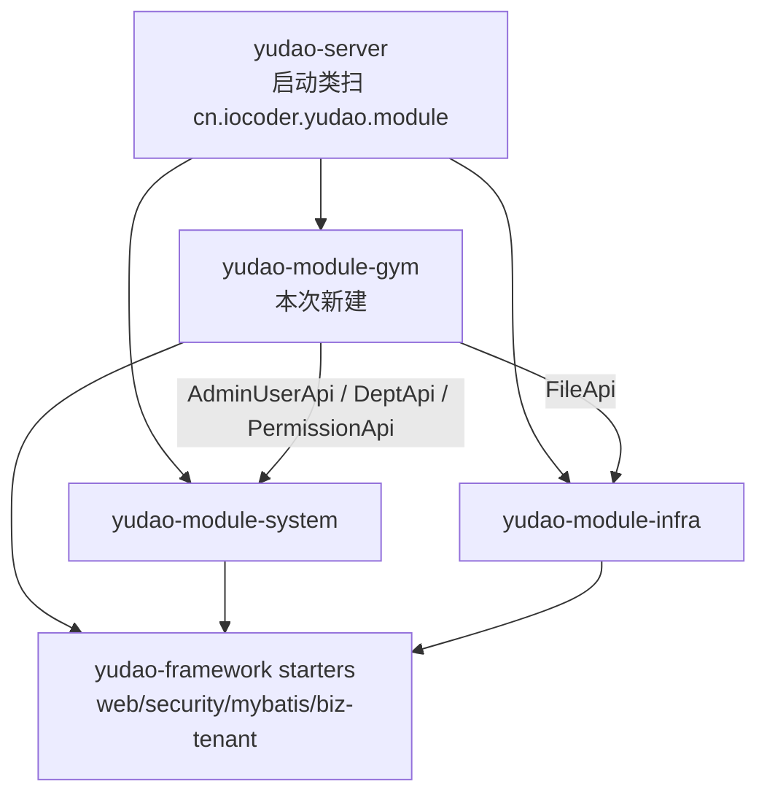

# 变更记录（时间升序）

> 规范见 [`README.md`](README.md)：**每次改动后追加一条**，含 意图 / 改了什么 / 结构关系 / 验证证据 / 影响面 / 未做后续。
> 本文件只追加，不修改历史条目。

| # | 时间 | 主题 | 一句话 |
| --- | --- | --- | --- |
| 1 | 2026-10-13 20:24 ~ 20:36 | [认证切片](#1-2026-10-13-2024-2036-认证切片41-前-5-个接口打通-gym-权限数据落地) | §4.1 前 5 个接口在 yudao 上跑通，落 51 个 gym 权限码与演示账号 |
| 2 | 2026-10-13 20:39 ~ 20:53 | [文件切片](#2-2026-10-13-2039-2053-文件切片41-后-3-个接口新建-yudao-module-gym) | 新建 `yudao-module-gym`，用 Java 实现上传/元数据/内容流 + 越权校验 |
| 3 | 2026-10-13 20:55 ~ 20:57 | [建立 doc 记录体系](#3-2026-10-13-2055-2057-建立-doc-记录体系) | 新增 `doc/`：变更流水 + 结构关系 + 验证清单，并确立「每次改动必记录」规范 |
| 4 | 2026-10-13 21:30 ~ 21:32 | [新增数据排查 SQL 清单](#4-2026-10-13-2130-2132-新增数据排查-sql-清单) | `script/gym/inspect.sql`：8 段只读查询，含同名覆盖缺陷的复现语句 |

---

## 1. [2026-10-13 20:24 ~ 20:36] 认证切片：§4.1 前 5 个接口打通 + gym 权限数据落地

### 意图

规划 `10-backend-mock-api-inventory.md` §4.1 的前 5 行（login / logout / refresh / codes / user info）要迁移到 yudao。
`08-gym-api-contract.md` §4 已明确目标路径是 yudao 原生接口，因此本条的意图**不是再写一套登录接口**，而是：

1. 消除「服务起得来但查不了库」的真实阻塞（原 `application-local.yaml` 写的 `root/12345678` 与本机 MySQL 不符）；
2. 把 51 个 `gym:*` 权限码、总部/门店角色、演示账号落成**数据**（yudao 的权限是数据驱动：`system_menu.permission` + `system_role`），
   否则第 4 个接口 `get-permission-info` 只能返回 yudao 演示数据，前端 `canGym(...)` 一个码都拿不到；
3. 建立可复现的验证手段（脚本 + IDEA 请求集），作为后续所有切片的验收模板。

### 改了什么

| 文件 | 类型 | 说明 |
| --- | --- | --- |
| `yudao-server/src/main/resources/application-local.yaml` | 修改 | L71-72 / L84-85：DB 账号改为 `${GYM_DB_USERNAME:yudao}` / `${GYM_DB_PASSWORD:123456}`，可用环境变量覆盖 |
| `script/gym/sql/01-gym-permission-seed.sql` | 新增 | 幂等种子：1 个「健身管理」根目录 + **51 个 `gym:*` 权限码**（按钮型，不产生路由）+ 2 角色 + 2 部门 + 2 演示账号 |
| `script/gym/seed.sh` | 新增 | 按文件名顺序执行 `script/gym/sql/*.sql`（幂等） |
| `script/gym/verify-auth-api.sh` | 新增 | 5 个认证接口端到端验证，26 条断言（含错误密码、登出失效、门店角色权限收窄的**反向断言**） |
| `script/gym/gym-auth.http` | 新增 | IDEA HTTP Client：登录自动写 `gymToken`/`gymRefresh`，一键跑完 5 个接口 |
| `script/gym/README.md` | 新增 | 认证切片说明（后被文件切片扩充为总说明） |

### 结构关系

本切片**没有新增 Java 类**，改的是「配置 + 数据 + 验证」，与既有代码的关系：

```
前端（GitHub/admin，本次不动）
  └─ POST /admin-api/system/auth/login ─────────┐
  └─ GET  /admin-api/system/auth/get-permission-info
  └─ GET  /admin-api/system/user/profile/get     │  这些路径本来就存在
                                                 ▼
yudao-module-system（既有 Java，未改一行）
  ├─ AuthController.java:66/73/85/93   login / logout / refresh-token / get-permission-info
  ├─ UserProfileController.java:50     profile/get
  └─ AdminAuthServiceImpl.java:100/230/236  登录、刷新、登出的服务实现
        │
        ▼ 读权限（数据驱动）
MySQL：system_menu.permission（51 个 gym:*，由 01-gym-permission-seed.sql 写入）
       system_role / system_role_menu / system_user_role / system_users / system_dept
```

关键结构点：**yudao 的权限码不是 Java 常量，而是 `system_menu.permission` 里的行**。
后续任何 gym 控制器写 `@PreAuthorize("@ss.hasPermission('gym:xxx:yyy')")`，能否通过完全取决于这张表，
这就是本切片必须先落数据的原因。

### 验证证据

```
$ bash script/gym/verify-auth-api.sh
 结果：通过 26 / 失败 0

$ curl -X POST .../system/auth/login -H 'tenant-id: 1' -d '{"username":"gymadmin","password":"Gym@123456"}'
{"code":0,"data":{"userId":252,"accessToken":"...","refreshToken":"...","expiresTime":...},"msg":""}

$ curl .../system/auth/get-permission-info -H "Authorization: Bearer <token>"
{"code":0,"data":{"roles":["gym_hq_admin"],"permissions":[51 个 gym:*],"user":{...}}}
```

幂等性：删净种子行后重跑 `seed.sh` → 再次 26/26 通过；连续跑两次结果一致（51 / 52 / 36 / 2）。

### 影响面 / 风险

- **影响前端联调（重要）**：yudao 多租户开启，**不带 `tenant-id` 请求头会直接 `code=400 请求的租户标识未传递`**。单租户部署可关 `yudao.tenant.enable`，否则前端适配层需补该请求头（前端不在本次范围）。
- 数据库账号从 `root` 改为 `yudao`：仅 `application-local.yaml`（本地 profile），不影响生产配置模板。
- 未见语义回归：yudao 原生认证接口未被改动。

### 未做 / 后续

- 未改任何 Java 代码（这 5 个接口 yudao 基座已实现）；未改前端。
- `homePath` / `authorizedStores`（旧 `/api/user/info` 有、yudao 原生没有）未补，留待前端适配层或后续 gym 专属 profile 接口。
- refresh token 未做「旧 token 立即轮换」（yudao 语义：有效期内不变、可复用），如需一次性轮换要改造 `OAuth2RefreshTokenService`。

---

## 2. [2026-10-13 20:39 ~ 20:53] 文件切片：§4.1 后 3 个接口，新建 yudao-module-gym

### 意图

§4.1 第 6~8 行（上传 / 元数据 / 内容流）在 yudao 基座里**没有**对应实现，且旧 Mock 的语义（魔数嗅探、按类别限制大小、门店/类别越权、私有下载不暴露静态地址）
是 infra 通用文件服务（`@PermitAll` 公开下载 + 全局类型白名单）覆盖不了的。
因此在后端新建自研模块 `yudao-module-gym`，实现这 3 个接口，并**顺带立起 gym 业务模块的骨架**，供后续 185 个业务端点沿用。

### 改了什么

| 文件 | 类型 | 说明 |
| --- | --- | --- |
| `pom.xml` / `yudao-server/pom.xml` | 修改 | 注册并依赖 `yudao-module-gym` |
| `yudao-server/src/main/resources/application.yaml` | 修改 | multipart 上限 16MB → 200MB（video 类别需要，否则 Spring 先拒） |
| `yudao-module-gym/pom.xml` | 新增 | 依赖 system（账号/权限/部门）+ infra（文件存储）+ tenant/web/security/mybatis/test starter |
| `.../controller/admin/file/GymFileController.java` | 新增 | 3 个端点；上传同时映射 `/gym/files` 与 `/gym/files/upload` |
| `.../controller/admin/file/vo/GymFileUploadReqVO.java` | 新增 | multipart 入参：`file` + `category` + `storeId?` |
| `.../controller/admin/file/vo/GymFileRespVO.java` | 新增 | 出参；**刻意不含 infra 存储 url** |
| `.../service/file/GymFileService.java` / `GymFileServiceImpl.java` | 新增 | 上传校验链 + 门店数据范围越权 + 落库（203 行，核心） |
| `.../service/file/dto/GymFileContentDTO.java` | 新增 | 内容流返回（name + mimeType + content），避免 Controller 重复查询 |
| `.../dal/dataobject/file/GymFileDO.java` | 新增 | 继承 `TenantBaseDO`（自动租户隔离 + 逻辑删除） |
| `.../dal/mysql/file/GymFileMapper.java` | 新增 | `BaseMapperX`，注释里给分页写法模板 |
| `.../enums/ErrorCodeConstants.java` | 新增 | 错误码区间 `1_070_000_xxx`（避开其他模块已占用区间） |
| `.../enums/file/GymFileCategoryEnum.java` | 新增 | 5 类别 × 大小上限 × 类型白名单（加枚举即扩展） |
| `.../enums/file/GymFileMimeTypeEnum.java` | 新增 | 7 种支持的 MIME 与扩展名 |
| `.../framework/file/core/utils/GymFileTypeUtils.java` | 新增 | 魔数嗅探 + `writeAttachment`（中文文件名 RFC 5987） |
| `.../test/.../GymFileTypeUtilsTest.java`（5 例）、`GymFileServiceImplTest.java`（10 例） | 新增 | 单测覆盖嗅探、类别、大小、越权、不存在 |
| `yudao-module-infra/.../api/file/FileApi.java` + `FileApiImpl.java` | 修改 | 新增 `getFileContentByUrl(url)`：跨模块读文件内容 |
| `yudao-module-infra/.../service/file/FileService.java` + `FileServiceImpl.java` | 修改 | 新增 `getFileByUrl(url)` |
| `yudao-module-infra/.../dal/mysql/file/FileMapper.java` | 修改 | 新增 `selectByUrl(url)` |
| `script/gym/sql/02-gym-file.sql` | 新增 | `gym_file` 建表（幂等 `CREATE TABLE IF NOT EXISTS`） |
| `script/gym/seed.sh` | 修改 | 改为执行 `sql/` 下全部脚本（不再只跑 01） |
| `script/gym/verify-file-api.sh` | 新增 | 29 条断言，含 5 类反例 |
| `script/gym/gym-files.http` | 新增 | IDEA：文件 3 接口 + 反例 |
| `script/gym/README.md` | 修改 | 扩充为「认证 5 + 文件 3」总说明，新增 §6 扩展清单 |

### 结构关系

**模块依赖（新增的 gym 模块处在 system/infra 之上）**



**上传链路（含校验顺序，早期失败即短路，避免读入超大内容）**

```
POST /admin-api/gym/files  (multipart, @PreAuthorize gym:files:upload)
  └─ GymFileController#uploadFile
       └─ GymFileServiceImpl#uploadFile
            1 GymFileCategoryEnum.find(category)          → 1070000002 非法类别
            2 file.getSize() vs category.maxSize          → 1070000004 超限（先看元信息，不读内容）
            3 file.getBytes() + GymFileTypeUtils.detect() → 1070000003 无法识别/与后缀或 Content-Type 不一致
            4 category.isMimeTypeAllowed(detected)        → 1070000003 类别白名单
            5 resolveAndValidateStoreId(storeId)          → AdminUserApi 取默认门店 / DeptApi 查存在 / PermissionApi 数据范围
                                                          → 1070000005 无门店、1070000006 门店不存在、1070000007 越权
            6 FileApi.createFile(content, name, "gym/"+category, mime)   → 内容交 infra 存储（本地磁盘/DB/S3）
            7 GymFileMapper.insert(GymFileDO)             → 业务归属落 gym_file（租户自动隔离）
```

**下载链路（鉴权 + 越权 + 不暴露 infra 地址）**

```
GET /admin-api/gym/files/{id}/content  (@PreAuthorize gym:files:read)
  └─ GymFileServiceImpl#getFileContent(id)
       ├─ getFile(id)：GymFileMapper.selectById → 1070000001 不存在
       │                validateStorePermission(userId, storeId) → 1070000007 越权
       ├─ FileApi.getFileContentByUrl(file.url)
       │    └─ infra：FileMapper.selectByUrl → FileServiceImpl.getFileContent(configId, path) → 存储客户端读取
       └─ GymFileController 用 GymFileTypeUtils.writeAttachment 输出（Content-Type 用嗅探结果，中文名 RFC 5987）
```

**数据关系**

```
gym_file（本模块新表，TenantBaseDO）
  id / store_id ──────────────► system_dept.id（门店 = 部门；总部角色 all=true，门店角色限本部门及以下）
  uploader_id ────────────────► system_users.id
  url ────────────────────────► infra_file.url（存储凭证，**不出现在任何响应里**）
  category / mime_type / size   业务与安全元数据
```

**权限链（两次校验，互相独立）**

```
① 功能权限：@PreAuthorize("@ss.hasPermission('gym:files:upload'|'gym:files:read')")
              → 取自 system_menu.permission（01 号种子写入的 51 个码）
② 数据权限：PermissionApi.getDeptDataPermission(userId)
              → all=true 放行；否则 storeId 必须 ∈ deptIds（角色 data_scope=1/4）
```

### 验证证据

```
$ mvn -T 1C -pl yudao-module-gym -am test -Dtest='GymFile*Test' -Dsurefire.failIfNoSpecifiedTests=false
 Tests run: 15, Failures: 0, Errors: 0, Skipped: 0        # GymFileTypeUtilsTest 5 + GymFileServiceImplTest 10

$ bash script/gym/verify-file-api.sh
 结果：通过 29 / 失败 0

$ bash script/gym/verify-auth-api.sh      # 回归
 结果：通过 26 / 失败 0
```

29 条断言中的关键反例（真跑出来的，不是静态结论）：

| 场景 | 期望 | 实际 |
| --- | --- | --- |
| PDF 内容改名 `.png` 传 image 类别 | 类型不匹配 | `code=1070000003`，msg 指出实际 `application/pdf` |
| 合同 PDF 传成 `image` 类别 | 类别白名单拦截 | `code=1070000003` |
| 11MB PNG 传 `image`（上限 10MB） | 超限 | `code=1070000004` |
| 未知类别 `coupon` | 非法类别 | `code=1070000002` |
| `gymstore` 读总部门店文件的元数据/内容 | 越权拒绝 | 两次均 `code=1070000007` |
| `gymstore` 读本店文件 / `gymadmin` 跨店读 | 正例放行 | `code=0` |
| 下载内容与上传文件 | 逐字节一致 | `cmp` 通过，`Content-Type: image/png` |
| 响应体是否含 infra 存储地址 | 不含 | `url`/`path` 字段均不存在 |

### 影响面 / 风险

- **infra 模块被扩展**（新增 3 个方法，未改既有签名）：对其他模块无破坏性影响；`FileApi` 是跨模块契约，新增方法属向后兼容。
- **multipart 上限放宽到 200MB**（全局配置）：所有上传接口都受益/受影响；业务侧仍有分类别上限兜底（10/20/200MB）。
- **新表 `gym_file`**：需要在所有环境执行 `script/gym/sql/02-gym-file.sql`（`seed.sh` 已包含）。
- 文件内容落在 infra 配置的存储上（本机默认存储配置），**进程重启不再丢文件**——与旧 Mock「内存存储、重启即失效」不同。
- 越权语义从旧 Mock 的 HTTP 404 变为业务码 `1070000007`（403 语义），前端提示文案需按 code 分支。

### 未做 / 后续

- 未做文件列表/分页接口（前端暂无该页面），`GymFileMapper` 注释里给了写法模板。
- 未做文件删除/清理（旧 Mock 也没有 DELETE；GC 策略待定）。
- 未做「按业务单据绑定」（`businessType`/`businessId`），等合同/审批模块落地后再加外键式关联。
- 未改前端：`admin` 仓库里 `yudaoAdapter.uploadFile` 目前仍指向 `/admin-api/infra/file/upload`，联调时需改为 `/admin-api/gym/files/upload`（属前端范围）。

---

## 3. [2026-10-13 20:55 ~ 20:57] 建立 doc 记录体系

### 意图

代码已经跨了两个切片（认证、文件），但「改了什么 / 为什么改 / 结构关系」只散落在对话与脚本注释里，评审时需要重新拼。
因此建立 **`doc/` 记录体系**，并把「每次改动后按时间顺序追加一条」定为流程的一部分，
让后续每个切片都能被独立审查，而不是依赖记忆。

### 改了什么

| 文件 | 类型 | 说明 |
| --- | --- | --- |
| `doc/README.md` | 新增 | 目录定位、阅读顺序、**记录规范**（条目格式 + 6 个必写段落 + 模板）、验证入口速查 |
| `doc/CHANGELOG.md` | 新增 | 变更流水账（时间升序）：本条 + 追溯补齐认证切片、文件切片两条历史记录 |
| `doc/architecture.md` | 新增 | 结构关系：模块依赖图、两条请求链路、数据模型与拆表理由、双道权限校验、代码地图、扩展点、与规划文档的对应 |
| `doc/testing.md` | 新增 | 三层验证策略、环境依赖、命令清单与当前结论数字、**已知测试盲区**、失败排查顺序 |

### 结构关系

本目录**不参与构建**（不被 Maven 打包、不影响运行时），只做记录；它与代码/脚本/规划文档的对应关系：

```
GitHub/admin/target/plan/            （规划：合同范围、08 接口契约、09 权限码、10 旧 Mock 盘点）
        │  需求与契约来源
        ▼
doc/CHANGELOG.md    ── 时间线：每次改动改了什么 / 意图 / 结构关系 / 证据
doc/architecture.md ── 结构：模块依赖、请求链路、数据模型、权限链、扩展点
doc/testing.md      ── 验证：三层策略 + 命令 + 当前结论 + 盲区
        │  指向实现与证据
        ▼
yudao-module-gym/（Java 实现）  script/gym/（种子 SQL、验证脚本、IDEA 请求、运维说明）
```

### 验证证据

- 文件存在性：`ls doc/` → `README.md` / `CHANGELOG.md` / `architecture.md` / `testing.md`
- 文内引用可解析：`script/gym/README.md`、`doc/CHANGELOG.md`、`doc/architecture.md`、`doc/testing.md` 均存在
- 无代码/配置改动 → 未重跑构建与测试；上一轮结论仍然有效（单测 15/15、认证 26/26、文件 29/29）
- 记录中的数字与代码现状核对一致：`GymFileServiceImpl.java` 203 行、gym 模块 Java 合计 1249 行（`wc -l`）

### 影响面 / 风险

- 对构建、运行时、接口行为**零影响**（纯文档）。
- 唯一约束是流程约束：后续改动如果不追加条目，`CHANGELOG.md` 会出现时间断层，评审时需注意。

### 未做 / 后续

- 未把 `admin/target/plan/` 的规划文档复制进本仓库（避免两份真相冲突，仅在文中引用）。
- 未加自动化校验（例如 CI 检查「有代码改动但 CHANGELOG 无新条目」），后续可按需加一个 `script/ci/check-changelog.sh`。
- 历史记录（#1、#2）是**追溯补齐**的，时间取自文件 mtime 与构建日志，误差在分钟级。

---

## 4. [2026-10-13 21:30 ~ 21:32] 新增数据排查 SQL 清单

### 意图

需要用 GUI 客户端（Sequel Ace / PyCharm Database / DBeaver）直接查库来审查成果，
但排查 SQL 之前只散落在对话里，每次都要重新拼。把已验证的查询固化成文件，客户端点开即跑，
同时把「文件同名覆盖」这个已知缺陷做成一条可复现的检查语句。

### 改了什么

| 文件 | 类型 | 说明 |
| --- | --- | --- |
| `script/gym/inspect.sql` | 新增 | 8 段只读查询：① 权限码 ② 角色与授权规模 ③ 门店/账号 ④ 模拟 get-permission-info ⑤ 文件列表与汇总 ⑥ 文件真实存储位置 ⑦ 同名覆盖缺陷排查 ⑧ 种子数据总览 |
| `doc/CHANGELOG.md` | 修改 | 本条记录 |

### 结构关系

```
script/gym/
├── seed.sh            写：建表 + 权限码 + 演示账号（幂等）
├── verify-*.sh        验：断言接口行为（通过/失败，退出码非 0 表示失败）
├── inspect.sql        查：只读看数据全貌与缺陷复现（本文件，不参与构建）
├── gym-*.http         IDEA 里逐个点接口
└── sql/*.sql          被 seed.sh 顺序执行
```

与 `verify-*.sh` 的分工：验证脚本回答「接口行为对不对」，`inspect.sql` 回答「库里到底是什么」。
两者都用同一套演示数据（`gymadmin` / `gymstore` / 51 权限码）。

### 验证证据

用项目账号整文件执行（只读，未改任何数据）：

```bash
$ mysql -uyudao -p123456 ruoyi-vue-pro < script/gym/inspect.sql
```

关键输出：

| 查询 | 结果 |
| --- | --- |
| ① gym 权限码 | 51 |
| ② 角色 / ⑤ 角色授权行 | 2 / 88 |
| ③ 演示账号 / ④ 门店部门 | 2 / 2 |
| ④ gymadmin / gymstore 权限码数 | 51 / 35（与接口返回一致） |
| ⑥ gym_file 行 | 12（验证脚本留下的记录） |
| ⑦ 同名覆盖排查 | `gym/contract/20261013/contract.pdf` 命中 **6 行** infra_file（缺陷复现成功） |

### 影响面 / 风险

- 全部是 `SELECT`，对数据零写入；可随时重复执行。
- ⑦ 的输出说明「同名同天上传互相覆盖」的缺陷**仍然存在**（尚未修复），修复前上传同名文件需注意。

### 未做 / 后续

- 未修 ⑦ 的覆盖缺陷（方案 A：打开 infra 的 `PATH_SUFFIX_TIMESTAMP_ENABLE`；方案 B：gym 侧目录加唯一片段，待决策）。
- 未加 CI 校验（如自动跑 `inspect.sql` 比对期望行数）。

## [2026-10-13 22:44 ~ 22:57] 对齐当前 JSS 前端，交付门店与员工首批 API

### 意图

先查阅 dashboard 当前 `targets/handoff/backend-priorities.md` P0/P1、`targets/plan/08-gym-api-contract.md`、`09-permissions.md`、`apps/web-jss/integration/backend-contract.md`/`menus.json` 和实际 stores/employees 页面及通用编辑器。结论：首批应解除菜单/门店/员工/数据隔离阻塞，当前 REST 与历史 `/page` 草案不同。按用户要求仅修改后端，前端只读。

### 改了什么

以下为本次新增或在既有未提交切片上修改的文件，不把此前 pom/infra/配置改动计作本次工作。

| 路径（相对 server） | 类型 | 说明 |
| --- | --- | --- |
| `yudao-module-gym/src/main/java/cn/iocoder/yudao/module/gym/controller/admin/common/GymPageReqVO.java` | 新增 | 页码/大小、关键词、状态和门店筛选 |
| `…/controller/admin/store/GymStoreController.java`、`…/store/vo/GymStore{SaveReq,Resp,MediaReq}VO.java` | 新增 | 门店四个基础接口及媒体替换；字符串 ID、营业时间/媒体嵌套响应 |
| `…/controller/admin/employee/GymEmployeeController.java`、`…/employee/vo/GymEmployee{SaveReq,Resp}VO.java` | 新增 | 员工四个基础接口；多店任职和账号关系 |
| `…/service/store/GymStoreService.java` | 新增 | 行 35 分页范围、58 新增部门/档案事务、82 PATCH 行锁、98 媒体校验替换 |
| `…/service/employee/GymEmployeeService.java` | 新增 | 行 34 授权 EXISTS 分页、75 PATCH 全任职范围校验、113 账号权限/主部门校验 |
| `…/service/common/GymDataScope.java`、`GymPatchUtils.java` | 新增 | 共用门店范围和部分更新合并 |
| `…/dal/dataobject/{store,employee}/Gym{Store,StoreMedia,Employee,EmployeeStore}DO.java` | 新增 | 四个 TenantBaseDO 业务模型 |
| `…/dal/mysql/{store,employee}/Gym{Store,StoreMedia,Employee,EmployeeStore}Mapper.java` | 新增 | CRUD、主记录锁定、整体替换关系 |
| `…/enums/ErrorCodeConstants.java` | 修改 | 门店/员工 12 个错误码 |
| `…/controller/admin/file/vo/GymFileRespVO.java` | 修改 | 补原文件名/字节数别名，业务 ID 改字符串，保留 name/size |
| `yudao-module-gym/pom.xml` | 修改 | 更新实现范围说明，无依赖改动 |
| `script/gym/sql/03-gym-store-employee.sql` | 新增 | 四业务表、租户/逻辑删除、唯一索引 |
| `script/gym/sql/04-gym-first-batch-menus.sql` | 新增 | 增量注册两个已交付页面，保留原权限 ID/授权 |
| `script/gym/verify-migrations.py`、`gym-organization.http` | 新增 | 隔离 MySQL 幂等验证及手工 API 请求 |
| `script/gym/verify-file-api.sh`、`README.md` | 修改 | 适配字符串文件 ID 的断言，链接本批交接 |
| `yudao-module-gym/src/test/java/…/service/GymOrganizationServiceTest.java` | 新增 | 17 个实际 DB/事务/方法权限测试 |
| `yudao-module-gym/src/test/resources/application-unit-test.yaml`、`sql/create_tables.sql`、`sql/clean.sql` | 新增 | 隔离 H2、租户拦截器、数据库约束与清理 |
| `docs/gym-first-batch-api.md` | 新增 | 完整更改/契约交接：字段、权限、错误码、部署、回退及未实现项 |
| `docs/README.md`、`architecture.md`、`testing.md`、`backend-contract.md`、`CHANGELOG.md` | 修改 | 当前入口、结构与可复现证据；旧快照标注新交接位置 |

### 结构关系

Controller 操作权限 → Service → GymDataScope/PermissionApi 的 system 部门范围 → MyBatis 租户过滤 → gym 表。门店 ID 等于 system_dept.id，新建部门与门店同事务；员工关联已有 system_users，不新建登录/RBAC。员工任职参与授权分页，读关联关系裁剪到授权门店，修改共享档案要求原/新全门店范围。主记录行锁保护 PATCH/关系替换；任职/媒体关系仅整体替换时删除关系行，业务档案不删除。详见 architecture.md 与新交接文档。

### 验证证据

- `mvn -q -pl yudao-module-gym -am test -Dtest='Gym*Test' -Dsurefire.failIfNoSpecifiedTests=false -DargLine='-javaagent:/Users/hh/.m2/repository/org/mockito/mockito-core/5.23.0/mockito-core-5.23.0.jar'`：退出 0；组织 17 + 文件 Service 12 + 类型工具 5 = **34 tests，0 failures，0 errors，0 skipped**。报告位于 gym/target/surefire-reports。首次默认 JVM 动态附加失败，改用启动 agent 后通过，不改项目测试/生产 JVM 配置。
- `mvn -q -DskipTests -pl yudao-server -am package`：退出 0，生成 yudao-server/target/yudao-server.jar。
- `python3 script/gym/verify-migrations.py`：退出 0；实际本机 MySQL 独立随机库验证四业务表、两个页面、四条页面授权，全部 SQL 两次执行记录数一致；测试库随后删除。
- `git -C /Users/hh/Documents/GitHub/dashboard status --short`：输出为空，前端文件未修改。
- `curl --max-time 5 http://127.0.0.1:48080/v3/api-docs` 未取得响应，本次无运行服务/OpenAPI HTTP/前端验收证据。

### 影响面 / 风险

- 当前前端基础路径/字段无需改动即可对接门店/员工首批。文件元数据 ID 由数字改为字符串，其他已有客户端若依赖数字需适配；原 name/size 保留。
- 只读权限/门店范围/租户负例已覆盖；system 外部依赖使用 mock，未覆盖完整 HTTP 中间件链或真实前端浏览器。不得把测试通过当成业务端到端验收。
- 历史演示角色带 payroll:read，会触发尚缺少的员工工资历史接口，员工编辑仍可能被该请求阻断；联调使用仅本批权限的角色或等待工资切片。未伪造历史数据、未擅自撤销既有角色权限。
- 自动页面授权仅租户 1 的两个既有 gym 角色；其他角色和租户需 system 后台授权。业务库未执行迁移，部署需按交接文档执行 SQL、重启及重新登录。
- SQL 保留档案自然键，未来删除/恢复和 ALTER 迁移需要独立设计。媒体/任职事务锁已落地，生产 MySQL 并发压测未执行。

### 未做 / 后续

未改前端，未提交/发布/启动服务，未清库或迁移业务库。未实现工资历史/模板、会员/卡、私教预约签课、删除/导出/批量接口、创建幂等、账号解绑或第三方接入。下一批优先补工资历史与模板以解除员工编辑条件阻塞，再推进会员/权益/预约签课；所有范围依现行交接文档。

## [2026-10-14 20:30 ~ 20:34] 修复文件二进制下载失败被当作成功 Blob

### 意图

修复本次代码审查指出的问题：文件记录或存储内容缺失时，ServiceException 被全局处理器包装成 HTTP 200 错误 JSON，前端 Blob 客户端将它误当作正常文件。依据文件契约的内容下载真实状态约定；用户授权修复，继续仅修改后端。

### 改了什么

| 路径 | 类型 | 说明 |
| --- | --- | --- |
| `yudao-module-gym/src/main/java/cn/iocoder/yudao/module/gym/controller/admin/file/GymFileController.java:94` | 修改 | 局部异常处理复用全局错误转换及日志；按匹配路由仅对内容下载映射 HTTP 404/403/400/500 |
| `yudao-module-gym/src/test/java/cn/iocoder/yudao/module/gym/controller/admin/file/GymFileControllerTest.java` | 新增 | 9 个真实 MVC/方法权限回归测试，覆盖成功、缺失、越权、非法 ID、存储异常及元数据兼容 |
| `script/gym/verify-file-api.sh` | 修改 | 增加内容下载 HTTP 状态及业务码断言 |
| `script/gym/README.md` | 修改 | 更新内容下载错误状态契约 |
| `docs/testing.md`、`docs/CHANGELOG.md` | 修改 | 记录测试证据及本次报告 |

### 结构关系

文件 Controller 的局部异常处理调用既有 GlobalExceptionHandler.allExceptionHandler，保留 CommonResult 错误码/错误日志。根据 MVC 实际匹配路由辨别内容下载，记录/内容缺失映射 404，跨店和操作权限失败映射 403，参数错误映射 400，未知存储异常映射 500。成功下载继续走原文件输出链；上传/元数据保持 HTTP 200 + body code。纯错误处理修复，不改变模块/数据库结构。

### 验证证据

- `mvn -q -pl yudao-module-gym -am test -Dtest='Gym*Test' -Dsurefire.failIfNoSpecifiedTests=false -DargLine='-javaagent:/Users/hh/.m2/repository/org/mockito/mockito-core/5.23.0/mockito-core-5.23.0.jar'`：退出 0，**43 tests，0 failures，0 errors，0 skipped**。其中新增控制器回归 9 个，验证真实 MVC 错误 JSON/HTTP 状态和 @PreAuthorize 拒绝；Service 为 mock。
- `bash -n script/gym/verify-file-api.sh`：退出 0；本次未对运行服务执行该脚本。
- `mvn -q -DskipTests -pl yudao-server -am package`：退出 0。
- `git diff --check`：退出 0；dashboard 的 `git status --short` 为空，前端文件未修改。

### 影响面 / 风险

二进制下载失败现在返回非成功 HTTP 状态，Blob 请求可进入错误分支；业务 code 保留，支持已有错误提示。元数据/上传响应约定不变。未修改共享全局异常处理器，对其他模块不改变 HTTP 约定。本次 MVC 测试不覆盖安全 Filter 层、真实存储渠道或前端浏览器；已提交/暂存的其他改动均保留原状态，未重新暂存。

### 未做 / 后续

未改前端、未改数据库、未部署/启动服务。真实服务下载回归可在部署后执行 `script/gym/verify-file-api.sh`；未新增其他业务接口。
